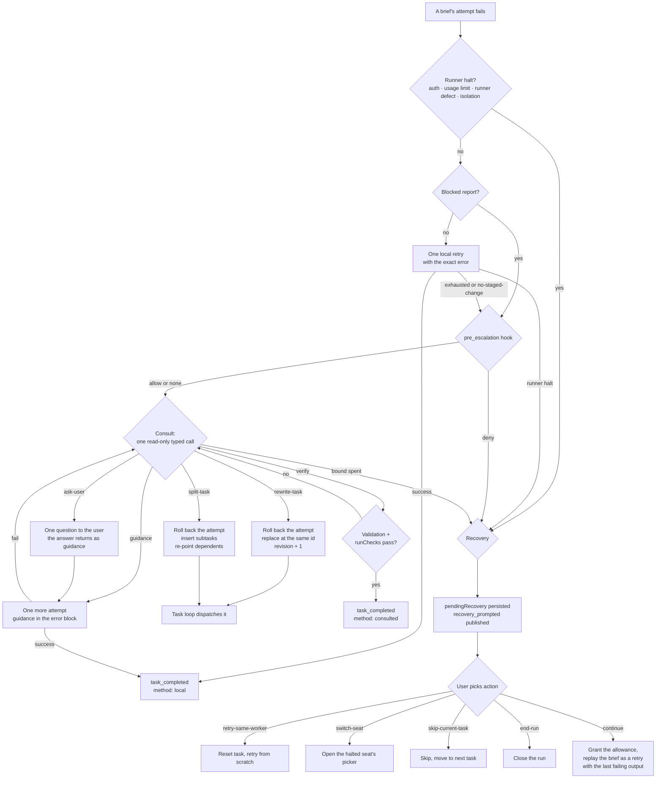

# SPLITBRIEF — Approval gates, escalation, and recovery

How SPLITBRIEF keeps the user in control during a workflow run. Four systems work together: the plan card pauses once on the plan; protected-path confirmation asks before a write to a protected path; the consult repairs validation failures automatically (the planner answers for a plan task, the review seat for a fix task); and recovery gives the user the final say when automation runs out of options. Drift detection runs alongside these systems as a continuous check.

For the workflow state machine, see `docs/WORKFLOW.md`. For the event model, see `docs/ARCHITECTURE.md`.

---

## The plan card

After the planning session produces a plan that passes its checks, the workflow pauses once for human review. There is one card, and it reviews the plan. The card lives in `runPlanApproval` (`src/engine/orchestrator/planning/session.ts`). The full flow is in [WORKFLOW.md §3](./WORKFLOW.md#3-the-planning-session).

A plan reaches the card only after `checkPlan` and the context fit pass ([TASK-CONTRACT.md](./TASK-CONTRACT.md)). There is no separate brief-quality or brief-readiness gate: the briefs are compiled from the checked plan.

`workflow.approve` controls the card:

| Level | What it does |
|---|---|
| `plan` (default) | The plan card opens before the build |
| `none` | No card; the build starts when the plan passes its checks |

The retired values `all`, `spec` and `default` load as `plan`, each with one config notice. There is no `--approve` flag.

The card shows `plan.md` and offers four rows: **Approve plan and start the build**, **Request changes** (the planning session takes the comment and the reviewed `plan.json`, applies its checks with one repair, and the card opens again), **Edit plan.json** (re-validated; an invalid edit is not applied and `plan.json` is restored), and **End run** (`CLOSE_RUN`: the run is closed and its files stay on disk). When the plan lists protected operations, one line above the rows names them (`Approving also confirms: write package.json`, `reviewConfirmsText`, `src/features/workflow/prompt-rows/approval.ts`), built by `planConfirmations` (`src/engine/orchestrator/approval/confirm.ts`), which feeds the card through `onApprovalNeeded`, so they stay in view while `plan.md` scrolls. The line names each operation once, even when two check ids run one command. The line wraps between operations, never inside one. On a terminal too short for the list beside one row of `plan.md`, the line counts them instead (`Approving also confirms 2 protected operations`): the panel sheds its border, then its key legend, then the list, until the plan keeps a row (`reviewDocumentForm`, budgeted by `getReviewPanelBudget` in `src/features/workflow/layout/rect.ts`). There is no reject: an answer that is not one of those four re-opens the card.

**Approving confirms the plan's protected writes.** Each task may list `protectedOperations` (`{ path, operation: 'write' }`). Approving the card turns each listed write into the same match the write gate uses (`planConfirmations`, `src/engine/orchestrator/approval/confirm.ts`, through `protectedWriteClass`, which runs `classifyAction` over `write <path>` and keeps only a protected class; a plan that lists a path whose write asks for nothing fails the `unprotected-operation` check) and records it in the run's evidence-ledger approvals (`persistApprovalEvidence`). When the build later writes that path, the gate finds the confirmation and does not ask again. A write the plan did not list still asks. The card shows the list near its top under `## Protected operations` as `- T002: write package.json`, and a line above the rows says `Approving also confirms: write package.json`; with `approve: none` no card opens, and each listed write asks when it happens.

**Headless approval is unattended.** A headless run approves the card with `{ approved: true, unattended: true }` (`src/cli/headless.ts`). An unattended approval records no confirmation, so a protected write in a headless build is denied with `APPROVAL_REQUIRED`.

**The approval is recorded.** An approved card publishes `plan_approved` in `reviewing-plan`, before the run moves on; End run publishes `plan_rejected`; a correction or a valid edit publishes `plan_regenerated`. The approval is a row of `session.jsonl`, so a run at rest replays it. The transcript draws no row for it: the header rail already marks the Plan stage as passed. An answer that arrives after the run was stopped publishes no approval.

**Resume.** A run parked at the card with a saved plan (`reviewing-plan` and `state.plan`) re-opens the card through `resumeParkedApproval` (`src/engine/orchestrator/run/resume-parked-approval.ts`) without re-spending the planner call. A correction typed while the card is parked is applied by the planning session before the card opens, and appears once in the transcript and session log; a bare `⏎` re-opens the card with no planner call. An older run parked at a spec gate, a briefs gate, or a plan gate without `plan.json` has no card to re-open: it continues as one planning session, which reads the run's earlier documents and the correction typed at the gate, and then opens the plan card. At rest such a run reads `Waiting at the plan · ⏎ to continue`.

**Interrupt, correct, continue.** A stop is not an end: the step it cut is recorded on the state and the run parks, holding for the operator. Every park publishes `turn_interrupted` with the step it parked. A stop at the card cuts nothing (`at: boundary`), and its transcript row names the card rather than offering a retry. Continuing composes what they typed *with* the step's real prompt rather than in place of it — the planning session takes it as a note, the reviewer re-issues its whole deterministic prompt with the note, and a brief restarts on its own prompt.

---

## Protected-path confirmation

**Two prompts, in sequence, never one.** Approving the plan and confirming a protected write are different questions. The card names the step it releases (`Approve plan and start the build`, `reviewDocumentOptions`, `src/features/workflow/prompt-rows/approval.ts`). The confirmation that may follow during the build names the operation and the path — the title is a sentence (`Change a package manifest:`, `Change a CI or secret file:`, `Destructive action:`), not a class name. The panel that asks to trust a `shell` or `agent` runner from the project config uses the same layout under its own title, `Trust and run a configured runner:` (class `runner_trust`, which no write produces).

The attempt gate detects protected changes after the implementer writes inside the run workspace. It runs before validation, not before a direct writer's filesystem operation. A denial restores that file from the attempt snapshot inside the workspace.

The write gate runs over the files the implementer changed. The classifier (`src/engine/orchestrator/approval/action-classifier.ts`) inspects each written path and the task's scope and assigns an action class. It classifies file paths, including writes outside the suggested set. It does not parse shell commands.

**Action classes the classifier produces:**

| Class | What triggers it | Asks? |
|---|---|---|
| `read` | Action descriptions beginning with `read`/`cat`/`ls`/`find`/`grep`, or anything with no write verb | no |
| `write_in_scope` | Writing to a file named in the task brief or matching `scope.inBounds` / `approval.allowedPaths` | no |
| `write_out_of_scope` | Writing to a file not covered by the task's scope: a brief's files are suggestions, so the write is recorded as touched, not suggested | no |
| `destructive` | Writing to a control-plane path (`.git`, `.splitbrief`) | yes |
| `sensitive_change` | Writing to CI configuration (`.github/`, `.gitlab-ci.yml`, `.circleci/`, `azure-pipelines.yml`, `Jenkinsfile`, `.buildkite/`) or a secret-bearing file (`.env`, `.env.*`, `*.pem`, `*.key`, `id_rsa*`, `.npmrc`, `.pypirc`) | yes |
| `package_change` | Writing to a package manifest or lockfile (`package.json`, `pnpm-lock.yaml`, …) | yes |

The protected patterns are matched against the written path, never against the task's file list, so a brief that declares `.env.example` does not make its ordinary writes ask. A write to a control-plane path is `destructive`; a write to CI configuration or a secret-bearing file is `sensitive_change`; a write to a package manifest is `package_change`; a write to a file in the task's `scope.inBounds`, `scope.approvedOutOfBounds`, or `approval.allowedPaths` is `write_in_scope`; any other write is `write_out_of_scope`. Anything that is not a write defaults to `read`.

**Protected or not; nothing else.** The rule is fixed (`DEFAULT_TIER_MAP`): a write to a protected path — `destructive`, `sensitive_change` or `package_change` (`PROTECTED_ACTION_CLASSES`, `src/core/schemas/enums.ts`) — asks, and no other write does (`gateAction`, `src/engine/orchestrator/approval/tiered-approval.ts`). `--yolo` is removed. `approval.enabled` is a retired key that loads with one notice and is ignored. There are no sticky grants, no `.splitbrief/approvals.json`, no `/approval` command, no `splitbrief approval list|clear`, and no tier overrides: `approval.tiers` is a retired key that loads with one notice and is ignored.

**The confirmation.** The response must carry the literal phrase `I confirm` and a non-empty reason; `gateConfirmTier()` (`src/engine/orchestrator/approval/confirm.ts`) rejects anything else as `invalid_confirm_phrase`. That contract is what a custom `onTieredApproval` callback satisfies itself. The TUI satisfies it on the user's behalf: the prompt paints its option rows under the shared selection grammar — `↑↓` wraps through them, `⏎` takes the highlighted row, and the letters stay live as accelerators, because this panel holds the keyboard (the recovery panel does too; the plan card leaves the keyboard to the composer, so its rows carry no letters) — and it opens on `Confirm`. A `destructive` action — a control-plane write — carries no key on its Confirm row and answers a stray `y` with `⏎ confirms this write · esc deny` instead of approving; every other protected class confirms on `y` or `⏎`. `r` opens an optional reason field; confirming without one records `confirmed at the prompt (no reason given)` so the evidence trail never reads as though a human justified the write. Keystrokes buffered before the prompt appeared are discarded for `PROMPT_TYPEAHEAD_GRACE_MS` (`src/lib/terminal/typeahead-grace.ts`). Approval events (`approval_prompted`, `approval_granted`, `approval_rejected`) are published from `events.ts`; shared gate input/output types live in `types.ts`.

**One confirmation per path per run.** A confirmed path and operation stays confirmed for that run. `confirmedEarlierInRun()` (`confirm.ts`) reads the run's `evidence.json`, including operations confirmed on the plan card. `gateAttemptChanges()` (`src/engine/orchestrator/task/attempt-gate.ts`) uses `gateChangedFiles()` for each changed file. It restores denied files and keeps the attempt's other accepted changes.

A failed restore stops the attempt. An extracted-code writer also uses `approveWrite` before its write. Without `onTieredApproval`, a protected write is denied with `APPROVAL_REQUIRED`.

---

## Escalation

File approval classifies the exact normalized `targetPath`. A declared `src/app.ts` does not authorize `src/app.ts.backup`. Task writes and validation stay in the run workspace. Checkout integration follows [Apply](./WORKFLOW.md#apply).

Workspace reuse keeps the same run directory across tasks, retries and continuation. It does not copy checkout edits into the workspace between calls. The [workspace data flow](./HOW-IT-WORKS.md#run-workspace-and-apply) defines its base and persistence.

When the implementer writes code and validation fails, the ladder tries the implementer once more and then consults a seat: the planner, or the reviewer for a fix task. The orchestrator runs the rungs in sequence (`handleRetryAndEscalation`, `src/engine/orchestrator/escalation/handle.ts`); if any rung succeeds, the task is done. The consulted seat advises; it never automatically takes over code-writing implementation.

**Only reviewer checks re-run at the run base.** A red reviewer check re-runs with the same command text on a disposable run base copy outside the checkout. Matching failures are pre-existing. They create no fix, and the Checks Log prints their keys. The base re-run row names the first failing tests of each side, `review.json` keeps each such check in `preExistingChecks`, `review.md` lists it under `### Pre-existing failures`, and the closed run's Run section names it under the Review row. A timeout, or a red with no failing test name and no diagnostic line, is never pre-existing: when the base re-run is red too, it is *not verified at the run base*, it stays a pending input, and the reviewer decides. The reviewer reports them without findings against the run. The reviewer can set aside any red check input that needs no work, for example a flaky test that no task changed: it rejects the input with a reason, and the input no longer blocks the review. The review row shows `Set aside V6.1` with the reason. `review.md` (under **Set aside**) and the `--plain` review line show `Set aside V6.1: <reason>`. An Apply conflict cannot be set aside; it always needs a fix task. Every other red input blocks the review (`blockingRedInputs`, `src/core/review/verdict.ts`). Each red that blocks fails the review record: `review.json` keeps it in `redInputs`, and `review.md` lists it under Critical. When such a red names no failing test, its reason quotes the first error line of the output: `both runs exited with code 1: Error: Cannot find module 'src'`. A brief check, a plan check and the Apply re-check do not re-run at the run base. A red brief check enters the ladder, also when the same failure is red at the run base.

**One local retry** (`src/engine/orchestrator/escalation/local-retries.ts`). The implementer retries once with the exact error message appended to its context. No additional API calls beyond the implementer itself. The attempt publishes a `task_retry` row. The rung ends early on the first `no-staged-change` outcome after feedback: an implementer that read the error and still staged nothing will stage nothing again, so the one retry is not spent on the same silence — the consult is asked instead. `DEFAULT_LOCAL_RETRIES` is 1 (`src/core/pipeline-spec/retries.ts`); `workflow.max_retries` is retired and loads with one notice.

**An aborted attempt is not an attempt.** `task_retry` is published when the attempt starts, not when it ends: the row carries the error this attempt is retrying against and precedes the attempt's own events, so it can never land after the `task_completed` it announced. An implementer call that reports an abort — the workflow signal is aborted, or the outcome carries the runner layer's abort text (`Aborted`) — ends the retry loop immediately: no further retry rows are published to `session.jsonl`, and the run stops at that boundary instead of consulting. The aborted attempt keeps the row that announced it, because the attempt was announced and made, while the persisted attempt counter rolls back to the value it had before it. A cancelled run therefore never burns an attempt or a consult on a call the user already cancelled.

**The consult** (`requestConsult`, `src/engine/orchestrator/consult/request.ts`; prompt in `src/engine/spec/prompts/consult.ts`). After the local retry, the run asks one seat for a typed `ConsultAnswer` (`src/core/schemas/consult.ts`). `consultSeat(task)` chooses the seat. A plan task consults the planner on the planner's resumable session. A fix task (`task.fix`, written by the reviewer at a review) consults the review seat, because the reviewer judged the change and wrote the fix; a rewrite or a split keeps `task.fix`, so its descendants consult the review seat too. The children of a split share the parent's failures: a shared failure gates only the last unfinished child that carries it. The review consult is one stateless call through `runReviewerCall` with the full prompt. It shows the findings' `failureKeys` as this brief's failures and `redKeys` as the whole red, and it tells the seat not to send the implementer after the other failures. With no `reviewer:` block the planner holds the review seat (`resolveReviewerRunner`). The call is read-only and carries the plan, the task with its revisions, the task's diff (`## Task Diff`: what is on disk now against `LineageRecord.startSnapshot`, the workspace when the lineage's first brief dispatched, so it holds every attempt, revision and split subtask, not only the latest attempt; the diff covers only the brief's own files (`suggestedFiles`), in the brief's order, bounded to `BOUNDS.consultDiffChars`, 40 000 characters: whole file diffs in order, the first one cut when it alone is larger, then one line that names the files not shown in full, the first 20 and a count of the rest, for the seat to read in the run workspace; one more line names every other file the task changed the same way, so generated files never push the brief's own files out of the diff, and when the brief's files have no change one line says so; a state with no recorded start shows a plain line in place of the diff), one line per failed attempt of the lineage (`## Failed Attempts`: the attempt number, the brief and revision, and the first error line bounded to `BOUNDS.consultAttemptLineChars`, 200 characters, recorded by `COUNT_ATTEMPT` in `LineageRecord.attemptFailures`), the failing output of the latest attempt (bounded to `BOUNDS.consultFailingOutputChars`, 4000 characters), the implementer's report, the lineage's earlier consults and the status of the other tasks. A `blocked` implementer report or a bundle's blocked form starts the consult without the local retry. Every answer is persisted on the task's lineage in `state.lineages` and in the session log; the transcript shows one row that names the seat, `PLAN → T003: split into T011, T012 · <diagnosis>` or `REVIEW → T013: guidance · <diagnosis>`. The consult record and the `consult_answered` event carry that `seat`; a record without a seat is a planner consult. The consulted seat never writes code, and a seat-trouble failure on the call is bounded by the seat rules below.

**The answers.** Exactly one action follows the mandatory `diagnosis`:

- **`guidance`** — `instructions` and an optional `context`. The task is kept, and one more implementer attempt runs with the guidance appended to the failed attempt's error block under the heading of the seat that answered: `## Guidance from the planner:` or `## Guidance from the reviewer:`.
- **`rewrite-task`** — one complete replacement `TaskSpec`. The current attempt's own changed files are rolled back (see below), and the task is replaced at the same id with the same criteria and `revision` raised by one; the task loop dispatches it again. A `cmd` check of the replacement follows the plan command policy: a check the policy refuses from its text fails the consult answer, and the seat gets its one repair (`refusedCheckErrors`). So do an `npm run` check whose script `package.json` does not define, unless the replacement or another pending task lists `package.json`, and, when the stack narrows the test command to the check's file, a `test` check that names no test file in the workspace or in the files of the replacement or another pending task (`unresolvedTestCheckErrors`). So do a `render` check whose value is not one scenario id and a `render` check when `validation.render` is not set (`unconfiguredRenderCheckErrors`).
- **`split-task`** — 2 to 4 complete `TaskSpec`s that together keep every criterion. The current attempt is rolled back, the parent leaves `state.tasks` and stays, with its evidence and its consult record, in the lineage record; the subtasks are inserted at the next free `T###` ids (the highest existing id + 1, in answer order), carry `parentId`, and share the lineage's counters. The answer's internal `dependsOn` are rewritten to the new ids, and every pending `dependsOn` that named the parent is re-pointed to all subtasks. A subtask is never split again. The `cmd` checks of the subtasks follow the plan command policy as a rewrite does.
- **`verify`** — no implementer call. The normal validation pipeline runs on the current workspace, and the named checks run through `runChecks` (`src/engine/orchestrator/validation/run-checks.ts`); a `render` check runs through `validation.render` and reports `not-runnable` when that key is not set. Every named check must exist, whichever task owns it, and the selection must cover the checks of the task's due criteria: a criterion it shares with a brief that has not run yet binds only once that brief is done, the same rule the brief gate uses. A clean run completes the task as `consulted`; anything else consults again.
- **`ask-user`** — the only question the ladder asks. The consulted seat's question, its choices and its default open in the existing question UI, and the answer comes back as `guidance`. The answer also joins the brief's operator instructions.

**The brief's operator instructions.** Every consult prompt and every review prompt shows the brief's operator instructions: each correction the user sent the brief (a queued message, a message during a call, a correction typed on a stopped run) and each answer to a question about it. They are one log, the lineage's `corrections` (`briefCorrections`, `src/core/state/machine.ts`), which the implementer also receives as its steer. `requestConsult` reads them for every consult. The consult contract tells the seat that no action undoes an operator instruction, and that a question about one quotes it and keeps it as the default.

**Reported decisions are not an escalation.** A done report whose `decisions` list names what the implementer did differently from the brief makes no seat call. Before the attempt is validated, `RECORD_DECISIONS` (`src/core/state/machine.ts`) adds each decision the ledger does not hold yet for that brief to the plan's decisions ledger, naming the reporting brief, on the first attempt, on every retry and on a fix task. A retry that reports the same decision again adds nothing. A decision is `{ what, why }`; a plain-text decision joins as `what` with no reason. The decisions spend no run counter, no lineage consult and no planner call. The ledger reaches every later brief's Plan context, every consult and every review; the review prompt says that a decision with a brief id was declared by that brief's implementer and that nobody confirmed it, so the reviewer judges it against the criteria and the code. The report is read by `readImplementerReport` (`src/core/schemas/consult.ts`): a done report keeps every field that matches its contract, and a field that does not reads as empty and is named in one `warning` (`code: implementer_report_field_dropped`). A missing `decisions` field reads as `[]` with no warning. A blocked report with a bad field, or a report with no known status, is not read.

**The consult guards.** A rewrite that changes accepted criteria or drops their required checks asks the operator through `applyAskUser`. A split that drops a criterion or its required check uses the same path. The question callback keeps the consulted seat, so a reviewer question shows `Reply to the reviewer…`. `applyConsultAnswer` returns the operator's answer as guidance, or `failed` when the question remains unanswered. It never returns an unasked question. Changing the task id in a rewrite or splitting an existing subtask is a contract error: one repair request, then a `seat-protocol-error` halt if the answer repeats the error.

**The bounds.** The lineage is bounded at 2 consults and 8 attempts; the run is bounded at 10 planner calls after planning. The name stays for compatibility: planner consults and review-seat consults spend from this one allowance (`state.plannerCalls`). Review answers spend no planner call. The bound applies to consults (`src/core/pipeline-spec/bounds.ts`; counters in `state.lineages` and `state.plannerCalls`, never reset by a split or a resume). A spent bound halts with `consult-bound-spent` or `planner-calls-spent`, carrying the diagnosis of the failure that raised it (the consulted seat's when a consult diagnosed that failure, else that failure's own output; the diagnosis of a validation failure is the line `check <id> failed` naming the first failed check, from `runBriefGate`, `src/engine/orchestrator/task/brief-gate.ts`) and the last failing output (`facts.failingOutput`), and offers **continue**, **skip-current-task** and **end-run** (`buildConsultBoundRecoveryIssue`, `src/engine/orchestrator/recovery/builders/consult.ts`). **Continue with a note** grants a recorded extra allowance — +1 consult and +4 attempts for the lineage, or +5 planner calls — records the note on the lineage and replays the brief. The replayed brief is never a bare reset: Continue records the halt's failing output on the lineage (`carriedFailure`), and the brief's first attempt runs as a retry carrying it. The record is cleared once that attempt returns; a stop keeps it for the resumed attempt. Continue replays the brief from the files its last attempt left, with the brief's first task-start snapshot; Skip restores them; End run keeps them in `run.patch`.

**Files that changed after planning.** Before dispatch, the run reads the brief's suggested and context files from the workspace (`refreshAndPersistCode`, `src/engine/orchestrator/task/refresh-code.ts`). A file that an earlier brief or the user changed after planning reaches the implementer as it is now. This asks no seat. A replay that carries a failure (`carriedFailure`) and a Try again of a revision that already ran (`dispatchedRevision`) run on the brief's own files (`runsOnOwnFiles`). Both keep the brief's first task-start snapshot and the action it started with.

**Seat failure classes.** One classifier, `classifySeatFailure` (`src/engine/runners/seat-failure.ts`), sorts every failed seat call. It returns one of five classes, tested in this order: `authoritative` (the outcome is its own verdict, such as a user abort or an invalid command recipe; no retry), `account` (the provider refuses the account: `balance`, `billing`, `quota` or `auth`), `rate-limited` (a limit with a parseable reset), `transient` (a network fault, HTTP 408 or HTTP 5xx) and `other`. An account refusal outranks a 429 in the same text. The `stdout-tail` source (the last line a failed tool printed) matches only the phrases in `HALT_SIGNATURES` (`src/core/pipeline-spec/halts.ts`), so a log line that names a path or a permission does not classify. The `stderr` source is the whole diagnostic of a failed CLI call: every seat reads it with the full classifier, so an account refusal on stderr, such as Cursor's `<model> is not included in your weekly usage`, halts the seat as Seat down on its first refused call.

**Shared phrases.** The limits of copilot, cursor and kilo-code classify through the shared phrases: `usage limit`, `quota exceeded`, `too many requests` and HTTP 429. A sign-out classifies through the shared auth phrases: HTTP 401 or 403, `unauthenticated` and `sign in`. A balance refusal that a tool prints on stderr, such as `insufficient balance`, classifies as an account balance on every seat.

**Seat trouble.** A transient network or server failure on a seat call — a reset or refused connection, a DNS miss, a connect timeout, HTTP 5xx or 408, or a bare 429 that named no reset — retries the same call up to 3 times with exponential backoff (2s, then 4s, then 8s; `src/engine/runners/transient.ts`). A reported rate-limit reset no more than 10 minutes away is waited for, not failed on: the deadline is persisted as `state.seatWait` with the tool that hit the limit (`holds`), the transcript records `seat_wait_started`, and a resume keeps waiting until it (`waitForSeatReset` / `resumeSeatWait`, `src/engine/orchestrator/escalation/seat-wait.ts`). A resume on which another tool runs that seat drops the wait and starts the seat at once: BUILD reads the brief's implementer profile, and REVIEW follows PLAN when there is no `reviewer:` block. A change of model on the same tool keeps the wait, and so does an older saved wait that names no tool. A longer or unreported reset keeps the `runner-usage-limit` halt with the seat picker, or moves the seat at once when a declared `fallback` applies ([Seat down](#seat-down)). While that wait runs, the byline and the build block read `Waiting for <tool> · resets <clock>`. A stopped run shows that line only while the seat still runs that tool. A change of model on the same tool keeps the line. The workflow header still shows its halt reset note.

**The idle watchdog.** The watchdog warns when a seat call sends no output for 5 minutes (`idleWarnMs`, default 300000). It never ends a call by default: a subprocess seat call (`cli`, `shell`, `agent`) has no default total timeout and no default idle cut, interactive or headless. The clock continues to count until output arrives. You stop the call with Esc (resumable), and Resume runs the seat again. A seat that sets `idleKillMs` is cut after that much byte silence (`armIdleKillTimer`, `src/lib/process/spawn/lifecycle.ts`); a running child process is not progress. The cut shows one error row, `<tool> sent no output for <m:ss>; SPLITBRIEF stopped it`. On BUILD it counts as one attempt on the lineage, the retry ladder continues, and two cuts or timeouts in a row on one brief halt as `runner-timeout-repeated` ([Seat down](#seat-down)), on every seat kind, `api` included. On PLAN, one timeout or cut halts as `planner-call-failed` ([Seat down](#seat-down)); on REVIEW, as `review-failed` with no verdict. In the interactive screen, an idle cut on a `shell` or `agent` planner or reviewer stops the call and waits for you instead: Resume or a typed note runs it again.

**The rollback rule.** A rewrite or a split restores only the current attempt's own changed files from its start. A symlink comes back with its start target, also a committed one. Files from earlier completed briefs and your other uncommitted files stay untouched. In checkout mode (`workflow.isolation: none`), readiness warns about uncommitted changes and names `.splitbrief/sessions/<id>/reverted/` as the backup folder.

**Review-packet warnings list.** The final review packet (`review-packet.json`) collects every operational `warning` event into its escalation warnings list (`escalations.warnings`, built by `src/engine/orchestrator/evidence/review-packet/sections.ts`). Warnings published with `safety: { category, code }` keep their message. The most common one is an implementer that ran and wrote nothing: the pipeline publishes exactly one warning with `category: 'implementer'` and `code: 'implementer_wrote_nothing'`, naming the runner and the task. The task itself still fails with the `no-staged-change` outcome — retry, consult, and recovery behaviour are unchanged, except for the fix attempt of an appended fix task and the first call of a brief continued after a stop or a *Seat down* halt, with or without a correction, that already changed its declared files, which may verify and change nothing (see [WORKFLOW.md](./WORKFLOW.md), Review fix cycles); the warning only makes the outcome legible in the transcript, `session.jsonl`, and the review packet. A second coded warning uses `category: 'usage'` and `code: 'implementer_usage_not_reported'`: it fires when a task completed but the runner's protocol carried no usage, so a run whose runner reported nothing is distinguishable from a run that did no work. It is published once per affected task, names the runner and the task, and does not change the task's outcome or the recorded zero token counts.

**Scope is guidance.** A `direct` implementer may edit an ordinary project file that the brief does not suggest when the change needs it (a caller, a test, a shared component), and names it in its report. The CLI implementer gates such writes instead of rejecting them (`undeclaredWrites` defaults to `'gate'`, `src/engine/implementers/cli.ts`), the classifier allows them (`write_out_of_scope` is `auto`), and the validation stage runs the tests of every changed file, not only the declared ones (`resolveTestTarget`, `src/engine/orchestrator/validation/commands.ts`). The file is recorded three times: one dim transcript row, `T003 also changed src/x.ts` (`task_touched_not_suggested`, published by `validateCommitAndAdvance` for the files outside the brief's declared set and the files of every brief already done); an `info` drift finding; and the `Files touched, not suggested by any brief` line of the review's Changed Files section. There is no revert retry. The `scope-violation` reason remains readable for older runs but has no producer now: `approval.tiers` is retired, so no override can turn such a write into a question.

Every retry step (`src/engine/orchestrator/escalation/step.ts`) refreshes code in the same run workspace and runs the implementer there. The protected gate restores denied files inside that workspace. The accepted changes then go to validation and evidence recording. If no changed file remains, the retry cannot complete as a code change. A retry creates no new project copy and writes no result into the checkout.

---

## Recovery

Replacing a BUILD worker after a usage limit updates the failing named profile, including a non-default profile. Other profiles keep their configuration; the retry uses the chosen replacement. The brief then runs on that profile, not on the profile routing would choose, also when the run stops or is opened again before the brief passes: `state.json` keeps the brief and its profile in `retryProfile` until the brief passes or is skipped. Taking `switch-seat` on the panel does not swap the tool alone: it opens that seat's own picker on the chosen tool, so the swap carries the model and effort picked there (`configWithSwitchedSeat` spreads `model`, `effort` and `variant` into the seat's runner block), and the picker writes the choice to `.splitbrief/config.yaml` so the next run starts on it too. Cancelling the picker leaves the halt pending and changes nothing.

Recovery takes over when the consult ladder is exhausted — a spent consult or attempt bound included — or when a workflow-level failure occurs that automation cannot resolve. The system lives in `src/engine/orchestrator/recovery/`.

When a recovery-worthy event happens, the orchestrator builds a `RecoveryIssue` (schemas: `src/core/schemas/recovery/`) describing the failure, the available actions, and a recommended action. The issue is set as `pendingRecovery` in `state.json` via `SET_PENDING_RECOVERY`, and `recovery_prompted` publishes on the EventBus. There is no `onRecoveryNeeded` callback: the TUI reacts to the persisted `pendingRecovery` (driving `applyRecoveryAction` in `src/engine/orchestrator/recovery/actions.ts`), while a headless run emits a `recovery_required` JSON line and exits non-zero (`src/cli/headless.ts`).

**An unresolved recovery is never silent.** Re-entering the task loop over a state that still carries `pendingRecovery` publishes a transcript-safe `warning` with `code: 'recovery_pending_unresolved'` naming the reason, the recovery status, and the available actions before stopping (`src/engine/orchestrator/task/loop.ts`). The issue is not cleared and not re-entered — only a real recovery action resolves it. Headless `--json` runs fail with exit code 1 for every recovery status: `awaiting-user` and `applying` alike. A machine consumer can tell the two apart because the `recovery_required` record carries the `status` field.

**Headless runs answer a halt with `continue --action`.** A `--plain` / `--json` run that meets a pending recovery prints the issue, its recommended action and the exact line that carries the run on — `Continue with: splitbrief continue <session> --action retry` (`formatResumeCommand`, `src/core/recovery/resume-command.ts`) — and exits 1; the `recovery_required` JSON record carries the same `resumeCommand`. `splitbrief continue <session> --action <skip|retry|restore|switch-seat:<tool>[:<model>]>` answers a pending recovery and continues the run. These four actions need a pending recovery. `--action end-run` closes an open run, with or without a pending recovery, as End run does on the run screen. Both paths refuse End run while `applying` remains recorded: restore or retry Apply first. A run ready to apply closes `discarded` and keeps `run.patch`. A closed run refuses continuation and End run with exit 1; `--json` writes an error record with `type` and `message`. See [CLI reference](./CLI-REFERENCE.md#splitbrief-continue). `restore` means `restore-backup` and answers only an `apply-partial` halt ([Partial Apply recovery](#partial-apply-recovery)). An action the issue does not allow is a blocked result and exits 1; an unparseable `--action` value exits 2. Only `skip`, `retry`, `switch-seat` and `end-run` name themselves in the printed line. Every other recommendation is a row of the recovery panel, which `splitbrief continue <session>` opens, so the printed line names the row in the panel's own words (`recoveryActionLabel`, `src/core/recovery/action-label.ts`) — `Continue with: splitbrief continue <session>, then choose Continue in the recovery panel` — and carries no `[--plain|--json]`, because the panel needs the TUI. Nothing is skipped or retried unless the operator asks for it by name, except a declared `fallback` that `--on-seat-down` applies ([Seat down](#seat-down)).

**The unavailable-implementer issue carries the runner's own reason.** When the availability gate fails, the `implementation-error` issue's details carry the runner's own explanation — the optional `Implementer.unavailabilityReason()` member, e.g. "the endpoint is unreachable" — falling back to generic installation / credentials / reachability guidance only when the runner cannot state one.

**A signed-out runner halts the run instead of escalating.** Subscription CLIs report a dead login as an ordinary turn failure (codex: `codex-turn-failed` with "Your access token could not be refreshed…"; Claude Code: an `is_error` result like "Invalid API key · Please run /login"). The implementer pipeline classifies those diagnostics as the `unauthenticated` outcome (`src/engine/runners/auth-failure.ts`, applied in `src/engine/implementers/pipeline/call-result.ts`), and the orchestrator halts — on the first attempt (`src/engine/orchestrator/task/implementation-failure.ts`) or between ladder steps (`src/engine/orchestrator/escalation/handle.ts`) — with a `runner-unauthenticated` recovery whose message names the exact re-login command (`codex logout` + `codex login`, or `claude /login`) and whose details keep the tool's own words verbatim. Without the halt, every task would silently spend a planner call on a run no retry can land. SPLITBRIEF does not launch the login itself: both flows are interactive browser OAuth, which cannot run in headless sessions or over SSH — log in from a separate terminal, then choose `retry-same-worker`; the retry rebuilds the runner sandbox and picks up the fresh credential. A planner-side auth failure halts the run at the planning call with the same reason on the `plan` seat: `handlePlanningFailure` (`src/engine/orchestrator/planning/failure.ts`) appends the planner tool's own diagnosis and the same login command, then raises a `runner-unauthenticated` recovery offering `retry-same-worker`, `switch-seat` (when another ready tool was detected), `skip-current-task` (when the call named a brief) and `end-run`.

**A usage-limited runner halts the run the same way — and never gets login advice.** Subscription CLIs report an exhausted quota as an ordinary turn failure too (codex: "You've hit your usage limit. … or try again at Aug 8th, 2026 3:27 PM."; Claude Code: an `is_error` result like "You've hit your session limit · resets 3:45pm" or "Credit balance is too low"), and API providers return HTTP 429 bodies. The pipeline classifies those diagnostics as the `usage-limit` outcome (`src/engine/runners/usage-limit.ts`, applied in `src/engine/implementers/pipeline/call-result.ts` for CLI results and in `src/engine/implementers/pipeline/run.ts` for thrown provider errors), and the orchestrator halts at the same points as the signed-out case with a `runner-usage-limit` recovery. The halt records the reset moment as `resetAt` whenever the tool's diagnostic carried one — codex "try again at Aug 8th, 2026 3:27 PM." or the bare-clock variant "try again at 3:27 PM.", Claude Code "resets 3:45pm" / "resets Mon 12:00am", Groq "try again in 7.66s", or an HTTP `Retry-After` header (threaded into the diagnostic as `(retry-after: Ns)` by `src/engine/streaming/stream-errors.ts`). Every surface spells `resetAt` when it is read, with one formatter (`formatResetNote`, `src/core/recovery/reset-clock.ts`): the panel, the workflow header (beside the halted seat, only while that seat shows the tool and model that hit the limit; a seat saved since carries no clock, and the panel title keeps it), the transcript's error row (`Error  resets 15:27`) and the headless `Seat down (runner-usage-limit): …` line. The clock is a 24-hour clock such as `15:27`, dated as `Aug 8, 15:27` when the reset is not today, so a run reopened on a later day dates it on every surface alike. The message is stored and the transcript replays it, so it names no clock: `OpenAI Codex CLI hit its usage limit. Wait for the limit to reset or change the BUILD tool, then continue.` The details keep the tool's words verbatim. Logging out and back in cannot restore quota, so the recovery never suggests it: the real options are moving the seat to another detected tool (`switch-seat`, the recommended action whenever one is offered), waiting for the reset and then `retry-same-worker` (the halt stays pending while you leave the run), skipping the task, or ending the run. A planner-side limit halts the run at the planning call with the same reset-aware guidance instead of a login command, as a `runner-usage-limit` recovery on the `plan` seat.

**Every planner-tier call halts on its own seat.** The planning calls, a brief's consult call and the final review read the tool's words the same way (`diagnosePlannerCallFailure`, `src/engine/orchestrator/recovery/planner-call-failure.ts`): a limit halts as `runner-usage-limit`, a sign-out as `runner-unauthenticated`, and anything else keeps its own recovery. The consult call first runs the seat rules of §Escalation, so a transient failure retries and a reset no more than 10 minutes away waits; a longer or unreported reset halts. A final review that hits a limit halts on the `review` seat instead of as `review-failed`; retry and `switch-seat` run the review again. A consult that hits one halts on the seat that answered it — `plan` for a plan task, `review` for a fix task — and names the brief, so retry and `switch-seat` replay that brief, and `skip-current-task` is offered. With no `reviewer:` block, REVIEW runs PLAN's tool and inherits its fallback. A REVIEW switch writes a new `reviewer` block and leaves `planner` unchanged. With an explicit `reviewer` block, the switch moves that block and uses only its own fallback. The error row names the reset once: the `error` event carries the halt's `resetAt`, the row spells it beside its label, and the tool's own clause (`or try again at …`, `· resets …`, `Resets in …`) is dropped from the quote (`stripRecoveryResetClause`, `src/core/recovery/reset-clock.ts`), on a BUILD halt's row too (`runnerHaltRow`). The details keep the words verbatim. A planner-tier row leads with its label and the tool's own words — `Final review failed: You've hit your usage limit. …` — not the call's own `Planner review call failed`.

**A refused model route has three outcomes, on every seat.** OpenCode calls a `provider/model` route through the provider's credential. It refuses a route with no credential and a model it does not serve with the same words (`provider.no-route`). SPLITBRIEF reads the tool's credential listing and its model listing again at the halt and decides:

| What the listings show | Halt | What moves |
|---|---|---|
| No credential for the route's provider, and the model listing serves no model of that provider (on the tool's own gateway, `opencode/…`, no credential is enough). This holds also when the tool stores no credential at all | `runner-unauthenticated`: ``OpenCode CLI has no credential for <provider>. Run `opencode auth login <provider>` in a separate terminal, then retry.`` | The seat moves to its fallback, once per run; with no fallback it offers another detected tool |
| A credential for the provider, or a model listing that serves a model of that provider, also when the tool stores no credential at all | `Model not listed by OpenCode CLI`: ``Model <id> is not listed by OpenCode CLI; pick a listed model`` | Nothing moves by itself; the recommended action opens a picker to choose a listed model or another tool |
| The credential listing cannot be read, or no credential names the provider and the model listing cannot be read, also when the tool stores no credential at all | `Model refused by OpenCode CLI`: one message names the sign-in command and a listed model | Nothing moves by itself |

PLAN, REVIEW and a consult call halt the same way as BUILD. `splitbrief doctor` and the start of a run print the same no-credential sentence as a warning before the run spends a call: ``BUILD: OpenCode CLI has no credential for ollama-cloud.`` with the fix ``Run `opencode auth login ollama-cloud`, or choose another model in Settings > Crew > BUILD.``

**Tool limit messages classify.** Beyond codex and Claude Code, SPLITBRIEF reads these limit messages: antigravity, which prints `error: Individual quota reached. Please upgrade your subscription to increase your limits. Resets in 2h6m30s.` on stderr — once beside exit 0 with `(response may be truncated)` appended, then again beside exit 3 — whose compact `Resets in 2h6m30s` is parsed as the reset moment, and whose line classifies whether or not the stream ends on a `result` frame (a planner-tier call that exits 0 with no text beside that line fails as a usage limit, `requireCompletedCall`, `src/engine/planners/require-completed-call.ts`, the way a BUILD call that changed nothing does); opencode 2.x, which emits a flat `provider.quota` error envelope (`{"type":"error","error":{"type":"provider.quota","message":"Go usage limit exceeded","status":429}}`); command-code, which says `You've reached your weekly usage limit`; and the Gemini API body behind antigravity, whose `RESOURCE_EXHAUSTED` status classifies on its own. Every other tool classifies through the shared phrases in *Seat failure classes* above. A tool that prints its limit and exits before it reads a stdin prompt breaks the pipe under that prompt; the limit line on stderr outranks the broken pipe, so the call still halts as `runner-usage-limit` and not as `planner-call-failed` (`src/engine/runners/cli-tools/process-invoke.ts`). A `shell` or `agent` runner that exits non-zero is read the same way (`thrownSeatFailure`, `src/engine/implementers/pipeline/call-result.ts`): its stderr first, then the last line it printed on stdout, which classifies only on the phrases in `HALT_SIGNATURES`. A script that prints a tool's limit or sign-in refusal last on stdout (`tool … 2>&1`, a `print()` wrapper) therefore halts as *Seat down*, with the reset that line names, on BUILD, PLAN, REVIEW and a consult call. A timeout or a cut call is not read this way: the output it keeps is the model's own text, so it keeps its timeout outcome.

### Seat down

A consult halt keeps the seat that answered and the interrupted task.
This applies to failed and blocked consults, including malformed answers.
Retry replays the task and sends its repair consult to the same seat.
Switch moves REVIEW when its repair consult fails during implementation.
An inherited REVIEW switch writes a `reviewer` block and leaves PLAN unchanged.
The consult question carries its seat to the composer hint. A reviewer question shows `Reply to the reviewer…`.

A *Seat down* halt means that a seat cannot run. The sign-out and usage-limit halts build through `buildSeatDownIssue` (`src/engine/orchestrator/recovery/builders/task.ts`). Its callers are the BUILD attempt (`task/implementation-failure.ts`), a consult call on the plan or review seat (`task/retry.ts`) and the planner calls (`recovery/builders/planner.ts`). The other seat-down reasons keep their own builders.

The panel title reads `Seat down · <cause>`. The details carry the tool's own words, with its request id when the tool printed one. They end with the fallback row:

| Condition | Detail row |
|---|---|
| No fallback | `no fallback set` |
| Fallback offered | `fallback: <identity>` |
| Tool cannot run | `fallback: <identity> · not offered: <reason>` |
| Seat already switched automatically in this run | `fallback: <identity> · automatic switch already used in this run` |
| Seat already runs the fallback identity | `fallback: <identity> · the seat runs it now` |
| Config of record does not load | `fallback: not read · config.yaml does not load` |

The reason is `not installed` for a missing tool, the tool's readiness state, or `needs sign-in`.
The halt reads the fallback tool from the last readiness pass. When that pass has no `ready` row for it, or no pass ran (a fresh clone, CI, a headless run), the halt checks that one tool live on its default sign-in channel and decides the row from that check. When no credential backs the fallback's route and no saved model list serves it, the halt also reads that tool's model list once, so a provider that the tool's own config sets up (such as `ollama/…` in `opencode.json`) is offered. The other tools in the offer come from the last readiness pass only.
`ready` and `unverified` do not block the fallback offer, except on a fallback route that the picker marks `needs sign-in` ([API keys](./API-KEYS.md#missing-credentials-in-the-runner-picker)). On that route the tool's credential listing does not name the route's provider, and either its model list was read and serves no model of that provider, or the route is the tool's own gateway (`opencode/…`, `kilo/…`). The reason is then `needs sign-in`, so the halt does not move the seat to that fallback. Switching still requires admission.
The identity test is `isSeatIdentity` in `src/core/crew/identity.ts`. The same tool with no model, or the same resolved model, counts as the current seat.

Set the seat's fallback in Settings › Fallback, or write it in `.splitbrief/config.yaml` using [Configuration §fallback](./CONFIGURATION.md#fallback).
The section is directly below Crew and has one row per seat. With none set, the halt pauses and asks.

The halt offers these actions:

- `switch-seat`, when the declared fallback or another ready detected tool is offered;
- `retry-later`, only when the halt names a reset;
- `retry-same-worker`;
- `skip-current-task`, only on a brief halt;
- `end-run`.

The recommended action is `switch-seat` when offered. Otherwise it is `retry-later` when a reset is named, else `retry-same-worker`.

**The declared fallback.** A seat names its fallback in its own block; an inherited REVIEW uses PLAN's. See [`fallback`](./CONFIGURATION.md#fallback). No seat has a default fallback. Declaring one is the only authorization for an automatic switch.

At every halt, `loadSeatSwapContext` (`src/engine/orchestrator/recovery/seat-swap-context.ts`) reads the fallback from `.splitbrief/config.yaml` of record in the same read that takes `configRevision`.
A fallback saved during a run applies at the next halt in that run, in every phase.
A BUILD halt that names an implementer profile reads that profile's fallback.
With no `config.yaml`, the prepared config is the record.
If the file exists but does not load, the halt offers no configured fallback. It shows the `not read` row above and does not use the prepared fallback.

**The automatic switch.** A halt carries an automatic-switch intent (`switchSeat.auto`) only when all four conditions hold:

- the seat declares a fallback, and the offer leads with it;
- the halt is an account refusal, or a rate-limited call whose reset is further away than the run waits (`BOUNDS.rateLimitResetWaitMs`);
- this run has not switched this seat automatically before (`seatSwitches`);
- the halt recorded the config revision (`configRevision`).

The TUI applies the intent at once. It asks no question and opens no picker (`createRecoveryDriver`, `src/features/workflow/recovery-driver.ts`). If the swap leaves the halt pending, the run loop drops the spent intent from memory, so the next entry shows the panel. The persisted halt keeps its intent, so a later `continue` applies it again. A halt without an intent opens the seat's picker on the first candidate, with its model and effort drafted.

An automatic switch makes the old CLI seat the fallback, preserving its tool and model.
It preserves `effort` only for an `effort-flag` channel, or `variant` only for a `variant` channel.
Model-ID axes remain in `model`; unused level fields are omitted.
If the old seat was an `api`, `shell` or `agent` runner, the new seat has no fallback.
A manual switch keeps the seat's fallback.
An inherited REVIEW uses PLAN's fallback. Switching it writes a `reviewer` block and leaves `planner` unchanged.
An explicit `reviewer` block keeps its own fallback on a manual switch, including none.
Settings › Fallback shows the saved fallback after the switch without a restart.

**The switch commit** (`switchSeatAndPrepareResume`, `src/engine/orchestrator/recovery/switch-seat-resume.ts`) runs in this order:

1. **Prepare.** The seat's runner is rebuilt on the switched config through the normal admission checks. Nothing is written yet.
2. **Write.** `recordSeatOfRecord` (`src/core/config/load/record-seat.ts`) patches that one seat in `.splitbrief/config.yaml`. It writes only when the file's `rawSha256` still equals the revision the halt read.
3. **Resolve.** The state applies `RESTART_ATTEMPT_ON_SEAT`, appends a record to `seatSwitches` (`seat`, `from`, `to`, `cause`, `auto`, `configRevision`, `ts`, optional `accountCause` and `headline`) and publishes `seat_switched` with the same cause details. The broad `cause` stays `runner-usage-limit` for balance, billing and quota refusals; `accountCause` keeps the classification and `headline` keeps the halt's shared wording. Older records retain their broad cause without an inferred account classification.

An automatic switch that resolves a recovery shows two transcript blocks. The first reads `Recovery  <cause> → continued on fallback`. It folds the issue's failed call diagnostics, BUILD failure and halt error, while keeping tool activity. Its existing expansion action reveals the runner's words. The second reads `<SEAT>  <from identity> → <to identity> · automatic fallback`, without repeating the cause. Equal catalog names use both model ids through `formatSeatChangeIdentities`; different names keep both catalog names. Manual switches use the same endpoints without `automatic fallback`, and keep the existing recovery rows. Pending or failed automatic switches keep those rows too. With an automatic intent, `runnerHaltRow` publishes cause-only text; the issue keeps its advice for the recovery panel.

A switch does not write the session's `seats.json`. The next resume reconciles `seats.json` against the config before it publishes `workflow_resumed`. The engine checks each changed seat against the `seat_switched` events since the last `workflow_started` or `workflow_resumed`. If the latest switch for that seat records the current config, the engine records nothing. A config change between runs is recorded as a `seat_switched` event with the cause `crew changed`: the transcript shows one seat row, and the review packet lists it under Recovery Decisions.

A seat saved in Settings or with `/crew` while the halt waits is used when the run goes on, also after you open the run again: Try again or a correction runs the halted step on it, recorded as `crew changed`. Change <SEAT> tool switches the seat to the row you take in its picker, the saved one included; Escape keeps the halt and the saved seat. The picker opens on the offered row, and Enter expands it at the offered variant and level. A seat saved on another role stays as saved. While the halt waits on a named BUILD profile, `/crew build` and the BUILD row in Settings open that profile's picker and save to it, also when the run is open at rest; the default profile and the other profiles keep their configuration.

History replay reads the recorded `auto` field. Switch rows that still need the cause use `formatSeatSwitchCause` in `src/core/recovery/headline.ts`; folded Recovery rows use the prompted headline.

An abort, a refused admission or a conflict keeps the halt pending. A conflict reads `config changed meanwhile · the halt stays`. A project with no `config.yaml` has no revision to check. Its switch commits with no file write, and the switched config travels in memory.

**Resume rules.** If the process stops after step 2 and before step 3, the next entry compares the seat of record with the candidate. A matching seat finishes the move with no second write. Any other seat of record drops the intent. The halt then resolves onto the seat that the config names, and the switch records `auto: false`. `continue --action switch-seat:…` and a picker choice also record `auto: false`. Only an applied intent records `auto: true`.

**Retry later.** `retry-later` sets the seat's wait to the halt's reset (`SET_SEAT_WAIT`) and clears the halt. The wait holds the tool that the run continues on when you choose to wait: the seat in the saved config, or the seat flag of this session when one names it. A seat you saved before *Retry at* still waits. A continue on that tool, or on the tool that hit the limit, keeps the wait; any other tool drops it and runs at once. The run then waits for the reset, as the seat wait described above does.

**Headless.** `--on-seat-down halt|switch` applies to `start`, `resume` and `continue`. Unset applies a declared intent, as the TUI does. `halt` stops at the halt and never switches. `switch` with no declared fallback in the config exits `2`. The headless loop applies the intent through the same `applyOfferedSeatSwap` path as the TUI. If the swap leaves the halt pending, the run emits `recovery_required` from the saved state and exits `1`. It does not apply the same intent again in that process. The `recovery_required` record carries `cause`, `providerMessage`, `requestId` and `fallback` when the halt has them.

**Grammar.** `switch-seat:<tool>[:<model>][@<word>]` names a seat. The `@` word is the variant on a variant-channel tool (opencode, kilo-code) and the effort on any other tool. The channel comes from `CLI_TOOL_CATALOG`. A name that is not a CLI tool reads the `@` word as an effort level.

### Isolation checks

The tripwire inspects tool calls reported by a `cli` implementer (`src/engine/implementers/isolation/boundary.ts`). A write outside the allowed workspace boundary stops the call and raises `implementer-left-isolation`. A read, list or search outside that boundary logs an `isolation_outside_read` warning for the reviewer. It does not halt. A tool that reports no input paths has only audit coverage.

In checkout mode (`workflow.isolation: none`) the boundary is the checkout itself. A write inside the checkout is allowed. A write outside it halts `implementer-left-isolation`, and a package-manager install halts. A read outside it is only logged.

A package-manager install writes into shared dependencies and still halts. Normal tool caches remain allowed. The boundary checks tool-reported paths; it does not provide shell or network confinement.

The audit compares checkout files and git state before and after every implementer call, including extracted-code writers. Changed checkout files publish `checkout_changed_during_call`; the call stands. Moves of the checkout's HEAD or current branch do not halt a workspace run. Apply integrates the checkout later.

Other branch refs, tags, stash, hooks, git config and the installed dependency set still raise `checkout-changed` when they change during a call. Remote-tracking refs, maintenance prefetch refs and SPLITBRIEF's own branches are excluded from the shared ref audit. `snapshotWorkspaceGit()` (`src/engine/implementers/isolation/checkout-audit.ts`) separately captures the run worktree's HEAD, branch ref and logical index. Staging or committing there halts too. A staged copy has no worktree git state of its own. When the staged copy comes from a git checkout, the audit checks the checkout's index, HEAD and current branch for git writes during the call.

**In checkout mode** the call edits the checkout, so the audit does not report the files the call writes. A git write during an in-place call halts `checkout-changed`: a new ref (`git branch topic`), a moved HEAD or current branch (a commit), the git index (`git add`, named `git index`), stash, hooks, git config or `node_modules`. A change you make between two implementer calls is a warning, not a halt and not a question. Within one process, the run shares its comparison baseline across implementer instances and publishes `checkout_changed_between_calls`: `Task T004: your checkout changed since the last call — src/app.ts; the next checks read it as it is`. After a process restart there is no warning baseline; a stopped run continues on the checkout as it is. Do not edit the checkout while a brief runs.

The halt names the brief and carries the evidence. The tripwire's halt reads `T004 left the isolation directory · Google Antigravity CLI wrote to ~/Projects/app/src/index.ts (your checkout) with run_command: touch ~/Projects/app/src/index.ts`. A write tool that names only its path carries no excerpt (`… wrote to ~/Projects/app/src/index.ts (your checkout) with write_to_file`). A package-manager install reads `… ran a package-manager command with Bash: npm install zod — a package-manager install, ci, add, remove or update writes to the project's shared node_modules; change the dependencies in the project yourself, then retry`. A read outside the boundary is logged, not halted: `Task T004 searched ~ (outside the workspace) with run_command: find ~ -name "process-invoke.ts" 2>/dev/null`. A path outside every named place reads `(outside the workspace)`; a path beside the run workspace — another worktree under the same parent — is spelled from the workspace: `Task T003 read ../other-run/src/app.ts (outside the workspace) with read`. When the workspace sits directly in your home, every path keeps its `~` spelling. The audit's halt reads `Repository changed under T004 · tag v1.2 · hook pre-commit` on every surface: the transcript's Error row, the panel header and the headless line join its parts with the one middle dot. It names the repository and not the implementer, because the audit cannot tell who made the change. When the tripwire stopped a call that also changed shared git state, the halt stays `implementer-left-isolation` and its evidence ends with `; ran while your checkout changed: tag v1.2`. A changed checkout file is a warning only: `Task T004: your checkout changed while Google Antigravity CLI ran — src/app.ts; nothing there was reverted`. The panel header shows the short form; the checkout halt's header carries its changes (`Needs you · Repository changed under T004 · tag v1.2 · hook pre-commit`) and lists no `Files` row, because the halt is about git state, not the brief's files. The transcript's error row, `session.jsonl` and the headless `<halt> (<reason>): …` line carry the full sentence.

An unreadable audit publishes `isolation_audit_failed` and lets the call stand. These checks detect changes; they cannot identify who made them. Read the named evidence before retrying. In a worktree or staged-copy run, neither halt undoes checkout changes. In checkout mode, SPLITBRIEF puts back the files the halted call changed. It first saves the bytes it replaces under `.splitbrief/sessions/<id>/reverted/<stamp>/`. The `implementer-left-isolation` detail then reads `SPLITBRIEF put back what this attempt changed in your checkout; the bytes it replaced are in <folder>.` The `checkout-changed` detail names the same folder and says that the git change stays for you to check. `implementer-left-isolation` offers retry, a seat switch when available, skip or End run. `checkout-changed` offers retry, skip or End run.

**Unreadable changed files are recorded, not thrown.** The baseline records an internal symlink by its target, `symlink:<target>`. Other unreadable entries use `UNREADABLE_FINGERPRINT` (`src/engine/orchestrator/changed-files-baseline.ts`). They are never treated as missing or opened. The run-start warning names their project-relative paths. An entry unreadable at both ends stays unchanged; a file replaced by a symlink counts as changed.

**Two halts.** A person sees one of two halts, and every recovery reason maps onto one of them (`REASON_HALT`, `haltOf(reason)`, `src/core/recovery/halt.ts`). *Needs you* is a decision that only the operator can make: a spent bound, a failed review that made no progress, a protected write, or a conflict at Apply. *Seat down* means that the seat cannot run: it is signed out, out of quota, refused its command or its input, or answered off its contract twice. The panel title and the at-rest byline show the halt and then the cause, for example `Needs you · T003 used its consult allowance` or `Seat down · Usage limit on ollama` (`formatRecoveryHeaderParts` and `recoveryHeadlineParts`, `src/features/workflow/recovery-prompt.ts`; the latter reads `formatRecoveryHeadlineSpans`, `src/core/recovery/headline.ts`). The cause states a count once: a brief that spent its retries reads `Needs you · T003 failed after 3 attempts`, and two timeouts in a row read `Seat down · Two timeouts in a row on T003`. The headless line starts with the halt and the reason code, for example `Seat down (runner-usage-limit): …` (`src/cli/headless.ts`). The reason code stays in the issue, the events and the log.

A halt offers only the actions of its kind (`allowedActionsForHalt`). *Needs you* allows `continue`, `retry-same-worker`, `revise`, `accept-as-is`, `restore-backup`, `skip-current-task` and `end-run`. *Seat down* allows `switch-seat`, `retry-later` (only with a reset), `retry-same-worker`, `accept-as-is` (only as **Skip review** on `review-input-too-large`), `skip-current-task` and `end-run`. Each reason offers the subset that its situation allows, in the order of `RECOVERY_ACTIONS` (`src/core/schemas/enums.ts`). When a reason names no preference, the recommended action is the first action that it offers.

**Recovery reasons and their available actions:**

Account halts name their cause: `Balance spent on <tool>`, `Billing refused by <tool>`, `Quota spent on <tool>` or `Access refused by <tool>`. An access refusal is a model that the plan does not include (Cursor) or an organization policy that refuses the account (Copilot `Access denied by policy settings`). Its halt reads `Access refused by <tool>. Check what the <tool> account allows, or change the <SEAT> tool, then continue.` and quotes the tool's own words. It has no reset, and a seat with a fallback moves to it, once per run.
OpenCode and Kilo Code bill the provider that the model route names, so their halts name that provider first: `Balance spent on deepseek (OpenCode CLI)`.
Rate limits keep `Usage limit on <tool>` and the reset clock. The panel omits the internal Worker profile row.
The issue keeps the selected profile for retry and seat switching: Try again, Continue and Change BUILD tool run the brief on that profile. When the brief does not fit that profile, the context-overflow halt names it, so `/crew build` saves a larger seat to that profile and Try again runs the brief on it. Context overflow keeps its `Context limit: <n> tokens` detail.

| Reason | Halt | When | Available actions | Recommended |
|---|---|---|---|---|
| `implementation-error` | Needs you | Implementer crashed, its endpoint is unreachable at the availability gate, or an API response stopped part way through its writes | `retry-same-worker`, `skip-current-task`, `end-run` | `retry-same-worker` |
| `retry-exhausted` | Needs you | A retry step failed outside a consult, or the `pre_escalation` hook blocked the consult | `retry-same-worker`* (only when the halt allows a retry override), `skip-current-task`, `end-run` | `retry-same-worker`, else `skip-current-task` |
| `consult-bound-spent` | Needs you | The lineage used its 2 consults or 8 attempts | `continue`, `skip-current-task` (only when the halt names a brief), `end-run` | `continue` |
| `planner-calls-spent` | Needs you | The run used its 10 planner calls | `continue`, `skip-current-task` (only when the halt names a brief), `end-run` | `continue` |
| `runner-unauthenticated` | Seat down | A runner's stored login stopped working mid-run (e.g. codex refresh token burned, Claude Code signed out), or the provider refused the account (HTTP 401 or 403, `unauthenticated`, `sign in`), or the tool refused a model route whose provider has no credential (OpenCode `provider.no-route` for a provider that `opencode auth list` does not name and the model listing does not serve). For a route, the message names the provider and its sign-in command: ``OpenCode CLI has no credential for ollama-cloud. Run `opencode auth login ollama-cloud` in a separate terminal, then retry.`` A seat with a fallback moves to it, once per run. Halts at once on every seat, with no local retry and no consult | `retry-same-worker`, `switch-seat`*, `retry-later`*, `skip-current-task` (BUILD, or a PLAN or REVIEW call that named a brief), `end-run` | `switch-seat`, else `retry-same-worker` |
| `runner-usage-limit` | Seat down | A runner ran out of quota mid-run and its reset is more than 10 minutes away or unreported (the limit message of codex, Claude Code, antigravity, opencode 2.x and command-code; provider 429; credit exhaustion), or the provider will not bill the account (HTTP 402, `payment required`, `insufficient_quota`, an OpenAI billing code, `requires more credits`, or `Insufficient Balance`, which opencode with DeepSeek prints as `provider.quota: Insufficient Balance`); a refused account has no reset and halts at once, with no local retry and no consult; message names the reset time when known | `retry-same-worker`, `switch-seat`*, `retry-later`*, `skip-current-task` (BUILD, or a PLAN or REVIEW call that named a brief), `end-run` | `switch-seat`, else `retry-later` with a reset, else `retry-same-worker` |
| `context-overflow` | Seat down | Task too large for any profile; or the BUILD tool refused the brief's prompt as too large (Codex `input_too_large`, Claude Code `Prompt is too long`). A refused prompt halts at once, with no local retry and no consult, because every attempt sends the same prompt. The message reads `Prompt too large for OpenAI Codex CLI on T001`, and its first detail states the size and the limit when the tool names them: `The prompt is 1,106,026 characters; OpenAI Codex CLI takes at most 1,048,576.` | Too large for any profile: `retry-same-worker`, `skip-current-task`, `end-run`. Refused prompt: `switch-seat`*, `skip-current-task`, `end-run` | Too large for any profile: `retry-same-worker`. Refused prompt: `switch-seat`, else `skip-current-task` |
| `apply-conflict` | Needs you | Apply cannot merge the candidate safely | `retry-same-worker` (**Re-run Apply**), `end-run` | `retry-same-worker` |
| `apply-partial` | Needs you | Apply stopped after starting checkout writes | `retry-same-worker`, `restore-backup` (End run refuses an unfinished Apply) | `retry-same-worker` |
| `dependency-blocked` | Needs you | Upstream task failed/skipped | `skip-current-task`, `end-run` | `skip-current-task` |
| `implementer-recipe-invalid` | Seat down | The tool refused the command line SPLITBRIEF built for it (an unknown flag, an argv shape the installed version rejects), or it refused the BUILD model. A model refusal is one of two halts. When the route's provider has a credential, or the model listing serves a model of that provider, the tool does not list the model: the title reads `Model not listed by OpenCode CLI` and the message ``Model <id> is not listed by OpenCode CLI; pick a listed model``. When the credential listing cannot be read, or no credential names the provider and the model listing cannot be read, one message names both causes: the title reads `Model refused by OpenCode CLI` and the message ``OpenCode CLI cannot use <id>: sign in with `opencode auth login <provider>` if <provider> has no credential, or pick a listed model``. A model refusal does not move the seat to its fallback by itself. When the seat's own tool is the only offer, the menu row reads **Pick another BUILD model** and opens that tool's picker | `retry-same-worker`, `switch-seat`*, `end-run` | `switch-seat`, else `retry-same-worker` |
| `implementer-left-isolation` | Seat down | A tool call wrote outside the allowed workspace boundary | `retry-same-worker`, `switch-seat`*, `skip-current-task`, `end-run` | `retry-same-worker` |
| `checkout-changed` | Needs you | Shared git state, installed dependencies or the run worktree git state changed during a call, or a git write touched the checkout's HEAD, branch or index during an in-place call; see [Isolation checks](#isolation-checks) | `retry-same-worker`, `skip-current-task`, `end-run` | `retry-same-worker` |
| `runner-timeout-repeated` | Seat down | Two timeouts in a row on one brief: the slice does not fit the deadline, so handing it to the planner would only repeat the same overrun | `retry-same-worker`, `switch-seat`*, `skip-current-task`, `end-run` | `switch-seat`, else `retry-same-worker` |
| `required-checks-unrunnable` | Needs you | A required check is refused, not runnable or of unknown status, so the run cannot judge the candidate; the panel names every check id and why it cannot run | `retry-same-worker` (**Run the checks again**), `end-run` | `retry-same-worker` |
| `approval-denied` | Needs you | The operator denied the brief's writes at the approval gate | `retry-same-worker`, `skip-current-task`, `end-run` | `retry-same-worker` |
| `snapshot-failed` | Needs you | The task-start snapshot could not be captured, so scope and attempt rollback cannot be enforced for this brief | `retry-same-worker`, `end-run` | `retry-same-worker` |
| `review-failed` | Needs you | The final review, or a scheduled task review, still reported the same blocking findings after a fix cycle, or reported blocking findings with no fix work to start; or it reached no verdict (the call failed, or the seat could not read the packet). The title names the review and its blockers: `Final review made no progress on F1 after fix cycle 2`, `Final review found no fix for F1`, or `Review T004 made no progress on F1 after fix cycle 1` for the task review of T004; `Final review reached no verdict` or `Review T004 reached no verdict` when no verdict came back | Blocking findings: `revise`, `end-run`; also `accept-as-is` at final review when no red check or Apply input remains. No verdict: `retry-same-worker`, `end-run` | `revise`; `retry-same-worker` when the review reached no verdict |
| `review-input-too-large` | Seat down | The review prompt is larger than the reviewer tool accepts, after the size guard trimmed it; or the tool refused it (Codex `input_too_large`, Claude Code `Prompt is too long`) | `switch-seat`* (**Change REVIEW tool**, only to a detected tool that takes the prompt), `accept-as-is`* (**Skip review**, at final review or after a task-cadence review), `end-run` | `switch-seat`, else `end-run` |
| `seat-protocol-error` | Seat down | A seat's typed answer failed validation after its repair; the transcript row lists every error and the panel shows one line per error | `retry-same-worker`, `switch-seat`*, `end-run` | `retry-same-worker` |
| `planner-call-failed` | Seat down | A planner call or a task consult failed for a reason that is neither a sign-out nor a quota limit, or the PLAN or REVIEW tool refused the seat's model, or the tool refused the prompt as too large (Codex `input_too_large`, Claude Code `Prompt is too long`). A prompt refused as too large offers no `retry-same-worker`, because a retry sends the same prompt. A model refusal reads as on BUILD: `Model not listed by <tool>` or `Model refused by <tool>`, the same message, no move to the fallback by itself, and **Pick another PLAN model** or **Pick another REVIEW model** when the seat's own tool is the only offer. The halt names the seat that answered. | `retry-same-worker`, `switch-seat`*, `skip-current-task` (only when the call named a brief), `end-run` | `switch-seat` on a model refusal or a prompt refused as too large (else `skip-current-task`, else `end-run`, when no other tool is detected), else `retry-same-worker` |
| `plan-questions-exhausted` | Needs you | The planner asked a third round of questions; a session takes 2 | `retry-same-worker`, `revise`, `end-run` | `revise` |
| `plan-checks-failed` | Needs you | The plan failed its checks again after one repair; the panel lists each failed check | `retry-same-worker`, `revise`, `end-run` | `revise` |

\* Conditional. On `retry-exhausted`, `retry-same-worker` requires the halt to allow a retry override. `switch-seat` is a *Seat down* action. A *Seat down* halt offers it only when the last readiness pass saw another ready tool that the seat's own role admits, or the halt's live check finds the declared fallback ready ([Seat down](#seat-down)); `context-overflow` offers it only for a refused prompt, not for a task too large for any profile. On `review-failed`, `accept-as-is` is available only at final review, never at a scheduled task review; on `review-input-too-large` it is **Skip review**, at final review or after a task-cadence review. `continue` grants extra allowance on `consult-bound-spent` and `planner-calls-spent`. On a *Seat down* halt, `retry-later` is offered only when the halt names a reset.

A no-verdict review caused by insufficient context asks for a review seat with a larger context in `/crew review`, then **Try again**. A plan context halt gives the same instruction for `/crew plan`. A timeout or another failed review call adds no seat-remedy line. Its panel offers **Try again** and **End run**.

**Retired reasons and actions.** `RETIRED_RECOVERY_REASONS` (`src/core/schemas/enums.ts`) holds `validation-failed`, `user-edit-conflict`, `approval-promotion-conflict`, `scope-violation`, `planner-returned-no-briefs`, `constitution-check-failed`, `brief-review-no-progress` and `brief-quality-unrepaired`. These reasons still parse, so an older `state.json` still loads, but nothing raises them. A saved halt on one of them resolves on continue (see [Retired file halts](#retired-file-halts)). `RETIRED_RECOVERY_ACTIONS` reads the actions of older files: `revise-spec` reads as `revise`, `route-bigger-worker` reads as `retry-same-worker`, and `pause-run` and `planner-split-rebase` are dropped from the lists that held them. A recovery status `paused` saved by an older run reads as `awaiting-user`.

Validation failures attributable to the task enter the retry ladder after the abort check. Checkout edits do not divert that failure into a user-edit decision. A parked brief keeps its partial workspace output; [continuation](./WORKFLOW.md#4-abort--continue--queue) defines its restart rules.

### Retired file halts

Continue resolves a saved halt on any retired reason with a `stale_file_halt_resolved` notice, `The halt this run saved no longer applies; continuing.` It does not ask the old decision again. A saved `checkout-changed` halt naming only HEAD or branch moves also resolves when the run has no recorded workspace. Other git halts still stand. `settleStaleHalt()` (`src/engine/orchestrator/run/init.ts`) records the resolution. [Old-run status](./WORKFLOW.md#run-status) stays compatible.

**Restore-on-exhaustion.** If the ladder halts and prompts a recovery for a task that was not diverted out of the ladder — a rewrite or a split has its own rollback — every file the brief changed since its task-start snapshot is restored to its pre-task state from `taskStartSnapshot` (`restoreExhaustedTaskFiles`, `src/engine/orchestrator/task/rollback.ts`), so a later task's validation never sees the failing task's leftover edits. A `warning` event discloses which files were restored. A consult-bound halt (`consult-bound-spent`, `planner-calls-spent`) keeps the files until the operator chooses. A consult call that fails also keeps the files: it halts through `handleTaskPlannerCallFailure` (`src/engine/orchestrator/task/retry.ts`), which restores nothing. Try again runs on the files the brief left, and Skip restores them.

**Every revert in the checkout is saved first.** In checkout mode a revert writes into your project: a failed attempt's rollback, a denied protected write, an exhausted brief, an interrupted brief on restart and `/run reject confirm`. Before each revert, the shared `saveReplacedEntries()` (`src/engine/orchestrator/isolation/entry-snapshot.ts`) saves the bytes and file modes it replaces under `.splitbrief/sessions/<id>/reverted/<stamp>/`. A symlink is saved as a link. The revert's warning or command message names that folder. Run rejection refuses closed runs in every isolation mode, except undo of a completed Apply in a worktree or staged-copy run. In checkout mode and older runs, rejection uses the baseline and the latest recorded run snapshot. It changes only recorded run paths that still match that snapshot and leaves later user edits intact. The message names up to five paths left as you changed them and counts the rest. A checkout run records a run snapshot after each brief settles and when the run comes to rest. Only a run killed before its first brief settled has none, and then rejection changes no files. Conflicts or missing snapshot files keep a checkout run open for a retry.

**What each action does in `src/engine/orchestrator/recovery/actions.ts`:**

`retry-same-worker` — For a taskless PLAN or REVIEW issue, resolves the issue and retries the recorded step. For BUILD, the pending issue must match the current task before `RESET_TASK` can replay it. A rejected action keeps the recovery menu available.

On a `required-checks-unrunnable` halt, "Run the checks again" reads the `validation` block from `.splitbrief/config.yaml` again, so a `validation.test_command` or `validation.render` added while the halt is open is used by the retried pre-review. A check value a review or a consult wrote cannot reach this halt as a bad value. These checks fail that answer's contract, and the seat repairs it: a `test` check that names no test file when the stack narrows the test command to the check's file, a `render` check that names no scenario id or that no `validation.render` can run, and an `npm run` check whose script `package.json` does not define, unless a task of that answer lists `package.json`. Some checks fail instead of halting, so the reviewer reads them as red checks: a `test` check whose test file the workspace does not hold when the stack narrows the test command to the check's file, an `npm run` check whose script `package.json` does not define, and a narrowed Rust check that runs no test. An explicit `validation.test_command`, a discovered command and a `package.json` test script that chains commands run as written, without adding the check's file, so such a `test` check runs the whole command and can pass.

When a required check cannot run because a program is missing — its executable is not installed, or the executable exits 127 because a program it calls is not installed — the panel says `Install what is missing, then run the checks again.` A check that cannot run for another reason gets `Fix the cause below, then run the checks again.` The line of each check names what to fix, such as `validation.render is not set`. No fix task can answer a check that cannot run.

`switch-seat` — Offered when another ready detected tool can take the blocked seat. The inline recovery menu above the composer starts on the recommended action. Use Up/Down and Enter to choose; **Change PLAN tool** (or BUILD/REVIEW) opens that seat's own picker in the `seat` slot with the first offered candidate's model and effort already drafted. An automatic-switch intent applies the configured fallback at once instead ([Seat down](#seat-down)). The row says what the swap runs again: `runs this step again` after a planning halt, `runs the review again` after a final-review halt, and `restarts this brief` after a halt that names a brief, which runs again from its first attempt. The panel lists no tools of its own. Escape in the picker returns to the action list without changing the seat.

Tab switches focus between the menu and the composer. While the menu holds focus, each row shows its letter key, and the legend adds `tab type a correction` on a halt that takes a correction, and `tab edit the words` on a halt that takes none while the composer holds text. A `/` typed while the menu holds focus moves the focus to the composer with the rest of the typed text and takes no letter key, so the slash command runs there. While the composer holds focus, the rows show no letter keys, and the legend reads `⏎ <action> with the typed correction · tab back to the actions` (<action> is the action's name without its consequence) on a halt that takes a correction, else `typing goes to the composer · tab back to the actions` (`src/features/workflow/components/recovery-menu.tsx`). When the composer holds a slash command, the legend reads `⏎ runs the command · tab back to the actions`: ⏎ runs the command and does not send it as the correction. The command list opens above the composer while the composer holds focus. While the list is open, Tab fills in the highlighted row, and the list footer names its keys. The composer placeholder names the actions while the menu holds focus and the correction while the composer holds it: `Choose an action above, or tab to type a correction…` or `Type a correction, or tab to choose an action…` on a halt that takes a correction, else `Choose an action above…` or `Tab to choose an action…` (`recoveryComposerHint`). A halt takes a typed correction through `retry-same-worker`, else `revise`, else `continue` on a spent consult or planner-call bound (`correctionActionFor`, `src/features/workflow/recovery-prompt.ts`). An action that reads no typed words is never the correction (`leavesWordsUnread`, `src/core/recovery/typed-words.ts`): Re-run Apply and Restore backup on a halt in Apply, and Accept as is on any halt but a review too large to run. A halt in Apply therefore takes no typed correction. At a task halt the correction is the implementer's steer for the retry. At a planner halt it accompanies a retry of the current planner step. On a spent bound it becomes the grant's note and the replayed brief's steer. When you pick that action on the panel while the composer holds text, the text goes with the action and the composer clears (`src/features/workflow/recovery-driver.ts`). A halt that offers none of the three refuses typed text on the feedback line (`This halt takes no typed correction. Choose an action.`), and the text and its images go back into the composer as they were typed. When you pick an action that reads no typed words while the composer holds text, the feedback line reads `Cannot send words with <action>. Clear them.`, the text stays, and nothing runs. Text typed into the composer of a run at rest is the same correction: on a halt whose correction action is `revise` it is sent with `revise` at once, and on another halt it steers the step that runs after you choose an action on the panel. When you continue a run at rest with typed text, only a halt that End run alone answers says on the feedback line that it takes no typed correction. `continueRun` (`src/engine/orchestrator/run/continue.ts`) refuses the text before anything runs in three cases (`statusLeavesWordsUnread`, `src/core/recovery/typed-words.ts`): you chose an action that reads no typed words and the run stopped before it ran (`Cannot send words with <action>. Clear them.`), every action of the halt but End run reads none (`Cannot send words to this halt. Clear them first.`), or the run stopped at Apply with no halt (`Cannot send words to Apply. Clear them.`). The text goes back into the composer and the run stays as it stands; a bare ⏎ then continues it. The footer and activity indicators show the stopped or waiting state until work actually resumes.

The selected candidate travels back to the run loop as `switchSeat`. Before the loop re-enters `runWorkflow`, it resolves the halt onto that tool and prepares the same session on it (`applyOfferedSeatSwap` → `switchSeatAndPrepareResume`). That preparation is the re-entry's only one: the seat that halted is not admitted again, so a signed-out or missing tool cannot block the move away from it. Preparation applies the normal runner admission checks to the new crew. Usage-limit recovery still shows the affected tool and reset time through `formatResetNote`; full diagnostics remain in the session log.

`retry-later` — Offered only when the halt names a reset. It sets the seat's wait to that reset (`SET_SEAT_WAIT`) and resolves the halt, so the run waits for the reset. See [Seat down](#seat-down).

`skip-current-task` — Records skip evidence in the evidence ledger, then skips the brief through `skipHaltedBrief` (`src/engine/orchestrator/task/skip-brief.ts`). It restores every file the brief changed since its task-start snapshot (`restoreExhaustedTaskFiles`); a halt that already restored them leaves nothing to restore. The restore keeps the restored files out of the final review and Apply, and the ledger then books on the skipped brief only the files still changed, so the run record does not list them either. The skip transitions `SKIP_TASK`, which drops the skipped brief's task-start snapshot, and publishes `task_skipped`; the action then resolves recovery and publishes the restore `warning` after `recovery_resolved`, so the transcript shows the choice and its outcome as one Recovery row. The workflow advances to the next task. A brief that a `pre_task` or `pre_validation` hook denies goes through `skipBrief`, which publishes its restore warning before `task_skipped`: every file the brief changed since its task-start snapshot goes back, the attempt that a `pre_validation` hook denied included, and the run record does not list them.

`continue` — On `consult-bound-spent` and `planner-calls-spent`, grants extra allowance with the operator note recorded on the lineage. It resets the task's status and attempt counter and replays the brief through `applyConsultGrantRecoveryAction()`; the replayed brief's first attempt is a retry carrying the halt's last failing output. The retry runs on the files the last attempt left.

`revise` — Queues the operator's correction as a user message and resolves recovery, so the next planner turn carries it. Offered for the halts where the planner's own output is the problem.

`revise` on `review-failed` queues the operator correction as a pending input of kind `defect` and source `user`. `REVIEW_CORRECTION` moves a failed final review back to `final-review`. The reviewer judges the candidate again with that input and without running the gates. A scheduled review stays in `implementing` and follows the same answer. The action records the note, and the answer to it runs another fix cycle. This is **fix again with a note**.

`end-run` — Uses `closeRunIfOpen()` through the same path as the stop menu and `/end`. It refuses an unfinished Apply: restore or retry Apply first. It preserves unapplied workspace work before closure. See [Apply](./WORKFLOW.md#apply).

**State machine for `pendingRecovery`:**

The recovery state tracks the issue lifecycle:
1. `SET_PENDING_RECOVERY` — Issue attached to state, status `awaiting-user`.
2. `MARK_RECOVERY_APPLYING` — User picked an action, status `applying`. `revise`, **fix again with a note**, `accept-as-is`, `continue` on a spent budget and `retry-same-worker` on a seat or a brief save this step, the typed note and step 3 in one write. A stop then leaves the whole answer saved or none of it, and the note is never applied twice. Re-run Apply and Restore backup keep status `applying` while Apply runs.
3. `RESOLVE_PENDING_RECOVERY` — Action applied, issue cleared from state.
4. `CLOSE_RUN` — User chose **End run**: the close is recorded on the state and the pending issue is cleared with it.

---

## Apply conflicts

An `apply-conflict` halt lists every conflicted file and the workspace path. For each file, choose the run version, the checkout version or a combined version. Write that result in the named workspace. Then choose **Re-run Apply**. Apply compares each side with the run base by content, file mode and symlink target. A side that still matches the base takes the other side's change, so a `chmod` or a new or retargeted symlink on one side lands. A file whose two sides changed the mode differently is a `mode` conflict, and a symlink that both sides changed differently is a `symlink` conflict. Apply never writes a symlink that points outside the project. The checkout stays unchanged while you resolve the candidate. If your resolution changes the reviewed candidate, Apply returns to checks and whole-run review. Apply keeps the version you chose for a file only while that workspace file and the checkout file stay as they were. When a later fix brief changes the workspace file, or you change the checkout file, Apply merges that file again: it stops, or sends conflict markers to the review, when both sides changed the same part. A file you resolved to the checkout's version or to the run base merges as usual from then on. See [Apply](./WORKFLOW.md#apply).

## Accept as is

A final `review-failed` halt offers **Accept as is** for every run. It records your override and the open findings. A worktree or staged-copy run becomes ready to apply. A checkout run, or an older run without a workspace, closes as complete because its changes are already on disk. The failed or unverified verdict stays recorded; the closed block still shows needs attention. Headless completion exits 0. A scheduled task review never offers this action.

Apply lists those findings and requires one explicit confirmation. The result menu calls this **Apply as is**. The command is `/run accept confirm`. Returning to the menu without confirmation writes nothing. A changed candidate still follows the Apply checks and review cycle.

## Review input too large

A reviewer tool can have an input cap. The cap is a tool fact (`promptLimit` on the tool's adapter, read through `cliPromptLimit`, `src/engine/runners/cli-tools/registry.ts`). Codex takes at most 1,048,576 characters. A tool with no recorded cap gets no guard. Claude Code has no recorded cap, because its limit counts tokens, not characters.

The review prompt carries one diff per file for the whole run. Each file is headed by the tasks that touched it. The Workspace Context carries only files with no recorded run effect. No section repeats another. A file that was already changed when the run started is listed apart as the user's own work. It is in a diff only when the run changed it again, and that diff starts at the version the run started with. A fix task cannot target such a file when the run did not change it. See [Complete transition table](./WORKFLOW.md#12-complete-transition-table).

SPLITBRIEF measures the prompt before the review call (`fitReviewPrompt`, `src/engine/orchestrator/evidence/review-packet/fit.ts`). An oversized prompt is trimmed in this order: whole new files (the reviewer reads them in the workspace), then the diffs of files no brief declares, then the recorded validation output and the drift report. The prompt names what it dropped in a `Trimmed for Size` section. The transcript shows one `Review input trimmed` warning, and `review-packet.json` records the measurement under `reviewInput`.

When the trimmed prompt is still over the cap, the run halts with `review-input-too-large` and makes no call. The same halt follows when the tool itself refuses the input: Codex answers `input_too_large`, Claude Code answers `Prompt is too long`. The halt names the size, the cap when the tool reports one, and the largest file diffs. It offers no retry, because a retry sends the same input. **Change REVIEW tool** is offered when another detected tool takes the prompt; it moves the review seat and runs the review again. **Skip review** after a task-cadence review records your note and the next brief starts; the final review still judges the whole change, and its verdict replaces the skip. **Skip review** at final review records your note and preserves the missing verdict; the Apply warning shows your note after the open findings. A worktree or staged-copy run becomes ready to apply; a checkout run or an older run without a workspace closes. It never claims a verification, and Apply asks for one confirmation, as for [Accept as is](#accept-as-is). **End run** saves the changes in `run.patch` and removes the workspace.

## While Apply writes

Apply has no safe cancel, so an Apply that runs in this window keeps the run screen until it finishes or halts. This holds for every Apply this window runs: Apply in the result menu, **Re-run Apply** after an Apply halt, and a run continued at Apply. Esc opens no session options while it writes, so nothing offers Stop now or End run. The byline reads `Applying to your checkout · 0:06`, and the rail marks Apply as the current stage. The result menu is gone, and the sessions list shows the run as running. Esc, a bare Enter or a typed `/home` waits for Apply, then goes home: the byline reads `Applying to your checkout · Returns home when Apply finishes · 0:06`, as the placeholder `/ for a command · ⏎ for home when Apply finishes…` says. Ctrl+C or `/quit` waits for Apply, then quits: the byline reads `Applying to your checkout · Quits when Apply finishes · 0:06`. A quit replaces a waiting home, and another press changes nothing: the placeholder then reads `/ for a command…`, and the key legend drops `esc home`. When Apply halts, a waiting home is dropped and the run screen shows the halt. A waiting quit still quits, and the run keeps its halt for the next start.

The wait applies only to an Apply that runs in this window. Another window that opens the run while this one applies it shows Apply as the current stage, the byline `Running in another process` and the placeholder `/ for a command · ⏎ for home…`: there, Esc, a bare Enter and `/home` go home at once, and the Apply in the first window goes on.

Other commands run at once while this window's Apply writes. The command palette, `/help` and `/` completion do not offer `/stop`, `/resume`, `/steer`, `/end` or `/run`. A typed `/resume`, `/steer`, `/end` or `/run` reports `Apply is still writing to your checkout.`, and the sessions list opens no run until Apply finishes. When Apply finishes, that message leaves the footer and the sessions list at once. Nothing can stop Apply: `/stop` reports `Nothing to stop: Apply finishes on its own.` and opens no session options.

## Partial Apply recovery

An `apply-partial` halt means the checkout write did not finish. A restart with `applying` still recorded reconciles the backup and offers this recovery. It does not assume the checkout holds a fresh, complete result.

**End run and Discard refuse an unfinished Apply.** Session options, the command palette, `/help` and `/` completion do not offer End run while Apply is unfinished (`applyUnfinished`, `src/core/sessions/run-status.ts`). A typed `/end` and `splitbrief continue <session> --action end-run` report `Apply did not finish. Restore or retry Apply first, then end the run.`. Discard uses the same guard through `/run reject confirm` and `continue --action discard`. The refusal preserves the run workspace, Apply backup and pending recovery. It changes no checkout file. This also applies after interruption, before a restart records the recovery issue. The `apply-partial` halt therefore offers only **Re-run Apply** and **Restore backup**.

The shared close path checks each commit attempt, including retries after another writer starts Apply. A patch already written before Apply started remains in the session directory; the workspace stays intact. When End run, Discard or Apply closes a run but cannot confirm the save or cannot remove the workspace, the next SPLITBRIEF start removes the run's worktree or staged copy, its git worktree entry and its branch.

Choose **Re-run Apply** to retry the remaining writes with the same backup. Choose **Restore backup** (headless: `splitbrief continue <session> --action restore`) to restore through `restoreApplyBackup()` (`src/engine/orchestrator/apply/restore.ts`). The backup lives under `.splitbrief/sessions/<id>/apply/<backup-id>/`. Restore puts back replaced files and symlinks and deletes the files and symlinks Apply created only while their checkout fingerprints still match Apply's result. Files not yet written stay untouched. A later edit becomes a reported conflict and stays intact. The transcript says what Restore did, for example `Restored Apply backup: put back 2 replaced files, removed 3 created files`; a part that is zero is left out. Re-run Apply, Restore and the undo after Apply remove the write temporaries that a cut write left beside its files. Restore and the undo also remove each folder that Apply made, when it is empty again. A folder that holds other files, or that you replaced with a file or a link, stays.

Restore clears `applying` through `APPLY_RESTORED`; the run can become ready to apply again. It never restores the run-start baseline. Checkout edits integrated before Apply therefore survive. After a completed Apply in a worktree or staged-copy run, [`/run reject confirm`](./SLASH-COMMANDS-REFERENCE.md#run-acceptreject) uses the same backup restore. It restores only paths that still match Apply's result and names later edits it leaves intact. The run stays closed and records the undo. Every closed checkout run refuses rejection.

---

## Drift detection

Before final review, `src/engine/orchestrator/final-review.ts` calls `analyzeBriefDrift()` from `src/engine/orchestrator/drift/analyze.ts` against the current diff, tasks, and evidence ledger.

Drift reads the full changed-file list, not the diff text. The CLI review prompt limits its diff copy to 100,000 characters. An API reviewer receives the full required review packet, including the untruncated diff; if that packet does not fit the configured context window, review stops with an insufficient-context diagnostic before dispatch.

A task's `suggestedFiles`, `scope.inBounds` and `scope.approvedOutOfBounds` are its accepted change patterns (`taskDeclaredPatterns`, `src/core/scope/declared-set.ts`).

`analyzeBriefDrift()` takes the task list, the list of changed files, the evidence ledger and the files already changed at run start. It checks for:

- **Out-of-scope files** — A changed file lies outside every brief's declared set. Always `info`: the message is `<file> touched, not suggested by any task.`, or, for a file that was already changed before the run started, a pre-existing note. An unplanned file never fails drift or blocks review.
- **Missing expected files** — A task reached `done` or `escalated` but none of its suggested files was changed. `warning`.
- **Failed task with diff** — A task failed but left changes in its suggested files. `error`.
- **Orphan diff** — Changed files exist but every task is failed or skipped. `error`.
- **Missing evidence** — No current run produces `missing_evidence`. An older saved report that has it still loads. `warning`.

The report has no score: it passes if it has no `error` finding. An older run's `out_of_bounds_text_match` finding is dropped when its report is read.

The report is written to the session folder as `drift-report.json` and published as a `drift_report` event. The planner sees the drift report in the final review phase, but drift findings don't block the workflow by default.

**No drift chains.** SPLITBRIEF no longer scores chains of out-of-bounds writes across tasks: a brief's files are suggestions, and the final reviewer reads the files the run touched that no brief suggested. `workflow.driftChainThreshold` is a retired key that loads with one notice and is ignored. The `drift_chain_detected` event stays in the event schema so that an older log replays.

**Structured final review.** The review seat answers with a typed `ReviewAnswer` that contains the verdict and fix work (`src/core/schemas/review.ts`): a plan mark (`met` / `partial` / `missed`) for every task in scope, a `pass` / `fail` / `unverified` status with its evidence for every criterion in scope, and findings of kind `defect` / `plan-gap` / `unverified` / `question` at `blocking` or `minor` severity. Coverage is a contract rule: a verdict that misses, duplicates or invents a task or criterion id fails the schema, and the seat gets its one repair. SPLITBRIEF runs the checks behind every unverified claim through `runChecks` (`src/engine/orchestrator/final-review.ts`), derives `pass`, `pass-with-notes` or `fail` from the answer and those results (`deriveReviewOutcome`, `src/core/review/verdict.ts`), and records it in `review.json`; `review.md` is its rendering. A render criterion stays unverified when no image of its check reached the reviewer, and an unverified criterion blocks pass.

**A red at the final review goes to a fix task, never back to a finished brief.** The fix task carries the red it answers: the check id, the exact command, own failure keys and all original red keys per check id, the file and the captured output. Keys come from the full process capture. An incomplete capture gives one placeholder key. The command must pass. Its brief gate runs each check once under the same command policy, with no base re-run. A red passes when no own failure remains. An own failure that an unfinished fix task of the same cycle also carries is left to that task. When every own failure of a carried check is a test failure, the gate runs the stack's test runner on the own test files only; the full command runs at the next review.

A diagnostic key includes its path, position and message. Match exact keys first, then pair unmatched diagnostics by message identity, with only the position removed. Pair each key once. Test failures match by name. Keys with no file match exactly. Other failures do not gate the brief: their fix tasks or the next review answer them. A check id with no own failures does not gate the brief when its findings carry failures for another check id. A check with no carried keys, or a re-run with no named failure, must pass its command.

This rule covers reviewer, plan and task checks. Each judged re-run gets a fix check verdict row. A settled re-run reads `your 2 failures gone · 3 others left for their fix tasks or the next review`. A shared failure reads `1 left to T025`. Plan and task checks get only a done row, with no duration. An own failure that remains fails the brief and follows the ordinary ladder: one local retry with the exact errors, then the consult on the review seat, then the recovery halt of a spent bound. The next review starts only after every fix task passed its own gate or was skipped: a `pre_validation` hook deny or the `skip-current-task` recovery action skips a fix task, and the review then runs without its pass. The `review-failed` halt and its no-progress rule are unchanged.

See [WORKFLOW.md](./WORKFLOW.md), Review fix cycles.

The record is the verdict's one home: the review packet's final-review section and `summary.json` (`reviewPacket.finalReviewVerdict`, `reviewPacket.finalReviewFindingCounts`) read it, and only a session saved before it falls back to parsing `review.md` with `parseFinalReview()` (`src/engine/parsers/final-review.ts`).
