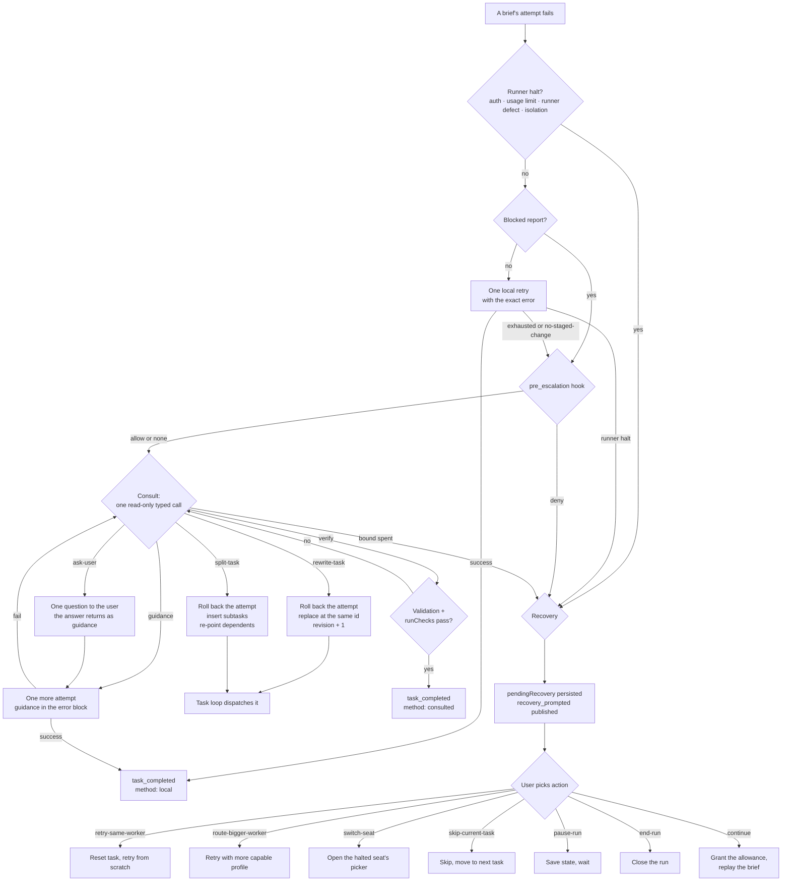

# SPLITBRIEF — Approval gates, escalation, and recovery

How SPLITBRIEF keeps the user in control during a workflow run. Four systems work together: the plan card pauses once on the plan; protected-path confirmation asks before a write to a protected path; the planner consult repairs validation failures automatically; and recovery gives the user the final say when automation runs out of options. Drift detection runs alongside these systems as a continuous check.

For the workflow state machine, see `docs/WORKFLOW.md`. For the event model, see `docs/ARCHITECTURE.md`.

---

## The plan card

After the planning session produces a plan that passes its checks, the workflow pauses once for human review. There is one card, and it reviews the plan. The card lives in `runPlanApproval` (`src/engine/orchestrator/planning/session.ts`). The full flow is in [WORKFLOW.md §3](./WORKFLOW.md#3-the-planning-session).

A plan reaches the card only after `checkPlan` and the context fit pass ([TASK-CONTRACT.md](./TASK-CONTRACT.md)). There is no separate brief-quality or brief-readiness gate: the briefs are compiled from the checked plan.

`workflow.approve` controls the card:

| Level | What it does |
|---|---|
| `plan` (default) | The plan card opens before the build |
| `none` | No card; the build starts when the plan passes its checks |

The retired values `all`, `spec` and `default` load as `plan`, each with one config notice. There is no `--approve` flag.

The card shows `plan.md` and offers four rows: **Approve plan and start the build**, **Request changes** (the planning session takes the comment and the reviewed `plan.json`, applies its checks with one repair, and the card opens again), **Edit plan.json** (re-validated; an invalid edit is not applied and `plan.json` is restored), and **End run** (`CLOSE_RUN`: the run is closed and its files stay on disk). When the plan lists protected operations, one line above the rows names them (`Approving also confirms: write package.json`, `reviewConfirmsText`, `src/features/workflow/prompt-rows/approval.ts`), read from the `plan.json` beside the card (`planCardConfirms`, `src/features/workflow/review-editor.ts`), so they stay in view while `plan.md` scrolls. On a terminal too short for the list beside one row of `plan.md`, the line counts them instead (`Approving also confirms 2 protected operations`): the panel sheds its border, then its key legend, then the list, until the plan keeps a row (`reviewDocumentForm`, budgeted by `getReviewPanelBudget` in `src/features/workflow/layout/rect.ts`). There is no reject: an answer that is not one of those four re-opens the card.

**Approving confirms the plan's protected writes.** Each task may list `protectedOperations` (`{ path, operation: 'write' }`). Approving the card turns each listed write into the same match the write gate uses (`planConfirmations`, `src/engine/orchestrator/approval/confirm.ts`, through `protectedWriteClass`, which runs `classifyAction` over `write <path>` and keeps only a protected class; a plan that lists a path whose write asks for nothing fails the `unprotected-operation` check) and records it in the run's evidence-ledger approvals (`persistApprovalEvidence`). When the build later writes that path, the gate finds the confirmation and does not ask again. A write the plan did not list still asks. The card shows the list near its top under `## Protected operations` as `- T002: write package.json`, and a line above the rows says `Approving also confirms: write package.json`; with `approve: none` no card opens, and each listed write asks when it happens.

**Headless approval is unattended.** A headless run approves the card with `{ approved: true, unattended: true }` (`src/cli/headless.ts`). An unattended approval records no confirmation, so a protected write in a headless build is denied with `APPROVAL_REQUIRED`.

**The approval is recorded.** An approved card publishes `plan_approved` in `reviewing-plan`, before the run moves on; End run publishes `plan_rejected`; a correction or a valid edit publishes `plan_regenerated`. The approval is a row of `session.jsonl`, so a run at rest replays it. The transcript draws no row for it: the header rail already marks the Plan stage as passed. An answer that arrives after the run was stopped publishes no approval.

**Resume.** A run parked at the card with a saved plan (`reviewing-plan` and `state.plan`) re-opens the card through `resumeParkedApproval` (`src/engine/orchestrator/run/resume-parked-approval.ts`) without re-spending the planner call. A correction typed while the card is parked is applied by the planning session before the card opens, and appears once in the transcript and session log; a bare `⏎` re-opens the card with no planner call. An older run parked at a spec gate, a briefs gate, or a plan gate without `plan.json` has no card to re-open: it continues as one planning session, which reads the run's earlier documents and the correction typed at the gate, and then opens the plan card. At rest such a run reads `Waiting at the plan · ⏎ to continue`.

**Interrupt, correct, continue.** A stop is not an end: the step it cut is recorded on the state and the run parks, holding for the operator. Every park publishes `turn_interrupted` with the step it parked. A stop at the card cuts nothing (`at: boundary`), and its transcript row names the card rather than offering a retry. Continuing composes what they typed *with* the step's real prompt rather than in place of it — the planning session takes it as a note, the reviewer re-issues its whole deterministic prompt with the note, and a brief restarts on its own prompt.

---

## Protected-path confirmation

**Two prompts, in sequence, never one.** Approving the plan and confirming a protected write are different questions. The card names the step it releases (`Approve plan and start the build`, `reviewDocumentOptions`, `src/features/workflow/prompt-rows/approval.ts`). The confirmation that may follow during the build names the operation and the path — the title is a sentence (`Change a package manifest:`, `Change a CI or secret file:`, `Destructive action:`), not a class name.

The attempt gate detects protected changes after the implementer writes inside the run workspace. It runs before validation, not before a direct writer's filesystem operation. A denial restores that file from the attempt snapshot inside the workspace.

The write gate runs over the files the implementer changed. The classifier (`src/engine/orchestrator/approval/action-classifier.ts`) inspects each written path and the task's scope and assigns an action class. It classifies file paths, including writes outside the suggested set. It does not parse shell commands.

**Action classes the classifier produces:**

| Class | What triggers it | Asks? |
|---|---|---|
| `read` | Action descriptions beginning with `read`/`cat`/`ls`/`find`/`grep`, or anything with no write verb | no |
| `write_in_scope` | Writing to a file named in the task brief or matching `scope.inBounds` / `approval.allowedPaths` | no |
| `write_out_of_scope` | Writing to a file not covered by the task's scope: a brief's files are suggestions, so the write is recorded as touched, not suggested | no |
| `destructive` | Writing to a control-plane path (`.git`, `.splitbrief`) | yes |
| `sensitive_change` | Writing to CI configuration (`.github/`, `.gitlab-ci.yml`, `.circleci/`, `azure-pipelines.yml`, `Jenkinsfile`, `.buildkite/`) or a secret-bearing file (`.env`, `.env.*`, `*.pem`, `*.key`, `id_rsa*`, `.npmrc`, `.pypirc`) | yes |
| `package_change` | Writing to a package manifest or lockfile (`package.json`, `pnpm-lock.yaml`, …) | yes |

The protected patterns are matched against the written path, never against the task's file list, so a brief that declares `.env.example` does not make its ordinary writes ask. A write to a control-plane path is `destructive`; a write to CI configuration or a secret-bearing file is `sensitive_change`; a write to a package manifest is `package_change`; a write to a file in the task's `scope.inBounds`, `scope.approvedOutOfBounds`, or `approval.allowedPaths` is `write_in_scope`; any other write is `write_out_of_scope`. Anything that is not a write defaults to `read`.

**Protected or not; nothing else.** The rule is fixed (`DEFAULT_TIER_MAP`): a write to a protected path — `destructive`, `sensitive_change` or `package_change` (`PROTECTED_ACTION_CLASSES`, `src/core/schemas/enums.ts`) — asks, and no other write does (`gateAction`, `src/engine/orchestrator/approval/tiered-approval.ts`). `--yolo` and `approval.enabled: false` do not change that: a protected write still asks. There are no sticky grants, no `.splitbrief/approvals.json`, no `/approval` command, no `splitbrief approval list|clear`, and no tier overrides: `approval.tiers` is a retired key that loads with one notice and is ignored.

**The confirmation.** The response must carry the literal phrase `I confirm` and a non-empty reason; `gateConfirmTier()` (`src/engine/orchestrator/approval/confirm.ts`) rejects anything else as `invalid_confirm_phrase`. That contract is what a custom `onTieredApproval` callback satisfies itself. The TUI satisfies it on the user's behalf: the prompt paints its option rows under the shared selection grammar — `↑↓` wraps through them, `⏎` takes the highlighted row, and the letters stay live as accelerators — and it opens on `Confirm`. A `destructive` action — a control-plane write — carries no key on its Confirm row and answers a stray `y` with `⏎ confirms this write · esc deny` instead of approving; every other protected class confirms on `y` or `⏎`. `r` opens an optional reason field; confirming without one records `confirmed at the prompt (no reason given)` so the evidence trail never reads as though a human justified the write. Keystrokes buffered before the prompt appeared are discarded for `PROMPT_TYPEAHEAD_GRACE_MS` (`src/lib/terminal/typeahead-grace.ts`). Approval events (`approval_prompted`, `approval_granted`, `approval_rejected`) are published from `events.ts`; shared gate input/output types live in `types.ts`.

**One confirmation per path per run.** A confirmed path and operation stays confirmed for that run. `confirmedEarlierInRun()` (`confirm.ts`) reads the run's `evidence.json`, including operations confirmed on the plan card. `gateAttemptChanges()` (`src/engine/orchestrator/task/attempt-gate.ts`) uses `gateChangedFiles()` for each changed file. It restores denied files and keeps the attempt's other accepted changes.

A failed restore stops the attempt. An extracted-code writer also uses `approveWrite` before its write. Without `onTieredApproval`, a protected write is denied with `APPROVAL_REQUIRED`.

---

## Escalation

File approval classifies the exact normalized `targetPath`. A declared `src/app.ts` does not authorize `src/app.ts.backup`. Task writes and validation stay in the run workspace. Checkout integration follows [Apply](./WORKFLOW.md#apply).

Workspace reuse keeps the same run directory across tasks, retries and continuation. It does not copy checkout edits into the workspace between calls. The [workspace data flow](./HOW-IT-WORKS.md#run-workspace-and-apply) defines its base and persistence.

When the implementer writes code and validation fails, the ladder tries the implementer once more and then asks the planner. The orchestrator runs the rungs in sequence (`handleRetryAndEscalation`, `src/engine/orchestrator/escalation/handle.ts`); if any rung succeeds, the task is done. The planner advises; it never automatically takes over code-writing implementation.

**Pre-existing failures do not enter the ladder.** Acceptance is judged against the run's validation baseline: a stage that was already red before the first task ran, and whose failure evidence names none of the task's changed files, is exempt. An exempt stage never produces a retry prompt, so retry and consult no longer fire for pre-existing failures — a task that introduces no new failure is accepted even when the tree was already red. The review packet keeps the raw `passed`/`total` validation figures for the task and names the exempt stages alongside them, so a shipped-over-red-stage task reads as what it is instead of a partial failure.

**One local retry** (`src/engine/orchestrator/escalation/local-retries.ts`). The implementer retries once with the exact error message appended to its context. No additional API calls beyond the implementer itself. The attempt publishes a `task_retry` row. The rung ends early on the first `no-staged-change` outcome after feedback: an implementer that read the error and still staged nothing will stage nothing again, so the one retry is not spent on the same silence — the consult is asked instead. `DEFAULT_LOCAL_RETRIES` is 1 (`src/core/pipeline-spec/retries.ts`); `workflow.max_retries` is retired and loads with one notice.

**An aborted attempt is not an attempt.** `task_retry` is published when the attempt starts, not when it ends: the row carries the error this attempt is retrying against and precedes the attempt's own events, so it can never land after the `task_completed` it announced. An implementer call that reports an abort — the workflow signal is aborted, or the outcome carries the runner layer's abort text (`Aborted`) — ends the retry loop immediately: no further retry rows are published to `session.jsonl`, and the run stops at that boundary instead of consulting. The aborted attempt keeps the row that announced it, because the attempt was announced and made, while the persisted attempt counter rolls back to the value it had before it. A cancelled run therefore never burns an attempt or a consult on a call the user already cancelled.

**The consult** (`requestConsult`, `src/engine/orchestrator/consult/request.ts`; prompt in `src/engine/spec/prompts/consult.ts`). After the local retry, the run asks its planner for a typed `ConsultAnswer` (`src/core/schemas/consult.ts`) on the planner's resumable session. The call is read-only and carries the plan, the task with its revisions, the attempt's diff from its start snapshot, the failing output (bounded to `BOUNDS.consultFailingOutputChars`, 4000 characters), the implementer's report, the lineage's earlier consults and the status of the other tasks. A `blocked` implementer report, a bundle's blocked form, or a task whose recorded inputs moved starts the consult without the local retry. Every answer is persisted on the task's lineage in `state.lineages` and in the session log; the transcript shows one row, `PLAN → T003: split into T011, T012 · <diagnosis>`. The planner never writes code, and a seat-trouble failure on the call is bounded by the seat rules below.

**The six answers.** Exactly one action follows the mandatory `diagnosis`:

- **`guidance`** — `instructions` and an optional `context`. The task is kept, and one more implementer attempt runs with the guidance appended to the failed attempt's error block under `## Guidance from the planner:`.
- **`rewrite-task`** — one complete replacement `TaskSpec`. The current attempt's own changed files are rolled back (see below), and the task is replaced at the same id with the same criteria and `revision` raised by one; the task loop dispatches it again.
- **`split-task`** — 2 to 4 complete `TaskSpec`s that together keep every criterion. The current attempt is rolled back, the parent leaves `state.tasks` and stays, with its evidence and its consult record, in the lineage record; the subtasks are inserted at the next free `T###` ids (the highest existing id + 1, in answer order), carry `parentId`, and share the lineage's counters. The answer's internal `dependsOn` are rewritten to the new ids, and every pending `dependsOn` that named the parent is re-pointed to all subtasks. A subtask is never split again.
- **`verify`** — no implementer call. The normal validation pipeline runs on the current workspace, and the named checks run through `runChecks` (`src/engine/orchestrator/validation/run-checks.ts`); a `render` check reports `not-runnable` until S6. Every named check must exist and the selection must cover the checks of the task's criteria. A clean run completes the task as `consulted`; anything else consults again.
- **`ask-user`** — the only question the ladder asks. The planner's question, its choices and its default open in the existing question UI, and the answer comes back as `guidance`.
- **`confirm`** — accepts a deviation the implementer reported in its `decisions`. The planner records the exact `decisions` list in the plan's decisions ledger (`CONFIRM_DECISIONS`, naming the reporting task) and the same attempt is validated without another implementer call. Use it only for a change of how that keeps every accepted criterion intact; a change of what is built is `ask-user`.

**The consult guards.** Dropping an accepted criterion or its required check changes the requirement and becomes `ask-user`. Changing the task id in a rewrite or splitting an existing subtask is a contract error: one repair request, then a `seat-protocol-error` halt if the answer repeats the error.

**The bounds.** The lineage is bounded at 2 consults and 8 attempts; the run is bounded at 10 planner calls after planning (`src/core/pipeline-spec/bounds.ts`; counters in `state.lineages` and `state.plannerCalls`, never reset by a split or a resume). A spent bound halts with `consult-bound-spent` or `planner-calls-spent`, carrying the planner's last diagnosis, and offers **continue**, **skip-current-task** and **end-run** (`buildConsultBoundRecoveryIssue`, `src/engine/orchestrator/recovery/builders/consult.ts`). **Continue with a note** grants a recorded extra allowance — +1 consult and +4 attempts for the lineage, or +5 planner calls — records the note on the lineage and replays the brief.

**The stale refresh** (`refreshStaleTask`, `src/engine/orchestrator/task/step.ts`). Before a brief is dispatched, the content hashes it recorded for its suggested and context files (`task.inputHashes`) are compared with the workspace (`inputsMoved`, `src/engine/orchestrator/task/stale-inputs.ts`). A change runs one consult with the reason `stale`, restricted to `guidance` and `rewrite-task`. A stale consult spends no planner call and runs at most once per task revision: guidance records the fresh hashes without a new revision and becomes the first attempt's extra instructions; a rewrite records them on the new revision. A consult that cannot be reached is a warning and dispatch goes on.

**Seat trouble.** A transient network or server failure on a seat call — a reset or refused connection, a DNS miss, a connect timeout, HTTP 5xx or 408, or a bare 429 that named no reset — retries the same call up to 3 times with exponential backoff (2s, then 4s, then 8s; `src/engine/runners/transient.ts`). A reported rate-limit reset no more than 10 minutes away is waited for, not failed on: the deadline is persisted as `state.seatWait`, the transcript records `seat_wait_started`, and a resume keeps waiting until it (`waitForSeatReset` / `resumeSeatWait`, `src/engine/orchestrator/escalation/seat-wait.ts`). A longer or unreported reset keeps the `runner-usage-limit` halt with the seat picker. There is no automatic seat switch.

**The no-progress cut.** The idle watchdog cuts a seat call when it has emitted no event for 20 minutes and has no running child process (`armIdleKillTimer`, `src/lib/process/spawn/lifecycle.ts`; `RUNNER_IDLE_KILL_MS` is `BOUNDS.noProgressCutMs`, 20 minutes). A running test, build or other command is progress and is never cut. The cut is recorded as one attempt on the lineage (`no_progress_cut`), and the run continues by itself: local retry, then consult.

**The rollback rule.** A rewrite or a split restores only the current attempt's own changed files from the snapshot taken when that attempt started (`restoreAttemptFiles`, `src/engine/orchestrator/task/rollback.ts`); files earlier done tasks changed are never touched.

**Review-packet warnings list.** The final review packet (`review-packet.json`) collects every operational `warning` event into its escalation warnings list (`escalations.warnings`, built by `src/engine/orchestrator/evidence/review-packet/sections.ts`). Warnings published with `safety: { category, code }` keep their message. The most common one is an implementer that ran and wrote nothing: the pipeline publishes exactly one warning with `category: 'implementer'` and `code: 'implementer_wrote_nothing'`, naming the runner and the task. The task itself still fails with the `no-staged-change` outcome — retry, consult, and recovery behaviour are unchanged, except for the fix attempt of an appended fix task, which may verify and change nothing (see [WORKFLOW.md](./WORKFLOW.md), Review fix cycles); the warning only makes the outcome legible in the transcript, `session.jsonl`, and the review packet. A second coded warning uses `category: 'usage'` and `code: 'implementer_usage_not_reported'`: it fires when a task completed but the runner's protocol carried no usage, so a run whose runner reported nothing is distinguishable from a run that did no work. It is published once per affected task, names the runner and the task, and does not change the task's outcome or the recorded zero token counts.

**Scope is guidance.** A `direct` implementer may edit an ordinary project file that the brief does not suggest when the change needs it (a caller, a test, a shared component), and names it in its report. The CLI implementer gates such writes instead of rejecting them (`undeclaredWrites` defaults to `'gate'`, `src/engine/implementers/cli.ts`), the classifier allows them (`write_out_of_scope` is `auto`), and the validation stage runs the tests of every changed file, not only the declared ones (`resolveTestTarget`, `src/engine/orchestrator/validation/commands.ts`). The file is recorded three times: one dim transcript row, `T003 also changed src/x.ts` (`task_touched_not_suggested`, published by `validateCommitAndAdvance` for the files outside the brief's declared set and the files of every brief already done); an `info` drift finding; and the `Files touched, not suggested by any brief` line of the review's Changed Files section. There is no revert retry. The `scope-violation` reason remains readable for older runs but has no producer now: `approval.tiers` is retired, so no override can turn such a write into a question.

Every retry step (`src/engine/orchestrator/escalation/step.ts`) refreshes code in the same run workspace and runs the implementer there. The protected gate restores denied files inside that workspace. The accepted changes then go to validation and evidence recording. If no changed file remains, the retry cannot complete as a code change. A retry creates no new project copy and writes no result into the checkout.

---

## Recovery

Replacing a BUILD worker after a usage limit updates the failing named profile, including a non-default profile. Other profiles keep their configuration; the retry uses the chosen replacement. Taking `switch-seat` on the panel does not swap the tool alone: it opens that seat's own picker on the chosen tool, so the swap carries the model and effort picked there (`configWithSwitchedSeat` spreads `model`, `effort` and `variant` into the seat's runner block), and the picker writes the choice to `.splitbrief/config.yaml` so the next run starts on it too. Cancelling the picker leaves the halt pending and changes nothing.

Recovery takes over when the consult ladder is exhausted — a spent consult or attempt bound included — or when a workflow-level failure occurs that automation cannot resolve. The system lives in `src/engine/orchestrator/recovery/`.

When a recovery-worthy event happens, the orchestrator builds a `RecoveryIssue` (schemas: `src/core/schemas/recovery/`) describing the failure, the available actions, and a recommended action. The issue is set as `pendingRecovery` in `state.json` via `SET_PENDING_RECOVERY`, and `recovery_prompted` publishes on the EventBus. There is no `onRecoveryNeeded` callback: the TUI reacts to the persisted `pendingRecovery` (driving `applyRecoveryAction` in `src/engine/orchestrator/recovery/actions.ts`), while a headless run emits a `recovery_required` JSON line and exits non-zero (`src/cli/headless.ts`).

**An unresolved recovery is never silent.** Re-entering the task loop over a state that still carries `pendingRecovery` publishes a transcript-safe `warning` with `code: 'recovery_pending_unresolved'` naming the reason, the recovery status, and the available actions before stopping (`src/engine/orchestrator/task/loop.ts`). The issue is not cleared and not re-entered — only a real recovery action resolves it. Headless `--json` runs fail with exit code 1 for every recovery status: `awaiting-user`, `paused`, and `applying` alike. A machine consumer can tell the three apart because the `recovery_required` record carries the `status` field.

**Headless runs answer a halt with `continue --action`.** A `--plain` / `--json` run that meets a pending recovery prints the issue, its recommended action and the exact line that carries the run on — `Continue with: splitbrief continue <session> --action retry` (`formatResumeCommand`, `src/core/recovery/resume-command.ts`) — and exits 1; the `recovery_required` JSON record carries the same `resumeCommand`. `splitbrief continue <session> --action <skip|retry|switch-seat:<tool>[:<model>]|end-run>` applies that `RecoveryAction` to the pending recovery and continues the run headlessly, or closes it for `end-run`. An action the issue does not allow is a blocked result and exits 1; an unparseable `--action` value exits 2. Only those four actions name themselves on the command line. Every other recommendation is a row of the recovery panel, which `splitbrief continue <session>` opens, so the printed line names the row in the panel's own words (`recoveryActionLabel`, `src/core/recovery/action-label.ts`) — `Continue with: splitbrief continue <session>, then choose Pause run in the recovery panel` — and carries no `[--plain|--json]`, because the panel needs the TUI. There is no automatic headless recovery policy: nothing is skipped or retried unless the operator asks for it by name.

**The unavailable-implementer issue carries the runner's own reason.** When the availability gate fails, the `implementation-error` issue's details carry the runner's own explanation — the optional `Implementer.unavailabilityReason()` member, e.g. "the endpoint is unreachable" — falling back to generic installation / credentials / reachability guidance only when the runner cannot state one.

**A signed-out runner halts the run instead of escalating.** Subscription CLIs report a dead login as an ordinary turn failure (codex: `codex-turn-failed` with "Your access token could not be refreshed…"; Claude Code: an `is_error` result like "Invalid API key · Please run /login"). The implementer pipeline classifies those diagnostics as the `unauthenticated` outcome (`src/engine/runners/auth-failure.ts`, applied in `src/engine/implementers/pipeline/call-result.ts`), and the orchestrator halts — on the first attempt (`src/engine/orchestrator/task/step.ts`) or between ladder steps (`src/engine/orchestrator/escalation/handle.ts`) — with a `runner-unauthenticated` recovery whose message names the exact re-login command (`codex logout` + `codex login`, or `claude /login`) and whose details keep the tool's own words verbatim. Without the halt, every task would silently spend a planner call on a run no retry can land. SPLITBRIEF does not launch the login itself: both flows are interactive browser OAuth, which cannot run in headless sessions or over SSH — log in from a separate terminal, then choose `retry-same-worker`; the retry rebuilds the runner sandbox and picks up the fresh credential. A planner-side auth failure halts the run at the planning call with the same reason on the `plan` seat: `handlePlanningFailure` (`src/engine/orchestrator/planning/failure.ts`) appends the planner tool's own diagnosis and the same login command, then raises a `runner-unauthenticated` recovery offering `retry-same-worker`, `switch-seat` (when another ready tool was detected), `pause-run` and `end-run`.

**A usage-limited runner halts the run the same way — and never gets login advice.** Subscription CLIs report an exhausted quota as an ordinary turn failure too (codex: "You've hit your usage limit. … or try again at Aug 8th, 2026 3:27 PM."; Claude Code: an `is_error` result like "You've hit your session limit · resets 3:45pm" or "Credit balance is too low"), and API providers return HTTP 429 bodies. The pipeline classifies those diagnostics as the `usage-limit` outcome (`src/engine/runners/usage-limit.ts`, applied in `src/engine/implementers/pipeline/call-result.ts` for CLI results and in `src/engine/implementers/pipeline/run.ts` for thrown provider errors), and the orchestrator halts at the same points as the signed-out case with a `runner-usage-limit` recovery. The halt records the reset moment as `resetAt` whenever the tool's diagnostic carried one — codex "try again at Aug 8th, 2026 3:27 PM." or the bare-clock variant "try again at 3:27 PM.", Claude Code "resets 3:45pm" / "resets Mon 12:00am", Groq "try again in 7.66s", or an HTTP `Retry-After` header (threaded into the diagnostic as `(retry-after: Ns)` by `src/engine/streaming/stream-errors.ts`). Every surface spells `resetAt` when it is read, with one formatter (`formatResetNote`, `src/core/recovery/reset-clock.ts`): the panel, the workflow header, the transcript's error row (`error  resets 15:27`) and the headless `Recovery required` line. The clock is a 24-hour clock such as `15:27`, dated as `Aug 8, 15:27` when the reset is not today, so a run reopened on a later day dates it on every surface alike. The message is stored and the transcript replays it, so it names no clock: `OpenAI Codex CLI hit its usage limit. Wait for the limit to reset or change the BUILD tool, then continue.` The details keep the tool's words verbatim. Logging out and back in cannot restore quota, so the recovery never suggests it: the real options are moving the seat to another detected tool (`switch-seat`, the recommended action whenever one is offered), waiting for the reset (`pause-run`, then `retry-same-worker`), switching to a different implementer profile (`route-bigger-worker`, offered when config has one), skipping the task, or ending the run. A planner-side limit halts the run at the planning call with the same reset-aware guidance instead of a login command, as a `runner-usage-limit` recovery on the `plan` seat.

**Every planner-tier call halts on its own seat.** The planning calls, a brief's consult call and the final review read the tool's words the same way (`diagnosePlannerCallFailure`, `src/engine/orchestrator/recovery/planner-call-failure.ts`): a limit halts as `runner-usage-limit`, a sign-out as `runner-unauthenticated`, and anything else keeps its own recovery. The consult call first runs the seat rules of §Escalation, so a transient failure retries and a reset no more than 10 minutes away waits; a longer or unreported reset halts. A final review that hits a limit halts on the `review` seat instead of as `review-failed`; retry and `switch-seat` run the review again. A consult that hits one halts on the `plan` seat and names the brief, so retry and `switch-seat` replay that brief, and `skip-current-task` is offered. With no `reviewer:` block the review runs on the plan seat's tool, so the review halt's swap names the `plan` seat: the panel reads **Change PLAN tool · runs the review again**, the picker and the swap write `planner:`, and the review keeps following it. With a `reviewer:` block the swap moves that block. The error row names the reset once: the `error` event carries the halt's `resetAt`, the row spells it beside its label, and the tool's own clause (`or try again at …`, `· resets …`, `Resets in …`) is dropped from the quote (`stripRecoveryResetClause`, `src/core/recovery/reset-clock.ts`), on a BUILD halt's row too (`runnerHaltRow`). The details keep the words verbatim. A planner-tier row leads with its label and the tool's own words — `Final review failed: You've hit your usage limit. …` — not the call's own `Planner review call failed`.

**The captured limit wording classifies.** Beyond codex and Claude Code, the captured phrasings are: antigravity, which prints `error: Individual quota reached. Please upgrade your subscription to increase your limits. Resets in 2h6m30s.` on stderr — once beside exit 0 with `(response may be truncated)` appended, then again beside exit 3 — whose compact `Resets in 2h6m30s` is parsed as the reset moment, and whose line classifies whether or not the stream ends on a `result` frame (a planner-tier call that exits 0 with no text beside that line fails as a usage limit, `requireCompletedCall`, `src/engine/planners/require-completed-call.ts`, the way a BUILD call that changed nothing does); opencode 2.x, which emits a flat `provider.quota` error envelope (`{"type":"error","error":{"type":"provider.quota","message":"Go usage limit exceeded","status":429}}`); command-code, which says `You've reached your weekly usage limit`; and the Gemini API body behind antigravity, whose `RESOURCE_EXHAUSTED` status classifies on its own. Copilot, cursor and kilo-code are the gaps: their limit wording has not been captured from a live run, so they classify only through the shared 429, quota and rate-limit phrases, unverified. A tool that prints its limit and exits before it reads a stdin prompt breaks the pipe under that prompt; the limit line on stderr outranks the broken pipe, so the call still halts as `runner-usage-limit` and not as `planner-call-failed` (`src/engine/runners/cli-tools/process-invoke.ts`).

### Isolation checks

The tripwire inspects tool calls reported by a `cli` implementer (`src/engine/implementers/isolation/boundary.ts`). A write outside the allowed workspace boundary stops the call and raises `implementer-left-isolation`. A read, list or search outside that boundary logs an `isolation_outside_read` warning for the reviewer. It does not halt. A tool that reports no input paths has only audit coverage.

A package-manager install writes into shared dependencies and still halts. Normal tool caches remain allowed. The boundary checks tool-reported paths; it does not provide shell or network confinement.

The audit compares checkout files and git state before and after every implementer call, including extracted-code writers. Changed checkout files publish `checkout_changed_during_call`; the call stands. Moves of the checkout's HEAD or current branch do not halt a workspace run. Apply integrates the checkout later.

Other branch refs, tags, stash, hooks, git config and the installed dependency set still raise `checkout-changed` when they change during a call. Remote-tracking refs, maintenance prefetch refs and SPLITBRIEF's own branches are excluded from the shared ref audit. `snapshotWorkspaceGit()` (`src/engine/implementers/isolation/checkout-audit.ts`) separately captures the run worktree's HEAD, branch ref and logical index. Staging or committing there halts too. A staged copy has no worktree git state of its own.

The halt names the brief and carries the evidence. The tripwire's halt reads `T004 left the isolation directory — Google Antigravity CLI wrote to ~/Projects/app/src/index.ts (your checkout) with run_command: touch ~/Projects/app/src/index.ts`. A package-manager install reads `… ran a package-manager command with Bash: npm install zod — a package-manager install, ci, add, remove or update writes to the project's shared node_modules; change the dependencies in the project yourself, then retry`. A read outside the boundary is logged, not halted: `Task T004 searched ~ with run_command: find ~ -name "process-invoke.ts" 2>/dev/null`. The audit's halt reads `Your checkout changed under T004 — tag v1.2 · hook pre-commit`. It names your checkout and not the implementer, because the audit cannot tell who made the change. When the tripwire stopped a call that also changed shared git state, the halt stays `implementer-left-isolation` and its evidence ends with `; ran while your checkout changed: tag v1.2`. A changed checkout file is a warning only: `Task T004: your checkout changed while Google Antigravity CLI ran — src/app.ts; nothing there was reverted`. The panel header shows the short form, and the evidence is the fact row under the task. The transcript's error row, `session.jsonl` and the headless `Recovery required (<reason>): …` line carry the full sentence.

An unreadable audit publishes `isolation_audit_failed` and lets the call stand. These checks detect changes; they cannot identify who made them. Read the named evidence before retrying. Neither halt undoes checkout changes. The recovery offers retry, a seat switch when available, skip, pause or End run.

**Unreadable changed files are recorded, not thrown.** The baseline records an internal symlink by its target, `symlink:<target>`. Other unreadable entries use `UNREADABLE_FINGERPRINT` (`src/engine/orchestrator/changed-files-baseline.ts`). They are never treated as missing or opened. The run-start warning names their project-relative paths. An entry unreadable at both ends stays unchanged; a file replaced by a symlink counts as changed.

**Recovery reasons and their available actions:**

| Reason | When | Available actions | Recommended |
|---|---|---|---|
| `implementation-error` | Implementer crashed, or its endpoint is unreachable at the availability gate | `retry-same-worker`*, `route-bigger-worker`*, `skip-current-task`, `pause-run`, `end-run` | `retry-same-worker`; at the availability gate `route-bigger-worker` when offered, else `retry-same-worker` |
| `validation-failed` | Tests fail during the ladder | `retry-same-worker`*, `route-bigger-worker`*, `skip-current-task`, `pause-run`, `end-run` | `retry-same-worker` |
| `retry-exhausted` | The consult call failed for a reason that is neither a sign-out nor a quota limit, or the `pre_escalation` hook blocked the consult | `route-bigger-worker`*, `retry-same-worker`* (only when the halt allows a retry override), `skip-current-task`, `pause-run`, `end-run` | `route-bigger-worker`, else `retry-same-worker`, else `pause-run` |
| `consult-bound-spent` | The lineage used its 2 consults or 8 attempts | `continue`, `skip-current-task`, `end-run` | `continue` |
| `planner-calls-spent` | The run used its 10 planner calls | `continue`, `skip-current-task`, `end-run` | `continue` |
| `runner-unauthenticated` | A runner's stored login stopped working mid-run (e.g. codex refresh token burned, Claude Code signed out) | BUILD: `retry-same-worker`, `skip-current-task`, `pause-run`, `end-run`. PLAN or REVIEW: `retry-same-worker`, `switch-seat`*, `skip-current-task` (only when the call named a brief), `pause-run`, `end-run` | `retry-same-worker` |
| `runner-usage-limit` | A runner ran out of quota mid-run and its reset is more than 10 minutes away or unreported (the captured wording of codex, Claude Code, antigravity, opencode 2.x and command-code; provider 429; credit exhaustion); message names the reset time when known | `retry-same-worker`, `route-bigger-worker`*, `switch-seat`*, `skip-current-task`, `pause-run`, `end-run` | `switch-seat`, else `route-bigger-worker`, else `pause-run` |
| `context-overflow` | Task too large for any profile | `route-bigger-worker`*, `pause-run`, `end-run` | `route-bigger-worker`, else `pause-run` |
| `user-edit-conflict` | Retired halt from a saved run; resolves on continue with a notice | Older state retains its stored actions | Continue the run |
| `approval-promotion-conflict` | Retired halt from a saved run; resolves on continue with a notice | Older state retains its stored actions | Continue the run |
| `apply-conflict` | Apply cannot merge the candidate safely | `retry-same-worker`, `pause-run`, `end-run` | `pause-run` |
| `apply-partial` | Apply stopped after starting checkout writes | `retry-same-worker`, `restore-backup`, `pause-run`, `end-run` | `retry-same-worker` |
| `dependency-blocked` | Upstream task failed/skipped | `skip-current-task`, `pause-run`, `end-run` | `pause-run` |
| `scope-violation` | No producer now; kept so an older `state.json` still loads. It was a denied write outside the brief's declared set under a tier override | `retry-same-worker`, `skip-current-task`, `pause-run`, `end-run` | `retry-same-worker` |
| `implementer-recipe-invalid` | The tool refused the command line SPLITBRIEF built for it — an unknown flag, an argv shape the installed version rejects, or a model the tool does not list | `retry-same-worker`, `switch-seat`*, `pause-run`, `end-run` | `pause-run` |
| `implementer-left-isolation` | A tool call wrote outside the allowed workspace boundary | `retry-same-worker`, `switch-seat`*, `skip-current-task`, `pause-run`, `end-run` | `retry-same-worker` |
| `checkout-changed` | Shared git state, installed dependencies or the run worktree git state changed during a call; see [Isolation checks](#isolation-checks) | `retry-same-worker`, `switch-seat`*, `skip-current-task`, `pause-run`, `end-run` | `retry-same-worker` |
| `runner-timeout-repeated` | Two timeouts in a row on one brief: the slice does not fit the deadline, so handing it to the planner would only repeat the same overrun | `retry-same-worker`, `route-bigger-worker`*, `switch-seat`*, `skip-current-task`, `pause-run`, `end-run` | `pause-run` |
| `approval-denied` | The operator denied the brief's writes at the approval gate | `retry-same-worker`, `skip-current-task`, `pause-run`, `end-run` | `pause-run` |
| `snapshot-failed` | The task-start snapshot could not be captured, so scope and attempt rollback cannot be enforced for this brief | `retry-same-worker`, `pause-run`, `end-run` | `retry-same-worker` |
| `review-failed` | The final review still reported blocking findings after the last fix cycle; or it reached no verdict (the call failed, or the seat could not read the packet) | Blocking findings: `revise`, `accept-as-is`* on a workspace run, `pause-run`, `end-run`. No verdict: `retry-same-worker`, `pause-run`, `end-run` | `pause-run`; `retry-same-worker` when the review call failed |
| `review-input-too-large` | The review prompt is larger than the reviewer tool accepts, after the size guard trimmed it; or the tool refused it (`input_too_large`) | `accept-as-is`* (**Skip review**, on a workspace run at the final review), `end-run` | `end-run` |
| `planner-call-failed` | The planner call failed for a reason that is neither a sign-out nor a quota limit | `retry-same-worker`, `switch-seat`*, `pause-run`, `end-run` | `retry-same-worker` |
| `planner-returned-no-briefs` | No producer now (older runs only). The retired `tasks` call parsed no Task Brief | `retry-same-worker`, `revise`, `end-run` | `retry-same-worker` |
| `constitution-check-failed` | No producer now (older runs only). The spec broke a hard constitution principle | `revise-spec`, `end-run` | `revise-spec` |
| `brief-review-no-progress` | No producer now (older runs only). The briefs gate went round the same failure 20 times | `revise`, `end-run` | `revise` |
| `brief-quality-unrepaired` | No producer now (older runs only). The repair pass could not fix the briefs | `retry-same-worker`, `revise`, `end-run` | `revise` |
| `seat-protocol-error` | A seat's typed answer failed validation after its repair | `retry-same-worker`, `switch-seat`*, `pause-run`, `end-run` | `retry-same-worker` |
| `plan-questions-exhausted` | The planner asked a third round of questions; a session takes 2 | `retry-same-worker`, `revise`, `end-run` | `revise` |
| `plan-checks-failed` | The plan failed its checks again after one repair; the panel lists each failed check | `retry-same-worker`, `revise`, `end-run` | `revise` |

\* Conditional. `retry-same-worker` requires retry budget remaining; on `retry-exhausted` it requires the halt to allow a retry override. `route-bigger-worker` requires a bigger profile in config. `switch-seat` is legal for the halts the seat itself caused or can have caused — `runner-usage-limit`, `runner-unauthenticated`, `implementer-recipe-invalid`, `implementer-left-isolation`, `checkout-changed`, `runner-timeout-repeated`, `planner-call-failed` and `seat-protocol-error` — and is offered only when the last readiness pass saw another ready tool the seat's own role admits. `accept-as-is` requires a worktree or staged-copy run. `continue` grants extra allowance on `consult-bound-spent` and `planner-calls-spent`.

Validation failures attributable to the task enter the retry ladder after the abort check. Checkout edits do not divert that failure into a user-edit decision. A parked brief keeps its partial workspace output; [continuation](./WORKFLOW.md#4-abort--continue--queue) defines its restart rules.

### Retired file halts

Continue resolves saved `user-edit-conflict` and `approval-promotion-conflict` halts with a `stale_file_halt_resolved` notice. It does not ask the old decision again. A saved `checkout-changed` halt naming only HEAD or branch moves also resolves when the run has no recorded workspace. Other git halts still stand. `settleFileHalt()` (`src/engine/orchestrator/run/init.ts`) records the resolution. [Old-run status](./WORKFLOW.md#run-status) stays compatible.

**Restore-on-exhaustion.** If the ladder halts and prompts a recovery for a task that was not diverted out of the ladder — a rewrite or a split has its own rollback — the task's attributed changed files are restored to their pre-task state from `taskStartSnapshot` (via `restoreDirtyFilesFromSnapshot`), so a later task's validation never sees the failing task's leftover edits. A `warning` event discloses which files were restored.

**What each action does in `src/engine/orchestrator/recovery/actions.ts`:**

`retry-same-worker` — For a taskless PLAN or REVIEW issue, resolves the issue and retries the recorded step. For BUILD, the pending issue must match the current task before `RESET_TASK` can replay it. A rejected action keeps the recovery menu available.

`route-bigger-worker` — Same as retry, but the recovery issue carries a `routeBiggerProfile` fact. The orchestrator uses this profile name to create a more capable implementer for the retry. Blocked if the profile doesn't exist in config.

`switch-seat` — Offered when another ready detected tool can take the blocked seat. The inline recovery menu above the composer starts on the recommended action. Use Up/Down and Enter to choose; **Change PLAN tool** (or BUILD/REVIEW) opens that seat's own picker — the same overlay Settings and Setup open — with the cursor on the first offered tool, so the tool and the model beside it are chosen in one place. The row says what the swap runs again: `runs this step again` after a planning halt, `runs the review again` after a final-review halt, and `restarts this brief` after a halt that names a brief, which runs again from its first attempt. The panel lists no tools of its own. Escape in the picker returns to the action list without changing the seat.

Tab switches focus between the menu and composer. Space pauses only while the action menu owns focus and pause is available; while typing, it inserts a space. Typed text is a correction: at a task halt it retries the brief with that text as the implementer's steer (`retry-same-worker`); at a planner halt it accompanies a retry of the current planner step, and a halt that offers no retry sends it with `revise` or `revise-spec` (`src/features/workflow/recovery-driver.ts`). A halt that offers none of the three refuses typed text on the feedback line. Text typed into the composer of a run at rest is the same correction: on a halt that offers no retry it is sent with `revise` at once, and on a retry halt it rides the retry you choose on the panel. The footer and activity indicators show the stopped or waiting state until work actually resumes.

The selected candidate travels back to the run loop as `switchSeat`. Before the loop re-enters `runWorkflow`, it resolves the halt onto that tool and prepares the same session on it (`applyOfferedSeatSwap` → `switchSeatAndPrepareResume`). That preparation is the re-entry's only one: the seat that halted is not admitted again, so a signed-out or missing tool cannot block the move away from it. Preparation applies the normal runner admission checks to the new crew. Usage-limit recovery still shows the affected tool and reset time through `formatResetNote`; full diagnostics remain in the session log.

`planner-split-rebase` — Legacy/manual only. New recovery issues do not offer it. If a saved state still contains it, selecting it blocks with `planner-proposal-required`; execution requires a separate flow where the planner proposes new Task Briefs and the user approves, edits or ends the run before it continues.

`skip-current-task` — Records skip evidence in the evidence ledger, transitions `SKIP_TASK`, resolves recovery, publishes `task_skipped`. The workflow advances to the next task.

`continue` — On `consult-bound-spent` and `planner-calls-spent`, grants extra allowance with the operator note recorded on the lineage. It resets and replays the brief through `applyConsultGrantRecoveryAction()`.

`pause-run` — Transitions `PAUSE_PENDING_RECOVERY`. State is saved to disk. The user can `splitbrief resume` later.

`revise` — Queues the operator's correction as a user message and resolves recovery, so the next planner turn carries it. Offered for the halts where the planner's own output is the problem.

`revise` — On `review-failed`, the failed review goes back for one more repair cycle. The correction is queued as a triage input of kind `defect` with source `user` and dispatched as `REVIEW_CORRECTION`, which moves the run from `complete`/failed back to `final-review`; the loop triages the saved review with that input and makes no new review call. It never reopens a brief, and it is never refused: with no correction the triage still answers the saved review's blocking findings and questions. At the cap the same action records the note and grants one more fix cycle (`BOUNDS.extraFixCyclesPerRun`) — this is **fix again with a note**.

`revise-spec` — Offered only on an older `constitution-check-failed` halt. It acts as `revise`: the note is queued as a correction for the planning session, and the recovery resolves. Its label reads `Send a correction`.

`end-run` — Uses `closeRunIfOpen()` through the same path as the stop menu and `/end`. It preserves unapplied workspace work before closure. See [Apply](./WORKFLOW.md#apply).

**State machine for `pendingRecovery`:**

The recovery state tracks the issue lifecycle:
1. `SET_PENDING_RECOVERY` — Issue attached to state, status `awaiting-user`.
2. `MARK_RECOVERY_APPLYING` — User picked an action, status `applying`.
3. `RESOLVE_PENDING_RECOVERY` — Action applied, issue cleared from state.
4. `PAUSE_PENDING_RECOVERY` — User chose pause, status `paused`.
5. `CLOSE_RUN` — User chose **End run**: the close is recorded on the state and the pending issue is cleared with it.

---

## Apply conflicts

An `apply-conflict` halt lists every conflicted file and the workspace path. For each file, choose the run version, the checkout version or a combined version. Write that result in the named workspace. Then choose **Re-run Apply**. The checkout stays unchanged while you resolve the candidate. If your resolution changes the reviewed candidate, Apply returns to checks and whole-run review. See [Apply](./WORKFLOW.md#apply).

## Accept as is

A workspace run's `review-failed` halt offers **Accept as is**. It records an owner override and the open findings, then makes the result ready to apply. It preserves failed and unverified verdicts. It does not claim that verification passed.

Apply lists those findings and requires one explicit confirmation. The result menu calls this **Apply as is**. The command is `/run accept confirm`. Returning to the menu without confirmation writes nothing. A changed candidate still follows the Apply checks and review cycle.

## Review input too large

A reviewer tool can have an input cap. The cap is a tool fact (`maxInputChars`, `src/core/runners/cli-tool-catalog.ts`). Codex takes at most 1,048,576 characters. A tool with no recorded cap gets no guard.

The review prompt carries one diff per file for the whole run. Each file is headed by the tasks that touched it. The Workspace Context carries only files with no recorded run effect. No section repeats another.

SPLITBRIEF measures the prompt before the review call (`fitReviewPrompt`, `src/engine/orchestrator/evidence/review-packet/fit.ts`). An oversized prompt is trimmed in this order: whole new files (the reviewer reads them in the workspace), then the diffs of files no brief declares, then the recorded validation output and the drift report. The prompt names what it dropped in a `Trimmed for Size` section. The transcript shows one `Review input trimmed` warning, and `review-packet.json` records the measurement under `reviewInput`.

When the trimmed prompt is still over the cap, the run halts with `review-input-too-large` and makes no call. The same halt follows when the tool itself refuses the input (`input_too_large`). The halt names the size, the cap and the largest file diffs. It offers no retry, because a retry sends the same input. **Skip review** records your note and makes a workspace run ready to apply with no review. It never claims a verification, and Apply asks for one confirmation, as for [Accept as is](#accept-as-is). **End run** saves the changes in `run.patch` and removes the workspace.

## Partial Apply recovery

An `apply-partial` halt means the checkout write did not finish. A restart with `applying` still recorded reconciles the backup and offers this recovery. It does not assume the checkout holds a fresh, complete result.

Choose **Re-run Apply** to retry the remaining writes with the same backup. Choose **Restore backup** to restore through `restoreApplyBackup()` (`src/engine/orchestrator/apply/restore.ts`). The backup lives under `.splitbrief/sessions/<id>/apply/<backup-id>/`. Restore puts back replaced entries and deletes files Apply created only while their checkout fingerprints still match Apply's result. Files not yet written stay untouched. A later edit becomes a reported conflict and stays intact.

Restore clears `applying` through `APPLY_RESTORED`; the run can become ready to apply again. It never restores the run-start baseline. Checkout edits integrated before Apply therefore survive. After a completed Apply, [`/run reject confirm`](./SLASH-COMMANDS-REFERENCE.md#run-acceptreject) uses the same backup restore.

---

## Drift detection

Before final review, `src/engine/orchestrator/final-review.ts` calls `analyzeBriefDrift()` from `src/engine/orchestrator/drift/analyze.ts` against the current diff, tasks, and evidence ledger.

Drift analyzes the full untruncated diff. The CLI review prompt limits its diff copy to 100,000 characters. An API reviewer receives the full required review packet, including the untruncated diff; if that packet does not fit the configured context window, review stops with an insufficient-context diagnostic before dispatch.

Primary task files remain required outputs; `task.file`, `scope.inBounds`, and `scope.approvedOutOfBounds` are accepted change patterns.

`analyzeBriefDrift()` takes the task list, the list of changed files, and the diff text. It checks for:

- **Out-of-scope files** — A changed file lies outside every brief's declared set. Always `info`: the message is `<file> touched, not suggested by any task.`, or, for a file that was already changed before the run started, a pre-existing note. An unplanned file never fails drift or blocks review.
- **Out-of-bounds pattern matches** — An `outOfBounds` pattern from any task scope appears in a changed file path or in the diff text. Always `error`.
- **Missing expected files** — A task reached `done` or `escalated` but its target file was not changed. `warning`.
- **Failed task with diff** — A task failed but left changes in its target file. `error`.
- **Orphan diff** — Changed files exist but every task is failed or skipped. `error`.
- **Missing evidence** — A completed task expected evidence (from the evidence ledger) but none was observed, or its test stage was recorded as `skipped`. `warning`.

Score formula: start at 1.0, subtract 0.25 per error, 0.08 per warning, clamped to [0, 1]. The report passes if error count is zero.

The report is written to the session folder as `drift-report.json` and published as a `drift_report` event. The planner sees the drift report in the final review phase, but drift findings don't block the workflow by default.

**Cross-task drift chains** (`src/engine/orchestrator/drift/chain.ts`). Single-task drift can be incidental. Repeated out-of-bounds changes across consecutive tasks suggest a systematic problem. `computePerTaskOutOfBounds` treats a changed file as out-of-bounds only when it is none of the task's own target file, a `dependsOn` task file, an `inBounds` glob match, or an `approvedOutOfBounds` match — the same in-scope contract the approval gate's `isInScope` enforces. The chain tracker accumulates these per-task out-of-bounds files and computes a chain score:

- Length term: `min(chainLength, 5) / 5 * 0.3`
- Overlap term: `(overlapCount / unionSize) * 0.5` (how much consecutive tasks touch the same out-of-bounds files)
- New-files term: `min(uniqueFiles, 10) / 10 * 0.2`

If a task has zero out-of-bounds files, the chain resets. If the current task's out-of-bounds files overlap with the previous entry's, the chain extends. No overlap starts a new chain.

When the chain score meets or exceeds the configured threshold, `drift_chain_detected` publishes with the chain length, score, and the most frequently touched out-of-bounds file. It is telemetry-only: the JSONL and logger sinks record it, but the conversation UI does not render a row for it. Chain state is persisted to the session folder as `drift-chains.json` (`src/engine/orchestrator/drift/chain-state.ts`).

**Structured final review.** The review seat answers with a typed `ReviewVerdict` (`src/core/schemas/review.ts`): a plan mark (`met` / `partial` / `missed`) for every task in scope, a `pass` / `fail` / `unverified` status with its evidence for every criterion in scope, and findings of kind `defect` / `plan-gap` / `unverified` / `question` at `blocking` or `minor` severity. Coverage is a contract rule: a verdict that misses, duplicates or invents a task or criterion id fails the schema, and the seat gets its one repair. SPLITBRIEF runs the checks behind every unverified claim through `runChecks` (`src/engine/orchestrator/final-review.ts`), derives `pass`, `pass-with-notes` or `fail` from the answer and those results (`deriveReviewOutcome`, `src/core/review/verdict.ts`), and records it in `review.json`; `review.md` is its rendering. A `render` check stays unverified, and an unverified criterion blocks pass.

The record is the verdict's one home: the review packet's final-review section and `summary.json` (`reviewPacket.finalReviewVerdict`, `reviewPacket.finalReviewFindingCounts`) read it, and only a session saved before it falls back to parsing `review.md` with `parseFinalReview()` (`src/engine/parsers/final-review.ts`).
