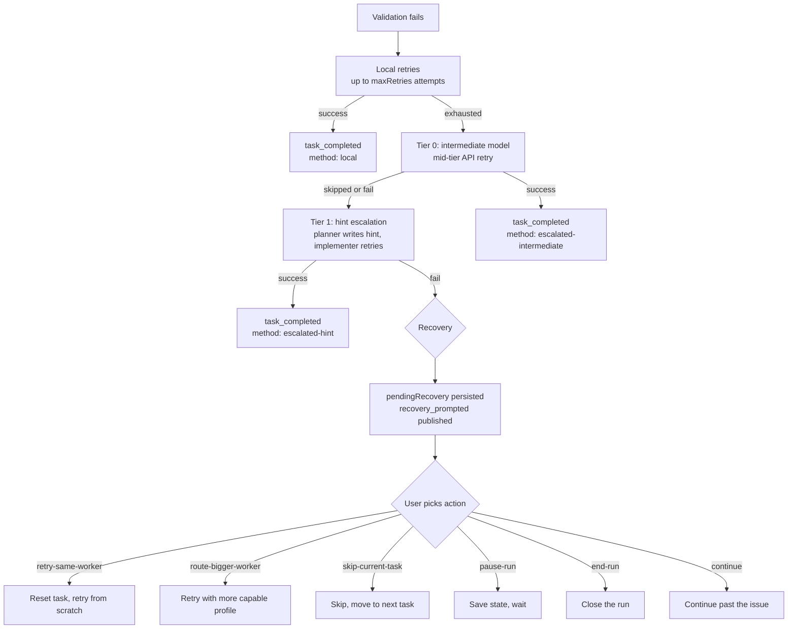

# SPLITBRIEF — Approval gates, escalation, and recovery

How SPLITBRIEF keeps the user in control during a workflow run. Four systems work together: document gates pause on spec, plan, and brief review; tiered approval reviews declared file writes; escalation handles validation failures automatically; and recovery gives the user the final say when automation runs out of options. Drift detection runs alongside these systems as a continuous check.

For the workflow state machine, see `docs/WORKFLOW.md`. For the event model, see `docs/ARCHITECTURE.md`.

---

## Document approval gates

After the planner writes a spec or plan, the workflow pauses for human review. The approval loop lives in `src/engine/orchestrator/approval/loop.ts`.

Before a spec or plan can feed a later phase or be shown at its review gate, it must be non-empty Markdown with a heading. Empty or heading-free output fails admission and is not used as an approved artifact.

The rule covers initial and replacement spec and plan artifacts. Admission runs before `spec.md` or `plan.md` is written and before its `artifact_written` event is published. An invalid replacement leaves the previous artifact unchanged, publishes no replacement artifact card, and cannot feed the next phase or approval gate.

Three review gates:

**Spec approval** — After the planner writes the spec. `onApprovalNeeded('spec', filePath)` fires. The gate offers four rows: **Approve** (the workflow continues to planning), **Request changes** (the planner redoes the spec from the comment), **Edit in $EDITOR** (the gate re-opens over the edited file), and **End run** (`CLOSE_RUN`: the run is closed and its files stay on disk). There is no reject: a gate answer that is not one of those four re-opens the gate rather than ending the run. If the user comments, the planner calls `regenerate()` with the feedback, publishes a `spec_regenerated` event, and loops back to approval. This can repeat as many times as the user wants.

**Plan approval** — Same mechanics as spec approval, applied to the plan. Active by default only in speckit mode. `onApprovalNeeded('plan', filePath)` fires, with the same approve/request-changes/edit/end-run rows.

**Briefs review** — Standard and speckit evaluate Task Brief quality before entering the `reviewing-briefs` phase. An error-level report feeds the linter's issues back to the planner as regeneration feedback, up to `workflow.maxRetries` attempts; when the retries are exhausted the run still enters review with the last quality report in hand rather than failing. This applies to every error-level issue, not only `empty_task_list`. The user reviews `tasks.md` on disk before any code is written. This gate is separate from `workflow.approve`. Before approval, the brief readiness gate (`runBriefReadinessGate()`, `src/engine/orchestrator/planning/brief-readiness-gate.ts`) warns on briefs that overflow the selected worker's context window. It resolves context from the same model cache and detected context length the task-loop router uses at dispatch time, so the gate and the router agree on what fits. A readiness warning requires re-evaluation or a user edit; a repeated approval does not make a `READINESS BLOCKED` report ready (see the brief readiness gate section below). A briefs review interrupted by a crash is resumable: `resumeBriefsApproval()` (`src/engine/orchestrator/planning/resume-briefs.ts`) re-opens the same prompt over the persisted `tasks.md`, and approving on resume advances the run to implementing exactly as a first-time approval would.

`workflow.approve` controls only the spec and plan document gates:

| Level | What it gates |
|---|---|
| `none` | No spec or plan gates |
| `spec` | Spec only |
| `plan` | Plan only |
| `all` | Spec and plan |
| `default` | Whatever the mode dictates |

Each mode has a default. `quick` defaults to `none`. `standard` defaults to `spec`. `speckit` defaults to `all`. Override with `--approve` on the CLI or `workflow.approve` in config. Standard and speckit still run briefs review even when `--approve none` skips spec and plan.

All three approval gates resume into their own prompt. A session interrupted at `reviewing-spec`, `reviewing-plan`, or `reviewing-briefs` is resumable: `resumeArtifactApproval()` (`src/engine/orchestrator/planning/resume-artifact-approval.ts`) re-opens the spec or plan gate over the persisted `spec.md` / `plan.md`, honouring a `revise` through the planner exactly as on the original turn, and re-derives the effective `workflow.approve` level from the current config — a user who changed it between runs gets the current level. The briefs gate resumes through `resumeBriefsApproval()` as described above.

Approving on resume continues from the persisted artifacts; it never restarts the planning turn. An approved `spec.md` regenerates `plan.md` and `tasks.md` from that spec and moves on to the plan gate; an approved `plan.md` moves on to the briefs gate. A `revise` at either gate rewrites the artifact through the planner, and a revised plan regenerates the Task Briefs it invalidated before the briefs gate opens. The approved artifact is never overwritten by a fresh planner call, and no gate is shown twice.

**Interrupt, correct, continue.** A stop is not an end: the step it cut is recorded on the state and the run parks, holding for the operator. Continuing composes what they typed *with* the step's real prompt rather than in place of it — the planner continues on its native session where it has one, the reviewer re-issues its whole deterministic prompt with the note, and a brief restarts on its own prompt with the files it already changed named. One path does it (`continueRun`, `src/engine/orchestrator/run/continue.ts`): a park this process holds settles in place, a run at rest is re-entered on its saved state, and a closed run is refused with its reason. See [WORKFLOW.md §4](./WORKFLOW.md#4-abort--continue--queue) for the per-seat table.

---

## Tiered approval

**Two prompts, in sequence, never one.** Approving a document and granting a write permission are different questions and are asked separately. The document gate names the step it releases and reads in plain words — `Approve plan and compile briefs` · `Request changes (type what to change)` · `Edit in $EDITOR` · `End run (close this run; keep changes)` (`reviewDocumentOptions`, `src/features/workflow/prompt-rows/approval.ts`). The permission gate that may follow names the operation and the path it points at — the title is a sentence (`Write outside the brief's declared files:`, `Change a package manifest:`, `Destructive action:`, `Network access:`), not a class name — and offers `allow this operation only` (the default), `allow for this session`, `allow always (writes .splitbrief/approvals.json)` and `deny`, so the scope of the grant is chosen explicitly rather than implied by a keystroke.

Document approval gates the planning output. Tiered approval gates the declared file writes the implementer reports during execution. The gate runs over the files the implementer changed; each is classified by risk and checked against a three-tier system.

The classifier lives in `src/engine/orchestrator/approval/action-classifier.ts`. It inspects the declared file path and the task's scope to assign an action class and a tier. It classifies declared file writes only — it does not parse or gate shell commands.

**Action classes the classifier produces:**

| Class | What triggers it | Default tier |
|---|---|---|
| `read` | Action descriptions beginning with `read`/`cat`/`ls`/`find`/`grep`, or anything with no write verb | `auto` |
| `write_in_scope` | Writing to a file named in the task brief or matching `scope.inBounds` / `approval.allowedPaths` | `auto` |
| `write_out_of_scope` | Writing to a file not covered by the task's scope | `sticky` |
| `destructive` | Writing to a control-plane path (`.git`, `.splitbrief`) | `confirm` |
| `package_change` | Writing to a package manifest or lockfile (`package.json`, `pnpm-lock.yaml`, …) | `confirm` |

Classification extracts the target file path from the action description, then checks scope membership. A write to a control-plane path is `destructive`; a write to a package manifest is `package_change`; a write to a file in the task's `scope.inBounds`, `scope.approvedOutOfBounds`, or `approval.allowedPaths` is `write_in_scope`; any other write is `write_out_of_scope`. Anything that is not a write defaults to `read`.

The `validation` and `network` classes remain part of the runtime action-class enum, but the file-write classifier never derives them from a description and `approval.tiers` no longer accepts them: the tier map is strict on the five classes above, so a config that names either fails the load.

**Three tiers:**

`auto` — Allow silently, no prompt. The implementer proceeds without interruption. Most in-scope work and reads fall here.

`sticky` — Check `.splitbrief/approvals.json` for a matching grant. If a grant exists with the right pattern and action class, allow silently. If not, prompt the user through `onTieredApproval`. The user can grant once (this action only), for the session (this run), or always (persisted to `approvals.json`). `gateAction()` in `src/engine/orchestrator/approval/tiered-approval.ts` classifies the action and dispatches sticky-tier handling in `sticky.ts`, which reads the grants store, tries to match against `always` grants first, then `session` grants scoped to the current session ID.

`confirm` — Always prompt the user, regardless of prior grants. The response must carry the literal phrase `I confirm` and a non-empty reason; `gateConfirmTier()` (`src/engine/orchestrator/approval/confirm.ts`) rejects anything else as `invalid_confirm_phrase`. That contract is what a custom `onTieredApproval` callback satisfies itself. The TUI satisfies it on the user's behalf: the prompt offers a keyed choice, and the friction lives in which key it is. A `destructive` action — a control-plane write — confirms on Enter only, and answers a stray `y` with `enter confirms this write` instead of approving; every other confirm-tier class confirms on `y`. `r` opens an optional reason field; confirming without one records `confirmed at the prompt (no reason given)` so the evidence trail never reads as though a human justified the write. Keystrokes buffered before the prompt appeared are discarded for `PROMPT_TYPEAHEAD_GRACE_MS` (`src/lib/terminal/typeahead-grace.ts`). Approval events (`approval_prompted`, `approval_granted`, `approval_rejected`) are published from `events.ts`; shared gate input/output types live in `types.ts`.

Override the default tier map per action class in config via `approval.tiers`. Disable tiered approval entirely with `approval.enabled: false`. `/approval list` shows active sticky grants. `/approval clear` removes them. The `--yolo` flag turns file-write tiered approval prompts off for a session.

---

## Brief quality gate

Before any code is written, `src/engine/spec/brief-quality.ts` scores each Task Brief on completeness. `evaluateBriefQuality(tasks)` runs the checks below. An empty task list is itself an error (`empty_task_list`).

**Error-level checks** (any one blocks the gate):

- `missing_validation` -- Task has zero tests.
- `vague_validation` -- Every test matches a vague pattern: `works`, `works correctly`, `works as expected`, `validate`, `make sure it works`, `should work`, `it works`, `correct`, `pass`, `tests pass`, and case variants.
- `missing_implementation_steps` -- Task has zero implementation steps.
- `multi_file_task` -- Task description or steps direct writes to two or more distinct concrete file paths (write-verb governed mentions; referenced paths such as pattern exemplars or import sources do not count).
- `missing_code_context` -- Task is a `modify` action but has no `currentCode`, `signature`, or `pattern`.
- `missing_escalation` -- Task text contains a risk keyword but defines no escalation rules. Risk keywords: `auth`, `security`, `secret`, `token`, `payment`, `database`, `migration`, `config`, `git`, `hook`, `permission`, `public api`.
- `missing_scope` -- Task has no scope, or scope has neither `inBounds` nor `outOfBounds`.
- `missing_evidence` -- Task has no evidence entries.

**Warning-level checks:**

- `missing_type_definitions` -- Task has no `typeDefs`.

**Scoring.** `score = 1 - errorCount * 0.2 - warningCount * 0.05`, clamped to [0, 1]. The gate passes only when `errorCount === 0` -- warnings lower the score but don't block.

The report is written to the session folder as `brief-quality.json`. If it passes, `brief_quality_passed` publishes and the workflow continues. If it fails, `brief_quality_failed` publishes and the repair loop below runs. The score is diagnostic and never supplies a quality override.

For `standard` and `speckit`, an error-level report feeds the linter's issues back to the
planner as regeneration feedback, up to `workflow.maxRetries` attempts. When the retries are
exhausted the workflow does not fail: it falls through to the ordinary `reviewing-briefs`
approval prompt with the last quality report in hand, where the reviewer can approve,
comment, reject, or edit. In an already-valid briefs review, a user edit or revision that
fails quality is reported and the user is prompted again; the invalid edit is never
overwritten.

## Brief readiness gate

Alongside the quality gate, the brief readiness gate (`runBriefReadinessGateAndReport()`, `src/engine/orchestrator/planning/brief-readiness-gate.ts`) runs over the Task Briefs at briefs approval and again after brief edits. It resolves routing metadata through the same model cache and detected context length the task-loop router uses at dispatch time, and blocks briefs whose block kinds are `overflow` (the task overflows the selected worker's context window), `no-capable-worker` (no profile can run the task), or `stale-conflict` (stale or conflicting routing context). Each block names the task, the kind, and the next best action.

The report is written to the session folder as `brief-readiness.json`. If it passes, `brief_readiness_passed` publishes and the workflow continues. If it fails, `brief_readiness_blocked` publishes carrying every blocked task id and every distinct block kind.

The block is advisory evidence. A `READINESS BLOCKED` report must be re-evaluated after a user edit or a routing/configuration change; a repeated approval does not grant a quality override. Editing or revising `tasks.md` changes the briefs fingerprint, so a decision is never granted against stale briefs. The review loop also terminates: a failure that repeats unchanged for `MAX_UNPRODUCTIVE_BRIEF_REVIEW_ATTEMPTS` (20) consecutive attempts leaves the review with a `brief_review_no_progress` error and raises the recovery of the same name — `revise` or `end-run` — instead of re-prompting forever. That cap covers the readiness, edit, and unreadable-`tasks.md` paths. Quality failures caused by edits in an already-valid review are reported and re-prompted; the invalid edits are never overwritten. Initial quality failures take the pre-review regeneration path described above.

---

## Escalation

File approval classifies the exact normalized `targetPath`; a declared `src/app.ts` does not authorize `src/app.ts.backup`. Promotion compares each target against the acquisition-time byte/hash and permission baseline, including edits made while the worker runs. Binary bytes and ordinary execute bits survive promotion. Conflicts preserve the user’s current file. A partial failure records the applied paths and failed file in `promotionAttempts`, retains the workspace, and prevents the brief from passing. It does not roll back the applied prefix.

When the implementer writes code and validation fails, the escalation system tries progressively more capable approaches before involving the user. The orchestrator calls these tiers in sequence. If any tier succeeds, the task is done.

**Pre-existing failures do not enter the ladder.** Acceptance is judged against the run's validation baseline: a stage that was already red before the first task ran, and whose failure evidence names none of the task's changed files, is exempt. An exempt stage never produces a retry prompt, so retry and escalation no longer fire for pre-existing failures — a task that introduces no new failure is accepted even when the tree was already red. The review packet keeps the raw `passed`/`total` validation figures for the task and names the exempt stages alongside them, so a shipped-over-red-stage task reads as what it is instead of a partial failure.

**Local retries** (`src/engine/orchestrator/escalation/local-retries.ts`). Before any tier, the implementer retries with the error message appended to its context. No additional API calls beyond the implementer itself. Runs up to `workflow.maxRetries` times (default 2). Each attempt publishes a `retry` event. Local retries are not a numbered tier. The rung also ends early on the first `no-staged-change` outcome after feedback: an implementer that read the error and still staged nothing will stage nothing again, so the remaining attempts are not spent on the same silence.

**An aborted attempt is not an attempt.** `task_retry` is published when the attempt starts, not when it ends: the row carries the error this attempt is retrying against and precedes the attempt's own events, so it can never land after the `task_completed` it announced. An implementer call that reports an abort — the workflow signal is aborted, or the outcome carries the runner layer's abort text (`Aborted`) — ends the retry loop immediately: no further retry rows are published to `session.jsonl`, and the run stops at that boundary instead of escalating. The aborted attempt keeps the row that announced it, because the attempt was announced and made, while the persisted attempt counter rolls back to the value it had before it. A cancelled run therefore never burns retries or escalation tiers on calls the user already cancelled.

**Tier 0: intermediate model** (`INTERMEDIATE_TIER` in `src/engine/orchestrator/escalation/tier.ts`; implementation in `intermediate.ts`). A mid-tier API model (`escalation.intermediateProvider` / `intermediateModel`) retries the task. This tier runs only when an intermediate provider is configured and `escalation.enabled` is not `false`; otherwise it is skipped. Publishes `escalate` with tier 0.

Tier 0 is configured in YAML only. The TUI does not expose an escalation row or picker; leave the provider or model unset to skip the tier.

**Tier 1: hint escalation** (`HINT_TIER` in `src/engine/orchestrator/escalation/tier.ts`; implementation in `hint.ts`). The rung runs only when the planner's capabilities carry `supportsHintEscalation`; for a planner without it the rung is absent rather than empty — no `task_escalating`, no planner call, no `escalate` — and the ladder ends on the rung below. When it runs, the planner analyzes the error and produces a short hint. `escalate` (tier 1) is published after the planner has answered and only when the answer carries text: an empty or failed hint ends the rung there, with no implementer call and no attempt charged. A hint that carries text is appended to the error context (truncated to 4000 chars), and the implementer retries once more with the enriched error.

**The hint rung asks for a verdict, not just a hint.** The hint prompt (`src/engine/spec/prompts/escalation.ts`) carries the implementer's hand-back and the brief's Scope and Escalation bullets, and asks the planner to open its reply with exactly one line. `VERDICT: answer` means the implementer retries once with the planner's text in its error block. `VERDICT: widen <path>[, <path>…] — <reason>` means that retry also runs with `undeclaredWrites: 'gate'`, so the named files may be written. `VERDICT: brief — <diagnosis>` means the brief itself is wrong: no retry is made, and the run halts with the implementer's words and the planner's diagnosis on the panel. A reply with no verdict line reads as `answer` (`parseHintVerdict`). A first attempt that stopped with a hand-back and staged nothing skips the local rung and tier 0 and comes straight here, because what it needs is the planner's answer, not another identical retry.

**A widening is a request, not a grant.** The widened retry's write to a named path is still classified `write_out_of_scope` and still passes tiered approval — `sticky` by default, so it prompts once and is remembered, and silent under `--yolo`, a matching grant, or `approval.allowedPaths`. Only a write the gate allowed is recorded: `WIDEN_TASK_SCOPE` appends the path to the brief's **Approved out of bounds** as `` `<path>` — planner-approved: <reason> `` and publishes `task_scope_widened`, so the declared set, the CLI effect gate, the classifier, the preamble and drift all read the same scope from then on. A denial takes the existing `scope-violation` recovery, unchanged.

The planner may provide hints; it never automatically takes over code-writing implementation.

After the supported worker/help path is exhausted, the run enters recovery. Historical tier 2 and `escalated-full` records remain readable but are never newly dispatched.

**Review-packet warnings list.** The final review packet (`review-packet.json`) collects every operational `warning` event into its escalation warnings list (`escalations.warnings`, built by `src/engine/orchestrator/evidence/review-packet/sections.ts`). Warnings published with `safety: { category, code }` keep their message. The most common one is an implementer that ran and wrote nothing: the pipeline publishes exactly one warning with `category: 'implementer'` and `code: 'implementer_wrote_nothing'`, naming the runner and the task. The task itself still fails with the `no-staged-change` outcome — retry, escalation, and recovery behaviour are unchanged; the warning only makes the outcome legible in the transcript, `session.jsonl`, and the review packet. A second coded warning uses `category: 'usage'` and `code: 'implementer_usage_not_reported'`: it fires when a task completed but the runner's protocol carried no usage, so a run whose runner reported nothing is distinguishable from a run that did no work. It is published once per affected task, names the runner and the task, and does not change the task's outcome or the recorded zero token counts.

**The scope-violation rung comes before the prompt.** A `direct` implementer that wrote outside the brief's declared set does not go straight to a permission prompt or a halt. The attempt fails with `implementer-effect-invalid`, the undeclared paths are restored from the task-start snapshot, one warning names them, and the next attempt's error block opens with the revert instruction — `Revert your changes to <paths>; only <declared files> may change` (`SCOPE_RULE.revertInstruction`, `src/core/pipeline-spec/scope.ts`, applied in `src/engine/orchestrator/task/implementation-failure.ts`). That retry runs with `undeclaredWrites: 'gate'`, so a second violation reaches the approval gate; a gate denial classed `write_out_of_scope` then raises the `scope-violation` recovery (`src/engine/orchestrator/escalation/step.ts`). One stray write costs a retry with an exact instruction, not the operator's attention.

Every retry step (`src/engine/orchestrator/escalation/step.ts`) follows the same sequence: refresh the task's code from disk, run the retry in a staged project (a temporary copy), gate the changed files through tiered approval, promote the staged changes back, then validate and record the outcome. If any approval gate denies the changes, the staged project is cleaned up and the retry counts as failed.

---

## Recovery

Replacing a BUILD worker after a usage limit updates the failing named profile, including a non-default profile. Other profiles keep their configuration; the retry uses the chosen replacement. Taking `switch-seat` on the panel does not swap the tool alone: it opens that seat's own picker on the chosen tool, so the swap carries the model and effort picked there (`configWithSwitchedSeat` spreads `model`, `effort` and `variant` into the seat's runner block), and the picker writes the choice to `.splitbrief/config.yaml` so the next run starts on it too. Cancelling the picker leaves the halt pending and changes nothing.

Recovery takes over when escalation is exhausted or when a workflow-level failure occurs that automation cannot resolve. The system lives in `src/engine/orchestrator/recovery/`.

When a recovery-worthy event happens, the orchestrator builds a `RecoveryIssue` (schemas: `src/core/schemas/recovery/`) describing the failure, the available actions, and a recommended action. The issue is set as `pendingRecovery` in `state.json` via `SET_PENDING_RECOVERY`, and `recovery_prompted` publishes on the EventBus. There is no `onRecoveryNeeded` callback: the TUI reacts to the persisted `pendingRecovery` (driving `applyRecoveryAction` in `src/engine/orchestrator/recovery/actions.ts`), while a headless run emits a `recovery_required` JSON line and exits non-zero (`src/cli/headless.ts`).

**An unresolved recovery is never silent.** Re-entering the task loop over a state that still carries `pendingRecovery` publishes a transcript-safe `warning` with `code: 'recovery_pending_unresolved'` naming the reason, the recovery status, and the available actions before stopping (`src/engine/orchestrator/task/loop.ts`). The issue is not cleared and not re-entered — only a real recovery action resolves it. Headless `--json` runs fail with exit code 1 for every recovery status: `awaiting-user`, `paused`, and `applying` alike. A machine consumer can tell the three apart because the `recovery_required` record carries the `status` field.

**Headless runs answer a halt with `continue --action`.** A `--plain` / `--json` run that meets a pending recovery prints the issue, its recommended action and the exact line that carries the run on — `Continue with: splitbrief continue <session> --action retry` (`formatResumeCommand`, `src/core/recovery/resume-command.ts`) — and exits 1; the `recovery_required` JSON record carries the same `resumeCommand`. `splitbrief continue <session> --action <skip|retry|switch-seat:<tool>[:<model>]>` applies that `RecoveryAction` to the pending recovery and continues the run headlessly. An action the issue does not allow is a blocked result and exits 1; an unparseable `--action` value exits 2. Only those three actions name themselves on the command line — every other recommendation needs the panel, and the printed line resumes and says where the action lives. There is no automatic headless recovery policy: nothing is skipped or retried unless the operator asks for it by name.

**The unavailable-implementer issue carries the runner's own reason.** When the availability gate fails, the `implementation-error` issue's details carry the runner's own explanation — the optional `Implementer.unavailabilityReason()` member, e.g. "the endpoint is unreachable" — falling back to generic installation / credentials / reachability guidance only when the runner cannot state one.

**A signed-out runner halts the run instead of escalating.** Subscription CLIs report a dead login as an ordinary turn failure (codex: `codex-turn-failed` with "Your access token could not be refreshed…"; Claude Code: an `is_error` result like "Invalid API key · Please run /login"). The implementer pipeline classifies those diagnostics as the `unauthenticated` outcome (`src/engine/runners/auth-failure.ts`, applied in `src/engine/implementers/pipeline/call-result.ts`), and the orchestrator halts — on the first attempt (`src/engine/orchestrator/task/step.ts`) or between ladder steps (`src/engine/orchestrator/escalation/handle.ts`) — with a `runner-unauthenticated` recovery whose message names the exact re-login command (`codex logout` + `codex login`, or `claude /login`) and whose details keep the tool's own words verbatim. Without the halt, every task would silently escalate to the planner. SPLITBRIEF does not launch the login itself: both flows are interactive browser OAuth, which cannot run in headless sessions or over SSH — log in from a separate terminal, then choose `retry-same-worker`; the retry rebuilds the runner sandbox and picks up the fresh credential. A planner-side auth failure halts the run at the planning call with the same reason on the `plan` seat: `handlePlanningFailure` (`src/engine/orchestrator/planning/failure.ts`) appends the planner tool's own diagnosis and the same login command, then raises a `runner-unauthenticated` recovery offering `retry-same-worker`, `switch-seat` (when another ready tool was detected), `pause-run` and `end-run`.

**A usage-limited runner halts the run the same way — and never gets login advice.** Subscription CLIs report an exhausted quota as an ordinary turn failure too (codex: "You've hit your usage limit. … or try again at Aug 8th, 2026 3:27 PM."; Claude Code: an `is_error` result like "You've hit your session limit · resets 3:45pm" or "Credit balance is too low"), and API providers return HTTP 429 bodies. The pipeline classifies those diagnostics as the `usage-limit` outcome (`src/engine/runners/usage-limit.ts`, applied in `src/engine/implementers/pipeline/call-result.ts` for CLI results and in `src/engine/implementers/pipeline/run.ts` for thrown provider errors), and the orchestrator halts at the same points as the signed-out case with a `runner-usage-limit` recovery. The message names the reset moment whenever the tool's diagnostic carried one — codex "try again at Aug 8th, 2026 3:27 PM." or the bare-clock variant "try again at 3:27 PM.", Claude Code "resets 3:45pm" / "resets Mon 12:00am", Groq "try again in 7.66s", or an HTTP `Retry-After` header (threaded into the diagnostic as `(retry-after: Ns)` by `src/engine/streaming/stream-errors.ts`) — surfaced in recovery copy as a locale-formatted time like `Aug 8, 2026, 3:27 PM` when parsed — and the details keep the tool's words verbatim. Logging out and back in cannot restore quota, so the recovery never suggests it: the real options are moving the seat to another detected tool (`switch-seat`, the recommended action whenever one is offered), waiting for the reset (`pause-run`, then `retry-same-worker`), switching to a different implementer profile (`route-bigger-worker`, offered when config has one), skipping the task, or ending the run. A planner-side limit halts the run at the planning call with the same reset-aware guidance instead of a login command, as a `runner-usage-limit` recovery on the `plan` seat.

**Every admitted tool's own limit wording classifies.** Beyond codex and Claude Code, the captured phrasings are: antigravity, which prints `error: Individual quota reached. Please upgrade your subscription to increase your limits. Resets in 2h6m30s.` on stderr — once beside exit 0 with `(response may be truncated)` appended, then again beside exit 3 — and whose compact `Resets in 2h6m30s` is parsed as the reset moment; opencode 2.x, which emits a flat `provider.quota` error envelope (`{"type":"error","error":{"type":"provider.quota","message":"Go usage limit exceeded","status":429}}`); command-code, which says `You've reached your weekly usage limit`; and the Gemini API body behind antigravity, whose `RESOURCE_EXHAUSTED` status classifies on its own. Copilot is the one gap: its limit wording has not been captured from a live run, so its classification rests on the generic 429 and rate-limit patterns and is unverified.

**Unreadable changed files are recorded, not thrown.** The task loop's changed-files baseline records every entry it cannot safely read — a symlink, a directory, an unreadable file — as the `'unreadable'` sentinel instead of failing the run (`UNREADABLE_FINGERPRINT`, `src/engine/orchestrator/changed-files-baseline.ts`; the old `changed-file-fingerprint-read` error kind is gone). Unreadable entries are excluded from user-edit detection, never treated as missing, and never opened; their project-relative paths are named once in a run-start warning, never as an absolute host path. Comparison stays correct in both directions: an entry unreadable at both ends is unchanged, and a file replaced by a symlink mid-run is reported as changed.

**Recovery reasons and their available actions:**

| Reason | When | Available actions | Recommended |
|---|---|---|---|
| `implementation-error` | Implementer crashed, or its endpoint is unreachable at the availability gate | `retry-same-worker`*, `route-bigger-worker`*, `skip-current-task`, `pause-run`, `end-run` | `retry-same-worker` |
| `validation-failed` | Tests fail mid-escalation | `retry-same-worker`*, `route-bigger-worker`*, `skip-current-task`, `pause-run`, `end-run` | `retry-same-worker` |
| `retry-exhausted` | All escalation tiers failed | `route-bigger-worker`*, `retry-same-worker`*, `skip-current-task`, `pause-run`, `end-run` | `route-bigger-worker` |
| `runner-unauthenticated` | A runner's stored login stopped working mid-run (e.g. codex refresh token burned, Claude Code signed out) | `retry-same-worker`, `skip-current-task`, `pause-run`, `end-run` | `retry-same-worker` |
| `runner-usage-limit` | A runner ran out of quota mid-run (codex/Claude Code usage limit, provider 429, credit exhaustion); message names the reset time when known | `retry-same-worker`, `route-bigger-worker`*, `switch-seat`*, `skip-current-task`, `pause-run`, `end-run` | `switch-seat`, else `route-bigger-worker`, else `pause-run` |
| `context-overflow` | Task too large for any profile | `route-bigger-worker`*, `pause-run`, `end-run` | `route-bigger-worker` |
| `user-edit-conflict` | External file edits conflict | `continue`*, `skip-current-task`, `pause-run`, `end-run` | depends on `safeToContinue` |
| `approval-promotion-conflict` | Approved changes can't promote | `skip-current-task`, `pause-run`, `end-run` | `pause-run` |
| `dependency-blocked` | Upstream task failed/skipped | `skip-current-task`, `pause-run`, `end-run` | `pause-run` |
| `scope-violation` | The retry wrote outside the brief's declared set again and the gate denied it | `retry-same-worker`, `skip-current-task`, `pause-run`, `end-run` | `retry-same-worker` |
| `implementer-recipe-invalid` | The tool refused the command line SPLITBRIEF built for it — an unknown flag, an argv shape the installed version rejects, or a model the tool does not list | `retry-same-worker`, `switch-seat`*, `pause-run`, `end-run` | `pause-run` |
| `runner-timeout-repeated` | Two timeouts in a row on one brief: the slice does not fit the deadline, so escalating it would only repeat the same overrun on the planner | `retry-same-worker`, `route-bigger-worker`*, `switch-seat`*, `skip-current-task`, `pause-run`, `end-run` | `pause-run` |
| `approval-denied` | The operator denied the brief's writes at the approval gate | `retry-same-worker`, `skip-current-task`, `pause-run`, `end-run` | `pause-run` |
| `snapshot-failed` | The task-start snapshot could not be captured, so scope and revert cannot be enforced for this brief | `retry-same-worker`, `pause-run`, `end-run` | `retry-same-worker` |
| `review-failed` | The final review still reported blocking findings after the last fix cycle | `pause-run`, `end-run` | `pause-run` |
| `planner-call-failed` | The planner call failed for a reason that is neither a sign-out nor a quota limit | `retry-same-worker`, `switch-seat`*, `pause-run`, `end-run` | `retry-same-worker` |
| `planner-returned-no-briefs` | The planner answered but produced no parsable Task Brief | `retry-same-worker`, `revise`, `end-run` | `retry-same-worker` |
| `constitution-check-failed` | The spec breaks a hard constitution principle | `revise-spec`, `end-run` | `revise-spec` |
| `brief-review-no-progress` | The briefs gate went round the same failure 20 times | `revise`, `end-run` | `revise` |
| `brief-quality-unrepaired` | The repair pass could not fix the briefs and no briefs gate is configured to review them | `retry-same-worker`, `revise`, `end-run` | `revise` |

\* Conditional. `retry-same-worker` requires retry budget remaining. `route-bigger-worker` requires a bigger profile in config. `switch-seat` is legal for the halts the seat itself caused — `runner-usage-limit`, `runner-unauthenticated`, `implementer-recipe-invalid`, `runner-timeout-repeated` and `planner-call-failed` — and is offered only when the last readiness pass saw another ready tool the seat's own role admits. `continue` on `user-edit-conflict` requires `safeToContinue`.

**Validation-failure handling (`src/engine/orchestrator/task/step.ts`).** When validation fails, the orchestrator first short-circuits on an aborted run (returning without raising recovery), then diffs the current changed files against the task-attributed set. If a foreign edit — one outside the task's promoted files that matches the current task or one of its dependencies — is present in the failing universe, it raises a `user-edit-conflict` recovery (`detectValidationFailureUserEdit`) instead of charging the implementer with the retry ladder. Only after both checks does it enter the retry ladder.

**The pre-task user-edit gate raises a conflict only from a scan that produced a file list.** `checkUserEditConflicts()` (`src/engine/orchestrator/user-edit/detection.ts`) fingerprints the changed files before each task. When the scan itself cannot run, SPLITBRIEF publishes a warning and lets the task proceed — a failed scan degrades to a warning, never to a fabricated conflict with an empty file list, and the run does not stop over an inspection failure. The task's own file stays protected regardless: the extracted-code baseline race check and hash-guarded promotion both remain in force.

**Restore-on-exhaustion.** If the retry ladder exhausts and prompts a `retry-exhausted` recovery for a task that was not diverted out of the ladder, the task's attributed changed files are restored to their pre-task state from `taskStartSnapshot` (via `restoreDirtyFilesFromSnapshot`), so a later task's validation never sees the failing task's leftover edits. A `warning` event discloses which files were restored.

**What each action does in `src/engine/orchestrator/recovery/actions.ts`:**

`retry-same-worker` — For a taskless PLAN or REVIEW issue, resolves the issue and retries the recorded step. For BUILD, the pending issue must match the current task before `RESET_TASK` can replay it. A rejected action keeps the recovery menu available.

`route-bigger-worker` — Same as retry, but the recovery issue carries a `routeBiggerProfile` fact. The orchestrator uses this profile name to create a more capable implementer for the retry. Blocked if the profile doesn't exist in config.

`switch-seat` — Offered when another ready detected tool can take the blocked seat. The inline recovery menu above the composer starts on the recommended action. Use Up/Down and Enter to choose; **Change PLAN tool** (or BUILD/REVIEW) opens that seat's own picker — the same overlay Settings and Setup open — with the cursor on the first offered tool, so the tool and the model beside it are chosen in one place. The panel lists no tools of its own. Escape in the picker returns to the action list without changing the seat.

Tab switches focus between the menu and composer. Space pauses only while the action menu owns focus and pause is available; while typing, it inserts a space. A correction in the composer accompanies a retry of the current planner step. The footer and activity indicators show the stopped or waiting state until work actually resumes.

The selected candidate travels back to `runWorkflow` as `switchSeat`, which re-prepares the same session on that tool (`applyOfferedSeatSwap` → `switchSeatAndPrepareResume`). Preparation applies the normal runner admission checks. Usage-limit recovery still shows the affected tool and reset time through `formatResetNote`; full diagnostics remain in the session log.

`planner-split-rebase` — Legacy/manual only. New recovery issues do not offer it. If a saved state still contains it, selecting it blocks with `planner-proposal-required`; execution requires a separate flow where the planner proposes new Task Briefs and the user approves, edits or ends the run before it continues.

`skip-current-task` — Records skip evidence in the evidence ledger, transitions `SKIP_TASK`, resolves recovery, publishes `task_skipped`. The workflow advances to the next task.

`continue` — Only allowed for `user-edit-conflict`, and only when the edit is safe. Resolves recovery and the workflow resumes where it left off.

`pause-run` — Transitions `PAUSE_PENDING_RECOVERY`. State is saved to disk. The user can `splitbrief resume` later.

`revise` — Queues the operator's correction as a user message and resolves recovery, so the next planner turn carries it. Offered for the halts where the planner's own output is the problem.

`revise-spec` — Transitions `REWIND_TO_SPEC` with the operator's note, then resolves recovery. Offered for `constitution-check-failed`.

`end-run` — Transitions `CLOSE_RUN`, resolves recovery. The run is closed: `state.json` records `closed: { at, as: 'ended' }` and the run lists as `ended`. This is the same path the stop sheet's **End run** row and `/end` take (`requestEndRun`, `src/features/workflow/handlers.ts`), so a run ended from the sheet is recorded the same way, and the files the run wrote stay on disk — no stop option reverts anything.

**State machine for `pendingRecovery`:**

The recovery state tracks the issue lifecycle:
1. `SET_PENDING_RECOVERY` — Issue attached to state, status `awaiting-user`.
2. `MARK_RECOVERY_APPLYING` — User picked an action, status `applying`.
3. `RESOLVE_PENDING_RECOVERY` — Action applied, issue cleared from state.
4. `PAUSE_PENDING_RECOVERY` — User chose pause, status `paused`.
5. `CLOSE_RUN` — User chose **End run**: the close is recorded on the state and the pending issue is cleared with it.

---

## Drift detection

Before final review, `src/engine/orchestrator/final-review.ts` calls `analyzeBriefDrift()` from `src/engine/orchestrator/drift/analyze.ts` against the current diff, tasks, and evidence ledger.

Drift analyzes the full untruncated diff. The CLI review prompt limits its diff copy to 100,000 characters. An API reviewer receives the full required review packet, including the untruncated diff; if that packet does not fit the configured context window, review stops with an insufficient-context diagnostic before dispatch.

Primary task files remain required outputs; `task.file`, `scope.inBounds`, and `scope.approvedOutOfBounds` are accepted change patterns.

`analyzeBriefDrift()` takes the task list, the list of changed files, and the diff text. It checks for:

- **Out-of-scope files** — A changed file lies outside every brief's declared set. Always `error`, whether or not any brief declares `outOfBounds`; a file that was already changed before the run started is `info` instead, since the run did not write it.
- **Out-of-bounds pattern matches** — An `outOfBounds` pattern from any task scope appears in a changed file path or in the diff text. Always `error`.
- **Missing expected files** — A task reached `done` or `escalated` but its target file was not changed. `warning`.
- **Failed task with diff** — A task failed but left changes in its target file. `error`.
- **Orphan diff** — Changed files exist but every task is failed or skipped. `error`.
- **Missing evidence** — A completed task expected evidence (from the evidence ledger) but none was observed, or its test stage was recorded as `skipped`. `warning`.

Score formula: start at 1.0, subtract 0.25 per error, 0.08 per warning, clamped to [0, 1]. The report passes if error count is zero.

The report is written to the session folder as `drift-report.json` and published as a `drift_report` event. The planner sees the drift report in the final review phase, but drift findings don't block the workflow by default.

**Cross-task drift chains** (`src/engine/orchestrator/drift/chain.ts`). Single-task drift can be incidental. Repeated out-of-bounds changes across consecutive tasks suggest a systematic problem. `computePerTaskOutOfBounds` treats a changed file as out-of-bounds only when it is none of the task's own target file, a `dependsOn` task file, an `inBounds` glob match, or an `approvedOutOfBounds` match — the same in-scope contract the approval gate's `isInScope` enforces. The chain tracker accumulates these per-task out-of-bounds files and computes a chain score:

- Length term: `min(chainLength, 5) / 5 * 0.3`
- Overlap term: `(overlapCount / unionSize) * 0.5` (how much consecutive tasks touch the same out-of-bounds files)
- New-files term: `min(uniqueFiles, 10) / 10 * 0.2`

If a task has zero out-of-bounds files, the chain resets. If the current task's out-of-bounds files overlap with the previous entry's, the chain extends. No overlap starts a new chain.

When the chain score meets or exceeds the configured threshold, `drift_chain_detected` publishes with the chain length, score, and the most frequently touched out-of-bounds file. It is telemetry-only: the JSONL and logger sinks record it, but the conversation UI does not render a row for it. Chain state is persisted to the session folder as `drift-chains.json` (`src/engine/orchestrator/drift/chain-state.ts`).

**Structured final review.** The review seat's text (written to `review.md`) is parsed by `parseFinalReview()` (`src/engine/parsers/final-review.ts`) into a verdict (`pass` / `pass_with_notes` / `fail`), per-criterion pass/fail marks, and findings categorised Critical / Warning / Note. A review that does not carry the demanded structure yields a null verdict and empty lists — the verdict is unknown, never guessed. The parsed verdict and finding counts are persisted into the review packet's final-review section and rolled up into `summary.json` (`reviewPacket.finalReviewVerdict`, `reviewPacket.finalReviewFindingCounts`), so the eval harness can read the verdict off the summary a run returns.
