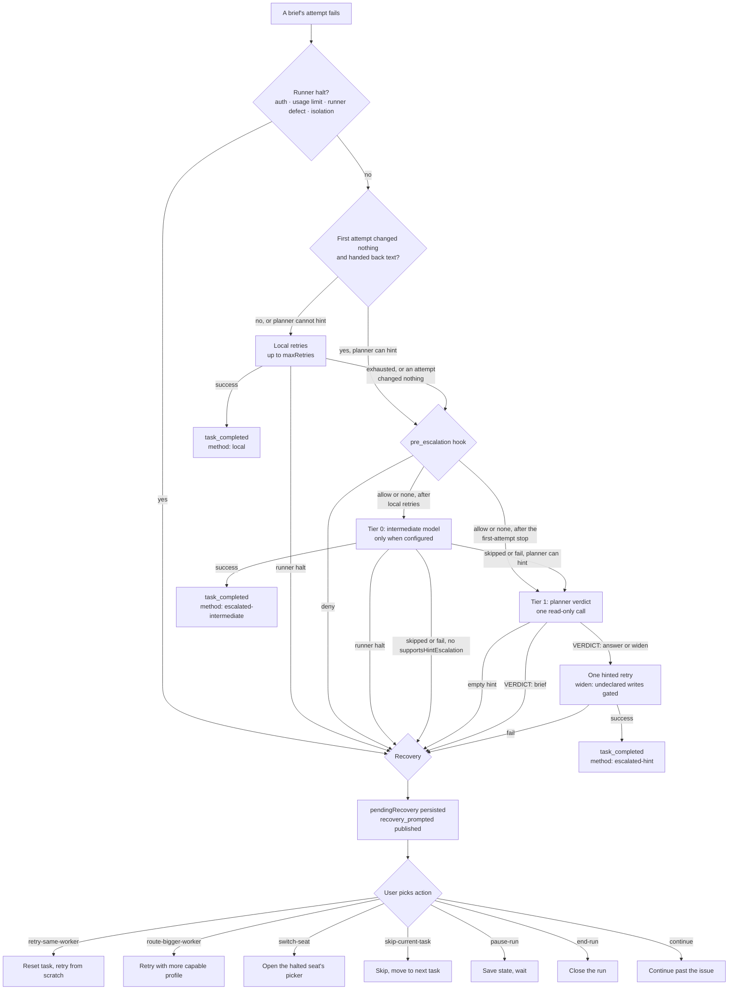

# SPLITBRIEF — Approval gates, escalation, and recovery

How SPLITBRIEF keeps the user in control during a workflow run. Four systems work together: the plan card pauses once on the plan; protected-path confirmation asks before a write to a protected path; escalation handles validation failures automatically; and recovery gives the user the final say when automation runs out of options. Drift detection runs alongside these systems as a continuous check.

For the workflow state machine, see `docs/WORKFLOW.md`. For the event model, see `docs/ARCHITECTURE.md`.

---

## The plan card

After the planning session produces a plan that passes its checks, the workflow pauses once for human review. There is one card, and it reviews the plan. The card lives in `runPlanApproval` (`src/engine/orchestrator/planning/session.ts`). The full flow is in [WORKFLOW.md §3](./WORKFLOW.md#3-the-planning-session).

A plan reaches the card only after `checkPlan` and the context fit pass ([TASK-CONTRACT.md](./TASK-CONTRACT.md)). There is no separate brief-quality or brief-readiness gate: the briefs are compiled from the checked plan.

`workflow.approve` controls the card:

| Level | What it does |
|---|---|
| `plan` (default) | The plan card opens before the build |
| `none` | No card; the build starts when the plan passes its checks |

The retired values `all`, `spec` and `default` load as `plan`, each with one config notice. There is no `--approve` flag.

The card shows `plan.md` and offers four rows: **Approve plan and start the build**, **Request changes** (the planning session takes the comment and the reviewed `plan.json`, applies its checks with one repair, and the card opens again), **Edit plan.json** (re-validated; an invalid edit is not applied and `plan.json` is restored), and **End run** (`CLOSE_RUN`: the run is closed and its files stay on disk). When the plan lists protected operations, one line above the rows names them (`Approving also confirms: write package.json`, `reviewConfirmsText`, `src/features/workflow/prompt-rows/approval.ts`), read from the `plan.json` beside the card (`planCardConfirms`, `src/features/workflow/review-editor.ts`), so they stay in view while `plan.md` scrolls. On a terminal too short for the list beside one row of `plan.md`, the line counts them instead (`Approving also confirms 2 protected operations`): the panel sheds its border, then its key legend, then the list, until the plan keeps a row (`reviewDocumentForm`, budgeted by `getReviewPanelBudget` in `src/features/workflow/layout/rect.ts`). There is no reject: an answer that is not one of those four re-opens the card.

**Approving confirms the plan's protected writes.** Each task may list `protectedOperations` (`{ path, operation: 'write' }`). Approving the card turns each listed write into the same match the write gate uses (`planConfirmations`, `src/engine/orchestrator/approval/confirm.ts`, through `protectedWriteClass`, which runs `classifyAction` over `write <path>` and keeps only a protected class; a plan that lists a path whose write asks for nothing fails the `unprotected-operation` check) and records it in the run's evidence-ledger approvals (`persistApprovalEvidence`). When the build later writes that path, the gate finds the confirmation and does not ask again. A write the plan did not list still asks. The card shows the list near its top under `## Protected operations` as `- T002: write package.json`, and a line above the rows says `Approving also confirms: write package.json`; with `approve: none` no card opens, and each listed write asks when it happens.

**Headless approval is unattended.** A headless run approves the card with `{ approved: true, unattended: true }` (`src/cli/headless.ts`). An unattended approval records no confirmation, so a protected write in a headless build is denied with `APPROVAL_REQUIRED`.

**The approval is recorded.** An approved card publishes `plan_approved` in `reviewing-plan`, before the run moves on; End run publishes `plan_rejected`; a correction or a valid edit publishes `plan_regenerated`. The approval is a row of `session.jsonl`, so a run at rest replays it. The transcript draws no row for it: the header rail already marks the Plan stage as passed. An answer that arrives after the run was stopped publishes no approval.

**Resume.** A run parked at the card with a saved plan (`reviewing-plan` and `state.plan`) re-opens the card through `resumeParkedApproval` (`src/engine/orchestrator/run/resume-parked-approval.ts`) without re-spending the planner call. A correction typed while the card is parked is applied by the planning session before the card opens, and appears once in the transcript and session log; a bare `⏎` re-opens the card with no planner call. An older run parked at a spec gate, a briefs gate, or a plan gate without `plan.json` has no card to re-open: it continues as one planning session, which reads the run's earlier documents and the correction typed at the gate, and then opens the plan card. At rest such a run reads `Waiting at the plan · ⏎ to continue`.

**Interrupt, correct, continue.** A stop is not an end: the step it cut is recorded on the state and the run parks, holding for the operator. Every park publishes `turn_interrupted` with the step it parked. A stop at the card cuts nothing (`at: boundary`), and its transcript row names the card rather than offering a retry. Continuing composes what they typed *with* the step's real prompt rather than in place of it — the planning session takes it as a note, the reviewer re-issues its whole deterministic prompt with the note, and a brief restarts on its own prompt.

---

## Protected-path confirmation

**Two prompts, in sequence, never one.** Approving the plan and confirming a protected write are different questions. The card names the step it releases (`Approve plan and start the build`, `reviewDocumentOptions`, `src/features/workflow/prompt-rows/approval.ts`). The confirmation that may follow during the build names the operation and the path — the title is a sentence (`Change a package manifest:`, `Change a CI or secret file:`, `Destructive action:`), not a class name.

The write gate runs over the files the implementer changed. The classifier (`src/engine/orchestrator/approval/action-classifier.ts`) inspects each written path and the task's scope and assigns an action class. It classifies declared file writes only — it does not parse or gate shell commands.

**Action classes the classifier produces:**

| Class | What triggers it | Asks? |
|---|---|---|
| `read` | Action descriptions beginning with `read`/`cat`/`ls`/`find`/`grep`, or anything with no write verb | no |
| `write_in_scope` | Writing to a file named in the task brief or matching `scope.inBounds` / `approval.allowedPaths` | no |
| `write_out_of_scope` | Writing to a file not covered by the task's scope: a brief's files are suggestions, so the write is recorded as touched, not suggested | no |
| `destructive` | Writing to a control-plane path (`.git`, `.splitbrief`) | yes |
| `sensitive_change` | Writing to CI configuration (`.github/`, `.gitlab-ci.yml`, `.circleci/`, `azure-pipelines.yml`, `Jenkinsfile`, `.buildkite/`) or a secret-bearing file (`.env`, `.env.*`, `*.pem`, `*.key`, `id_rsa*`, `.npmrc`, `.pypirc`) | yes |
| `package_change` | Writing to a package manifest or lockfile (`package.json`, `pnpm-lock.yaml`, …) | yes |

The protected patterns are matched against the written path, never against the task's file list, so a brief that declares `.env.example` does not make its ordinary writes ask. A write to a control-plane path is `destructive`; a write to CI configuration or a secret-bearing file is `sensitive_change`; a write to a package manifest is `package_change`; a write to a file in the task's `scope.inBounds`, `scope.approvedOutOfBounds`, or `approval.allowedPaths` is `write_in_scope`; any other write is `write_out_of_scope`. Anything that is not a write defaults to `read`.

**Protected or not; nothing else.** The rule is fixed (`DEFAULT_TIER_MAP`): a write to a protected path — `destructive`, `sensitive_change` or `package_change` (`PROTECTED_ACTION_CLASSES`, `src/core/schemas/enums.ts`) — asks, and no other write does (`gateAction`, `src/engine/orchestrator/approval/tiered-approval.ts`). `--yolo` and `approval.enabled: false` do not change that: a protected write still asks. There are no sticky grants, no `.splitbrief/approvals.json`, no `/approval` command, no `splitbrief approval list|clear`, and no tier overrides: `approval.tiers` is a retired key that loads with one notice and is ignored.

**The confirmation.** The response must carry the literal phrase `I confirm` and a non-empty reason; `gateConfirmTier()` (`src/engine/orchestrator/approval/confirm.ts`) rejects anything else as `invalid_confirm_phrase`. That contract is what a custom `onTieredApproval` callback satisfies itself. The TUI satisfies it on the user's behalf: the prompt paints its option rows under the shared selection grammar — `↑↓` wraps through them, `⏎` takes the highlighted row, and the letters stay live as accelerators — and it opens on `Confirm`. A `destructive` action — a control-plane write — carries no key on its Confirm row and answers a stray `y` with `⏎ confirms this write · esc deny` instead of approving; every other protected class confirms on `y` or `⏎`. `r` opens an optional reason field; confirming without one records `confirmed at the prompt (no reason given)` so the evidence trail never reads as though a human justified the write. Keystrokes buffered before the prompt appeared are discarded for `PROMPT_TYPEAHEAD_GRACE_MS` (`src/lib/terminal/typeahead-grace.ts`). Approval events (`approval_prompted`, `approval_granted`, `approval_rejected`) are published from `events.ts`; shared gate input/output types live in `types.ts`.

**One confirmation per path per run.** A confirmation the run granted — at the prompt, or by approving a plan that listed the write — holds for the same path and operation for the rest of the run: the gate reads the run's own `evidence.json` approvals before it prompts again (`confirmedEarlierInRun`, `confirm.ts`). A direct writer's undeclared write under `.git` or `.splitbrief` never reaches the write gate: the changed set leaves those paths out, so the write is never promoted to the project and nothing asks; a change to the git state the checkout shares halts the brief as `checkout-changed` instead. The gate asks about every changed file on its own (`gateChangedFiles`, `gate-files.ts`): a denial discards only the denied file, the attempt's other writes go ahead to validation, and the error row names what was discarded: `Approval gate denied <files>: <reason>. SPLITBRIEF discarded this attempt's writes to <files>.` When every changed file is denied, or a denied file changed during the prompt, the attempt stops and none of its writes go ahead (`gateAndPromoteChangedFiles`, `gate-and-promote.ts`); the brief then halts with the `approval-denied` recovery, or with the user-edit conflict the changed file raised. Without an `onTieredApproval` callback, as in a headless run, a protected write is denied with `APPROVAL_REQUIRED`.

---

## Escalation

File approval classifies the exact normalized `targetPath`; a declared `src/app.ts` does not authorize `src/app.ts.backup`. Promotion compares each target against the acquisition-time byte/hash and permission baseline, including edits made while the worker runs. A file edit that lands during an implementer call does not halt the brief: the isolation audit under Recovery publishes the `checkout_changed_during_call` warning, and the call stands. Only a change to the git state of your checkout halts the brief as `checkout-changed`. Binary bytes and ordinary execute bits survive promotion. Conflicts preserve the user’s current file. A partial failure records the applied paths and failed file in `promotionAttempts`, retains the workspace, and prevents the brief from passing. It does not roll back the applied prefix.

Worktree reuse compares both copies with the inputs saved in the project session's `isolation-baseline.json` (`isolation/acquisition.ts`). An operator edit updates an unchanged worker copy before the next call. Worker-only partial output stays available after a process restart. If both copies changed, acquisition preserves both and promotion remains guarded by the previous target fingerprint, including on a fresh attempt. The version 1 record identifies the worktree and whether its inputs are known. Known inputs carry separate target and worktree maps of SHA-256 digests and permission bits, because the worktree adds its own `.gitignore` entries. It is written atomically before dispatch; an invalid record or failed write refuses acquisition. A legacy workspace without this record gets an unknown-input record naming its directory. It cannot prove which side changed, so differing files stay intact and promotion requires the copies to agree. A promotion halt records the actual acquisition directory in `facts.workspacePath`. Continue rechecks that directory against its saved inputs, clears a resolved overlap, and leaves unresolved or partial-promotion halts parked. After manually merging both copies, continue the same run; the next acquisition accepts their matching bytes as its inputs.

When the implementer writes code and validation fails, the escalation system tries progressively more capable approaches before involving the user. The orchestrator calls these tiers in sequence. If any tier succeeds, the task is done.

**Pre-existing failures do not enter the ladder.** Acceptance is judged against the run's validation baseline: a stage that was already red before the first task ran, and whose failure evidence names none of the task's changed files, is exempt. An exempt stage never produces a retry prompt, so retry and escalation no longer fire for pre-existing failures — a task that introduces no new failure is accepted even when the tree was already red. The review packet keeps the raw `passed`/`total` validation figures for the task and names the exempt stages alongside them, so a shipped-over-red-stage task reads as what it is instead of a partial failure.

**Local retries** (`src/engine/orchestrator/escalation/local-retries.ts`). Before any tier, the implementer retries with the error message appended to its context. No additional API calls beyond the implementer itself. Runs up to `workflow.maxRetries` times (default 2). Each attempt publishes a `retry` event. Local retries are not a numbered tier. The rung also ends early on the first `no-staged-change` outcome after feedback: an implementer that read the error and still staged nothing will stage nothing again, so the remaining attempts are not spent on the same silence.

**An aborted attempt is not an attempt.** `task_retry` is published when the attempt starts, not when it ends: the row carries the error this attempt is retrying against and precedes the attempt's own events, so it can never land after the `task_completed` it announced. An implementer call that reports an abort — the workflow signal is aborted, or the outcome carries the runner layer's abort text (`Aborted`) — ends the retry loop immediately: no further retry rows are published to `session.jsonl`, and the run stops at that boundary instead of escalating. The aborted attempt keeps the row that announced it, because the attempt was announced and made, while the persisted attempt counter rolls back to the value it had before it. A cancelled run therefore never burns retries or escalation tiers on calls the user already cancelled.

**Tier 0: intermediate model** (`INTERMEDIATE_TIER` in `src/engine/orchestrator/escalation/tier.ts`; implementation in `intermediate.ts`). A mid-tier API model (`escalation.intermediateProvider` / `intermediateModel`) retries the task. This tier runs only when an intermediate provider is configured and `escalation.enabled` is not `false`; otherwise it is skipped. Publishes `escalate` with tier 0.

Tier 0 is configured in YAML only. The TUI does not expose an escalation row or picker; leave the provider or model unset to skip the tier.

**Tier 1: hint escalation** (`HINT_TIER` in `src/engine/orchestrator/escalation/tier.ts`; implementation in `hint.ts`). The rung runs only when the planner's capabilities carry `supportsHintEscalation`; for a planner without it the rung is absent rather than empty — no `task_escalating`, no planner call, no `escalate` — and the ladder ends on the rung below. When it runs, the planner analyzes the error and produces a short hint. `escalate` (tier 1) is published after the planner has answered and only when the answer carries text: an empty or failed hint ends the rung there, with no implementer call and no attempt charged. A hint that carries text is appended to the error context (truncated to 4000 chars), and the implementer retries once more with the enriched error.

**The hint rung asks for a verdict, not just a hint.** The hint prompt (`src/engine/spec/prompts/escalation.ts`) carries the implementer's hand-back and the brief's Scope and Escalation bullets, and asks the planner to open its reply with exactly one line. `VERDICT: answer` means the implementer retries once with the planner's text in its error block. `VERDICT: widen <path>[, <path>…] — <reason>` means that retry may also write the named files. `VERDICT: brief — <diagnosis>` means the brief itself is wrong: no retry is made, and the run halts with the implementer's words and the planner's diagnosis on the panel. A reply with no verdict line reads as `answer` (`parseHintVerdict`). The line may sit behind a `#` heading mark or a `-` bullet. A widening's paths are its path-like words (a `/` or a file extension, or a single name such as `Makefile`); the other words are its reason when no dash or colon gave one, so `VERDICT: widen a.ts (b consumes it)` widens `a.ts` for the reason `b consumes it`. A first attempt that stopped with a hand-back and staged nothing skips the local rung and tier 0 and comes straight here, because what it needs is the planner's answer, not another identical retry.

**A widening is a request, not a grant.** The widened retry's write to a named path is classified like any other write: an ordinary path is `write_out_of_scope` and allowed, and a protected path (`package_change`, `sensitive_change` or `destructive`) still asks. Only a write the gate allowed is recorded: `WIDEN_TASK_SCOPE` appends the path to the brief's **Approved out of bounds** as `` `<path>` — planner-approved: <reason> `` and publishes `task_scope_widened`, so the declared set, the CLI effect gate, the classifier, the preamble and drift all read the same scope from then on. When the gate denies every write of the widened retry, the ladder ends in a `retry-exhausted` halt whose last error is the gate's reason. When it denies only some of them, the denial is recorded, the denied files are discarded and the rest of the retry goes ahead to validation. `widen` applies to direct-writing implementers only: a file-bundle (API) implementer may return only its declared files, so a widened path is rejected before it reaches the gate.

The planner may provide hints; it never automatically takes over code-writing implementation.

After the supported worker/help path is exhausted, the run enters recovery. Historical tier 2 and `escalated-full` records remain readable but are never newly dispatched.

**Review-packet warnings list.** The final review packet (`review-packet.json`) collects every operational `warning` event into its escalation warnings list (`escalations.warnings`, built by `src/engine/orchestrator/evidence/review-packet/sections.ts`). Warnings published with `safety: { category, code }` keep their message. The most common one is an implementer that ran and wrote nothing: the pipeline publishes exactly one warning with `category: 'implementer'` and `code: 'implementer_wrote_nothing'`, naming the runner and the task. The task itself still fails with the `no-staged-change` outcome — retry, escalation, and recovery behaviour are unchanged, except for the fix attempt of a brief the final review reopened, which may verify and change nothing (see [WORKFLOW.md](./WORKFLOW.md), Review fix cycles); the warning only makes the outcome legible in the transcript, `session.jsonl`, and the review packet. A second coded warning uses `category: 'usage'` and `code: 'implementer_usage_not_reported'`: it fires when a task completed but the runner's protocol carried no usage, so a run whose runner reported nothing is distinguishable from a run that did no work. It is published once per affected task, names the runner and the task, and does not change the task's outcome or the recorded zero token counts.

**Scope is guidance.** A `direct` implementer may edit an ordinary project file that the brief does not suggest when the change needs it (a caller, a test, a shared component), and names it in its report. The CLI implementer gates such writes instead of rejecting them (`undeclaredWrites` defaults to `'gate'`, `src/engine/implementers/cli.ts`), the classifier allows them (`write_out_of_scope` is `auto`), and the validation stage runs the tests of every changed file, not only the declared ones (`resolveTestTarget`, `src/engine/orchestrator/validation/commands.ts`). The file is recorded three times: one dim transcript row, `T003 also changed src/x.ts` (`task_touched_not_suggested`, published by `validateCommitAndAdvance` for the files outside the brief's declared set and the files of every brief already done); an `info` drift finding; and the `Files touched, not suggested by any brief` line of the review's Changed Files section. There is no revert retry. The `scope-violation` recovery is raised only when an `approval.tiers.write_out_of_scope` override makes such a write ask and the operator denies it (`src/engine/orchestrator/escalation/step.ts`).

Every retry step (`src/engine/orchestrator/escalation/step.ts`) follows the same sequence: refresh the task's code from disk, run the retry in a staged project (a temporary copy), gate the changed files through the protected-path confirmation, promote the staged changes back, then validate and record the outcome. When the gate denies every changed file, the staged project is cleaned up and the retry counts as failed. A partial denial discards only the denied files, and the rest of the retry goes ahead to validation.

---

## Recovery

Replacing a BUILD worker after a usage limit updates the failing named profile, including a non-default profile. Other profiles keep their configuration; the retry uses the chosen replacement. Taking `switch-seat` on the panel does not swap the tool alone: it opens that seat's own picker on the chosen tool, so the swap carries the model and effort picked there (`configWithSwitchedSeat` spreads `model`, `effort` and `variant` into the seat's runner block), and the picker writes the choice to `.splitbrief/config.yaml` so the next run starts on it too. Cancelling the picker leaves the halt pending and changes nothing.

Recovery takes over when escalation is exhausted or when a workflow-level failure occurs that automation cannot resolve. The system lives in `src/engine/orchestrator/recovery/`.

When a recovery-worthy event happens, the orchestrator builds a `RecoveryIssue` (schemas: `src/core/schemas/recovery/`) describing the failure, the available actions, and a recommended action. The issue is set as `pendingRecovery` in `state.json` via `SET_PENDING_RECOVERY`, and `recovery_prompted` publishes on the EventBus. There is no `onRecoveryNeeded` callback: the TUI reacts to the persisted `pendingRecovery` (driving `applyRecoveryAction` in `src/engine/orchestrator/recovery/actions.ts`), while a headless run emits a `recovery_required` JSON line and exits non-zero (`src/cli/headless.ts`).

**An unresolved recovery is never silent.** Re-entering the task loop over a state that still carries `pendingRecovery` publishes a transcript-safe `warning` with `code: 'recovery_pending_unresolved'` naming the reason, the recovery status, and the available actions before stopping (`src/engine/orchestrator/task/loop.ts`). The issue is not cleared and not re-entered — only a real recovery action resolves it. Headless `--json` runs fail with exit code 1 for every recovery status: `awaiting-user`, `paused`, and `applying` alike. A machine consumer can tell the three apart because the `recovery_required` record carries the `status` field.

**Headless runs answer a halt with `continue --action`.** A `--plain` / `--json` run that meets a pending recovery prints the issue, its recommended action and the exact line that carries the run on — `Continue with: splitbrief continue <session> --action retry` (`formatResumeCommand`, `src/core/recovery/resume-command.ts`) — and exits 1; the `recovery_required` JSON record carries the same `resumeCommand`. `splitbrief continue <session> --action <skip|retry|switch-seat:<tool>[:<model>]|end-run>` applies that `RecoveryAction` to the pending recovery and continues the run headlessly, or closes it for `end-run`. An action the issue does not allow is a blocked result and exits 1; an unparseable `--action` value exits 2. Only those four actions name themselves on the command line. Every other recommendation is a row of the recovery panel, which `splitbrief continue <session>` opens, so the printed line names the row in the panel's own words (`recoveryActionLabel`, `src/core/recovery/action-label.ts`) — `Continue with: splitbrief continue <session>, then choose Pause run in the recovery panel` — and carries no `[--plain|--json]`, because the panel needs the TUI. There is no automatic headless recovery policy: nothing is skipped or retried unless the operator asks for it by name.

**The unavailable-implementer issue carries the runner's own reason.** When the availability gate fails, the `implementation-error` issue's details carry the runner's own explanation — the optional `Implementer.unavailabilityReason()` member, e.g. "the endpoint is unreachable" — falling back to generic installation / credentials / reachability guidance only when the runner cannot state one.

**A signed-out runner halts the run instead of escalating.** Subscription CLIs report a dead login as an ordinary turn failure (codex: `codex-turn-failed` with "Your access token could not be refreshed…"; Claude Code: an `is_error` result like "Invalid API key · Please run /login"). The implementer pipeline classifies those diagnostics as the `unauthenticated` outcome (`src/engine/runners/auth-failure.ts`, applied in `src/engine/implementers/pipeline/call-result.ts`), and the orchestrator halts — on the first attempt (`src/engine/orchestrator/task/step.ts`) or between ladder steps (`src/engine/orchestrator/escalation/handle.ts`) — with a `runner-unauthenticated` recovery whose message names the exact re-login command (`codex logout` + `codex login`, or `claude /login`) and whose details keep the tool's own words verbatim. Without the halt, every task would silently escalate to the planner. SPLITBRIEF does not launch the login itself: both flows are interactive browser OAuth, which cannot run in headless sessions or over SSH — log in from a separate terminal, then choose `retry-same-worker`; the retry rebuilds the runner sandbox and picks up the fresh credential. A planner-side auth failure halts the run at the planning call with the same reason on the `plan` seat: `handlePlanningFailure` (`src/engine/orchestrator/planning/failure.ts`) appends the planner tool's own diagnosis and the same login command, then raises a `runner-unauthenticated` recovery offering `retry-same-worker`, `switch-seat` (when another ready tool was detected), `pause-run` and `end-run`.

**A usage-limited runner halts the run the same way — and never gets login advice.** Subscription CLIs report an exhausted quota as an ordinary turn failure too (codex: "You've hit your usage limit. … or try again at Aug 8th, 2026 3:27 PM."; Claude Code: an `is_error` result like "You've hit your session limit · resets 3:45pm" or "Credit balance is too low"), and API providers return HTTP 429 bodies. The pipeline classifies those diagnostics as the `usage-limit` outcome (`src/engine/runners/usage-limit.ts`, applied in `src/engine/implementers/pipeline/call-result.ts` for CLI results and in `src/engine/implementers/pipeline/run.ts` for thrown provider errors), and the orchestrator halts at the same points as the signed-out case with a `runner-usage-limit` recovery. The halt records the reset moment as `resetAt` whenever the tool's diagnostic carried one — codex "try again at Aug 8th, 2026 3:27 PM." or the bare-clock variant "try again at 3:27 PM.", Claude Code "resets 3:45pm" / "resets Mon 12:00am", Groq "try again in 7.66s", or an HTTP `Retry-After` header (threaded into the diagnostic as `(retry-after: Ns)` by `src/engine/streaming/stream-errors.ts`). Every surface spells `resetAt` when it is read, with one formatter (`formatResetNote`, `src/core/recovery/reset-clock.ts`): the panel, the workflow header, the transcript's error row (`error  resets 15:27`) and the headless `Recovery required` line. The clock is a 24-hour clock such as `15:27`, dated as `Aug 8, 15:27` when the reset is not today, so a run reopened on a later day dates it on every surface alike. The message is stored and the transcript replays it, so it names no clock: `OpenAI Codex CLI hit its usage limit. Wait for the limit to reset or change the BUILD tool, then continue.` The details keep the tool's words verbatim. Logging out and back in cannot restore quota, so the recovery never suggests it: the real options are moving the seat to another detected tool (`switch-seat`, the recommended action whenever one is offered), waiting for the reset (`pause-run`, then `retry-same-worker`), switching to a different implementer profile (`route-bigger-worker`, offered when config has one), skipping the task, or ending the run. A planner-side limit halts the run at the planning call with the same reset-aware guidance instead of a login command, as a `runner-usage-limit` recovery on the `plan` seat.

**Every planner-tier call halts on its own seat.** The planning calls, a brief's hint call and the final review read the tool's words the same way (`diagnosePlannerCallFailure`, `src/engine/orchestrator/recovery/planner-call-failure.ts`): a limit halts as `runner-usage-limit`, a sign-out as `runner-unauthenticated`, and anything else keeps its own recovery. A final review that hits a limit halts on the `review` seat instead of as `review-failed`; retry and `switch-seat` run the review again. A hint call that hits one halts on the `plan` seat and names the brief, so retry and `switch-seat` replay that brief, and `skip-current-task` is offered. With no `reviewer:` block the review runs on the plan seat's tool, so the review halt's swap names the `plan` seat: the panel reads **Change PLAN tool · runs the review again**, the picker and the swap write `planner:`, and the review keeps following it. With a `reviewer:` block the swap moves that block. The error row names the reset once: the `error` event carries the halt's `resetAt`, the row spells it beside its label, and the tool's own clause (`or try again at …`, `· resets …`, `Resets in …`) is dropped from the quote (`stripRecoveryResetClause`, `src/core/recovery/reset-clock.ts`), on a BUILD halt's row too (`runnerHaltRow`). The details keep the words verbatim. A planner-tier row leads with its label and the tool's own words — `Final review failed: You've hit your usage limit. …` — not the call's own `Planner review call failed`.

**The captured limit wording classifies.** Beyond codex and Claude Code, the captured phrasings are: antigravity, which prints `error: Individual quota reached. Please upgrade your subscription to increase your limits. Resets in 2h6m30s.` on stderr — once beside exit 0 with `(response may be truncated)` appended, then again beside exit 3 — whose compact `Resets in 2h6m30s` is parsed as the reset moment, and whose line classifies whether or not the stream ends on a `result` frame (a planner-tier call that exits 0 with no text beside that line fails as a usage limit, `requireCompletedCall`, `src/engine/planners/require-completed-call.ts`, the way a BUILD call that changed nothing does); opencode 2.x, which emits a flat `provider.quota` error envelope (`{"type":"error","error":{"type":"provider.quota","message":"Go usage limit exceeded","status":429}}`); command-code, which says `You've reached your weekly usage limit`; and the Gemini API body behind antigravity, whose `RESOURCE_EXHAUSTED` status classifies on its own. Copilot, cursor and kilo-code are the gaps: their limit wording has not been captured from a live run, so they classify only through the shared 429, quota and rate-limit phrases, unverified. A tool that prints its limit and exits before it reads a stdin prompt breaks the pipe under that prompt; the limit line on stderr outranks the broken pipe, so the call still halts as `runner-usage-limit` and not as `planner-call-failed` (`src/engine/runners/cli-tools/process-invoke.ts`).

**An implementer that leaves its isolation directory halts the brief.** A direct writer works in the run's isolation directory, and nothing but promotion may carry its work into your checkout. Two detectors watch each implementer call (`src/engine/implementers/isolation/`). The tripwire halts the brief as `implementer-left-isolation`. The audit halts the brief as `checkout-changed` when the git state of your checkout changed, and only warns when files changed:

- **The tripwire** reads every tool call a `cli` implementer's stream reports. Most tools report a call when it starts and when it finishes. OpenCode and Kilo report a call once, when it finishes. The tripwire reads each call once. Claude Code's start record carries no input, so the tripwire reads a Claude Code call from its finished record. Command Code's stream names no tool inputs, so only the audit covers it. It takes the paths the call names — file-tool paths and the absolute, `~` and `$HOME` paths in a shell command line, with the command read for what it does: `find` and `grep -r` search, `cat` reads, `>`, `cp` and `rm` write, and a package-manager install, ci, add, remove or update (npm, pnpm, yarn, bun — never `npx`, `npm test`, `npm run` or `npm exec`) writes to `./node_modules` — and checks each against a boundary derived from the isolation directory (`createIsolationBoundary`). An operand of a command the tripwire does not know counts only when that path exists, so a test name like `/api/users` or a container path like `/app` is not taken for a place on disk. A relative path resolves from the isolation directory, or from the directory the call names when it names one; agy's `run_command` names none. For Claude Code only, a `cd` carries over to the next tool call, because its shell keeps its directory between calls. This includes a `cd` to a temp directory outside the isolation directory, so a relative path in the next call resolves from there. The isolation directory, the temp directories, `/dev/null` and the tool's own state directory (`~/.gemini` for agy, `~/.claude` for Claude Code) are open. The tripwire reads a path in the tool's state directory as the tool spells it, before links resolve, so a read through agy's `~/.gemini/skills` link into `~/.agents/skills` stays open. System and toolchain roots (`/usr`, `/opt`, `/etc`, `~/.nvm`, `~/.cargo`, the `PATH` entries) are open to reads and searches. The run's attached global skills — each skill's directory, or a loose skill's own file — are open to reads and searches only, because the implementer prompt names their files; a write there halts the brief like any other. The checkout's `node_modules`, which the isolation directory links to, is open to reads only, so a package-manager install in the isolation directory is a write into your checkout, and its evidence says so: `… ran a package-manager command with Bash: npm install zod — a package-manager install, ci, add, remove or update writes to the project's shared node_modules; change the dependencies in the project yourself, then retry`. This is the same rule the implementer prompt states. Caches never halt. A tool writes them while it runs (`node_modules/.vite`, `node_modules/.cache`, a `.tsbuildinfo`), and the tripwire reads only what the tool call names. A tool call that writes a dot entry of `node_modules` (`rm -rf node_modules/.vite`) stays open too, and the audit ignores `node_modules` dot entries and gitignored paths. `node_modules/.bin`, pnpm's package store `node_modules/.pnpm` and the package managers' lockfile markers (`.package-lock.json`, `.modules.yaml`, `.yarn-state.yml`, `.yarn-integrity`) are not caches, so a tool call that writes them halts. The checkout itself and every other path — another project, your home directory — are closed. The first tool call that crosses stops the call through the same abort that ends a cancelled one, which reaps the tool's whole process group.
- **The audit** snapshots your checkout before each direct implementer call (`cli` and `agent`) and compares it after. It reads two kinds of change. The files are the files git reports as changed or untracked, with their content hashes. The git state is the refs, except remote-tracking refs, `git maintenance` prefetch refs and SPLITBRIEF's own `splitbrief/` branches; `HEAD`; the stash; the hooks; the git config; and the installed dependency set. The window is one call, so your edits between calls never count. The audit sees what changed, not who changed it. An editor save changes files, so a changed file does not halt the brief. The pipeline publishes the `checkout_changed_during_call` warning, and the call stands: `Task T004: your checkout changed while agent ran — src/app.ts; nothing there was reverted`. The warning is in the transcript, in `session.jsonl` and in the review packet's warnings list. A change to the git state halts the brief as `checkout-changed`. A commit, a branch switch or a stash of yours, a hook that is still running, or an agent that adds a worktree to the same repository halts the brief the same way. The evidence names each change, so you can tell who made it. A stopped call is not halted; the `implementer_left_isolation` warning reports the git state that changed during it. A checkout git cannot read publishes the `isolation_audit_failed` warning and lets the call stand.

The halt names the brief and carries the evidence. The tripwire's halt reads `T004 left the isolation directory — Google Antigravity CLI searched ~ with run_command: find ~ -name "process-invoke.ts" 2>/dev/null`. The audit's halt reads `Your checkout changed under T004 — branch main · hook pre-commit`: it names your checkout and not the implementer, because the audit cannot tell who made the change. When the tripwire stopped a call that also changed the git state, the halt stays `implementer-left-isolation` and its evidence ends with `; ran while your checkout changed: branch main`. The panel header shows the short form, and the evidence is the fact row under the task and its files; the transcript's error row, `session.jsonl` and the headless `Recovery required (<reason>): …` line carry the full sentence, and a headless run exits 1 like every other halt. The halt raises before the retry ladder: on the first attempt, and on every implementer retry the ladder makes (the planner's hint call on the hint rung is not watched). Nothing the attempt wrote in the isolation directory is promoted. Both halts offer `retry-same-worker` (recommended: the implementer prompt names the isolation directory and tells the implementer to stay in it), `switch-seat` when another ready tool was detected, `skip-current-task`, `pause-run` and `end-run`; headless, `splitbrief continue <session> --action retry` takes the retry. A change the audit found stays in your checkout — SPLITBRIEF reverts nothing there — so check the named changes before you retry.

**Unreadable changed files are recorded, not thrown.** The task loop's changed-files baseline records a symlink that stays inside the project by its target (`symlink:<target>`), and every other entry it cannot safely read — any other symlink, a directory, an unreadable file — as the `'unreadable'` sentinel instead of failing the run (`UNREADABLE_FINGERPRINT`, `src/engine/orchestrator/changed-files-baseline.ts`; the old `changed-file-fingerprint-read` error kind is gone). Unreadable entries are excluded from user-edit detection, never treated as missing, and never opened; their project-relative paths are named once in a run-start warning, never as an absolute host path. Comparison stays correct in both directions: an entry unreadable at both ends is unchanged, and a file replaced by a symlink mid-run is reported as changed.

**Recovery reasons and their available actions:**

| Reason | When | Available actions | Recommended |
|---|---|---|---|
| `implementation-error` | Implementer crashed, or its endpoint is unreachable at the availability gate | `retry-same-worker`*, `route-bigger-worker`*, `skip-current-task`, `pause-run`, `end-run` | `retry-same-worker` |
| `validation-failed` | Tests fail mid-escalation | `retry-same-worker`*, `route-bigger-worker`*, `skip-current-task`, `pause-run`, `end-run` | `retry-same-worker` |
| `retry-exhausted` | All escalation tiers failed, the planner found the brief wrong, or the `pre_escalation` hook blocked escalation | `route-bigger-worker`*, `retry-same-worker`*, `skip-current-task`, `pause-run`, `end-run` | `route-bigger-worker`; `pause-run` when the planner found the brief wrong, because no retry can land that brief |
| `runner-unauthenticated` | A runner's stored login stopped working mid-run (e.g. codex refresh token burned, Claude Code signed out) | `retry-same-worker`, `skip-current-task`, `pause-run`, `end-run` | `retry-same-worker` |
| `runner-usage-limit` | A runner ran out of quota mid-run (the captured wording of codex, Claude Code, antigravity, opencode 2.x and command-code; provider 429; credit exhaustion); message names the reset time when known | `retry-same-worker`, `route-bigger-worker`*, `switch-seat`*, `skip-current-task`, `pause-run`, `end-run` | `switch-seat`, else `route-bigger-worker`, else `pause-run` |
| `context-overflow` | Task too large for any profile | `route-bigger-worker`*, `pause-run`, `end-run` | `route-bigger-worker` |
| `user-edit-conflict` | External file edits conflict | `continue`*, `skip-current-task`, `pause-run`, `end-run` | depends on `safeToContinue` |
| `approval-promotion-conflict` | Approved changes can't promote | `skip-current-task`, `pause-run`, `end-run` | `pause-run` |
| `dependency-blocked` | Upstream task failed/skipped | `skip-current-task`, `pause-run`, `end-run` | `pause-run` |
| `scope-violation` | No producer now; kept so an older `state.json` still loads. It was a denied write outside the brief's declared set under a tier override | `retry-same-worker`, `skip-current-task`, `pause-run`, `end-run` | `retry-same-worker` |
| `implementer-recipe-invalid` | The tool refused the command line SPLITBRIEF built for it — an unknown flag, an argv shape the installed version rejects, or a model the tool does not list | `retry-same-worker`, `switch-seat`*, `pause-run`, `end-run` | `pause-run` |
| `implementer-left-isolation` | A tool call named a path outside the isolation directory | `retry-same-worker`, `switch-seat`*, `skip-current-task`, `pause-run`, `end-run` | `retry-same-worker` |
| `checkout-changed` | The git state of your checkout — refs, `HEAD`, stash, hooks, git config or installed dependencies — changed while the implementer call ran | `retry-same-worker`, `switch-seat`*, `skip-current-task`, `pause-run`, `end-run` | `retry-same-worker` |
| `runner-timeout-repeated` | Two timeouts in a row on one brief: the slice does not fit the deadline, so escalating it would only repeat the same overrun on the planner | `retry-same-worker`, `route-bigger-worker`*, `switch-seat`*, `skip-current-task`, `pause-run`, `end-run` | `pause-run` |
| `approval-denied` | The operator denied the brief's writes at the approval gate | `retry-same-worker`, `skip-current-task`, `pause-run`, `end-run` | `pause-run` |
| `snapshot-failed` | The task-start snapshot could not be captured, so scope and revert cannot be enforced for this brief | `retry-same-worker`, `pause-run`, `end-run` | `retry-same-worker` |
| `review-failed` | The final review still reported blocking findings after the last fix cycle | `revise`, `pause-run`, `end-run` | `pause-run` |
| `planner-call-failed` | The planner call failed for a reason that is neither a sign-out nor a quota limit | `retry-same-worker`, `switch-seat`*, `pause-run`, `end-run` | `retry-same-worker` |
| `planner-returned-no-briefs` | No producer now (older runs only). The retired `tasks` call parsed no Task Brief | `retry-same-worker`, `revise`, `end-run` | `retry-same-worker` |
| `constitution-check-failed` | No producer now (older runs only). The spec broke a hard constitution principle | `revise-spec`, `end-run` | `revise-spec` |
| `brief-review-no-progress` | No producer now (older runs only). The briefs gate went round the same failure 20 times | `revise`, `end-run` | `revise` |
| `brief-quality-unrepaired` | No producer now (older runs only). The repair pass could not fix the briefs | `retry-same-worker`, `revise`, `end-run` | `revise` |
| `seat-protocol-error` | A seat's typed answer failed validation after its repair | `retry-same-worker`, `switch-seat`*, `pause-run`, `end-run` | `retry-same-worker` |
| `plan-questions-exhausted` | The planner asked a third round of questions; a session takes 2 | `retry-same-worker`, `revise`, `end-run` | `revise` |
| `plan-checks-failed` | The plan failed its checks again after one repair; the panel lists each failed check | `retry-same-worker`, `revise`, `end-run` | `revise` |

\* Conditional. `retry-same-worker` requires retry budget remaining. `route-bigger-worker` requires a bigger profile in config. `switch-seat` is legal for the halts the seat itself caused or can have caused — `runner-usage-limit`, `runner-unauthenticated`, `implementer-recipe-invalid`, `implementer-left-isolation`, `checkout-changed`, `runner-timeout-repeated`, `planner-call-failed` and `seat-protocol-error` — and is offered only when the last readiness pass saw another ready tool the seat's own role admits. `continue` on `user-edit-conflict` requires `safeToContinue`.

**Validation-failure handling (`src/engine/orchestrator/task/step.ts`).** When validation fails, the orchestrator first short-circuits on an aborted run (returning without raising recovery), then diffs the current changed files against the task-attributed set. If a foreign edit — one outside the task's promoted files that matches the current task or one of its dependencies — is present in the failing universe, it raises a `user-edit-conflict` recovery (`detectValidationFailureUserEdit`) instead of charging the implementer with the retry ladder. Only after both checks does it enter the retry ladder.

**The pre-task user-edit gate raises a conflict only from a scan that produced a file list.** `checkUserEditConflicts()` (`src/engine/orchestrator/user-edit/detection.ts`) fingerprints the changed files before each task. When the scan itself cannot run, SPLITBRIEF publishes a warning and lets the task proceed — a failed scan degrades to a warning, never to a fabricated conflict with an empty file list, and the run does not stop over an inspection failure. The task's own file stays protected regardless: the extracted-code baseline race check and hash-guarded promotion both remain in force.

When the inline question offers **End run**, choosing it closes the run immediately through the shared closure path. The edit decision is recorded, no second recovery menu opens, and the workflow publishes one cancellation event if this answer won the close. **Continue** absorbs safe edits; **Pause** leaves the conflict in recovery for a later decision. Unsafe conflicts go straight to recovery without an inline question. A safe edit is outside the remaining briefs, or is stale input to a brief that has not started. An edit to a file of a `done` dependency is stale input when the current brief has not started. An edit to a file of a dependency in any other status is a `dependency-file-conflict` and is unsafe (`classifyUserEditConflict`, `src/engine/orchestrator/user-edit/conflicts.ts`). Absorbed files go into `changedFilesBaseline`, so a restart on the same bytes does not ask again. Absorbing an edit makes it the input of the next brief. It does not protect the file from a later brief that writes it.

**A parked brief keeps its recorded output.** On continue, a declared file counts as the brief's own output only when its content and mode match its latest target receipt. The receipt must belong to the same brief definition. Successful promotions, stopped promotion prefixes, and direct API applications update that receipt from the writer's result. An isolated API bundle records its workspace application separately; only the promotion writer's exact returned entries establish target ownership. A target that already held the proposed bytes gets no new receipt. A later write replaces the previous owner for that path. Historical receipts and matching bytes from an older brief cannot establish current ownership. Legacy evidence, missing receipts, and unreceipted direct writes require the external-edit decision. A brief with no recorded target output takes the edit as its starting point; one with recorded output stops on a conflict. Unchanged recorded output receives the `own_partial_output_kept` warning (`src/engine/orchestrator/user-edit/detection.ts`).

**A file halt that no longer holds clears itself.** On continue, a persisted `user-edit-conflict` or `approval-promotion-conflict` halt whose files no longer block the brief is resolved with `recovery_resolved` (`outcome: continued`) and one `stale_file_halt_resolved` warning instead of asking again (`fileHaltIsStale`, `src/engine/orchestrator/run/init.ts`).

**Restore-on-exhaustion.** If the retry ladder exhausts and prompts a `retry-exhausted` recovery for a task that was not diverted out of the ladder, the task's attributed changed files are restored to their pre-task state from `taskStartSnapshot` (via `restoreDirtyFilesFromSnapshot`), so a later task's validation never sees the failing task's leftover edits. A `warning` event discloses which files were restored.

**What each action does in `src/engine/orchestrator/recovery/actions.ts`:**

`retry-same-worker` — For a taskless PLAN or REVIEW issue, resolves the issue and retries the recorded step. For BUILD, the pending issue must match the current task before `RESET_TASK` can replay it. A rejected action keeps the recovery menu available.

`route-bigger-worker` — Same as retry, but the recovery issue carries a `routeBiggerProfile` fact. The orchestrator uses this profile name to create a more capable implementer for the retry. Blocked if the profile doesn't exist in config.

`switch-seat` — Offered when another ready detected tool can take the blocked seat. The inline recovery menu above the composer starts on the recommended action. Use Up/Down and Enter to choose; **Change PLAN tool** (or BUILD/REVIEW) opens that seat's own picker — the same overlay Settings and Setup open — with the cursor on the first offered tool, so the tool and the model beside it are chosen in one place. The row says what the swap runs again: `runs this step again` after a planning halt, `runs the review again` after a final-review halt, and `restarts this brief` after a halt that names a brief, which runs again from its first attempt. The panel lists no tools of its own. Escape in the picker returns to the action list without changing the seat.

Tab switches focus between the menu and composer. Space pauses only while the action menu owns focus and pause is available; while typing, it inserts a space. Typed text is a correction: at a task halt it retries the brief with that text as the implementer's steer (`retry-same-worker`); at a planner halt it accompanies a retry of the current planner step, and a halt that offers no retry sends it with `revise` or `revise-spec` (`src/features/workflow/recovery-driver.ts`). A halt that offers none of the three refuses typed text on the feedback line. Text typed into the composer of a run at rest is the same correction: on a halt that offers no retry it is sent with `revise` at once, and on a retry halt it rides the retry you choose on the panel. The footer and activity indicators show the stopped or waiting state until work actually resumes.

The selected candidate travels back to the run loop as `switchSeat`. Before the loop re-enters `runWorkflow`, it resolves the halt onto that tool and prepares the same session on it (`applyOfferedSeatSwap` → `switchSeatAndPrepareResume`). That preparation is the re-entry's only one: the seat that halted is not admitted again, so a signed-out or missing tool cannot block the move away from it. Preparation applies the normal runner admission checks to the new crew. Usage-limit recovery still shows the affected tool and reset time through `formatResetNote`; full diagnostics remain in the session log.

`planner-split-rebase` — Legacy/manual only. New recovery issues do not offer it. If a saved state still contains it, selecting it blocks with `planner-proposal-required`; execution requires a separate flow where the planner proposes new Task Briefs and the user approves, edits or ends the run before it continues.

`skip-current-task` — Records skip evidence in the evidence ledger, transitions `SKIP_TASK`, resolves recovery, publishes `task_skipped`. The workflow advances to the next task.

`continue` — Only allowed for `user-edit-conflict`, and only when the edit is safe. Resolves recovery and the workflow resumes where it left off.

`pause-run` — Transitions `PAUSE_PENDING_RECOVERY`. State is saved to disk. The user can `splitbrief resume` later.

`revise` — Queues the operator's correction as a user message and resolves recovery, so the next planner turn carries it. Offered for the halts where the planner's own output is the problem.

On `review-failed`, `revise` sends the failed review back for one more repair cycle. The correction is recorded as a user message. The briefs that own the Critical findings in `review.md` reopen with those findings, and the correction is added beside each of them. The correction also reopens every brief whose declared files it names; when neither the findings nor the correction names a brief, the last brief answers it. `REVIEW_FIX_START` moves the run from `complete` back to `implementing`, and the final review runs again when the briefs pass. The cycle counts past `REVIEW_CYCLE_CAP`, so that review passes and closes the run, or halts on `review-failed` again. With no correction and no Critical finding a brief owns, the action is refused with `nothing-to-correct`.

`revise-spec` — Offered only on an older `constitution-check-failed` halt. It acts as `revise`: the note is queued as a correction for the planning session, and the recovery resolves. Its label reads `Send a correction`.

`end-run` — Transitions `CLOSE_RUN`, resolves recovery. The run is closed: `state.json` records `closed: { at, as: 'ended' }` and the run lists as `ended`. This is the same path the stop sheet's **End run** row and `/end` take (`requestEndRun`, `src/features/workflow/handlers.ts`), so a run ended from the sheet is recorded the same way, and the files the run wrote stay on disk — no stop option reverts anything.

**State machine for `pendingRecovery`:**

The recovery state tracks the issue lifecycle:
1. `SET_PENDING_RECOVERY` — Issue attached to state, status `awaiting-user`.
2. `MARK_RECOVERY_APPLYING` — User picked an action, status `applying`.
3. `RESOLVE_PENDING_RECOVERY` — Action applied, issue cleared from state.
4. `PAUSE_PENDING_RECOVERY` — User chose pause, status `paused`.
5. `CLOSE_RUN` — User chose **End run**: the close is recorded on the state and the pending issue is cleared with it.

---

## Drift detection

Before final review, `src/engine/orchestrator/final-review.ts` calls `analyzeBriefDrift()` from `src/engine/orchestrator/drift/analyze.ts` against the current diff, tasks, and evidence ledger.

Drift analyzes the full untruncated diff. The CLI review prompt limits its diff copy to 100,000 characters. An API reviewer receives the full required review packet, including the untruncated diff; if that packet does not fit the configured context window, review stops with an insufficient-context diagnostic before dispatch.

Primary task files remain required outputs; `task.file`, `scope.inBounds`, and `scope.approvedOutOfBounds` are accepted change patterns.

`analyzeBriefDrift()` takes the task list, the list of changed files, and the diff text. It checks for:

- **Out-of-scope files** — A changed file lies outside every brief's declared set. Always `info`: the message is `<file> touched, not suggested by any task.`, or, for a file that was already changed before the run started, a pre-existing note. An unplanned file never fails drift or blocks review.
- **Out-of-bounds pattern matches** — An `outOfBounds` pattern from any task scope appears in a changed file path or in the diff text. Always `error`.
- **Missing expected files** — A task reached `done` or `escalated` but its target file was not changed. `warning`.
- **Failed task with diff** — A task failed but left changes in its target file. `error`.
- **Orphan diff** — Changed files exist but every task is failed or skipped. `error`.
- **Missing evidence** — A completed task expected evidence (from the evidence ledger) but none was observed, or its test stage was recorded as `skipped`. `warning`.

Score formula: start at 1.0, subtract 0.25 per error, 0.08 per warning, clamped to [0, 1]. The report passes if error count is zero.

The report is written to the session folder as `drift-report.json` and published as a `drift_report` event. The planner sees the drift report in the final review phase, but drift findings don't block the workflow by default.

**Cross-task drift chains** (`src/engine/orchestrator/drift/chain.ts`). Single-task drift can be incidental. Repeated out-of-bounds changes across consecutive tasks suggest a systematic problem. `computePerTaskOutOfBounds` treats a changed file as out-of-bounds only when it is none of the task's own target file, a `dependsOn` task file, an `inBounds` glob match, or an `approvedOutOfBounds` match — the same in-scope contract the approval gate's `isInScope` enforces. The chain tracker accumulates these per-task out-of-bounds files and computes a chain score:

- Length term: `min(chainLength, 5) / 5 * 0.3`
- Overlap term: `(overlapCount / unionSize) * 0.5` (how much consecutive tasks touch the same out-of-bounds files)
- New-files term: `min(uniqueFiles, 10) / 10 * 0.2`

If a task has zero out-of-bounds files, the chain resets. If the current task's out-of-bounds files overlap with the previous entry's, the chain extends. No overlap starts a new chain.

When the chain score meets or exceeds the configured threshold, `drift_chain_detected` publishes with the chain length, score, and the most frequently touched out-of-bounds file. It is telemetry-only: the JSONL and logger sinks record it, but the conversation UI does not render a row for it. Chain state is persisted to the session folder as `drift-chains.json` (`src/engine/orchestrator/drift/chain-state.ts`).

**Structured final review.** The review seat's text (written to `review.md`) is parsed by `parseFinalReview()` (`src/engine/parsers/final-review.ts`) into a verdict (`pass` / `pass_with_notes` / `fail`), per-criterion pass/fail marks, and findings categorised Critical / Warning / Note. The parser reads these forms, at any indent, behind a `-`, `*` or `1.` bullet or none:

- a label with its finding: `- **Critical**: text`, `**Critical:** text`, `**Critical (2)**: text`, `- **Critical** — text` (an em, en or spaced hyphen dash), `- **[Critical]** text` or `- [Critical] text`, and behind a bullet only `- Critical: text`;
- a titled finding: `**Critical — title**` or `**Warning 1 — title**`;
- a heading with its finding: `### Critical: text`;
- a label that stands alone: an empty `- **Critical**:` owns the sub-bullets under it, and a `**Critical**` line, a `**Critical (2)**:` line or a `### Critical` heading owns the bullets below it. The first bullet sets the depth of the findings; a deeper bullet is detail of the finding above it.

A Critical finding must name a defect in the code, the tests, or the behavior the diff produces. An evidence-record gap is at most a Note: a missing ledger entry (expected versus observed evidence), a missing render, screenshot or critique, or a missing process record. SPLITBRIEF records only its own validation facts, and no seat can add render evidence to the ledger. An evidence gap alone therefore never causes `fail`; the review prompt states this rule (`src/engine/spec/prompts/review.ts`).

The review prompt asks for `None.` after the label of an empty category. A label or bullet that says `None.`, `None of note`, `N/A`, `Not applicable`, `Nothing to report`, `No critical issues found` (a reason may follow any of these after a punctuation mark: `None. The drift report is empty.`), `0`, a dash or nothing is an empty category, not a finding, also inside emphasis, inline code or parentheses (`_None._`, `(none)`). "None of the error paths are tested", "None found except the inverted auth check", "No tests cover the retry path" and "N/A values in the config crash the parser" are findings. A review that does not carry the demanded structure yields a null verdict and empty lists — the verdict is unknown, never guessed. The verdict sits under a `### Verdict` heading or on the heading line itself (`### Verdict: pass`), in any case, with its words joined by `_`, spaces or hyphens (`Pass with notes`, `pass-with-notes`). A first line that leads with a verdict word, alone or before punctuation (`**PASS** — the reason`), is the verdict even when its reason names another verdict word; otherwise the section must carry exactly one verdict word. Criteria marks read `[PASS]` / `[FAIL]` behind a `-`, `*` or `1.` bullet. CRLF line endings read as LF. The parsed verdict and finding counts are persisted into the review packet's final-review section and rolled up into `summary.json` (`reviewPacket.finalReviewVerdict`, `reviewPacket.finalReviewFindingCounts`), so the eval harness can read the verdict off the summary a run returns.
