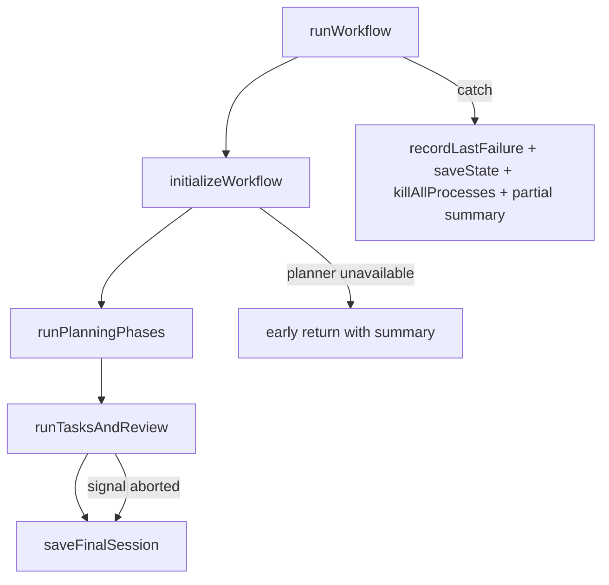
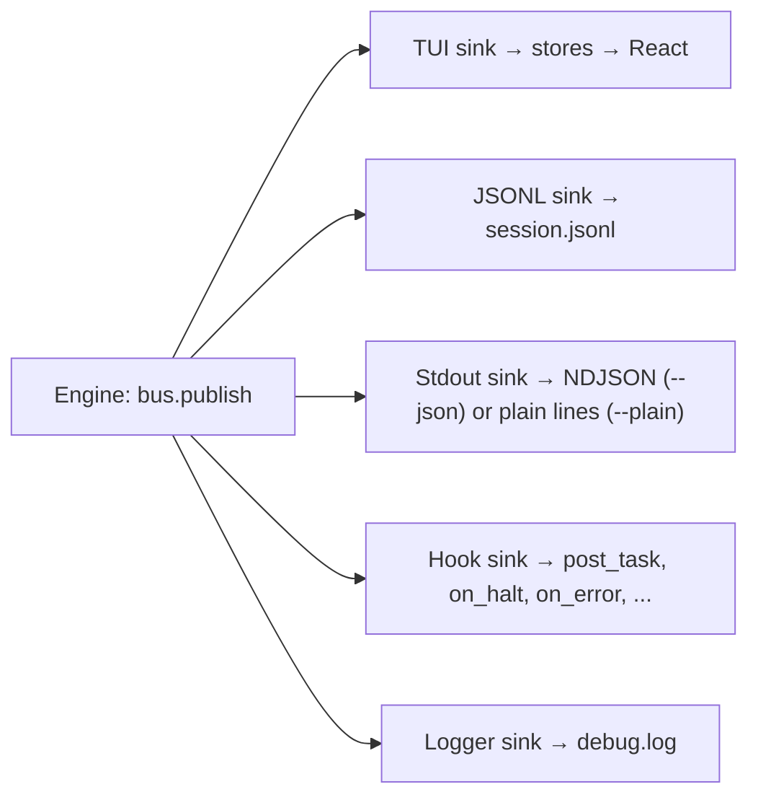

# SPLITBRIEF — Engine internals

How the orchestrator runs, how events flow, and how the engine talks to the UI without knowing the UI exists.

---

## The orchestrator

Preparation does not reuse completed execution-admission or session-ownership checks. Discovery can share compatible observations that are still in flight; each start or continue validates current execution authority.

Entry point: `runWorkflow()` in `src/engine/orchestrator/run/workflow.ts`. It builds a `WorkflowContext`, runs the planner, runs the implementer on each task, reviews the result, and writes a summary. The top-level sequence:

1. `initializeWorkflow()` (`run/init.ts`) — creates the EventBus, subscribes all sinks, spawns the planner and implementer, bootstraps initial state or loads saved state for resume.
2. `runPlanningPhases()` (`run/phases.ts`) — decides what this entry runs. A run whose resume step is a brief or a review is past planning and returns ready-for-tasks; a run parked at the plan card re-opens it (`resumeParkedApproval`); everything else runs the one planning session (`planning/session.ts`): typed questions or a typed plan, `checkPlan` with one repair, `plan.json` compiled into tasks, then the plan card.
3. `runTasksAndReview()` — runs the task loop (implementer writes code, validation runs), then calls the planner for a final review. `runTaskLoop()` returns one of four statuses — `complete`, `stopped` (a recovery or a reconciled halt), `cancelled`, or `paused` (the operator asked for a pause after the current brief) — and only `complete` runs the review. A `paused` loop does not end the run: `runTasksAndReview` parks it in place, recording the brief it stopped before and awaiting a continuation exactly as a mid-call park does, then re-enters the loop when the operator continues. A host with no prompt surface records the park and returns, so the run resumes at that brief later.
4. `saveFinalSession()` (`session-lifecycle/finalize.ts`) — persists the summary and updates stats. It does not take a status from its caller: it derives the run's status with `deriveRunStatus` from the tracked state, the lockfile and the artifacts on disk, writes that into `summary.json` alongside the run's phase and mode, and releases the active-session receipt **only when the run is closed**. A run that merely stopped keeps its pointer, because it is still continuable. A resumed pass drops the stop the last pass wrote as it starts (`reopenSessionRecord`), so `summary.json` never reports a stop the running run has left behind.

If any step throws, the catch block records the error on the state as `lastFailure: { step, message, at }`, saves state to disk, kills all subprocesses, publishes an error event, and returns a partial summary. The run is not marked failed — there is no such status. `deriveRunStatus` reads `lastFailure` and reports the run as `open`, stopped for reason `failed`, and continuing it retries the step it died on. Re-entering the run clears `lastFailure` (`RESUME_STEP`, dispatched by `runPlanningPhases`), so a later stop that records nothing reads `interrupted`, never the old error.



### Orchestrator subdirectories

The orchestrator is split by concern under `src/engine/orchestrator/`:

- **`planning/`** — The planning session. `run.ts` is the entry (`runPlanningPhase`): it takes a saved rewind, runs the session, then the plan card. `session.ts` builds the repo map, runs the session (`runPlanningSession`), compiles the plan and owns the plan card (`runPlanApproval`); `plan-session.ts` is the pure question/plan/repair loop; `plan-context-fit.ts` estimates each task's context fit.
- **`task/`** — The task loop. `loop.ts` iterates tasks, `step.ts` runs a single task (call implementer, validate, retry), `commit.ts` advances validated tasks without Git writes, `pre-task.ts` runs pre-task setup.
- **`run/`** — The run's own entry and exit. `workflow.ts` is `runWorkflow`, `init.ts` builds the context, `phases.ts` decides what a re-entry runs, and `continue.ts` is `continueRun` — the one path that picks a run up: it settles a park this process holds, re-enters a run at rest on its saved state with the operator's steer, or refuses a run that is missing, unreadable or closed, with the reason.
- **`escalation/`** — The retry ladder when the implementer fails: one local retry (`local-retries.ts`), then the consult loop in `handle.ts` and the seat-trouble rules (`seat-wait.ts` for a ≤10-minute rate-limit wait, `transient.ts` for backoff retries). A spent bound opens recovery; the planner does not take over writing the code.
- **`consult/`** — The read-only typed consult (`request.ts`). `consultSeat` sends a plan task's consult to the planner's session and a fix task's consult to the review seat. `apply.ts` applies the six answers to the task or the run: guidance, rewrite-task, split-task, verify, ask-user and confirm.
- **`recovery/`** — User-facing recovery flow for anything a turn cannot decide alone: the ladder or a consult bound running out, and the planner-seat halts in `builders/planner.ts`. Presents the user with one of two halts, *Needs you* or *Seat down* (`src/core/recovery/halt.ts`), and the choices that halt allows: continue, retry the same worker, switch the seat, revise, accept as is, restore the backup, skip, or end the run. `bus.ts` builds the bus a recovery answered between two turns publishes on, so a host that holds no live orchestrator still records the prompt and the decision.
- **`approval/`** — The write gate for declared file writes. Classifies changed paths by risk (in-scope, out-of-scope, control-plane, package change, CI or secret file) and asks only for a write to a protected path; `confirm.ts` also turns an approved plan's `protectedOperations` into confirmations (`planConfirmations`).
- **`drift/`** — Brief drift detection. Checks the run's changed files against the briefs and the evidence ledger and reports findings (`analyze.ts`); the report passes when it has no `error` finding. There is no score and no cross-task chain.
- **`evidence/`** — Collects evidence of task completion for the final review. The `review-packet/` subfolder assembles all evidence into a structured packet for the review seat. The review seat answers a typed `ReviewAnswer` (`src/core/schemas/review.ts`). Its verdict lives in `review.json` and its rendering in `review.md`. Its fix work lives in `state.triage`. `parseFinalReview()` in `src/engine/parsers/final-review.ts` stays only as the reader for sessions saved before the typed review. The verdict, criteria counts and finding counts land in the packet's final-review section and are rolled up into `summary.json` (`reviewPacket.finalReviewVerdict`, `reviewPacket.finalReviewFindingCounts`).
- **`apply/`** — Writes a ready run into the checkout once (`runApply`, `run.ts`): a three-way merge of the workspace base, the checkout and the run workspace (`merge.ts`), the backup before the first write (`backup.ts`), one hash-guarded write (`write.ts`), backup restore (`restore.ts`) and the `run.patch` that Discard and End run keep (`patch.ts`). A checkout edit during a run is not a halt: Apply merges it. See [WORKFLOW.md §Apply](./WORKFLOW.md#apply).

---

## WorkflowContext

Every orchestrator function receives a `WorkflowContext` (`src/engine/orchestrator/types.ts`). It carries everything the workflow needs:

```
projectDir, sessionId     — where we are, which session
config                     — full resolved Config
callbacks                  — OrchestratorCallbacks (see "Events vs callbacks")
bus                        — the EventBus
planner, implementer       — the active runner instances
context                    — ProjectContext (name, dir, skillsContext — the run's skills block, built once for every seat)
signal                     — optional AbortSignal for cancellation
metadata                   — SpecMetadata for written artifacts
sinks                      — WorkflowSinks (abort handler, queue handler)
validator                  — validation pipeline
isolation                  — run-scoped isolation handle (worktree default, staged-copy fallback)
resumeHolder               — prior messages for stateless resume
modelCache                 — pricing/cost lookups
drainPendingAttachments    — pulls attachments from store
detectedContextLength      — boot-probed implementer context window
```

This is the "god object" of the orchestrator. It's created once in `initializeWorkflow()` and threaded through every function call. Functions that need a subset of it use `Pick<WorkflowContext, ...>` or narrower types like `PlannerCallbacksContext`, which carries the routing inputs (`modelCache`, `detectedContextLength`) so the readiness gate and the task-loop router resolve context from the same sources.

---

## EventBus

`src/engine/events/bus.ts`. Created by `createEventBus()`.

```ts
function createEventBus(): EventBus {
  // Two methods: publish(event) and subscribe(sink)
}
```

**Synchronous fan-out.** `publish()` calls every registered sink inline, in registration order. No async, no microtask scheduling. This guarantees that when `publish()` returns, all sinks have processed the event.

**Crash isolation.** Each sink call is wrapped in try/catch. If one sink throws (disk full, render error, hostile hook), the other sinks still run. The error is swallowed intentionally — sinks that care about their own failures can publish a warning event before throwing.

**External ownership.** The bus is usually created inside `initializeWorkflow()`, but can be passed in as `opts.eventBus` by a caller that owns the bus itself.

### EngineEvent

`EngineEventSchema` in `src/engine/events/schema.ts` (the `EngineEvent` alias is `z.infer`d in `src/engine/events/types.ts`). It is dispatched by the mandatory `type` field (snake_case) and carries `ts` (epoch millis). Workflow events also carry `phase` when they occur inside a workflow phase; global events such as snapshot restore conflicts and approval-mode changes are phase-less. Event type names use snake_case to match the on-disk JSONL convention — no translation layer between memory and persistence.

Events cover the full workflow lifecycle. A few examples:

- `workflow_started` / `workflow_complete` — session boundaries
- `task_started` / `task_completed` / `task_full_fail` — task lifecycle with timing, method, retries
- `planner_text` — streaming planner output chunks. Planner document chunks set
  `content: 'markdown'`; plain logs omit it or use `content: 'plain'`.
- `runner_call_*` — normalized planner/implementer/backend call lifecycle, text deltas, usage, raw tool-use, safe activity, session IDs, artifacts, warnings, errors, and completion, plus `runner_call_heartbeat`: a frame with nothing to show that still proves the tool is working, such as Claude Code's thinking-token estimates, at most one a second per call. A heartbeat moves the Build progress block's freshness clock (`lastRunnerEventTs`, `src/stores/workflow/lifecycle.ts`), paints no row, and stays out of `session.jsonl`
- `cost_update` — cumulative token usage after each planner or implementer call

The full union has many variants, but the pattern is consistent: every event is a flat object with snake_case type, timestamp, optional phase, and domain-specific fields. The phase is the run's phase when the event is published. A run follows every state head committed for its session (`followCommittedState`, `src/engine/orchestrator/state-ops.ts`), so a call's own events, its text and a recovery event never carry a phase the run has already left. A recovery issue keeps the phase its halt was raised in.

### Runner call pipeline

Raw acquisition happens before the runner-call contract. The shared subprocess helpers in `src/lib/process/spawn/` (`lifecycle.ts`, `run-command.ts`, `progress.ts`, `line-stream.ts`) drain child stdout/stderr while retaining bounded snapshots: stdout/result text defaults to 1 MiB with prefix+tail retention, stderr defaults to a 256 KiB tail, and stdout line buffers default to 1 MiB; an over-budget channel is retained-and-reported, never terminated. Snapshots carry `bytesSeen`, `bytesStored`, `omittedBytes`, `truncated`, policy, and budget. Runner stderr streaming uses an 8 KiB line buffer; an oversized stderr line is skipped and becomes a bounded `stderr_line_overflow` warning. Process errors use only sanitized bounded snapshots.

Backend calls are normalized through `src/engine/calls/*`. CLI tools, shell commands, API streams, and Claude Code adapters emit `RunnerCallEvent` values. `createRunnerCallRecorder()` validates every emitted value with `RunnerCallEventSchema`; invalid upstream data becomes a bounded `call_unknown_upstream` diagnostic with a safe preview instead of a malformed event. Final snapshots/results validate with `RunnerCallResultSchema`. Streaming parsers and provider adapters validate their own upstream message/block shapes before recording; unrecognized provider chunks also route through unknown-upstream diagnostics. The collector turns the ordered stream into a `RunnerCallResult` with:

- call identity: `callId`, role, backend kind, runner/model metadata
- lifecycle status: `completed`, `failed`, `truncated`, `aborted`, `timeout`, `refused`, `unsupported_tool`, or `incomplete`
- text with semantic channel (`assistant`, `result`, `system`, or raw compatibility text), usage, native session ID, tool-use, artifacts, warnings, error, and `partial`

Which budget a call dies on is a judgement, not a byte count. The text channels, the streamed tool-input deltas and the artifacts are the result itself, so exhausting one of their budgets ends the call `truncated` with the limit as its error. Stderr, the tool-use records and the input a tool was *announced* with (`toolUseDelta` at the `started` stage, which `toolUseDone` carries again in full) are diagnostics: exhausting their budgets leaves the call `completed` and says so with a `call_warning`, so a run with hundreds of tool calls does not lose a healthy result to its own telemetry.

Runner-call usage preserves optional `reasoningTokens`. Legacy `TokenDelta` projections use the named `preserve_reasoning_metadata` policy: they carry reasoning tokens as metadata rather than folding them into `outputTokens`, because some providers already include reasoning in completion totals. `InvokeResult` is now a compatibility projection only. `toInvokeResult()` accepts completed calls; non-completed calls stay typed so planner/implementer policy can preserve partial output or fail closed. Public consumers receive bounded/redacted projections, not raw backend payloads.

Planner and implementer paths publish those call events through `publishRunnerCallEvent()` in `src/engine/orchestrator/events.ts`. The helper requires the call's working directory as `rootDir`, preserves the call's recorded axis words, and attaches workflow phase, optional task id, and a monotonic sequence before publishing projected `runner_call_*` `EngineEvent` values on the EventBus. Safe `runner_call_activity` projections carry bounded redacted labels keyed by stable activity ids, so the UI does not inspect raw tool payloads to render activity. File targets and their labels are relative to the call's working directory when the file is inside it. Outside paths stay absolute. A native session id still publishes `runner_call_session_id`, but produces no activity row. The engine does not import UI code or stores; the TUI sink projects these events into workflow stores.

Terminal runner events always carry frozen timing and outcome fields: `startedAt`, `endedAt`, `durationMs`, `partial`, `error`, `usage`, `nativeSessionId`, runner name/model/axis words/attempt, role, backend kind, phase, and optional task id. `runner_call_completed` can only have `status: 'completed'` with `error: null`; `runner_call_error` can only use failure statuses.

Model answer text is transcript/output content. It is never repurposed as status chrome or tool/action activity. Structured assistant/model protocol chunks are recorded as assistant/result text channels, while operational progress must be explicitly classified into safe `runner_call_activity` before the UI can render it as activity.

Warnings are explicit, not a side effect of benign stderr. `call_stderr_delta` is raw diagnostic material and is dropped from the public `runner_call_*` projection by default. Warning-like stderr and stderr from failed calls are promoted to bounded `call_warning` records with `source: 'stderr'`; successful subprocesses can still write benign stderr without creating a warning row. Actionable warnings enter through `call_warning` or unknown-upstream conversion and carry `code`, `severity`, `source`, `surface`, optional parser/upstream/channel metadata, `fingerprint`, `message`, and optional `rawRef`. Fingerprints normalize volatile timestamps, session ids, attempts, pids, durations, temp paths, and project-local absolute paths. Primary UI surfaces are `status`, `activity`, and `transcript`; `hidden` and `debug` stay out of the main transcript/status. `operationsStore` groups warnings by fingerprint/code/source/surface and keeps count, first/last timestamps, latest message, and max severity. Native-session resume attempts buffer callback output; if the old backend session is expired and a fresh attempt succeeds, the failed attempt is not flushed as primary runner activity.

---

## Sinks

Several sinks can subscribe to the bus. The JSONL and logger sinks are unconditional; the rest are gated by config or runtime mode. All are registered by `attachRunSinks()` (`run/init-sinks.ts`), which `initializeWorkflow()` (`run/init.ts`) calls — a bus reused by a second run has the first run's sinks unsubscribed before the new ones attach:

**TUI sink** (`src/features/workflow/tui-sink.ts`) — calls `addEvent()` from `src/stores/workflow/actions/event.ts`. This is the bridge between engine and UI. It lives in `src/features/`, not `src/engine/`, because the engine layer must not import from React or stores. The sink is passed in as `opts.tuiSink` — the engine never constructs it.

**JSONL sink** (`src/engine/events/sinks/jsonl.ts`) — appends byte-bounded, redacted events to `.splitbrief/sessions/<id>/session.jsonl`. This is the audit log and the source for session replay.

**Stdout JSON sink** (`src/engine/events/sinks/stdout-json.ts`) — writes public NDJSON records to stdout. Live events pass the same payload bounds as every other external consumer before they are wrapped as `{ "type": "event", "data": <EngineEvent> }`; readiness, recovery, final-review, warning, and error records use their own top-level `type`. Only subscribed in `--json` headless mode.

**Stdout text sink** (`src/engine/events/sinks/stdout-text.ts`) — the `--plain` projection of the same stream: `phase:`, `task <id>:`, `stalled:`, `review:` and `done:` lines and nothing else, so a script can read a run with `grep`. Cost is reported in tokens, not dollars, because a sink holds no price catalog. Only subscribed in `--plain` headless mode, and exactly one of the two stdout sinks is ever installed — `attachRunSinks()` picks by `opts.plain`.

**Hook sink** (`src/engine/hooks/sink.ts`) maps events to workflow hook triggers and dispatches matching hooks without waiting. Only five event types trigger hooks. `task_completed` maps to `post_task`. `checks_run` maps to `post_validation`. It fires after brief gate checks and after plan and task checks before the final review, once per task that owns them. Its payload has `taskId` and `results` (`{ id, passed }[]`). `recovery_prompted` maps to `on_halt`. `workflow_complete` maps to `on_complete`. `error` maps to `on_error`. The sink ignores all other events.

**Logger sink** (`src/engine/events/sinks/logger.ts`) — mirrors bounded events into the debug log at a level per event type. Writes nothing when the logger is disabled.



---

## Events vs callbacks

Two separate communication mechanisms serve different purposes.

**EventBus** — Broadcast, fire-and-forget. No return value. For state changes that anyone can observe. The engine publishes, sinks consume. Nobody waits for a sink to "respond."

**Callbacks** — Await-able request/response pairs on `WorkflowContext.callbacks` (`OrchestratorCallbacks` in `src/engine/orchestrator/types.ts`). For moments where the workflow must stop and wait for the user:

- `onApprovalNeeded(type, filePath)` — the plan card (`'plan'`, over `plan.md`)
- `onPlannerReply(reply)` — the planner asked a round of typed questions; the session waits for the answers
- `onContinuationNeeded(partialResponse)` — planner call was interrupted, should we continue?
- `onTieredApproval(request)` — a declared implementer write to a protected path needs confirmation
- `onReviewChecksApproval(request)` — with `validation.approve_checks: ask`, the reviewer checks wait for Run all (`'run'`) or Skip all (`'skip'`); `undefined` is a card closed without an answer
- `onComplete(summary)` — workflow finished

In **interactive mode**, the TUI fulfills callbacks by switching input mode (e.g., showing an approval prompt) and resolving the promise when the user acts. In **headless mode**, the plan card is approved unattended (it confirms none of the plan's protected writes), planner questions stop the run with `input_required`, recovery exits non-zero, a protected write is denied with `APPROVAL_REQUIRED`, and with `validation.approve_checks: ask` no reviewer check runs (`review_checks` with `status: 'skipped'`).

The split exists because events and callbacks solve different problems. Events push state outward (anyone can listen). Callbacks pull decisions inward (the workflow needs an answer before it can proceed). Merging them would mean either every event blocks until consumed, or every callback becomes lossy.

---

## Payload bounds

`boundEngineEventForConsumer()` (`src/engine/events/bound.ts`) is applied before events leave the engine through the session log, the TUI store, or stdout JSON. It never drops an event: it bounds and revalidates one. An event that cannot survive bounding is replaced by a `payload-bounds` / `payload_omitted` warning carrying the original timestamp and phase, so the consumer sees why the payload is missing.

The bounding itself lives in `src/core/payload-bounds.ts` and is shared by every consumer: terminal controls are stripped from strings, secrets are redacted with the shared redaction rules, strings and full payloads are byte-bounded per consumer context (`tui`, `stdout-json`, `stdout-text`, `hooks`, `session-log`), unsupported and circular values are replaced with placeholders, and the normalized payload is validated against its schema again. Hook command stdin and interpolated hook fields go through the same bounding at the `hooks` limits.

---

## How events reach the UI

The full path from engine to pixel:

1. Engine calls `bus.publish({ type: 'task_completed', ... })`
2. TUI sink calls `addEvent(event)` from `src/stores/workflow/actions/event.ts`
3. `addEvent` dispatches to workflow sub-stores synchronously:
   - `eventsStore` — appends the TUI-safe event-log projection
   - `tasksStore` — updates task progress (status, counts)
   - `tokensStore` — updates cost and token usage
   - `lifecycleStore` — updates phase, queue depth, terminal workflow timing
   - `operationsStore` — updates active/last runner operation lifecycle for compact status
4. React components using `store.use(s => s.tasks)` re-render when their selector output changes

**Ordering invariant:** safe retained event log, then tasks, then tokens, then lifecycle, then operations. Strictly synchronous — no await, no setTimeout, no microtask scheduling between them. `addEvent()` computes the safe event-log projection first, then passes the original raw event to the operational stores in the same call. React 19 + Ink batch synchronous store updates, so subscribers observe one consistent commit with all workflow stores updated together.

`cost_update` events take a fast path: they skip the event log and task store and only update tokens. This avoids growing the event log with high-frequency cost ticks.

`workflow_cancelled` is canonical. UI cancel aborts the run with a recognizable reason, and `runWorkflow()` publishes `workflow_cancelled` for UI aborts as well as OS-signal shutdown. Approval-gate `user_cancelled` follows the same event path. The store projection freezes lifecycle/operation duration immediately and accepts late terminal runner/cost events idempotently.

---

## State persistence

Two complementary paths:

**`saveState()`** (`src/core/state/persistence.ts`) — writes `state.json` on every phase transition via `transitionAndSave()`. This is the continuation source of truth: `splitbrief resume` reads it to know what phase, which tasks, and what progress. It's overwritten, not appended.

One API owns the file. `src/core/state/state-file.ts` reads and classifies it and owns `revisionFromBytes`, the compare-and-swap revision every reader shares; `src/engine/orchestrator/state-ops.ts` is the only writer, and `commitWorkflowState` stamps `WORKFLOW_STATE_VERSION` (`src/core/schemas/workflow.ts`) rather than spelling the number. No caller writes `state.json` directly or infers a revision from an event stream.

A persisted changed-files baseline has two provenance states: `head: null` records a known unborn start, and a SHA records the exact run-start commit. State without a baseline is rejected at final review (`finalReviewError.missingRunBaseline`) rather than reconstructed from commit subjects.

`runStartChangedFiles` is immutable run-start provenance, while rolling fingerprints retain absorbed `"missing"` tombstones. A symlink that stays inside the project is recorded by its target (`"symlink:<target>"`), the way git records it. An entry SPLITBRIEF refuses to read — any other symlink, a directory, an unreadable file — is recorded as `"unreadable"` rather than thrown. Right after changed-files baseline capture, the task loop publishes one warning naming those project-relative paths (code `unreadable_changed_files`); the entries are never opened.

**`jsonlSink`** — appends bounded events to `session.jsonl` via `src/core/sessions/log-writer.ts`. This is the audit log and transcript source. Stateless backends (those that don't support session resume natively) rebuild planner context from the JSONL log on resume.

Session directory confinement for state and log writes is shared via `assertSessionDirConfined` in `src/core/sessions/confinement.ts`.

The two serve different consumers: `state.json` is for the state machine (small, structured, overwritten), `session.jsonl` is for history (append-only, bounded events, including streaming planner text).

### Session JSONL format

`session.jsonl` contains three record types interleaved chronologically. Every record is a JSON object with a `kind` discriminant and a `ts` timestamp.

**Event records** (`kind: 'event'`). Written by `jsonlSink` after payload bounding. Fields: `kind`, `ts`, `type` (the `EngineEvent` type name), optional `phase`, optional `taskId`, and a `data` object with event-specific fields. Known event payloads are validated before replay.

**Message records** (`kind: 'message'`). Written by the transcript buffer (`src/engine/streaming/transcript-buffer.ts`) from planner and implementer streaming output. A planner call's text is written when the call settles: as a reply, or as the partial of a call that was cut or failed before it completed. A document the call lands is not written: it is the step's artifact, and the later step prompts carry it as an input. Fields: `kind`, `ts`, `role` (`'user'` or `'assistant'`), `text`, optional `phase`, and optional `interrupted`. The buffer accumulates streaming chunks and flushes above 16 KB or when the call ends. If the call is aborted, `flushInterrupted()` writes a final marker with `interrupted: true`, including an empty marker when the call printed nothing or its text was already flushed. `readInterruptedPartial` (`src/engine/orchestrator/continuation.ts`) reconstructs that call's assistant stream after the last `runner_call_started`, retaining the last 8,000 characters for the continuation prompt. An earlier call's text never supplies the next call's partial. The implementer buffer takes normal, retry and consult-guided output, including a direct writer's narration, and writes it to the checkout's log, not to the isolation directory the writer works in. In-process steers use that same checkout log. Context rebuild on resume reads these records to reconstruct the planner conversation: user turns and planner replies, without the implementer's output.

**Summary records** (`kind: 'summary'`). Written by the compaction system (see SUBSYSTEMS.md section 11). Contains `text`, `summarizedUpTo` timestamp, optional `tokenEstimate`, and optional `structured` fields. On resume, only messages after the latest summary's `summarizedUpTo` are loaded.

All three live in the same file because consumers need chronological ordering. Context rebuild reads message records and, when compaction exists, uses the latest summary record as a synthetic message before loading later messages. A separate file per record type would require merge-sorting at read time. Session-log writes and readers share bounded record-size limits; malformed or oversized lines are skipped with diagnostics rather than being silently treated as valid history.

### Replay

`readRunEvents(ref)` (`src/engine/events/replay.ts`) inverts `toEngineEventEntry`: it reads the session log through `readSessionLogWithDiagnostics`, lifts each event record's `type`, `ts`, `phase` and `taskId` back out of the record and onto the payload, turns the ISO timestamp back into epoch milliseconds, and validates the result with the engine's event parser. A record whose type no longer exists in the schema, or whose data no longer parses, is skipped and counted — a retired variant cannot stop an old session from replaying. A type is reported in `unknownTypes` only when no record of that type parsed, so one bad payload does not condemn the variant. The returned array is wrapped in the two replay events: `replay_started` first, `replay_complete` last, both carrying the read diagnostics (lines read, events replayed, and what was skipped and why). Both sit on the log clock, never the wall clock: `replay_started.ts` is the first replayed event, `replay_complete.ts` is the last, and `replay_complete.durationMs` is the span between them — the stretch of run the replay covers, not how long the read took. A replay is therefore byte-identical across repeated reads of the same log. Those two events have no other publisher; they are infrastructure-phase, so the lifecycle reducer ignores their `phase`, and they render no transcript row. Replay lives in `src/engine/` rather than `src/core/` because `core` may not import the event schema.

The consumer is `loadEvents` (`src/stores/workflow/actions/load.ts`). It calls `resetWorkflow()` first — a loaded run replaces whatever was on screen, so no store may keep the previous run's tasks, tokens or lifecycle — then folds the whole array through the same reducers the live path runs per event and commits each store once. The event log is built by `mergeEventLog` (`src/stores/workflow/events.ts`), the batch form of `mergeEvent`: both share the command replacement and tail merge helpers, and the batch form marks evicted entries in place and materializes once, so a 50k-event log costs a single pass rather than a whole-array copy per event past the cap.

---

## Abort handling

A SIGINT — the OS signal a headless run gets from Ctrl-C — reaches the handler registered in `withSignalHandlers` (`src/engine/orchestrator/signals.ts`), which runs `shutdownWorkflow()`:

1. `killAllProcesses()` — terminates all tracked subprocess (planner, implementer).
2. Saves `state.json` from whatever `trackedState` is at the moment of interruption.

Shutdown reverts nothing. A task that was in progress keeps whatever it had written; the run parks with its partial changes and the operator decides what happens to them. (In the TUI `ctrl+c` never reaches this path as a signal — Ink delivers it as a key and it becomes Stop now, which aborts the call through the same `AbortController` the sheet uses.)

The `withShutdownHandlers` wrapper in `session-lifecycle/shutdown.ts` returns the cancellation state so the run loop knows to stop and return a partial summary. For UI-originated aborts, `runWorkflow()` publishes a `workflow_cancelled` event with the abort reason; the TUI sink then freezes active operations through the store projection.

**Continuation loop.** When a planner call is interrupted (not the whole workflow, just the current call), `withContinuationLoop()` in `src/engine/orchestrator/continuation.ts` handles it. It aborts the in-flight call via a per-call `AbortController`, transitions the state to `awaitingContinue: true`, calls `onContinuationNeeded` to ask the user whether to continue, then rebuilds the prompt with the partial response and loops. The transcript buffer flushes with `interrupted: true` so the JSONL log marks the partial response.

This means Stop now during a planner call doesn't kill the workflow — it pauses the current call and asks the user what to do. A process-level signal (outside an active planner call, or with no continuation callback set) runs the shutdown path.

---

## Message queue

`src/engine/orchestrator/queue/submit.ts` (live-queue entry), with drain/clear/prompt in sibling `queue/` modules. While the planner is running, the user can type messages. These are queued, not dropped.

`enqueueUserMessage()` adds a `QueuedMessage` to `state.messageQueue` (capped at 50 messages). Each message is persisted as a message record and a `message_queued` event is published. The event carries a sanitized bounded preview for local UI and replay consumers.

Queue submission is planner-only. The shared enqueue boundary rejects messages outside live planner phases and rejects when the cap is full; callers receive an explicit rejection result and the engine publishes a bounded warning. The TUI shows anchored feedback instead of pretending success.

At safe points — end of the current planner call — the orchestrator calls `drainQueue()`, which marks pending-undelivered messages as drained and publishes `queue_drained`. The drained messages get formatted into the next planner prompt as `[user also says during <phase>]` blocks.

**Native injection.** For backends that support `injectUserTurn` (e.g., Claude Code's conversation API), messages bypass the queue entirely. `dispatchNativeInjection()` in `src/engine/orchestrator/queue/native-injection.ts` calls `planner.injectUserTurn()` to push the message as a real user turn into the active conversation. Only confirmed native delivery marks `deliveredViaNative`; a not-ready session leaves the message pending independently of whether usage counters were returned. Prompt acknowledgement drains only the supplied message IDs, so a correction arriving during regeneration stays pending without replaying the delivered correction.

---

## Summary shape

Summary usage data remains persisted for explicitly opened `/usage` details. It is not a main-screen cost counter.

Source: `src/core/schemas/summary.ts`. Written to `summary.json` at workflow end by `saveFinalSession()`.

```typescript
type Summary = {
  feature: string
  totalTasks: number
  completedByLocal: number
  escalatedToPlanner: number
  skipped: number
  failed: number
  totalTime: number                       // ms
  tokenUsage: TokenUsage
  escalationRate: number

  // Runner identity
  plannerTool?: string
  plannerModel?: string
  implementerTool?: string
  implementerModel?: string
  mode?: WorkflowMode                     // older summaries only; a new run writes none

  // Per-task breakdown
  taskBreakdown?: TaskTokenUsage[]
  phaseTimings?: Record<string, number>   // phase name → ms

  // Spend
  costBreakdown?: {
    actualPlannerCost: number
    actualImplementerCost: number
    totalActualCost: number
    providerCosts?: Record<string, { inputTokens: number; outputTokens: number; cost: number }>
  }

  // Quality signals
  briefQuality?: { score: number; passed: boolean; errorCount: number; warningCount: number }
  driftSummary?: { passed: boolean; errorCount: number; warningCount: number }
  evidenceSummary?: { path: string; totalTasks: number; tasksWithValidationEvidence: number; ... }
  reviewPacket?: ReviewPacketSummary
  checkpointSummary?: CheckpointSummaryRollup
}
```

The summary is the final artifact. It carries enough data to render a closed run’s ledger and compute cumulative project stats without re-reading the JSONL log.

---

## Key event shapes

From `src/engine/events/schema.ts` (`EngineEventSchema`). Every event carries `ts: number` (epoch ms); workflow-phase events also carry `phase: Phase`.

```ts
// Task lifecycle
{ type: 'task_started'; taskId: TaskId; title: string; index: number; total: number;
  file: string; action: 'create' | 'modify'; tool?: string; model?: string;
  axes?: readonly string[]; backendKind?: 'cli' | 'api' | 'shell' | 'agent';
  implementerProfile?: string; contextFit?: TaskContextFit;
  estimatedTokens?: number; untruncatedEstimatedTokens?: number;
  contextLength?: number; currentCodeTruncated?: boolean;
  currentCodeContextMode?: CurrentCodeContextMode;
  costPosture?: string; routingReason?: string }

{ type: 'task_completed'; taskId: TaskId; title: string;
  method: TaskCompletionMethod; retries: number; duration: number;
  tool?: string; model?: string; implementerProfile?: string }
// `duration` is measured once, at completion, from the brief's start time
// (`validateCommitAndAdvance`). The ledger entry's `durationMs` carries the same value.

// Review fix cycle — the review answer appended fix tasks and START_FIX_CYCLE sent the run back
{ type: 'review_fix_started'; cycle: number; taskIds: TaskId[] }

// Validation
{ type: 'validate'; taskId: TaskId; status: 'running' | 'done';
  passed: boolean; stages: ValidationStages; error?: string; duration?: number }
// No live run publishes it on the bus; sessions saved before the reviewer checks keep it.
// The pre_validation hook payload takes this shape without `stages`.

{ type: 'review_checks'; scope: 'final' | 'task'; status: 'planned' | 'off' | 'skipped';
  commands?: { id: string; command: string; reason: string }[];
  declined?: { target: string; reason: string }[];
  reason?: string | null }
// One per review that runs reviewer checks. `planned` carries the reviewer's choice:
// the reviewer checks (ids V1, V2, …), each related test it declined, and the reason
// when it chose none. `off` means validation.end_checks is false: no reviewer check
// ran, and plan and task checks still ran. `skipped` follows `planned` when
// validation.approve_checks is ask and none of the chosen commands ran: it carries
// the commands and the reason (Skip all, a card closed without an answer, or no screen).

{ type: 'full_suite'; status: 'running' | 'done' | 'not-run' | 'refused';
  id?: string; stage?: 'typecheck' | 'lint' | 'test'; command: string;
  moment: 'pre-review' | 'base' | 'brief';
  passed?: boolean; detail?: string; duration?: number;
  newFailures?: number; preExisting?: number; notVerified?: number;
  own?: number; ownLeft?: number; others?: number; proven?: boolean }
// One reviewer command run, or a judged plan or task check in a fix brief.
// `id` names the check (V1, K1, …); an event
// without `id` comes from an older session and carries its full-suite `stage`.
// `passed` is set on the done event. Reviewer checks also set `duration`.
// `detail` says why a command
// did not run (`V1 failed`) or was refused. `moment: 'base'` is the re-run of a red
// command at the run base with the same command text; its done event counts the
// failures that are new, pre-existing and not verified at the run base, and a red
// base done event's `detail` says why a failure is not verified. `moment: 'brief'`
// is a fix brief's check, run once with no base re-run. A reviewer check uses the
// command the finding carries, under the reviewer command policy. A fix check
// done event counts `own` carried failures, `ownLeft` failures still present and
// `others` every unmatched re-run key. `proven` is true on green, or when the
// red still shows an original other key. Diagnostics pair by exact key, then
// message identity. Test keys match exactly. Keys come from the full capture.
// An incomplete capture is a placeholder and requires a passing command.
// A red without proof must pass its command. Green re-runs show the verdict too.
// Plan and task checks a fix finding carries also get a done row when judged. They get no running row or duration.

// Recovery
{ type: 'recovery_prompted'; issueId: string; reason: RecoveryReason;
  taskId?: TaskId; files: string[]; affectedTaskIds: TaskId[];
  availableActions: RecoveryAction[]; recommendedAction: RecoveryAction;
  headline: string; resumeCommand: string }
// The one event that fires the `on_halt` hook. `headline` is the operator-facing sentence
// (`formatRecoveryHeadline`) and `resumeCommand` the line that carries the run on
// (`formatResumeCommand`), both from `src/core/recovery/`.

// Tiered approval
{ type: 'approval_prompted'; tier: ApprovalTier;
  actionClass: ActionClass; taskId?: TaskId }

// Cost
{ type: 'cost_update'; tokenUsage: TokenUsage }
// where TokenUsage = {
//   plannerInput: number; plannerOutput: number;
//   implementerInput: number; implementerOutput: number;
//   escalationInput: number; escalationOutput: number;
//   plannerCacheRead?: number; plannerCacheCreate?: number;
//   implementerCacheRead?: number; implementerCacheCreate?: number;
// }

// Planner heartbeat (emitted while the planner is running)
{ type: 'planner_heartbeat'; phase: Phase; elapsedMs: number; callId?: string }

// Workflow config (emitted once at startup); `skills` names the skills every seat call carries
{ type: 'workflow_config'; mode?: WorkflowMode;   // older logs only; a new run writes none
  plannerTool: string; plannerModel?: string;
  implementerTool: string; implementerModel?: string;
  skills?: string[] }

// Operational message — `warning` has the same shape without `resetAt`;
// `resetAt` is the ISO instant a usage-limit halt's quota comes back
{ type: 'error'; message: string; category?: string; code?: string; resetAt?: string }
```

**Where an `error` comes from.** The generic `error` event carries an optional `category`/`code` pair naming the halt that produced it. Two codes sit under `category: 'recovery'`: `retry_exhausted` (the retry ladder ran out for a task, `task/retry.ts`) and `review_failed` (the final review still reported blocking findings after the last fix cycle, `run/task-execution.ts`). The two other halts that stop the run mid-task — an approval gate denial (`approval-denied`) and a task-start snapshot that could not be captured (`snapshot-failed`) — raise their recovery issue without an `error` event: they reach consumers as `recovery_prompted`, which is also what fires the `on_halt` hook. Re-entering the task loop over an unresolved recovery publishes the matching `warning` (`recovery_pending_unresolved`) instead.

`routingReason` on `task_started` is the router's sentence, for example `Selected profile default (fits, estimated 5075/1000000 tokens)`. The run log and the review packet keep it. The task-start row does not print it. The row names the worker from `implementerProfile`, and only a `tight` or `overflow` fit adds the estimate against the window (`~24,310 of 32K context tokens (tight)`). Fuller context-fit and per-task routing metadata is also retained in the run record; the engine emits it as plain event data and does not import UI code.
