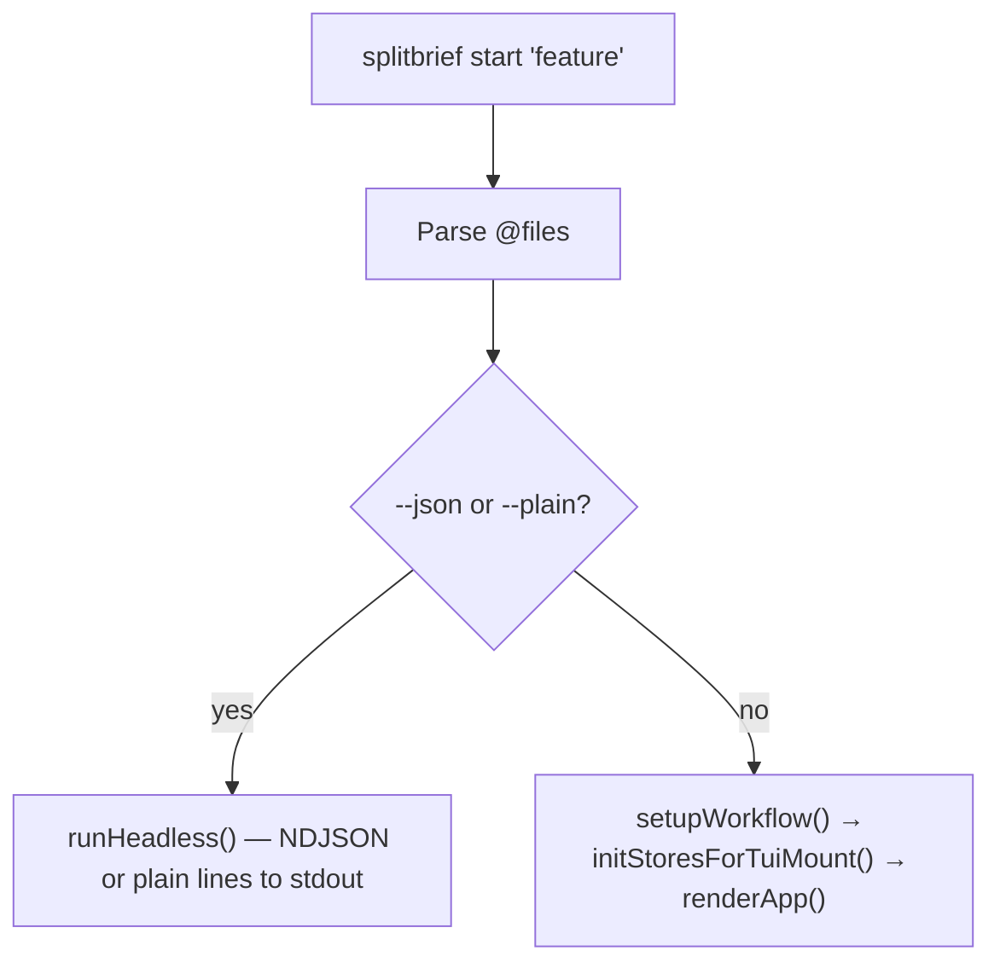
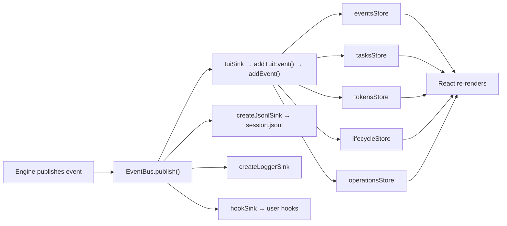

# SPLITBRIEF — How it works

This is the data flow from CLI entry to workflow completion. You've read the [mental model](./MENTAL-MODEL.md) and know what SPLITBRIEF does. This page shows you where it happens — file paths, function names, the actual call chain. Read this when you want to trace through the code.

---

## CLI entry

The user types `splitbrief start "add email validation"`. Execution begins in `src/cli.ts`, which creates a Commander program and registers subcommands. `start` is registered by `registerStartCommand()` in `src/cli/commands/start/register.ts` and is the default command — bare `splitbrief "feature"` hits the same path.

A headless run needs a feature argument. `--json` or `--plain` without one fails with `--<mode> requires a feature argument`. A file reference in the feature position stops the command with exit code `2` before startup. An empty feature before `@file` inputs stops it too.

CLI and composer file references use `resolveInputFile()` in `src/core/attachments/resolve.ts`. This core resolver reads text or identifies images from any path. `prepareDraftSubmission()` in `src/core/composer/submission.ts` separates display text, attached bodies, images, and metadata before the composer forwards them.

For `@file` arguments, `parseAtFiles()` (`src/cli/parse-at-files.ts`) returns text context, image attachments, attached inputs with resolved paths, and errors. The attached inputs travel with the run to the first `user_message` event. Any refused input stops the command with exit code `2` before startup. After these checks, the handler queues the images in the attachments store and selects one of two paths:

**`--json`** runs the workflow headless via `runHeadless()` (`src/cli/headless.ts`). Events stream as NDJSON to stdout. The plan card is approved unattended, and an unattended approval confirms none of the plan's protected writes. A write to a protected path (dependency manifests and lockfiles, `.git`, `.splitbrief`, CI configuration, env and key files) always asks, and no other write does, so a headless run denies a protected write with `APPROVAL_REQUIRED`. **`--plain`** is the same headless run with the text rendering of that stream (`phase:`, `task <id>:`, `review:`, `done:`); the two cannot share stdout, so passing both exits `2`.

**Interactive** (the default) is the path most users take. It calls `setupWorkflow()` (`src/cli/setup.ts`) to resolve the project directory, check for a git repo, and create a default config if none exists. If no config exists and no CLI overrides were provided, it returns `needsSetup: true` and the router opens the setup screen instead of the workflow.

After setup, the handler calls `initStoresForTuiMount()` and then `renderApp()`. Discovery continues while Ink mounts, so the first screen paints before the runner refresh ends.

---

## Store bootstrap

`initStoresForTuiMount()` in `src/cli/bootstrap/init.ts` prepares the shared state layer on the interactive start path. It runs four phases in order. It awaits the first three and returns the fourth as an `awaitDiscovery` promise, so the TUI mounts without waiting for discovery. `initStores()` runs the same four phases and awaits all of them; `splitbrief init` and the interactive `continue` path use it.

**`initUIChrome()`** subscribes the terminal-size store to resize events so layout reflows when the window changes.

**`loadProjectState()`** loads configuration from `.splitbrief/config.yaml` via `configStore.load()`, loads session history via `sessionsStore.load()`, installs history persistence, and restores the sidebar preference. Config must load before sessions — session display depends on config state.

**`ensureHooksTrusted()`** (`src/cli/hook-trust-prompt.ts`) checks whether the project's configured hooks have been approved. If not, it prompts the user before continuing. This runs after config is loaded (hooks come from config) but before discovery (discovery shouldn't run under untrusted hooks).

**`loadDiscovery()`** runs last because it's async and independent of session state. It detects provider capabilities via `detectCapabilities()` (`src/engine/providers/capabilities.ts`), then hydrates the detection stores from the on-disk cache snapshot via `hydrateDetectionIntoStores()` (`src/stores/discovery/detection-adapter.ts`) so a cold start shows remembered runners immediately, and kicks off two background tasks: the remembered models.dev catalog seed and the live runner/model refresh via `loadDetectionForCurrentConfig()` (`src/engine/detection/store-publication.ts`).

It finishes by awaiting skill discovery via `discoverSkills(projectDir)` (`src/engine/skill-discovery.ts`). The sources are a fixed union that does not depend on the planner — the project and global roots listed in `src/core/skills/scan-paths.ts`, plus `<project>/AGENTS.md`. Discovery also re-runs whenever the skills overlay opens (`src/app/refresh-skills.ts`).

---

## TUI rendering

`renderApp()` in `src/cli/render/app.ts` mounts the Ink app. It tries fullscreen mode via `withFullScreen()` from `fullscreen-ink` — if that fails (unsupported terminal, broken escape codes), it falls back to inline rendering. Ink reads its keys through a filtered stdin in both modes. In fullscreen it strips mouse escape sequences before they reach Ink's input handler, and in both modes it writes each Backspace byte as its own key.

**`src/app/root.tsx`** is the root component. It reads `routerStore` for the current screen and `overlayStore` for any active overlay, wires runtime commands via `useRuntimeCommands()` (`src/app/command-context.ts`), binds app-wide keys via `useAppKeys()` (`src/app/keys.ts`) and mouse input via `useAppMouse()` (`src/app/mouse.ts`), and renders `<AppProvider>` (`app/provider.tsx`, today only `<ThemeProvider>`) wrapping `<Router/>` (`app/router.tsx`), which composes the page files and returns `<Layout screen={…} overlay={…}/>`.

Screen selection is a switch on `routerStore`'s `screen` field (`ALL_SCREENS`, `src/core/navigation/types.ts`):

- **home** — `<HomeScreen/>` — the landing screen when no feature was provided
- **workflow** — `<WorkflowScreen/>` — the run's home, whether something is running on it or not
- **setup** — `<SetupScreen/>` — first-run configuration wizard

There is no summary screen. A run that stops stays on the screen it was already on: the route's execution flips to `at-rest` and the same screen paints the run from its `RunRecord`, with a `Closed ─` block at the tail of its own transcript once the run is closed.

`<WorkflowScreen/>` is where the engine starts. `useRunLoop()` (`src/features/workflow/hooks/use-run-loop.ts`) triggers `runWorkflow()` from the engine: it creates an `AbortController`, wires up cancel/rewind handlers, creates a TUI event sink, and calls `runWorkflow()` with callbacks that bridge engine gate requests to the UI's input mode system. Beside it, `useRunContinue()` (`use-run-continue.ts`) owns how the run is re-entered — the state and steer its next turn starts from, and the `continueRun` call behind `/resume` and a typed correction.

The callbacks are how the engine asks for human decisions without importing React. `onApprovalNeeded` switches to review mode for the plan card and resolves when the user responds. `onPlannerReply` waits on the planner's questions. The engine `await`s these promises — it's blocked until the user answers.

---

## Workflow initialization

`runWorkflow()` (`src/engine/orchestrator/run/workflow.ts`) is the top-level engine entry. It takes the already-prepared execution (project dir, session ID, admitted config), builds a summary base with planner/implementer metadata, acquires the session liveness lockfile so a concurrent resume refuses to double-run the session, wraps the entire run in `withShutdownHandlers()` (`src/engine/orchestrator/session-lifecycle/shutdown.ts` — the SIGINT/SIGTERM/SIGHUP handler that saves state on interrupt), and delegates to `initializeWorkflow()` (`src/engine/orchestrator/run/init.ts`).

`initializeWorkflow()` does the following, in order:

**Creates the EventBus** — `createEventBus()` in `src/engine/events/bus.ts`. The bus is a synchronous fan-out dispatcher: `publish(event)` iterates all subscribed sinks and calls each one. A throw in one sink is caught and swallowed — a crashing sink cannot tear down the engine mid-task.

**Subscribes sinks** to the bus through `attachRunSinks()` (`src/engine/orchestrator/run/init-sinks.ts`):
- The TUI sink (`opts.tuiSink`) if provided — this is `addTuiEvent` from `src/features/workflow/tui-sink.ts`, which forwards events to `addEvent()` in the workflow store. The engine doesn't import it — it receives it as an opaque `EventSink` via the options, which is how the engine/UI boundary stays clean.
- The JSONL sink (`createJsonlSink()`) appends every event to `session.jsonl`.
- The logger sink (`createLoggerSink()`) writes every event through the process logger.
- The call-evidence sink (`createCallEvidenceSink()`) keeps the run's per-call usage record in memory for the summary.
- One stdout sink (headless only): the stdout-JSON sink writes NDJSON, or under `--plain` the stdout-text sink writes text lines.
- The hook sink (`createHookSink()`) dispatches user-configured hooks on matching events.

**Creates the planner** via `createPlannerSeat()` (`src/engine/orchestrator/run/init-seats.ts`), which calls `createPlanner()` in `src/engine/runners/factory.ts`. The factory switches on `config.planner.kind` and lazy-loads the appropriate backend module. Backend modules are loaded with dynamic `import()` behind a memoizing `lazy()` wrapper — the module is only loaded when first needed, and subsequent calls return the same promise.

**Creates the implementer** via `createImplementerSeat()`, which calls `createImplementer()` from the same factory.

**Resolves the reviewer.** `resolveReviewerRunner()` (`src/core/config/accessors/reviewer-runner.ts`) decides who holds the review seat. With no `reviewer` block the planner instance is reused as the reviewer and nothing else happens. With one, `createPlannerSeat()` calls `createReviewer()`, which builds a separate runner from the same factory and the same lazy planner backends (`src/engine/orchestrator/run/init-seats.ts`). A configured reviewer is a candidate in `prepareExecution()` under slot `{ role: 'reviewer' }` and goes through the same fresh admission as the other seats — one that fails admission blocks the run start with a readiness blocker naming the Reviewer.

**Handles resume** — if `savedState` exists and there's no pending recovery, it auto-compacts the JSONL log and rebuilds context for stateless backends (those that don't support session persistence natively).

**Publishes `workflow_started`** (or `workflow_resumed` for a resume) and saves the initial state to disk.

After initialization, `runWorkflow()` installs a queue handler for messages that the operator types during a live run. Enter with text queues a message for the seat of the active stage: PLAN, BUILD, or REVIEW. `ctrl+⏎` with text stops now and continues with the text, like `/steer <text>`. A terminal without extended keys reports this key as Enter, which queues the message. `/steer` works in every terminal. The run then proceeds to planning.

The queue handler shares one run-scoped `SteeringPort` with foreground BUILD, planning-session, and verdict calls. It captures the attached call before enqueue work. After persistence, it offers the message only when the call's seat matches the active stage. Helper calls receive no port. See [Delivery to a running call](./ENGINE.md#delivery-to-a-running-call) for queue outcomes. See [Mid-call steering](./PLANNERS-AND-IMPLEMENTERS.md#mid-call-steering) for tool support and transport details.

---

## Planning phases

`runPlanningPhases()` (`src/engine/orchestrator/run/phases.ts`) decides whether planning runs at all — a run whose `resumeStep` names a brief or a review is past it, and one parked at the plan card goes to `resumeParkedApproval()` — then delegates to `runPlanningPhase()` (`src/engine/orchestrator/planning/run.ts`). That function takes a saved rewind if the state carries one, and runs the planning session.

**The planning session** — `runPlanningSession()` (`src/engine/orchestrator/planning/session.ts`) drives the pure loop `runPlanSession()` (`plan-session.ts`):

- the planner answers typed JSON against `PlanAnswerSchema` through `requestTyped`: questions (at most 3 per round, at most 2 rounds) or a plan;
- a plan is checked by `checkPlan` plus the context fit, and goes back to the planner once if it fails;
- a plan that passes is compiled: `taskFromSpec` maps its tasks, `plan.json` is written, `plan.md` and `tasks.md` are rendered, and `PLAN_COMPILED` stores it;
- `runPlanApproval()` opens the plan card when `workflow.approve` is `plan`, then dispatches `BEGIN_IMPLEMENTATION`.

An older run parked in a retired planning phase or at an older gate continues as this one session; the session reads the run's earlier research, spec, plan and `tasks.md` as "Earlier Planning".

Each planning turn takes its prompt from `planTurnText()` (`src/engine/orchestrator/planning/session.ts`). It builds a repo map via `buildRepoMap()` (`src/engine/codebase/repomap.ts`) — a PageRank-weighted summary of the codebase focused on the files the feature names — and `buildPlanSessionPrompt()` puts it in a `## Repository Map` section. It does this for every planning session, `splitbrief spec` included. This gives the planner structural context without sending the entire codebase. See [REPOMAP.md](./REPOMAP.md#integration).

PLAN reads pending messages at its next planner call. A Claude Code planner can also receive them in its native session when no call is attached or the offer is deferred. Native injection runs only in plan phases. An uncertain offer skips native injection. See [Message queue](./ENGINE.md#message-queue) for delivery rules.

During planning, `planner_heartbeat` events (`src/engine/orchestrator/planning/heartbeat.ts`) fire every 2 seconds after a 5-second threshold, carrying `phase`, `elapsedMs` (restarts when `callId` changes), optional `callId`. These are proof-of-life signals during long waits — the TUI shows them as a spinning indicator. The planning session streams no narration, because its answer is typed JSON.

The plan lands as three files in the session folder: `plan.json` (`writePlanJson`, `src/core/sessions/plan-file.ts`), and `plan.md` and `tasks.md`, rendered from it and written with `artifact_written` events. A run planned by an older engine also has `research.md`, `spec.md` and possibly `brief-quality.json`; a new run writes none of them.

Planning ends in exactly one of two dispositions: `ready-for-tasks` or
`terminal` (`PlanningPhaseResult`,
`src/engine/orchestrator/planning/types.ts`). A terminal result carries the
outcome — `cancelled`, `rejected` or `failed` — and never enters execution.

---

## Task loop

After planning, `runTasksAndReview()` (`src/engine/orchestrator/run/task-execution.ts`) enters the task loop via `runTaskLoop()` (`src/engine/orchestrator/task/loop.ts`).

`runTasksAndReview()` runs only on a `ready-for-tasks` disposition; a terminal
result makes zero implementer or task-loop calls.

No check runs before the first task. Before the final review, the reviewer chooses the reviewer checks that verify the change, and SPLITBRIEF runs them over the run workspace (`runReviewChecks`, `src/engine/orchestrator/review-checks.ts`; `validation.end_checks` turns them off). With `task`, the task's own checks and due checks also run after each task, and each task review runs reviewer checks scoped to the related tests. When a reviewer check is red, SPLITBRIEF re-runs the same command text on a disposable run base copy outside the checkout. A failure also red there is pre-existing and starts no fix. A timeout, or a red with no failure keys, is never pre-existing: it is not verified at the run base and reaches the reviewer. With `validation.approve_checks: ask`, the TUI asks Run all or Skip all before any reviewer check runs. The `review_checks` event carries the reviewer's choice, and the `full_suite` events (with `id` `V1`, …) show each reviewer check and its base re-run. Only reviewer checks re-run at the run base.

Before those reviewer checks, `runPreReviewChecks` (`src/engine/orchestrator/run/pre-review-checks.ts`) runs every plan and task check separately. Each publishes `full_suite` at `moment: plan` in the review phase before execution and after its result. A render alone carries `scenario` and displays `Render <scenario>` with `running`, `rendered` or `failed`. The byline and build block use each check's own clock. Required failures keep their existing triage inputs; plan rows add no reviewer-check reds.

On `turn_interrupted` or `workflow_cancelled`, the operations reducer clears command stages. The events store settles unfinished `full_suite` and older `validate` rows as `stopped`, with the same rule for live events and replayed logs. Continuing starts a new clock when a command runs again.

The loop iterates tasks in the order of `plan.json`. `checkPlan` (`src/engine/spec/plan-checks.ts`) refuses a plan that lists a task before a lower batch (`batch-out-of-order`) or before a dependency (`dependency-later-batch`, `dependency-later-task`), so that order is the build order. For each task:

**Dependency check** — if any task in this task's `dependsOn` list has failed or been skipped, the task enters recovery. The user is prompted to decide what to do.

**Input refresh** reads and hashes code in the run workspace. A stale brief gets a consult before dispatch. Checkout edits do not enter the workspace between tasks. Apply integrates them at the end. See [Run workspace and Apply](#run-workspace-and-apply).

**Implementer profile routing** — `routeTaskToImplementerProfile()` (`src/engine/orchestrator/context-routing/route.ts`) estimates the task's token requirements and selects the best implementer profile. Each profile's context window resolves through one ladder — `resolveRunnerContextWindow()` (`src/engine/providers/model/context-window.ts`): cached models.dev metadata, then runtime metadata, then the bundled known-model catalog, then the shared default; a CLI tool under `model: auto` resolves to the smallest window its bundled catalog guarantees. If no profile can handle the task (context overflow), the task enters recovery. The routing preview behind brief approval and the review overlay (`buildRoutingPreviewMetadata()`, `src/engine/routing-preview.ts`) is built from the same model cache and detected context length as dispatch-time routing, so the preview and the dispatched route agree by construction. The routing decision is carried into the implementer call: `configForProfile()` (`src/engine/orchestrator/task/routing.ts`) copies the decided `contextLength` into the config handed to the selected implementer when the profile declares none, so the prompt the implementer receives is budgeted against the routed window, not an unbudgeted whole file.

Filesystem snapshots, diffs, and validation remain available; the Git index and commits belong to the user.

**Execution** — `runSingleTask()` (`src/engine/orchestrator/task/step.ts`) runs the task:

1. Transitions state to `START_TASK` and refreshes the file's current code from disk
2. Runs pre-task hooks if configured
3. Captures the task-start snapshot in the run workspace
4. Calls `runImplementation()` (`src/engine/orchestrator/task/run-implementation.ts`). Every writer receives the same run workspace. `cli` and `agent` write there directly. `api` and `shell` return code that SPLITBRIEF writes there. The extracted-code path keeps its guard against a destructive whole-file replacement.
5. Calls `gateAttemptChanges()` (`src/engine/orchestrator/task/attempt-gate.ts`) on the attempt's changed files. The [protected gate](./APPROVAL-AND-RECOVERY.md#protected-path-confirmation) restores denied files inside the workspace. Task completion records before/after entries with `taskId` and `briefHash` through `captureTaskReviewChanges()` (`src/engine/orchestrator/evidence/review-capture.ts`).
6. Calls `runBriefGate()` in `src/engine/orchestrator/task/brief-gate.ts`. End cadence runs no check for ordinary briefs. Task cadence runs the task's checks and its due checks. A fix task also runs the checks of the red it answers (`task.fix.findings[].checkIds`) through `runTaskChecks()` (`src/engine/orchestrator/task/task-checks.ts`). A carried reviewer check runs by the command its finding carries through `runReviewCheck()` (`src/engine/orchestrator/review-checks.ts`). A carried plan or task check runs by id through `runChecks()`.

   Each fix check runs once per brief gate under the same command policy, with no base re-run. A red passes only when no carried failure remains and the re-run still shows a key the original red showed that is not the task's own. Otherwise, the command must pass. A diagnostic key includes its path, position and message. Match exact keys first, then pair unmatched diagnostics by message identity, with only the position removed. Pair each key once. Test failures match by name. Keys come from the full process capture. An incomplete capture is a placeholder and requires a passing command.

   Every unmatched re-run key counts as another failure. The red must show an original other key before it can settle. A check with no carried keys, or a re-run with no named failure, must pass its command. A carried failure that remains rejects the brief even when the check is optional. Results of `refused`, `unknown` and `not-runnable` also reject the brief. Each judged re-run gets a fix check verdict row. A green re-run shows that all carried failures are gone. A red without proof shows `your N failures not shown · not proven fixed`. Plan and task checks get only a done row, with no duration.

   The final review runs the reviewer checks. The first reviewer check with new failures stops the list. The reviewer returns the fix work for it.

7. If the checks pass with pending messages, SPLITBRIEF runs a counted BUILD answer attempt on the same brief before accepting it. The attempt keeps the files and spends no retry rung. `runLocalRetries` dispatches `COUNT_ATTEMPT`, which increases the displayed lineage attempt count. The attempt remains subject to the attempt bound, which can halt delivery. SPLITBRIEF runs the checks again after the attempt.

   With no pending correction and a passing gate, SPLITBRIEF dispatches `VALIDATION_PASS` and records evidence.
8. If the checks fail, the ordinary retry path delivers pending messages and spends a retry rung. BUILD retries once with the error message. SPLITBRIEF then consults the planner for a plan task or REVIEW for a fix task. The seat returns guidance, a rewritten or split brief, a check re-run, or a question. A spent bound halts for recovery.

See [Message queue](./ENGINE.md#message-queue) for BUILD corrections before calls, after calls, and during checks.

---

## Run workspace and Apply

`runWorkflow()` builds one run-scoped isolation with `createRunIsolation()` (`src/engine/orchestrator/isolation/create.ts`) before initialization. Before execution, `runTasksAndReview()` captures a snapshot named `workspace-base` and opens one workspace through that isolation's `open()`. `RECORD_WORKSPACE` saves its kind, path, base snapshot id and starting HEAD. Every task, retry, validation and code review reads that workspace. Attempt cleanup restores only the current attempt's changes. Earlier tasks remain available to later tasks.

The checkout receives no run result until Apply. The planner's cwd stays in the checkout to preserve its native session. Brief refresh, consult snapshots and review packets read the workspace. Consult and planner-review prompts name that path. A separate reviewer runs with the workspace as its cwd. Session state and evidence remain under the project checkout.

The worktree path is `$XDG_STATE_HOME/splitbrief/trees/<repo-key>/<session-id>/`, or `~/.local/state/splitbrief/trees/...` by default. `isolationWorktreePath()` (`src/core/paths.ts`) uses the first 12 hex characters of `sha256(realpath(git-common-dir))` as the repository key. The directory stays outside `.git/` and the project root, so project test discovery does not count a second copy. [Configuration](./CONFIGURATION.md#implementer-isolation) defines the strategies, dependency links and fallback.

`runApply()` (`src/engine/orchestrator/apply/run.ts`) captures three states through `captureApplyStates()` (`apply/states.ts`):

| State | Source |
|---|---|
| `base` | The saved `workspace-base` snapshot at workspace creation, including captured uncommitted files. Missing delta entries resolve through the session baseline. |
| `ours` | The run workspace now. |
| `theirs` | The checkout now, captured once for the merge and write guard. |

`mergeApplyStates()` (`apply/merge.ts`) merges into the workspace. Text merges use `mergeFileEntries()` (`src/lib/git/entry-merge.ts`), which calls `git merge-file`. The resulting workspace is the candidate. The [Apply sequence](./WORKFLOW.md#apply) owns conflict handling, checks, re-review, backup and the guarded checkout write.

An open run retains its workspace across stops and restarts. After Apply commits its record, it removes the worktree with its branch, or the staged-copy directory. It also clears the retained-workspace record. A removal failure publishes a warning; the run stays applied. Discard and End run preserve its work before removal. See [Apply](./WORKFLOW.md#apply).

In checkout mode (`workflow.isolation: none`) `openWorkspace()` (`src/engine/orchestrator/isolation/create.ts`) creates no worktree and keeps no workspace record. Readiness warns about uncommitted changes and names `.splitbrief/sessions/<id>/reverted/` as the backup folder. An attempt revert restores only paths that attempt changed and leaves your other uncommitted files untouched. The run records `workspace.kind: 'checkout'` in `state.json` once, so a later config change does not move it. Every task, check and review reads the checkout. There is no Apply: a passing review closes the run, and the close writes no `run.patch`.

A worktree shares repository hooks and config, and the host's ports, sockets and databases. It is a file boundary, not a sandbox. The [tripwire and git audit](./APPROVAL-AND-RECOVERY.md#isolation-checks) check implementer calls. `createRunnerSandboxEnv()` (`src/engine/runners/sandbox-env.ts`) provides credential and path hygiene. Keychain-backed session channels keep host `HOME` and `USER`; see [API-KEYS.md](./API-KEYS.md#what-a-host-account-child-can-and-cannot-reach).

---

## Event flow

When the engine publishes an event through the bus, every subscribed sink receives it synchronously. The TUI path is the one that drives the terminal display:

**`addEvent()`** in `src/stores/workflow/actions/event.ts` is the bridge between engine events and React state. It updates five stores in a fixed order: events, tasks, tokens, lifecycle, operations. This ordering is strictly synchronous — no `await`, no `setTimeout`, no microtask scheduling. React 19 with Ink batches synchronous store updates so subscribers observe one consistent commit with all five stores updated.

One optimization: `cost_update` events take a fast path that only touches the tokens store, skipping the other writes.

If the lifecycle store's `cancelled` flag is set, `addEvent()` drops every event that `acceptsEventAfterCancellation()` does not admit. That function admits `workflow_cancelled`, `turn_interrupted`, `review_completed`, and the `runner_call_*` events that settle a call (completion, error, warning, usage, session id and artifact), so a call cut by the stop still settles. This prevents other late-arriving events from a cancelled workflow from polluting the display.

React components subscribe to individual store slices via `store.use(selector)`. A component that only reads `tasksStore.use(s => s.currentTask)` won't re-render when the token count changes. The store system makes selector-based subscriptions automatic — no `useMemo` or `useCallback` needed.

---

## Persistence

Every workflow run produces files on disk under `.splitbrief/sessions/<id>/`:

**`state.json`** — the source of truth for resume. Overwritten on every phase transition via `transitionAndSave()` (`src/engine/orchestrator/state-ops.ts`), which calls `saveState()` (`src/core/state/persistence.ts`). Contains the current phase, task list with statuses, token usage, message queue, and any pending recovery state.

**`session.jsonl`** — the full event log, append-only. The JSONL sink writes every `EngineEvent` as it's published (`src/core/sessions/log-writer.ts`). This is the audit trail and the source for context rebuild when resuming with a stateless backend.

**`plan.json`, `plan.md`, `tasks.md`** — the plan the planning session compiled, and its two renderings. The user reviews `plan.md` on the plan card and may edit `plan.json`. A run planned by an older engine also holds `research.md`, `spec.md` and the other documents of the retired chain.

**`summary.json`** — final cost, timing, task outcomes. Written at the end of each pass by `saveFinalSession()` (`src/engine/orchestrator/session-lifecycle/finalize.ts`), which also clears the `.splitbrief/active` lock file once the run is closed. A resumed pass drops the stop the last pass recorded as it starts (`reopenSessionRecord`).

**`snapshots/`** — the run's content-addressed snapshots: the run-start `baseline`, the `workspace-base` a workspace run starts from, `pre-final-review`, the `post-task-<n>` snapshots of a checkout run, and for a run without a workspace or a checkout-mode run the accepted-run snapshot, plus the run ledger. There are no configurable trigger points. See [SUBSYSTEMS.md](./SUBSYSTEMS.md).

**`entries/`** — the content-addressed byte store of the entry snapshots. A staged copy, and a no-git checkout in checkout mode, take their task-start and attempt snapshots without git: hashes and modes in the snapshot, bytes once in this store. A restart restores from it.

**`reverted/<stamp>/`** — the bytes SPLITBRIEF replaced when it reverted files in the checkout in checkout mode: a failed attempt's rollback, a denied protected write, an exhausted brief or an interrupted brief on restart. A symlink is saved as a link. The revert's warning names the folder.

**On interrupt** (SIGINT, SIGTERM or SIGHUP), `withSignalHandlers()` (`src/engine/orchestrator/signals.ts`) runs `shutdownWorkflow()` (`src/engine/orchestrator/session-lifecycle/shutdown.ts`): it kills all child processes and saves the current state to `state.json`. It does not touch the `.splitbrief/active` marker: `saveFinalSession()` clears that only once the run is closed. Continue later with `splitbrief continue <session-id>` when the saved state is resumable.

**Collectable orphan directories.** A session directory that never started — a crash or abort after `readiness.json` landed and before the run wrote its lockfile — holds nothing but `readiness.json`, or nothing at all. A directory with exactly that content (or empty) is **collectable**; `src/core/sessions/orphans.ts` is where the recognition rule lives. A directory holding any other artifact — a lockfile, an ownership marker, or anything else — is never collectable.

---

## Final review and shutdown

When all tasks complete, `runTasksAndReview()` calls `runFinalReviewPhase()` (`src/engine/orchestrator/final-review.ts`).

The reviewer reads the queue at each verdict call. See [Message queue](./ENGINE.md#message-queue) for messages received during a verdict call and REVIEW messages retained for BUILD.

The function transitions to `ALL_DONE`. The reviewer reads the full workspace diff against `plan.md`, or `spec.md` on an older run without `state.plan`. Brief drift compares the requested and actual changes. `runReviewerCall()` (`src/engine/orchestrator/review-call.ts`) sends that context, records reviewer usage, and writes `review.md` in the session folder.

The reviewer reads the whole run diff at final review and after a fix cycle. Apply can start an integration fix cycle when its merge changes that diff. See [Apply](./WORKFLOW.md#apply). Planning, Task Brief compilation, consults and summarization stay on the planner.

When the reviewer call fails, the review is reported as failed (`reviewStatus: 'failed'`) with the reviewer's display name in the error, the final-review evidence is still recorded, and the summary is still built. SPLITBRIEF never falls back to the planner behind your back.

Evidence recording happens throughout: the evidence ledger tracks approvals, rejections, validation outcomes, and the final review status. After the review, a review packet is written — a structured summary of all evidence for the session, carrying the parsed review verdict, criteria counts and finding counts in its final-review section.

The function transitions to `REVIEW_DONE`, publishes `workflow_complete`, builds the summary, and calls `callbacks.onComplete(summary)`. `saveFinalSession()` writes `summary.json`. A workspace result with a passing review remains ready to apply; it keeps the active pointer until closure. Older runs without a workspace close on pass. See [Run status](./WORKFLOW.md#run-status).

In the TUI, the run loop settles at rest on the same screen and re-reads its `RunRecord`. A ready run shows [the result menu](./FEATURES.md#run-result-menu). A closed run shows its ledger at the transcript's tail. `/usage` owns the cost details. A configured reviewer has its own recorded cost line; otherwise review usage stays with the planner.

---

## Continue

`splitbrief resume` (`src/cli/commands/resume.ts`) picks up a run that is not finished with it. A run is a durable record: an open run stays continuable. The refusals are listed in [CLI-REFERENCE.md](./CLI-REFERENCE.md); a ready or closed run is one of them.

The CLI reads `.splitbrief/active` to find the session ID, loads `state.json` via `loadState()` (`src/core/state/persistence.ts`), and runs three guards:

1. **Version check** -- `stateVersion` must equal `WORKFLOW_STATE_VERSION` (`src/core/schemas/workflow.ts`, currently 4). A v3 state is migrated on load; anything else refuses with an error.
2. **Run-status check** -- `deriveRunStatus` (`src/core/sessions/run-status.ts`) reads the state, the lockfile and the artifacts on disk. Open runs resume. Ready runs offer Apply or Discard. Closed runs are refused. See [Run status](./WORKFLOW.md#run-status).
3. **Recovery check** -- a pending issue opens before work. [Retired file halts](./APPROVAL-AND-RECOVERY.md#retired-file-halts) resolve with a notice.

After validation, the CLI routes to headless (`--json`) or interactive (TUI) mode, passing the loaded state as `resumeState`.

Inside `initializeWorkflow()` (`src/engine/orchestrator/run/init.ts`), context rebuild follows the capability matrix:

1. **Native session resume** -- if the planner has `supportsSessionResume` and `plannerSessionId` is set, the factory seeds the backend with that thread id and it resumes the conversation (`claude --resume <id>`, `codex exec resume <id>`). The id is only ever one the tool itself reported: it is captured from the stream as the call runs, so a call cut halfway still leaves a thread to pick up.
2. **Auto-compaction + transcript rebuild** -- `autoCompactResumeContext()` (`src/engine/orchestrator/resume-context.ts`) checks whether the JSONL log exceeds `compactionThreshold`. If so, it summarizes old messages via `planner.summarize()`. Then, if `supportsSessionResume` is false, the PLAN seat moved to another tool, or the state holds no `plannerSessionId`, `applyRebuiltContext()` rebuilds a messages array from `session.jsonl` and injects it as `resumeHolder.messages` for the next planner call. The array is the planner conversation: user turns and planner replies. It carries no implementer output and no document a planner call landed, because that document is a step artifact that the step prompts pass as an input.
3. **Artifact fallback** -- if no transcript exists to rebuild from and native resume failed, the run continues with its plan and task artifacts only.

The orchestrator then publishes `workflow_resumed` and picks up at the step `resumeStep` names — the gate it parked at, the brief it was building, the review it reached, or the planning session for anything before the build. It does not replay what is already on disk.

### Related commands

**`splitbrief spec <feature>`** (`src/cli/commands/spec.ts`) -- runs the planning session and exits without implementation. It writes `plan.json`, `plan.md` and `tasks.md`. In a terminal it reads one line of answers to the planner's questions; without a TTY every question takes its default. Because the command never implements, the plan card does not apply to it.

**`splitbrief continue [alias]`** (registered in `src/cli/commands/continue/register.ts`) -- continues a session by numeric alias, by session ID, or through the active pointer, resuming from its saved state.

---

## What to read next

- **[WORKFLOW.md](./WORKFLOW.md)** — the state machine: every phase, every transition, every edge case
- **[ARCHITECTURE.md](./ARCHITECTURE.md)** — layer boundaries, import rules, design rationale
- **[ENGINE.md](./ENGINE.md)** — EventBus internals, sink contracts, how engine and UI communicate
