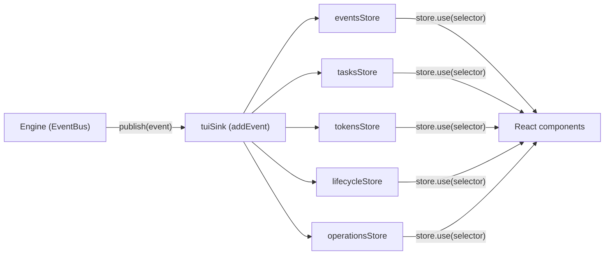

# Stores and UI

How state flows from the engine to the screen. Read this before adding a store, a feature, or an overlay. Prerequisites: [MENTAL-MODEL.md](./MENTAL-MODEL.md) for concepts, [ENGINE.md](./ENGINE.md) for how the EventBus delivers events, [HOW-IT-WORKS.md](./HOW-IT-WORKS.md) for the full flow.

---

## The store factory

`src/stores/create-store.ts` creates a store from an initial value or factory function. Each store exposes five methods:

- `get()` -- synchronous read. Used by non-React UI/CLI glue and store actions.
- `set(updater)` -- replace state or pass a function `(prev) => next`. Skips notification when the new value is reference-equal (`Object.is`) to the old one, so updaters must return new objects to trigger subscribers.
- `subscribe(listener)` -- register a callback, returns an unsubscribe function.
- `use(selector)` -- React hook. Wraps `useSyncExternalStore`. Caches the selected value per render -- if the store state reference and selector function haven't changed, it returns the cached result without re-running the selector.
- `reset()` -- restore to initial state.

Stores are module-scoped singletons. Import the store, call its methods. No providers, no prop drilling.

`storeBase(store)` strips `set` from the public surface, exposing only `use`, `get`, `subscribe`, `reset`. The `set` method is kept in a private `_nameInternal` export so only the store's own actions file can write to it.

**What the codebase does not use:** No React Context for state (only `ThemeContext` for colours). No `useMemo`, `useCallback`, `React.memo`, `forwardRef`, `useImperativeHandle`. The store pattern makes them unnecessary.

Every colour is a theme token from `src/core/theme/palette.ts`; `resolveTheme` maps it per colour level to a readable truecolor, 256-index or ANSI value against the detected background; components paint no faint (SGR 2) or fixed colours.
Every `Text` in `src` is `ThemeText`, which drops an `undefined` colour so the terminal's own colour shows.

---

## Engine to UI -- the event path



The engine publishes events through the EventBus. `addTuiEvent` in `src/features/workflow/tui-sink.ts` bounds each event and hands it to `addEvent` in `src/stores/workflow/actions/event.ts`, which dispatches each event synchronously to workflow sub-stores in a fixed order: safe event log, tasks, tokens, lifecycle, and operations. React 19 + Ink batch these synchronous updates into one commit, so subscribers see a consistent snapshot.

This is the only event path from engine to UI. UI composition boundaries may call engine read/run APIs explicitly — for example `useWorkflowRunner()` starts `runWorkflow()`, and command-context wiring can invoke snapshot functions — but engine events still flow into render state through stores, not direct component imports.

Store modules may import engine types with `import type` (`EngineEvent`, detection service types), but they must not import engine values. Engine modules do not import store values; they publish events and receive explicit inputs.

`runner_call_*` events are part of that same event stream. `addEvent()` projects the event-log copy before retaining it: raw `runner_call_text_delta`, tool-use, session-id, artifact, warning, error, and completion events are not stored in `eventsStore.events`. The same original event still reaches the operational stores in the same synchronous dispatch. `operationsStore` consumes runner-call lifecycle events as the canonical active-operation lifecycle for the status row: start, terminal status, duration, partial output flag, runner/model metadata, grouped warnings, and usage. Terminal operation fields are frozen once a call is cancelled/completed/failed, so late abort or warning telemetry cannot mutate the visible cancelled row. The engine separately projects safe `runner_call_activity` events from structured tool/action/artifact progress; conversation rows render that already-redacted activity surface as compact task/activity children. Raw runner text/tool/session/artifact payload events stay silent in conversation rows, and `tokensStore` does not count runner-call usage directly. `cost_update` remains the canonical user-facing token/cost projection, which avoids double-counting.

Cancellation has the same shape in every path. UI cancel first records a local cancellation intent so the screen stops spinning immediately, then the engine publishes `workflow_cancelled` with a reason such as `user_cancelled`. Both paths terminalize running operations with `endedAt` and `durationMs`; late `runner_call_error(status: aborted)` or final cost events are accepted idempotently.

When the workflow needs a human decision -- approve the plan, answer a question, confirm a write -- it uses a separate mechanism: the engine awaits a promise, and the UI resolves it when the user acts. These blocking callbacks are distinct from the fire-and-forget event path. The approval store (`src/stores/approval-prompt/`) and the `useInputMode` hook manage this.

---

## Store groups

### Workflow -- `src/stores/workflow/`

Runtime state of the active workflow run.

- **eventsStore** -- the TUI-safe event log. Array of projected `EngineEvent` objects, merged and capped. It keeps structural workflow/task events, safe planner/validation messages, and safe `runner_call_activity` display events. It does not retain raw runner text, tool-use, session-id, artifact, warning, error, or completion payloads. When capped, ordinary activity/log events are evicted before structural task/config events so completed-task summaries and active task grouping remain reconstructable. Consecutive text chunks merge until an implementer message marks its first chunk with `messageStart`; older events without the marker keep their original merge behavior. Command updates and results replace the outstanding `running` row anywhere in the log, even across warnings. A `full_suite` matches by `suiteCommandKey`; a `validate` matches by task id. Live and replay logs share `commandReplacementIndex`, so each command run keeps one row.
- **lifecycleStore** -- current phase (`planning`, `reviewing-plan`, `implementing`, etc.), cancellation flag, and message queue depth.
- **tasksStore** -- task map, ordered task list, current/total counts.
- **tokensStore** -- token usage, cost, pricing context, per-phase breakdowns.
- **operationsStore** -- active/last normalized runner operation. Terminal states carry frozen `endedAt` / `durationMs`, and running states stay compact. Runner warnings are kept only while the call is running and only when their surface is `status`, `activity`, or `transcript`. They are grouped by fingerprint/code/source/surface with count, first/last timestamps, latest message, and max severity.
- **conversationScrollStore** -- scroll offset for the conversation view.
- **stopStore** -- the run's stop state: the `intent` the operator chose (`none` / `stop-now` / `pause-after-brief` / `end-run` / `quit`), the `phase` it has reached (`idle` → `requested` → `terminating` → `forcing` → `parked` / `ended`), when it was asked for, and the parked brief with the resolver that resumes it. A final review that passes before a stop lands closes a run without a workspace complete and makes a workspace run ready to apply, and nothing was stopped: the store goes back to `idle` once a queued leave or quit has gone, so the closed run's own byline shows and no stop menu opens, and the lifecycle is laid from the saved state, so it reads the completion rather than the cancellation End run marked at the keypress. There is no armed-intent ladder: one press opens the sheet, one row applies. After End run the store stays `ended`, so the stop sheet still offers Back to sessions, and the byline is the closed run's own (`bylineText`): the stop ladder adds no line.
- **streamingOutputStore** -- live code lines from `extracted-code` implementers (`api` and `shell`). Direct writers narrate in transcript rows.
- **transcriptTailStore** -- the rows and scroll units the blocks after the run's own events add, so the keyboard scrolls the document the screen painted rather than stopping at the last event.
- **reviewStore** -- which file is under review, the scroll offset, and the rendered Markdown row height.
- **attachmentsStore** -- files attached to the next user message.

On `turn_interrupted` or `workflow_cancelled`, the operations reducer clears every running command stage. The events store settles unfinished `full_suite` and older `validate` rows as `stopped` in the dim tone. Both `mergeEvent` and `mergeEventLog` apply this rule. The engine publishes no command settlement for a stop, and live continuation and hydration retain no stale command clock.

### Navigation -- `src/stores/navigation/`

- **routerStore** -- current screen (`home` | `workflow` | `setup`) plus screen-specific data. Validates transitions against a fixed map. The `workflow` route carries the run itself: a `RunRecord` (`src/core/sessions/run-record.ts`) and whether a process in this session is driving it (`execution: { kind: 'local'; prepared; steer? } | { kind: 'at-rest' }`). Every session selection lands there — `handleSessionSelect` reads the record, replays the history and navigates at rest, whatever the run did. The record is complete before the route changes, so the screen does no disk IO; `routerStore.updateRun({ run, execution? })` re-reads it in place when the run loop returns or a command changes its checkpoint.

### UI -- `src/stores/ui/`

- **overlayStore** -- active overlay type, overlay stack, exclusive flag.
- **feedbackStore** -- user-facing feedback. Informational messages and transient errors auto-clear after 3 seconds; persistent errors remain until replaced or reset.
- **controlsStore** -- sidebar visibility, input mode echo.
- **terminalSizeStore** -- reactive terminal cols/rows, subscribes to resize events.
- **inputHeightStore** -- current composer height in rows.
- **composerLiveStore** -- whether the composer is empty right now. Session draft persistence lives in `src/stores/ui/session-drafts.ts`, backed by each session’s `draft.json`; departure flushes pending writes before leaving or quitting.
- **inputHistoryStore** -- command history with disk persistence.
- **commandPaletteMruStore** -- most-recently-used entries for the command palette.
- **projectFilesStore** -- refresh invalidation tick for project-file completion; the composer owns the async file read and local suggestion list.
- **pickerViewStore** -- the seat picker's sub-view, preserved left index, expanded model, option draft and text draft. See [The picker view state](#picker-view-state).
- **composerDraftStore** -- a one-shot draft request (`{ epoch, value }`) aimed at the composer. Code outside the composer -- the palette's prefill of an `arg` command, a visual fixture -- sets the draft only through this store, never by reaching into the composer.

### Project -- `src/stores/project/`

- **configStore** -- loaded `Config` object, project directory, CLI overrides, disk persistence.
- **skillsStore** -- available and selected skills, which every seat of the next run or continue carries; opening a run selects the skills it saved.
- **detectionStore** -- detected tool availability (git, npm, language runtimes).
- **sessionsStore** -- past session metadata.

### Discovery -- `src/stores/discovery/`

- **modelCacheStore** -- provider model lists with TTL-based expiry.

### Approval -- `src/stores/approval-prompt/`

Promise-based gates. `openApprovalPrompt(request)` returns a promise. The store holds the pending request and its `resolve` function. The UI renders the prompt, the user acts, the component calls `closeApprovalPrompt(response)`, and the promise resolves. The engine continues.

### Reviewer checks card -- `src/stores/review-checks-prompt/`

The same promise-based gate for `validation.approve_checks: ask`. `openReviewChecksPrompt(request)` holds the reviewer's chosen commands. The workflow screen renders `ReviewChecksCard` (`src/features/workflow/review-checks/card.tsx`) above the composer, and `⏎` on **Run all** or **Skip all** calls `closeReviewChecksPrompt('run' | 'skip')`. A stop or a teardown closes the card with no answer: a stop aborts the review, and a card closed in any other way runs none of the commands and records `the reviewer checks card closed without an answer`.

---

## The multi-store hook

`useStores()` from `src/stores/use-stores.ts` subscribes to multiple stores in one call. It returns proxied state objects that track which properties each component actually reads. On the next store update, it compares only the accessed properties -- if none changed, the component skips re-rendering.

```ts
const [router, overlay] = useStores(routerStore, overlayStore);
// Only re-renders when router.screen or overlay.active changes
// (assuming those are the only properties read in JSX)
```

Use `store.use(selector)` when reading one store. Use `useStores()` when reading two or more in the same component.

---

## Screens

`src/app/router.tsx` reads `routerStore.screen` (via `app/root.tsx`) and dispatches the matching FLAT page from `src/app/screens/`:

| Screen | Component | Location |
|---|---|---|
| `home` | `HomeScreen` | `src/app/screens/home.tsx` |
| `workflow` | `WorkflowScreen` | `src/app/screens/workflow.tsx` |
| `setup` | `SetupScreen` | `src/app/screens/setup.tsx` |

Features are vertical slices. Each `src/features/<name>/` owns its screen (or overlay/picker), local components in `components/`, local hooks in `hooks/`. Features never import from each other. Shared code lives in `src/components/`, `src/hooks/`, `src/utils/`.

---

## WorkflowScreen

The main screen during execution. Key hooks:

- **`useWorkflowRunner()`** -- starts the engine via `runWorkflow()`, passing `tuiSink: addTuiEvent` and managing the run lifecycle via an `AbortController`. The EventBus is created inside the engine (`runWorkflow` init wires the `tuiSink` to it). Returns `startedAt` and `handleResume`.
- **`useInputMode()`** -- manages three input modes: `normal` (typing), `review` (approve/reject), `question` (answering planner). `setReviewMode()` and `setQuestionMode()` return promises -- the engine blocks until the user acts, then the promise resolves.
- **`useWorkflowKeys()`** -- workflow-local keyboard shortcuts: Ctrl-D toggles the latest diff locally, plus review/conversation arrow navigation. Stop now (`ctrl+c`) and the `esc` that opens the stop sheet live in `src/app/keys.ts`.

Key components: `Header` (the three-stage rail: Plan · Build · Review — `RAIL_STAGES`, `src/core/rail-stages.ts`; every pre-build phase maps to Plan through `getRailActiveIndex(phase)`; done and active stages both show `●`, only the active one bright and bold, and pending stages show `○`. A live run that completes replaces the rail with one done line, `done · 4/4 briefs passed · no drift` — the fraction from the task list, then `no drift`, `drift found` or `drift not run` when no drift report exists. A run whose final review failed never reads `done`: the rail shows `✗` on Review, live or at rest (`recordPhase`, `src/features/workflow/at-rest.ts`), and `×` once the run is ended. A run at rest that is complete shows three `●`), `ConversationFlow` (row-based event stream), `Sidebar`, `Composer`, `InputFooter` (byline), `ApprovalPrompt`, `QuestionPrompt`.

The clock pinned right of the `Header` rail is the run's clock: how long the run has run (`runElapsedMs`, `src/stores/workflow/lifecycle.ts`). It keeps counting while a question, a gate, an approval or a recovery choice waits on the user, because the run is still running, and it stops only when the run stops — a park, a run at rest (frozen at the last event its log carries), or its end. The time a run sits parked or stopped is no run time: a resume banks the stretches before it in `lifecycle.bankedRunMs`, and the clock counts on from that sum. Ending an at-rest run keeps the clock where the park stopped it, so the time the run sat parked before End is not on it. The byline's clock is the one that leaves waits out. The `animate` flag of `deriveWorkflowDisplay` stops spinners at a prompt, never a clock.

The **Build progress block** is fixed chrome under the header rail (`BuildProgressBlock`, `src/features/workflow/components/build-progress.tsx`, rendered by the workflow page inside `ScreenShell`'s header). `deriveBuildProgress` (`src/features/workflow/display/build-progress.ts`) reads task, lifecycle and operations state and returns three lines of facts — counts (`3/7 briefs passed`, plus `escalated` / `failed` only when non-zero, and `attempt N of M` only from attempt 2 of a brief in the build), the activity line (the seat and what it is doing, the check command it is inside, or the reviewer check and its command — `Reviewer check V1 · npm test`, `Base re-run V1 · npm test`, `Fix check V1 · npm test`), and freshness. While a plan check, reviewer check or its base re-run runs, freshness reads the command's own clock (`running 10:02`, or `running 0:35`, using `formatElapsedClock` just like the byline). Otherwise freshness reads `last event 3s ago` until the idle watchdog has warned that a seat on a call is silent — check, suite and base events count as runner events for freshness (`full_suite`, `checks_run`, `validate`, `review_checks`) — after `RUNNER_IDLE_WARN_MS` (5 minutes) by default, tunable per runner as `idleWarnMs`, and never below the 60 s `UI_IDLE_WARN_MS` floor. Then it names what the seat does through the silence: `No output for 5:12 · running <command>` for a tool the stream opened and has not closed (`OperationsState` keeps the open tools per call), `No output for 5:12 · tools report when done` for `opencode` and `kilo-code`, which report tools only when they end, and `No output for 5:12` otherwise. The clock continues to count, and output clears it. The watchdog warn never ends the call; the user stops it with Esc. There is no ETA. The block repaints on the shared run clock while the run is running, so freshness moves when nothing else does. Freshness is the one home of runner silence while the block is on screen: a running command is no seat's silence, so its own clock takes the freshness line, and the byline shows the normal live status beside the block and states the silence only where no block is painted. Whether the block is painted is one answer, `getProgressRows` (`layout/chrome-rows.ts`): the screen asks it and hands the answer to the byline, and the input paths (`layout/snapshot.ts`) ask it from the same facts — the phase, a cancel or recovery halt, a gate, question or stop menu taking the prompt rows, and a run at rest. The same facts appear at every width, regrouped rather than dropped: two rows at 120 columns and wider (activity and freshness share the second row; `buildProgressRowCount` receives the chrome content width, so the threshold is 118 columns), three below, in the build and in the final review alike (`buildProgressRowCount(contentWidth)` in `layout/chrome-rows.ts`). During the final review no brief runs, so the counts line carries no attempt. With no call running in the final review, the activity line reads `Review · waiting for the verdict` and freshness reads `last event … ago`, or stays blank before the first event; a running reviewer check or base re-run reads `Review · Reviewer check V1 · <command>` or `Review · Base re-run V1 · <command>` on its own clock. A fix check runs in Build and reads `Fix check V1 · <command>`. Summary and compaction calls read `Review · Summary` and `Review · Compaction`, without the reviewer identity. A `review_fix_started` event marks the appended review fix tasks as pending in the task store. Earlier briefs keep their passed status. The fraction includes every brief and increases when a fix task passes. The only fraction in the block is passed briefs. Token usage and monetary estimates appear only in the explicitly opened `/usage` overlay; the sidebar and closed-run ledger do not show them. There is no Show spend control.

The task reducer reads `lineageAttempt` and `attemptAllowance` from `implementer_generate_running` at every attempt start, including consult and answer attempts. The publisher derives them from `lineageAttemptsOf(state, task)`, the same counter the ladder bounds. `task_started` and real `task_retry` events also carry these fields; consult and answer attempts add no Retry row. Older attempt-start events without the fields preserve the counters already recorded. Replay uses the same reducer; state hydration preserves these counters. After an Apply undo, the closed block says **Apply undone**, counts any conflicts kept on its Apply row, and offers no second undo.

`Sidebar` asks `layout/rect.ts` for its task-title budget (`getSidebarTaskTitleWidth`) instead of deriving one: the budget is the exact interior of the row it renders into — border, padding, and the bar/marker/space prefix accounted for — and shortens further when a status tail claims cells, so a long title always fits on one line.

The sidebar is the run's persistent task list, and it ships on: `controlsStore.sidebarVisible` starts `true`, `getWorkflowSidebarWidth` suppresses it at 120 columns and below, and `/sidebar` toggles it. Every task in the plan stays listed for the whole run, marked `✓` done (dim), `◉` running (foreground, bold, with the `▌` live bar), `○` pending, `▲` escalated, `✗` failed, `–` skipped. None of those glyphs may be tinted with `accent` — cyan is reserved for paths and links.

`tasks_planned` announces the whole plan once, before the task loop, so the list shows pending rows from the start instead of learning each task only when it begins. `updateTaskMap` seeds one `pending` entry per announced task and never downgrades a task that already earned a status, which is what makes the event safe to republish on resume. **`tasks_planned.total` is the authoritative plan size**; `task_started.total` remains only for streams that predate the announcement. The two cannot disagree — `runTaskLoop` derives both from the same `state.tasks.length` on the same entry — so the header cannot flicker as the first task starts.

The `N queued` count survives only as `selectTaskListView.unannounced` (`total - tasks.length`), which the plan announcement drives to zero; it renders as `+N more` so it never repeats the `queued` wording the overflow marker uses. Only `escalated`, `failed` and `skipped` carry a status word — a dash against a circle is the whole distinction between skipped and queued, so the states the user has to act on keep their word at every width, while done, running and pending never needed one. `getSidebarStatusColumnCells` reserves the 11-cell status column on **every** row of a list that contains any of those three, filled or not, so all titles truncate in one column instead of ragging against a right-aligned word of varying length; a list with none of them reserves nothing and spends the cells on titles. Label case is settled: Title Case for the `Tasks` header and the `Planner`/`Implementer` role names, lowercase for every state and metric word (`done`, `escalated`, `failed`, `skipped`, `queued`, `above`, `below`, `local`).

When the list is taller than its row budget, `getSidebarTaskWindow` windows it around the running task; the running task is always inside the window. The markers name what is out of view rather than only counting it — `7 done above`, `13 queued below`, falling back to a bare count when the hidden slice is not all one status — because the list follows the run instead of scrolling, so a bare count would be a dead end. When the budget affords only one marker row, `combine` collapses both edges onto it so neither is silently truncated; only a budget with no marker row at all (a single row, which the anchor claims) reports no marker. A combined row that cannot hold both labels in full drops the direction words from both sides at once (`11 done · 12 queued`) rather than a status word from one side, because an asymmetric drop reads as the two edges meaning different things. `getSidebarTaskListRows` derives the budget from the `height` the screen passes down through `WorkflowBody`; without a height the list never windows.

The panel reads on two left edges, not four: the header, the divider and every footer row sit on the marker column, titles and overflow markers sit on the title column, and the `▌` live bar hangs alone in the column left of the markers. The footer gives the planner and the implementer a row each — one shared row spent its whole width on the planner and cut the implementer away at the 34-column floor. The empty state uses the same grid: `No tasks yet` on the title column, the spinner on the marker column with the stage label beside it, and no separate "planner is working" line, since the spinner row already says the planner is running and names the stage.

Settled sections render inline inside the one scroller in finish order: `groupEventsIntoSections` turns a finished brief's event range into a `completed-task` section and the planning or review rows before another brief into a `settled-stage` section. `walkTranscript` yields both in event order as one-row transcript blocks (`ConversationRow` with `node` = `TaskSummary`, via `settledRowBlock`), with no blank spacer between consecutive settled rows. Stage rows use the brief row's mark, id, title and dim detail run: `✓ Plan <feature>  <duration>`, `✗ Review 1 failed  npm test, 4 checks · fixes T006 T007 T008 · 47m 14s`, or `✓ Review 2 passed  <duration>`. `review_fix_started` stays with the review it closes. There is no sticky Completed ledger, no `Completed · N/M briefs passed` heading, no `+N earlier` row, and no row cap: settled stages and briefs scroll with the rest of the continuous transcript. The build progress block and the sidebar carry the counts. Build-phase rows between two briefs join the earlier brief only up to the first `consult_answered` event whose `taskId` is the next brief; from that event on they join the next brief.

Done brief rows in the transcript and closed ledger share `TaskSummary` and `fitDetailRun`. They keep `· <method> · <duration>` at every width, dropping retries before the path shortens. Path elision shares the picker label rule in `src/utils/display-text.ts`: whole middle directories go first (`testing/…/projections.ts`), then the first directory (`…/projections.ts`), then the path marker. Only when the bare filename cannot fit does it lose characters. Settled durations remain durations (`2m 0s`, `14.0s`). Check-row statuses `not run` and `chose none` join their words with `\u00a0`, so each phrase wraps as one unit.

A brief that a recovery restarted stays one section. When `task_started` opens a brief whose latest range is an abandoned range of the same brief, `groupEventsIntoSections` reopens that range instead of a new one (`src/core/sections/event-sections.ts`). The earlier attempt, its halt and its `Recovery` row stay in the brief's own section under the one header the brief opened with. `walkTranscript` folds one recovery — its prompt, its selection, the task reset and its outcome — into one row, `Recovery  <action> → <outcome>` (`recoveryRowBlock`, `src/features/workflow/conversation-rows/event-rows/dispatch.ts`); a reset that no recovery covers reads `Task reset  T002 back to pending`. The transcript's pending block, `Pending n`, spells each brief as its id and title, such as `T002 Publish and render`. It does not list the brief the run is on, even while a recovery has set it back to `pending`. When the block has fewer rows than pending briefs, its last row reads `+n more` inside the same row budget.

`ConversationFlow` batches safe `runner_call_activity` events by model call and builds one canonical activity batch view model whose render-facing fields are `visibleItems`, `hiddenCount`, `headerCount`, `renderableUnits`, `expandableKey`, `severityCounts`, `groups`, and `rawMarkers`, alongside identity/state fields `batchKey`, `expanded`, `headerText`, `headerRunner`, and `tone`. Header text, hidden-row affordance, scroll math, and activity target discovery all use that model, whose item identity is the normalized visible label/value rather than raw event count. The compact block shows the latest three distinct items, such as `Run  npm run typecheck`, `Read  src/app.ts`, `Search  useWorkflowRunner`, `Call  github/list_issues`, or `Art  plan.md`; when older distinct items are hidden, the batch shows the compact `ctrl+a` affordance for only that targetable batch. `/activity` and `Ctrl+A` both toggle the latest expandable activity batch. Historical `kind: 'session'` activity records still parse, but produce no rows, update counts or disclosure entries. Assistant/result text from runner streams is transcript/output content only. `FeedbackRow` reads `lifecycleStore.queueDepth` so the pending queue count remains visible near the composer without echoing queued text outside the conversation.

Raw activity expansion is an explicit boundary. `rawAvailable:true` means a safe display row has an expansion target in the persisted log; it does not mean raw text can be shown inline or shown without re-sanitizing. The transcript uses a `raw` marker only as an affordance. Default display payloads and expansion payloads canonicalize terminal controls before redaction.

Transcript rows share one column model, and the workflow screen's chrome stands on it. Column 1 carries centred glyphs only — marks, connectors and every box stroke — and text never enters it; text starts on column 3. Every row the transcript's own builders emit opens with one cell of empty padding (`ROW_LEADING`), so a row's mark — the block `●`/`◉`/`○` batch dots, the `❯` prompt marker on the user-message echo and the answered-question header, the `│` callout bar, or the `├`/`└` activity children under their batch header — lands on column 1 with its content on column 3; a row with no mark — planner/implementer prose, the `1.` question number, the answer, the `+N more · ctrl+a` affordance — leaves the two-cell mark slot (`MARK_SLOT_CELLS`, `components/row-leading.ts`) blank and starts its content on column 3 all the same. The two blocks that paint their own leading — the settled task and stage summaries and the closed run's ledger — spend the same cells. `rowLeading()` in `conversation-rows/row-markers.ts` owns that leading, and every row builder wraps at `width - rowLeadingCells(kind)`, so full lines do not clip at the right edge; a prose continuation never opens with the space the wrapper broke on. Hovering or focusing a row paints the `▌` bar into column 0, the padding cell left of the mark. The chrome rows are furniture rather than transcript content, so they open on the gutter line itself: the legend, the build block and the at-rest byline start on column 1 with the rail's pip, the byline's pip and every box stroke, and measure the full `getChromeContentWidth`. Column 1 is the screen's one left line: `WORKFLOW_GUTTER_X` (`layout/chrome-rows.ts`) is measured off `ROW_LEADING`, and the header rail, the question/approval/recovery panels, the stop sheet, the composer, the review frame and the sidebar all stand on it, with the same one-cell gap kept on the right. The boxes are box drawing — `borderStyleFor` returns the named frame (`round` for the input, `single` for panels, `bold` for gates) on a unicode host and `classic` on the ascii tier — standing on column 1 with `paddingX={1}`, so their content lands on column 3 beside the prose above them; a centred stroke sits on the marks' centre line, which is why no letter may share that column. The callout rail and the `├`/`└` connectors stay under their batch dot. Only the rules above and below the transcript — the header and footer dividers — bleed to the screen's own first and last columns, and the closed ledger's own rules stop one column short of the composer's right stroke rather than overhanging it by half a cell. There is no transcript max-width cap: the conversation spans the full content width, and a visible sidebar squeezes it by a clamped 25% share — floored at 34 and capped at 48 columns, gated on widths above the workflow-local 120-column breakpoint — plus a 2-column gap (`layout/rect.ts`).

Activity batches always render a header (`PLAN activity  4 updates  [Claude Code CLI · Opus 5.5]`), even for a single event, so the header does not flicker in as a batch grows. The bracket is `headerRunner`: the tool and model the batch's own call ran on, in the seat identity's words — the tool's display name (a call the Claude runner names `claude` resolves to its tool through `cliToolIdForCommand`) and the model's catalog label (`resolveModelDisplayName`), with no axis words, since a call's record carries none — so a batch from before a seat swap keeps naming the runner that produced it. On a narrow row the header sheds the model before the tool, and a tool name that would be cut leaves the row rather than ending it in half a name. Ledger labels render as Capitalized display strings via `display/activity-label-display.ts` (`Run`, `Read`, `Edit`, `Search`, `Call`, `List`, …); hints stay lowercase (`+3 more · ctrl+a`). Shell commands from CLI runners pass through the conservative prettifier in `display/shell-activity-pretty.ts`: `cat` / `sed -n` / `head` / `tail` become `Read`, `rg` / `grep` become `Search`, `ls` becomes `List`, and anything compound (`&&`, `|`, `;`, redirects) stays a raw `Run`.

Pre-review collection publishes `full_suite` at `moment: plan` before and after each plan or task check. Only a render carries `scenario`. Its row reads `Render workflow-x · running`, then `rendered · 14.2s` or `failed · 14.2s`. The build block reads `Review · Render workflow-x` with freshness `running 0:12`; the byline reads `Review · Render workflow-x 0:12`. Render displays omit the command; other plan checks retain their id and command. Plan rows add no reviewer-check reds to stage summaries or the closed ledger.

Live status renders in the byline under the composer, not as a transcript row. `deriveLiveStatus()` in `display/live-activity.ts` decides whether a stage is live; `InputFooter` renders `⠼ Planning… 2:24` with spinner, verb, and elapsed in the active stage's role hue and the rest dim. The elapsed time is formatted with the single `formatElapsedClock` (`m:ss`, or `h:mm:ss` once past an hour). The byline names a seat only while its call runs (`Review… <reviewer>` during the reviewer call, `Review · waiting for the verdict` between calls, and `Review · Summary` or `Review · Compaction` during those calls). While a plan check, reviewer check or its base re-run runs, `deriveLiveStatus` names it from the running `full_suite` event in the operations store (`Review · Reviewer check V1 · <command>`, `Review · Base re-run V1 · <command>`, `Fix check V1 · <command>`) and counts from that command's start. An older session's `full_suite` without `id` keeps its stage wording. While a prompt is open (question, review, approval) the byline shows `○ Waiting for your answer · <stage>` instead. The byline carries only derived status, never model answer text or raw stdout. Spinner frames are braille on every unicode-tier terminal and `|/-\` on the ascii tier (`src/lib/glyphs.ts`).

Scroll banners ride the chrome dividers instead of consuming transcript rows: `N lines above` on the header divider, `N lines below · ↓ N new events` on the footer divider. `flow.tsx` reports the labels through `onScrollAbove` / `onScrollBelow`, and `layout/scroll-window.ts` gives the window the full viewport height. Question-mode prompts (interrupt continuation, clarify questions, edit conflicts) render as a bordered panel above the composer (`components/question-prompt.tsx`, budgeted by `getQuestionPromptRows` in `prompt-rows/question.ts`) with the transcript still visible; only review mode swaps the body.

Conversation scrolling is row-based. `planner_text` events with `content: 'markdown'` are parsed with the pure Markdown block/inline/layout utilities before they become conversation rows; unmarked planner/implementer text stays plain log output. The parser covers text, bold/italic/strikethrough, inline code, links, leading-pipe GFM tables, headings h1–h6, and lowlight-highlighted fenced code; markdown HTML comments (including planner `<!-- Q:… -->` clarification markers) parse but never render. Layout segments carry `href` (link target), `scope` (highlight token), and `depth` (heading level) as data only — `workflow-markers.ts` scans inline workflow tokens, `conversation-segments.ts` maps them to conversation-row tones and paths, and `review-segments.ts` maps them for the review overlay; OSC 8 hyperlink sequences are resolved only at render time in `row-view.tsx` (transcript) and `components/markdown.tsx` (review overlay), never baked into the parsed rows. Safe `runner_call_activity` events become batched styled activity blocks; raw runner-call text/tool/session/artifact events do not. See [`WORKFLOW-CONVERSATION-SCROLL.md`](./WORKFLOW-CONVERSATION-SCROLL.md) for the row renderer, prompt-row budgeting, terminal resize behavior, and scroll-window invariants.

The projection and per-event row blocks are cached by identity, not content. `getConversationRowsProjection` (`conversation-rows/projection-cache.ts`) hits its cache when all six inputs — sections, expanded-diff/activity sets, cols, viewport height, streaming state — are reference-equal to the prior call, so a cache hit costs a handful of `===` checks regardless of transcript size; this replaces the old content-key hashing, which re-serialized every event on every lookup. `conversation-rows/block-cache.ts` memoizes per-event row blocks in a `WeakMap<EngineEvent, …>`, so appending one event reuses every unchanged event's block instead of rebuilding the transcript. Both caches lean on the store layer never mutating events or sections in place (`mergeEvent` and `computeSections` re-allocate on change) and both reset at workflow start. The composer-byline live status derives from `lifecycleStore`'s `phaseFirstSeenTs` map — one timestamp recorded the first time each phase is seen — instead of rescanning the full events array on every spinner tick. The elapsed time it prints is that timestamp minus the time the run spent waiting on the user: `waitingSince` opens when a question or an approval takes the screen and closes on resume, and the total lands in `waitedMs` under the phase it was spent in, so answering a prompt never inflates the stage clock behind it. A resume — the engine's `workflow_resumed` or a park settled in-process — records `resumedAt` and clears `waitedMs`, and the clock counts from the later of the stage's first-seen timestamp and `resumedAt`, so a run replayed from an earlier process does not count the hours it sat parked. While the engine names a planner call, the clock is that call's: a call that follows another records `plannerCallStartedTs` and clears `waitedMs`, so `Compiling briefs…` counts neither the plan call before it nor the waits that call spent, and the first call after a start or a resume records that start, so the preparation before it stays on the clock.

The planning session's questions use the bordered `QuestionPrompt` panel above the composer on every run. A typed question with `choices` shows as a choice and one without shows as a text input; the default comes first with a dim `default` mark, and a free-text question starts filled with its default, so walking through with `⏎` takes the defaults. The transcript shows `Questions before the plan · round <n> of 2`; the byline reads `Waiting for your answer · Plan`. The operator's consult answer is published as a `user_message` event with `qa` and rendered with the existing answered questions row block (`answeredQuestionsRowBlock`), joining the brief's section. When a plan fails checks before repair, the warning names the failed check code and reason: `The plan failed check <code>: <message>; it goes back to the planner once.` The embedded message drops its trailing full stop before `(+N more)` and the semicolon. The warning adds `(+N more)` when multiple checks failed; `planCheck.message` keeps the raw message.

The plan card has one text-editing path. Pressing `Ctrl+E` or typing `e` or `edit` opens the run's `plan.json` in the in-app editor overlay (`openReviewEditor`, `src/features/workflow/review-editor.ts`). A save checks the JSON, `PlanProposalSchema` and `checkPlan` without the context fit (`planSaveErrors`, `src/features/editor/plan-save.ts`); a refused save keeps the overlay open on one red row, `Not saved: <first message> (+N more)`, with no check codes. A valid save writes `plan.json`, closes the overlay and sends `requestApply` through `externalEditRequestStore`; `useWorkflowInlineEdit` then settles the card with `{ approved: false, action: 'edit' }`, and the engine re-validates and compiles. `Ctrl+O` in the overlay opens the external editor on the same file; its save settles the card the same way. External-editor resolution uses explicit `VISUAL` first, then non-terminal `EDITOR`, then detected GUI editors (`cursor`, `code`, `zed`, `subl`, `mate`, `bbedit`) with wait flags, macOS `open -W -t`, terminal `EDITOR`, and finally `vi`. Implicit GUI auto-detection probes only safe absolute `PATH` segments (empty, `.`, and relative segments are skipped) and spawns the resolved absolute executable path. There is no brief field editor, no brief yank and no brief focus key.

---

### Review projection store

`src/stores/workflow/review.ts` is the UI projection store for the review surface. It owns the
current review source, owner token, revision, scroll offset, rendered/visible row counts, brief
paths/sources, and the load error used to paint the review. Components read it with `store.use()`
and local review actions update only that display state; it owns no persistence and calls no
provider.

---

### Whole-screen geometry and composer ownership

The workflow's fixed rows are owned by `ScreenShell`: one header row, one header divider, the
scrollable body, one footer divider, one feedback row, the variable-height composer, and one input
footer/byline row. `layout/chrome-rows.ts` is the shared row contract used by viewport and pointer
geometry; scroll banners ride the dividers and never consume body rows. The composer is outside the
body rectangle and is always terminal-originated: `x = 0`, `width = cols`. Recovery status,
help text, prompt text, sidebar visibility, and review content width may change the composer height
or its hint, but never its x-coordinate or width.

The sidebar rule is exact: it renders iff `sidebarVisible` and `cols > 120`
(`getWorkflowSidebarWidth`, `src/features/workflow/layout/rect.ts`) — `/sidebar` turns it off at any
width. At 121 columns it has its clamped width and the two-column gap; the body and the sidebar end
on the same bottom row. At 120 columns and below the sidebar and gap both disappear and the body
reaches the content bottom, which is what all three gallery viewports render — 120x40, 80x24 and
60x18 (`REQUIRED_VIEWPORTS`, `testing/visual/catalog.ts`). The same rectangle equation is used for
the conversation and the document review, so zero-height and prompt-clamped bodies cannot
introduce a second breakpoint or hidden bottom row.

Sidebar seats keep the tool, model and effort words. An identity that exceeds its column wraps after the tool.
The second row starts in the identity column and keeps the seat color. Each row uses the existing segment rule.
The task list pays for every seat row. An inherited review seat stays on one row as `REVIEW = PLAN`.

## Overlays

`overlayStore` manages a stack. Opening a different overlay pushes the current one onto the stack and clears the exclusive flag. Opening the active overlay again changes only its focus and keeps its exclusive flag and stack. Equal focus leaves the state unchanged. Omitted focus clears the focus. `Esc` pops. When an overlay is active, `Layout` (`src/app/layout.tsx`) hides the screen and renders the overlay in its place.

Overlay types: `help`, `command-palette`, `skills`, `settings`, `planner-picker`, `implementer-picker`, `reviewer-picker`, `stop-sheet`, `sessions`, `usage-details`, `editor` — the `ACTIVE_OVERLAYS` tuple in `src/core/navigation/types.ts`, which spreads `SEAT_PICKER_OVERLAYS` (one picker overlay per seat picker role). There is no `crew` overlay: crew is the first section of `settings`.

The `stop-sheet` navigation token owns keyboard focus for a compact menu above the workflow composer (`src/features/workflow/stop/menu.tsx`, view in `stop/sheet.tsx`). Unlike covering overlays, the router renders `null` for this token, leaving the transcript visible and updating. `esc` opens it with or without a draft, with one exception: on the plan card, the first `esc` clears a comment draft and returns the keys to the card rows (`reviewKeysStore.commenting`); `↑↓` selects, `Enter` executes, a second `esc` performs Stop now, and `Tab` dismisses. End run is always an explicit selection. Rows come from `stopSheetRows`, and existing handlers write the intent into `stopStore`. Every row states its consequence, so the sheet is exactly as tall as its rows whichever one is selected and no row stands blank; a row that wraps breaks between clauses and hangs its continuation under its label. The composer temporarily displays one line without losing the draft. The menu replaces any question/review prompt visually while preserving its stored answers and focus. Once parked, the rows become Resume / End run / Back to sessions, and Esc leaves the session. Further Esc/Ctrl+C during stopping queue home/quit until cleanup and persistence complete. Ctrl+C at rest/home uses a two-second inline confirmation. `/stop` reopens the menu after Tab dismissal.

Each type maps to a component in `renderOverlay()` in `src/app/router.tsx`. The three picker overlays all render the same component parameterised by role: `<ToolModelPicker role="planner" | "implementer" | "reviewer" />` (`src/app/overlays/runners.tsx`). `role` is `SeatPickerRole` — the three members of `SEAT_PICKER_ROLES` (`src/core/runners/seat-roles.ts`); confirming a `reviewer` selection writes the `reviewer` block in project config.

### Settings ∋ Crew

Crew has no page of its own. `buildSettingsItems` (`src/features/settings/items.ts`) returns one flat `SettingsItem[]` — the crew rows from `deriveCrewRows` (`src/core/crew/rows.ts`, keyed `seat:<id>`) followed by the settings defs, sorted by section — and `settingsItemSection` files the crew items under the `Crew` section, which `SETTINGS_SECTIONS` orders first. One list, one cursor, one filter: `↑↓` walks from `PLAN` into `Tuning` without a mode switch, and a filter narrows seats and settings together. There is no escalation row or picker: the retired `escalation` block had no crew row, and the planner's consult runs on the PLAN seat.

- **Decoration slots.** The cross-lab verdict under `REVIEW` is not an item. It is a single `ListViewport` `after` decoration (`decorations.after`, `src/components/pickers/list-viewport.tsx`), so `computeListDisplayWindow` charges it against the row budget while it stays unreachable by the cursor. There is no `before` decoration and no spine row. A filtered list is no longer the block, so the page switches it off.
- **`pinnedHead`.** The page passes the crew item count as `pinnedHead`, so while the cursor is on a seat the window pins to the start of the list and the crew block stays whole at its head.
- **Layout.** Layout is pure. `planSeatBlock` (`src/features/crew/format.ts`) plans the whole block from `innerWidth` plus a row budget; `formatCrewRow` plans one row — the 8-cell label, the identity truncated to one budget shared by every row, and the right-aligned posture word. There is no rail and no branch: the renderer paints the cursor gutter and nothing else. `CrewRowView` and `CrewVerdictLine` (`src/features/crew/row-view.tsx`) render what it planned.
- **The ladder.** When the block does not fit its budget, `planSeatBlock` drops the verdict line — the one row it can yield. Posture is a width decision, not a budget one — it drops for the whole block when the identity column would fall under its minimum.
- **`/crew` deep link.** Bare `/crew` calls `overlayStore.open('settings', 'seat:plan')`; `/crew <seat>` opens that seat's picker directly. Settings reads its focus as the `initialKey` for `useFilterableList`, or as `initialFilter` when it carries the `filter:` prefix. A changed focus updates the cursor or filter while Settings stays open. A changed picker focus moves its tool or model cursor while preserving the picker view state.

The seat and lab models live in core, not in the feature: `src/core/crew/seats.ts` (`deriveCrewSeats`, the `plan` / `build` / `review` seats), `src/core/crew/rows.ts` (`deriveCrewRows`, one row per seat), `src/core/crew/presets.ts` (`computeCrewPresets`, which offers only crews whose every tool is installed and authenticated) and `src/core/crew/labs.ts` (`resolveLab` / `crossLabVerdict` — a verdict is rendered only when the labs behind `BUILD` and `REVIEW` are both determined). The feature keeps `use-crew.ts` (config + detection → `{ seats, presets }`), `rows.ts` (`crewActivate`, which maps a seat to its picker overlay and performs the `overlayStore.open`, or applies a preset in a single config save), `format.ts`, `row-view.tsx` and `preset-row.tsx`.

The first-run setup screen (`src/app/screens/setup.tsx`) composes the same feature — the ready-made crews above the same seat block, plus a continue row — so first run and `/crew` show the same seats through the same code.

### The sizing rule

`overlayRect` (`src/core/navigation/overlay-rect.ts`) computes every panel's rectangle from the live terminal size and a named density; the home body and composer apply a local 108-column cap:

| density | share | min | max | who |
|---|---|---|---|---|
| `compact` | 0.60 | 56 | 72 | start preparation, the picker's "initializing tools" panel |
| `roomy` | 0.70 | 76 | 96 | settings (crew included), help, palette, skills, sessions, the picker's sub-steps |
| `wide` | 0.90 | 76 | 140 | the seat picker, setup, the home body and composer (capped locally at 108) |

`width = min(cols - 4, max(min, floor(cols * share)), max)`; the frame costs 6 columns and 4 rows, and `overlayGutterRows` gives back one row of vertical air per 6 rows above the 18-row floor, capped at 2 (the first at 24 rows, the second at 30). Every panel passes a `density` to `OverlayPanel`; `maxWidth` no longer exists, so nothing renders byte-identical at 80 and 120 columns.

The workflow screen takes no density, live or at rest: its rail, dividers, transcript (the closed run's ledger included) and composer all span `getChromeContentWidth(cols)`, and nothing on it is centred.

### Picker view state

`pickerViewStore` (`src/stores/ui/picker-view.ts`) holds the seat picker's sub-view: which step is showing (`picker`, the two custom-command steps, custom model), the left index preserved across a step, the expanded model (provider routes or an option family), the drafted option-family variant its axis rows spell out, and the in-flight text draft. It replaces the picker's component-local `useReducer`. The move buys two things a component-local reducer cannot: the state survives the picker unmounting and remounting, and a test or a visual fixture can seed a step directly (`pickerViewStore.open(...)`, `pickerViewStore.expand(id, draftId)`) instead of driving keystrokes into it.

---

## Adding a new store

1. Create `src/stores/<group>/<name>.ts`.
2. Call `createStore(initialState)`.
3. Export the public API via `storeBase(store)` -- this gives consumers `use`, `get`, `subscribe`, `reset`.
4. Export `_nameInternal = { set: store.set }` for the actions file that needs write access.
5. If the store reads disk on startup: add an init call in `src/cli/init-stores.ts`.
6. Reset in tests: `beforeEach(() => store.reset())`.

---

## Key store shapes

State types from the source files. Use `store.use(selector)` in React and `store.get()` only in UI/CLI glue or store actions. Engine code publishes events and receives explicit inputs; it does not import stores.

```ts
// src/stores/workflow/lifecycle.ts
interface LifecycleState {
  phase: Phase;          // 'idle' | 'researching' | 'implementing' | ...
  status: 'idle' | 'running' | 'complete' | 'cancelled';
  cancelled: boolean;
  queueDepth: number;    // pending user messages
  startedAt: number | null;
  endedAt: number | null;
  durationMs: number | null;
  reason: string | null;
}

// src/stores/workflow/operations/state.ts
type OperationStatus =
  | 'running'
  | 'completed'
  | 'failed'
  | 'cancelled'
  | 'aborted'
  | 'timeout'
  | 'truncated'
  | 'refused'
  | 'unsupported_tool'
  | 'incomplete';

type ActiveOperation = {
  callId: string;
  role: 'planner' | 'implementer' | 'review' | 'summary' | 'compaction' | 'escalation';
  backendKind?: 'cli' | 'api' | 'shell' | 'agent';
  phase: Phase;
  taskId?: string;
  runnerName?: string;
  model?: string;
  attempt?: number;
  status: OperationStatus;
  startedAt: number;
  endedAt: number | null;
  durationMs: number | null;
  reason: string | null;
  usage: unknown | null;
  warnings: readonly OperationWarningGroup[];
  partial: boolean;
};
interface OperationWarningGroup {
  code: string;
  severity: 'debug' | 'info' | 'warning' | 'error';
  source: string;
  surface: 'hidden' | 'status' | 'activity' | 'transcript' | 'debug';
  fingerprint: string;
  count: number;
  firstTs: number;
  lastTs: number;
  latestMessage: string;
}

// src/stores/workflow/tasks.ts
interface TasksState {
  currentTask: number;
  totalTasks: number;
  tasks: WorkflowTask[];               // ordered list
  taskMap: Map<string, WorkflowTask>;   // id → task
}
interface WorkflowTask { id: string; title: string; status: TaskStatus }

// src/stores/workflow/tokens.ts
interface TokensState {
  tokenUsage: TokenUsage | null;
  perPhase: Record<string, PhaseTokens>;
  perTask: Record<string, PerTaskTokens>;
  localCount: number;       // tasks completed by primary implementer
  escalatedCount: number;   // tasks completed via escalation
  completedTaskCount: number;
  pricingContext: { plannerTool: string; implementerTool: string;
    plannerModel?: string; implementerModel?: string } | null;
}

// src/stores/workflow/review.ts
interface ReviewState {
  filePath: string | null;
  scrollOffset: number;
  renderedLineCount: number;
}

// src/stores/project/config.ts
interface ConfigState {
  config: Config | null;       // full resolved config (disk + CLI overrides)
  diskConfig: Config | null;   // config as persisted on disk, without overrides
  projectDir: string;
  overrides: CLIOverrides;
}

// src/stores/ui/picker-view.ts
type PickerSubView =
  | { kind: 'picker' }
  | { kind: 'custom-command-contract'; refocusKind?: 'shell' | 'agent' }
  | { kind: 'custom-command'; intendedKind: 'shell' | 'agent' }
  | { kind: 'custom-model' };
interface PickerViewState {
  view: PickerSubView;
  preservedLeftIndex: number;    // left column index restored when a step closes
  expandedModelId: string | null; // model showing its expansion: provider routes or option axes
  optionDraftId: string | null;   // variant the expanded option family's axis rows spell out
  draft: string | null;           // text the current step is editing
}

// src/stores/ui/composer-draft.ts
interface ComposerDraftRequest {
  epoch: number;   // increments per request, so the same text can be sent twice
  value: string;
}

// src/stores/navigation/router.ts
type RouteData =
  | { screen: 'home' }
  | { screen: 'workflow'; run: RunRecord; execution: WorkflowExecution }
  | { screen: 'setup'; onComplete?: 'home' | 'workflow'; feature?: string };
```

---

## Adding a new feature

1. Create the feature's components and hooks under `src/features/<name>/`. A pure-entry surface with no internals skips this — the page in step 2 is the whole surface.
2. Add a FLAT page in `src/app/screens` | `src/app/overlays`, then wire it into `renderScreen()` / `renderOverlay()` in `src/app/router.tsx`.
3. If it's a new screen: add the route to the `Screen` type and the `transitions` map in `src/stores/navigation/router.ts`.
4. Feature-local components: `src/features/<name>/components/`.
5. Feature-local hooks: `src/features/<name>/hooks/`.
6. When something is used by two or more features, move it to `src/components/` or `src/hooks/`.
