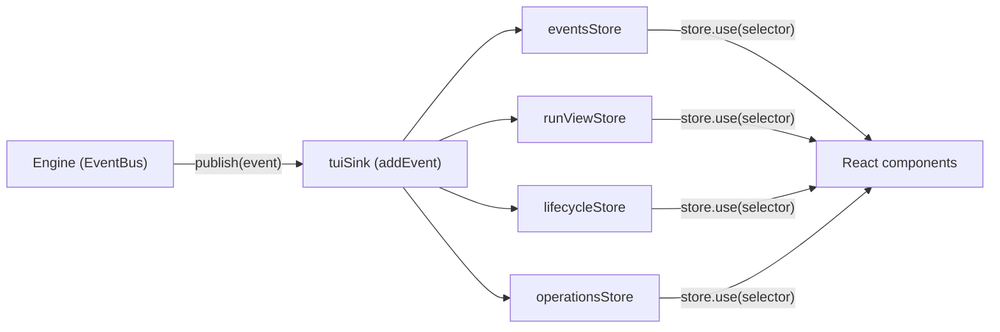

# Stores and UI

How state flows from the engine to the screen. Read this before adding a store, a feature, or an overlay. Prerequisites: [MENTAL-MODEL.md](./MENTAL-MODEL.md) for concepts, [ENGINE.md](./ENGINE.md) for how the EventBus delivers events, [HOW-IT-WORKS.md](./HOW-IT-WORKS.md) for the full flow.

---

## The store factory

SPLITBRIEF uses its own external store, built on React's `useSyncExternalStore`, in one short file. It gives the core of Zustand with zero dependencies: the project needs no middleware (devtools, persist, immer), partial merge semantics, custom equality functions or SSR support. The dependency count stays at zero and the whole implementation stays visible.

The store factory creates a store from an initial value or factory function: `const store = createStore<State>(initialState)`. It returns a `Store<T>` with five methods:

- `get()` -- `() => T`, synchronous read. Used by non-React UI/CLI glue and store actions.
- `set(updater)` -- `(updater: T | (prev: T) => T) => void`, replace state or pass a function `(prev) => next`. Skips notification when the new value is reference-equal (`Object.is`) to the old one, so updaters must return new objects to trigger subscribers.
- `subscribe(listener)` -- `(listener: () => void) => () => void`, register a callback, returns an unsubscribe function.
- `use(selector)` -- `<S>(selector: (s: T) => S) => S`, React hook. Wraps `useSyncExternalStore(subscribe, getSnapshot)`. `getSnapshot` caches the selected value per state and selector -- if the store state reference and selector function haven't changed, it returns the cached result without re-running the selector. This is concurrent-mode safe, with no tearing.
- `reset()` -- restore to initial state (a factory initial runs again), with the same `Object.is` bailout as `set()`.

State is a closure variable, not React state, so changes are synchronous. Listeners are kept in a `Set<Listener>`: no duplicates, O(1) add and remove.

Stores are module-scoped singletons. Import the store, call its methods. No providers, no prop drilling.

Design decisions:

- **Not React Context.** Context re-renders all consumers when any part of its value changes. External stores with selectors re-render only when the selected slice changes, and need no provider nesting.
- **Module-scoped singletons.** The app is a single CLI process: exactly one instance of each store, shared by React components, UI glue and store actions. No dependency injection, no second instance.
- **No `useMemo` / `useCallback` / `React.memo`.** Components subscribe to specific slices and re-render only when those slices change. Action functions are module-level closures with stable identity.

`storeBase(store)` strips `set` from the public surface, exposing only `use`, `get`, `subscribe`, `reset`. The `set` method is kept in a private `_<name>Internal` export (for example `_runViewInternal`) so only the store's own actions file can write to it.

**What the codebase does not use:** No React Context for state (only `ThemeContext` for colours). No `useMemo`, `useCallback`, `React.memo`, `forwardRef`, `useImperativeHandle`. The store pattern makes them unnecessary.

Option lists use `planListRows` to measure terminal cells. Rows share the widest key and name in the filtered group. A description with fewer than 20 cells beside the name wraps beneath it. Focus controls the cursor and keyboard input. Key letters keep their cells when focus moves.

Every colour is a theme token from the palette. Seat words use `CREW_SEAT_ROLES`; state words and marks use `stateTone(StateMeaning)`. Cause prose keeps `text`, and secondary text and separators use `textDim`. Dark `textDim` is `#9fa7bf`. The `dimError`, `dimSuccess` and `validator` tokens are removed. `resolveTheme` maps tokens to readable truecolor, 256-index or ANSI values against the detected background. Components paint no faint (SGR 2) or fixed colours.
Every `Text` in `src` is `ThemeText`, which drops an `undefined` colour so the terminal's own colour shows.

### Initialization

Stores that need data from disk are loaded **synchronously before React renders**:

```
CLI (commander parses args)
  → initStoresForTuiMount(projectDir, opts)
      1. configStore.load(projectDir, overrides)
      2. sessionsStore.load(projectDir)
      3. hook trust check
      4. discovery, returned as awaitDiscovery and not awaited:
         detection hydrate + refresh, then discoverSkills(projectDir) → skillsStore.setAvailable(skills)
  → routerStore.init(route)           // set initial screen
  → render(<App />)                   // React starts here, while discovery continues
```

`initStores()` runs the same steps and awaits discovery too; `splitbrief init` and the interactive `continue` path use it.

If stores were loaded inside React hooks (for example in a `useEffect`), there would be a render cycle where the store is empty, which needs loading flags and conditional rendering. Because the stores load before React boots, components always see initialized data. `configStore.useConfig()` throws if config is null: a fail-fast safety net for this contract.

Skill discovery also runs again after boot: both sites that open the skills overlay (`Ctrl+S` in the app-wide keys, and the `/skills` command through `ctx.refreshSkills()`) call `refreshSkills()`, which re-runs `discoverSkills(projectDir)` and feeds `skillsStore.setAvailable()`. It is a helper called from the open sites, not a mount-time effect inside the overlay.

---

## Engine to UI -- the event path



The engine publishes events through the EventBus. `addTuiEvent` bounds each event and hands it to `addEvent`, which dispatches each event synchronously to workflow sub-stores in a fixed order: the run view (phase, seat wait, halt and briefs), then the safe event log, lifecycle, and operations. React 19 + Ink batch these synchronous updates into one commit, so subscribers see a consistent snapshot.

This is the only event path from engine to UI. UI composition boundaries may call engine read/run APIs explicitly — for example `useRunLoop()` starts `runWorkflow()`, and command-context wiring can invoke snapshot functions — but engine events still flow into render state through stores, not direct component imports.

Store modules may import engine types with `import type` (`EngineEvent`, detection service types), but they must not import engine values. Engine modules do not import store values; they publish events and receive explicit inputs.

The engine does not write workflow stores directly and does not import `workflow/actions.addEvent`. It publishes on the `EventBus` (`wctx.bus.publish(event)`); the TUI sink, `addTuiEvent`, is subscribed at workflow init and forwards each bounded `EngineEvent` to `addEvent`. The direction is **engine → bus → sink → store → UI**:

- Engine code publishes events; sinks write to stores; UI components subscribe and re-render only when their selected slice changes.
- Non-event cross-cutting writes (abort and queue handler registration) go through the `sinks` surface on the workflow context. The engine does not import stores to observe cancellation; it receives an `AbortSignal` from the caller.
- Engine modules have zero React, Ink or store imports. They publish `EngineEvent` values and return data. Nothing in the engine calls `store.use()`, `store.get()` or store actions.

`runner_call_*` events are part of that same event stream. `addEvent()` projects the event-log copy before retaining it: raw `runner_call_text_delta`, tool-use, session-id, warning, and error events are not stored in `eventsStore.events`. A `runner_call_completed` is stored stripped: it keeps the call id, role, task and timing, and drops the native session id and the runner, model and invocation metadata. The transcript reads it only to know that the call ended, and it renders no row. The same original event still reaches the operational stores in the same synchronous dispatch. `operationsStore` consumes runner-call lifecycle events as the canonical active-operation lifecycle for the status row: start, terminal status, duration, partial output flag, runner/model metadata, and grouped warnings. Terminal operation fields are frozen once a call is cancelled/completed/failed, so late abort or warning telemetry cannot mutate the visible cancelled row. The engine separately projects safe `runner_call_activity` events from structured tool/action progress; conversation rows render that already-redacted activity surface as compact task/activity children. Raw runner text/tool/session payload events stay silent in conversation rows.

Cancellation has the same shape in every path. UI cancel first records a local cancellation intent so the screen stops spinning immediately, then the engine publishes `workflow_cancelled` with a reason such as `user_cancelled`. Both paths close running operations and record `endedAt` and `durationMs`. A late `runner_call_error(status: aborted)` leaves the operation closed.

When the workflow needs a human decision -- approve the plan, answer a question, confirm a write -- it uses a separate mechanism: the engine awaits a promise, and the UI resolves it when the user acts. These blocking callbacks are distinct from the fire-and-forget event path. The approval store and the `useInputMode` hook manage this.

---

## Store groups

`src/stores/` has one directory per domain, plus the factory (`create.ts`) and the multi-store hook (`use-many.ts`). There are **zero barrels** (`index.ts` files; see [NO-BARRELS.md](./NO-BARRELS.md)): consumers import directly from the store file. Files that are not stores sit beside the stores they serve: `ui/session-drafts.ts` (per-session `draft.json` load, save and flush, functions only), `ui/input-history-persistence.ts`, `project/config-persistence.ts`, `project/save-feedback.ts`, `discovery/detection-adapter.ts`, `workflow/operations/` (`state.ts`, `reducer.ts`, …) and `workflow/actions/`.

### Workflow

Runtime state of the active workflow run.

The ready card says that run changes await Apply. A seat switch can save the crew in `.splitbrief/config.yaml` before Apply. See [Seat down](./APPROVAL-AND-RECOVERY.md#seat-down) for this write.

- **eventsStore** -- the TUI-safe event log. Array of projected `EngineEvent` objects, merged and capped. It keeps structural workflow/task events, safe planner/validation messages, and safe `runner_call_activity` display events. It does not retain raw runner text, tool-use, session-id, warning, or error payloads. It keeps each `runner_call_completed` stripped of its native session id and runner, model and invocation metadata, so the transcript can tell when a call ended. When capped, ordinary activity/log events are evicted before structural task/config events so completed-task summaries and active task grouping remain reconstructable. Consecutive text chunks merge until an implementer message marks its first chunk with `messageStart` or a call's end separates the text of two calls; older events without the marker keep their original merge behavior. The text of a sub-agent (`subagentId`) never merges with the main text or with the text of another sub-agent. The held end of a word (`continues`) joins the text row it ends, past the tool rows that came while it was held. The held end of a sub-agent word also passes the text of the other sub-agents. Command updates and results replace the outstanding `running` row anywhere in the log, even across warnings. A `full_suite` matches by `suiteCommandKey`; a `validate` matches by task id. Live and replay logs share `commandReplacementIndex`, so each command run keeps one row. Shape `{ events: EngineEvent[] }`; written only through `actions.addEvent`.
- **lifecycleStore** -- run status (`idle`, `running`, `paused`, `interrupted`, `complete`, `cancelled`), cancellation flag, run clocks, queued count, and attached steerable call. It holds no phase: it reads each phase change from the run view. Shape `{ status, interruptParked, cancelled, queueDepth, queuedMessageIds, steerableCall, stall, startedAt, endedAt, durationMs, reason, lastRunnerEventTs, briefClock, plannerCall, plannerCallStartedTs, waitingSince, waitedMs, resumedAt, restored }`: `interruptParked` tells a parked prompt that owns the composer from an interrupt that has not reached a call boundary yet, `stall` is the silent call, `lastRunnerEventTs` is the run's last sign of life, `briefClock` is the time the current brief has worked, folded from the run's events, `plannerCall` is the call the run is on when the engine names one, `plannerCallStartedTs` is where the byline clock of that call starts, `waitingSince` / `waitedMs` keep time spent waiting on the user out of the stage clock, `resumedAt` keeps a resumed run's park out of it, and `restored` marks a state read back from disk that the engine has not moved since. Written through `actions.addEvent` and the local cancel intent.
- **runViewStore** -- the run view: what the run's log says about the run, folded once by `reduceRunView`. It holds the current phase (`planning`, `reviewing-plan`, `implementing`, etc.), `phaseFirstSeen` (the time the run first entered each phase), the seat wait, live or kept by a stop, the halt the run waits on with the step it resumes at (`recovery_prompted` sets it; its `recovery_resolved`, a cancel, a completion or a new start clears it), and the briefs (`RunBriefs`): the task map, the ordered task list, the current task and total, the checks each brief last ran, and the completed count of the last `workflow_complete`. It also holds what the run asks and why it stopped: `questions`, the open planner round (`planner_questions_asked` sets it; the next `user_message` or a new start clears it); `planCard`, true while the plan card waits (`plan_card_opened` sets it; `plan_approved`, `plan_rejected`, `plan_regenerated` or a new start clears it); `stopKept`, the files a stop mid-brief kept (`turn_interrupted.kept`; a `run_rejected` drops the files it put back); `failure`, the error the run stopped on (`run_failed`); `briefKept`, the count of the files a put-back of the running brief still acts on after its last attempt revert, restore or denied write (the `info`, `warning` or `error` row of that revert, restore or denial carries it; a row without the count changes nothing; the next attempt start clears it, and the stop sheet promises no kept change while it is 0); and `apply`, the clock of an Apply (`apply_started` starts it, `apply_finished` stops it). `workflow_resumed` clears `stopKept` and `failure`. `addEvent` folds each live event into it before the cancellation gate, and `loadEvents` folds a replayed log, so the live screen, a run at rest and `--plain` read one fold. The replay markers carry the phase of the reading, not of the run, and `idle` is where a run stands before its first phase, so neither moves the phase. `hydrateFromState` lays the saved state over the folded log with `settleRunView`: the phase and the pending halt in `state.json` win, because every step saves the state before it publishes its event, and the brief list is the saved tasks, each with its saved status. The saved state also supplies the open round (`pendingPlannerConversation`), the plan card (`reopensPlanCard`), the kept files (`interruptedStep.kept`) and the failure (`lastFailure.message`), so a log written before these events reads them too. The composer byline reads `planCard`, `failure` and `stopKept` here, the question prompt reads `questions`, and a run that another process applies reads `apply` for its `Applying to your checkout · <clock>` line. The header rail, the composer byline, the build progress block, the sidebar and the runtime commands read the phase here. Shape `{ phase, phaseFirstSeen, seatWait, halt, briefs, questions, planCard, stopKept, failure, briefKept, apply }`; written through `actions.addEvent`, `actions.loadEvents` and `actions.hydrateFromState`.
- **operationsStore** -- active/last normalized runner operation. Terminal states carry frozen `endedAt` / `durationMs`, and running states stay compact. Runner warnings are kept only while the call is running and only when their surface is `status`, `activity`, or `transcript`. They are grouped by fingerprint/code/source/surface with count, first/last timestamps, latest message, and max severity. Shape `{ active, last, byCallId }` (`operations/state.ts`); written through `actions.addEvent` and the local cancel intent.
- **conversationScrollStore** -- scroll offset for the conversation view. Shape `{ scrollOffset, expandedDiffs, … }`. Actions: `scrollUp()`, `scrollDown()`, `scrollToBottom()`, `toggleDiff()`, `toggleActivityBatch()`.
- **stopStore** -- the run's stop state: the `intent` the operator chose (`none` / `stop-now` / `pause-after-brief` / `end-run` / `quit`), the `phase` it has reached (`idle` → `requested` → `terminating` → `forcing` → `parked` / `ended`), when it was asked for, and the parked brief with the resolver that resumes it. A final review that passes before a stop lands closes a run without a workspace complete and makes a workspace run ready to apply, and nothing was stopped: the store goes back to `idle` once a queued leave or quit has gone, so the closed run's own byline shows and no stop menu opens, and the lifecycle is laid from the saved state, so it reads the completion rather than the cancellation End run marked at the keypress. There is no armed-intent ladder: one press opens the sheet, one row applies. After End run the store stays `ended`, so the stop sheet still offers Back to sessions, and the byline is the closed run's own (`bylineParts`): the stop ladder adds no line. Shape `{ intent, phase, requestedAt, parked, error? }`. Actions: `request(intent)`, the phase marks `markTerminating()`, `markSettling()` and `markForcing()`, `park()`, `resume(steer)`, `end()`, `fail()`.
- **departureStore** -- the one departure that waits for a stop's cleanup or an Apply to settle: `{ kind: 'home' | 'quit', run } | null`. A quit replaces a queued home. Actions: `queue(departure)`, `take()`, `reset()`.
- **streamingOutputStore** -- live code lines from `extracted-code` implementers (`api` and `shell`). Direct writers narrate in transcript rows. Shape `{ taskId, lines, active }`. Actions: `startStreaming()`, `replaceLines()`, `stopStreaming()`.
- **Transcript tail** (module state, not a store) -- the blocks the screen appended after the run's own events. The transcript writes them with `publishTranscriptTail()`. The keyboard and the pointer read them with `readTranscriptTail()`, so both measure the document the screen painted and both reach a fold in a tail block. Nothing subscribes to it.
- **resultMenuStore** -- the measured result menu height, including Apply confirmation: `number | null`. `setHeight()` and `reset()` are written by the workflow screen and read by the scroll snapshot.
- **recoveryNoticeStore** -- `{ open, asking }`: whether the recovery panel waits on the operator (its question, a note or the picker it opened), and whether the question on screen is the panel's own, not a note an action asks for. The halt itself is the run view's. `open()`, `ask(asking)` and `clear()` are written by the TUI recovery driver.
- **reviewStore** -- which file is under review, the scroll offset, and the rendered Markdown row height. Shape `{ filePath, scrollOffset, renderedLineCount, … }`. Actions: `setReviewFile()`, `setReviewArtifact()`, `setScrollOffset()`, `setRenderedLineCount()`, `clearReview()`, `clearReviewIfOwner()`, plus brief source, path and confirm setters.
- **attachmentsStore** -- files attached to the next user message. Shape `{ pending: Attachment[] }`. Actions: `add()`, `remove()`, `replacePendingImages()`, `drain()`, `peek()`, with the `attachImage()` / `detachImage()` / `listAttachments()` helpers.

Activity batch marks describe item severity. `buildActivityBatchViewModel` receives only projected `runner_call_activity` items; call outcomes do not reach the batch. Error items give the mark the failed tone, and warning items give it the attention tone. A batch with neither uses its seat tone, or `textDim` without a seat. It makes no claim that the call passed.

On `turn_interrupted` or `workflow_cancelled`, the operations reducer clears every running command stage. The events store settles unfinished `full_suite` and older `validate` rows as `stopped`. The word `stopped` uses `warning`, and the metadata around it uses `textDim`. Both `mergeEvent` and `mergeEventLog` apply this rule. The engine publishes no command settlement for a stop, and live continuation and hydration retain no stale command clock.

#### Workflow actions module

`workflow/actions/` is not a store — it holds composite operations that orchestrate writes across workflow sub-stores (`event.ts`, `load.ts`, `hydrate.ts`, `interrupt.ts`, `resume.ts`, `pause.ts`, `reset.ts`, `sections.ts`, `wait.ts`). The TUI sink calls it for engine events, and UI command handlers call it for local intent such as cancellation. Direct `.set()` on sub-stores is reserved for test helpers.

| Export | Purpose |
|---|---|
| `addEvent(event: EngineEvent)` | Single ingress for engine events. Called by `addTuiEvent` (registered on the engine `EventBus` as the TUI sink), **not** directly by the orchestrator. After local cancel, terminal runner events and final telemetry are accepted while UI noise is ignored. The run view folds first, before the cancellation gate, so the end a stop writes for a seat wait, and the end of a brief the stop cut, still reach it. Normal fan-out order is then events → lifecycle → operations. Strictly synchronous. |
| `markCancellationRequested(intent?)` | Local UI intent for immediate feedback. Terminalizes lifecycle and running operations with frozen duration, but does **not** append a fake event or rewrite `planner_status` to success. The canonical history event is still engine-published `workflow_cancelled`. |
| `resetWorkflow()` | Resets the workflow sub-stores (plus the stop, recovery-notice and streaming-output stores, and closes the approval and reviewer-checks prompts) **and invalidates the memo caches** (`cachedEvents`, `cachedSections`, through `clearSectionsCache()`) so subscribers observe a clean slate. It only clears: nothing is synthesized here. Cache invalidation is symmetric with sub-store reset — missing it leaks pre-reset sections into the first post-reset `useSections()` call. |
| `loadEvents(events)` (`load.ts`) | The hydration counterpart of `addEvent`: resets first, then folds a whole replayed log through the same reducers and commits each store once. |
| `hydrateFromState(state)` (`hydrate.ts`) | Lays the saved state over whatever the replay rebuilt — the phase, the brief list and the queued count. It never claims a run read back from disk is running: an open run hydrates as `paused`, a finished one as `complete`. |
| `getSections()` / `useSections()` | Memoized derivation of conversation sections from `eventsStore.events`. Cache lives file-local. |

**Reducers live with their owner sub-store** — `events/merge.ts` exports `mergeEvent` + `MAX_EVENTS`, `lifecycle/phase.ts` exports `updatePhase` + `updateQueueDepth` + `updateStall`, and `operations/reducer.ts` exports `updateOperations`. The run view's reducer, `reduceRunView`, and its brief fold, `reduceBriefs`, live in `core`, because the `--plain` sink folds them too. They are pure functions and can be tested directly.

`lifecycle/phase.ts` derives the queued count, `queueDepth`, from `queuedMessageIds`. `message_queued` adds its id. `message_injected_native` or `queue_drained` removes that id at its first delivery to any seat. A repeated delivery id changes nothing and cannot lower another message's count. `queue_cleared` removes cleared entries from the set. Older drain events without ids retain count-based replay compatibility.

`hydrateFromState(state)` restores ids through `isQueuedMessagePendingFirstDelivery`. It includes messages during native injection until confirmation. It excludes messages with an implementer, reviewer, native, or mid-call delivery record. A message that REVIEW read remains available to the next fix brief's BUILD call, but it no longer counts as queued. `/queue clear` preserves it as history. See [Queued count](./ENGINE.md#queued-count).

The lifecycle store also holds `steerableCall: { seat: CrewSeatId; taskId?: string } | null`. `steerable_call` events set the receiving seat and brief, or clear the value when both fields are absent. Run start and hydration reset it to `null`; replay cannot imply that a stopped call accepts messages. This state changes the delivery copy, not the queued count.

`message_queued` and `queue_drained` carry optional `seat` and `taskId` fields. A delivery into the running call adds `via: 'mid-call'` to `queue_drained`. The UI uses these fields to name the receiving seat and brief. Older events without these fields still render. The queued count includes only messages awaiting first delivery to any seat.

`message_queued.steerable` is an optional boolean. The event records whether the queue captured a matching steerable call. The transcript uses it for the pending row's delivery timing.

`operations/state.ts` and `operations/reducer.ts` own compact runner lifecycle for operation-state consumers: active/last call identity, terminal status, frozen timing, warning count/detail, partial output, runner, and model. It does not decide what activity text belongs in chrome. Conversation rows render safe `runner_call_activity` events from the retained event log as batched per-call activity blocks; assistant/result text, prompts, task bodies, full descriptions, and raw tool payloads remain transcript-bearing and must not update status chrome.

### Navigation

- **routerStore** -- current screen (`home` | `workflow` | `setup`) plus screen-specific data. Validates transitions against a fixed map. The `workflow` route carries the run itself: a `RunRecord` and whether a process in this session is driving it (`execution: { kind: 'local'; prepared; steer? } | { kind: 'at-rest' }`). Every session selection lands there — `handleSessionSelect` reads the record, replays the history and navigates at rest, whatever the run did. At rest, the screen observes changes to the session's state, lock, log and summary files. `rereadRunAtRest` replays the saved history and calls `routerStore.updateRun({ run, execution? })` with the refreshed record. When the project folder of the run is gone, the read says so in the footer and draws nothing, so the transcript, the rail and the byline stay. A superseded read publishes nothing. The run loop and commands also update the record in place. Shape `RouteData`, a discriminated union on `screen`. Actions: `navigate({ to, … })`, `init()`, `updateRun()`.
- **preparationStore** -- the readiness check before a run starts or continues: `{ kind: 'idle' | 'checking' | 'blocked' | 'failed', … }`. Actions: `submit()`, `cancel()`, `reset()`.
- **sessionSelectStore** -- the session picker's selection and its error. Actions: `clearError()`, `reset()`; `handleSessionSelect()` and `continueRunInPlace()` drive it.

### UI

- **overlayStore** -- active overlay type, overlay stack, exclusive flag. Shape `{ active, exclusive, focus?, stack[] }`. Actions: `open()`, `close()`, `setExclusive()`.
- **feedbackStore** -- user-facing feedback. A refusal shows as a message; an error is for a failure. Informational messages and transient errors auto-clear after 3 seconds and errors after 5 seconds, or after 60 ms per character when that is longer, so a long message stays until it can be read. A new message or a reset replaces the current one. The moment this process's Apply ends (`onActiveApplyChange`), the App root clears a message that starts with `APPLY_RUNNING_REFUSAL`, and the same refusal in `sessionSelectStore.error`; any other message stays. On home the message wraps at word boundaries onto up to four even rows above the composer (`deriveHomeHintLines`); only a message past the fourth row ends in an ellipsis. On the run screen the feedback row gives a message up to three rows (`getFeedbackRows`), one row less than home, so a halt panel above it keeps its actions at 60x18; the screen layout counts these rows. On both screens a path inside a sentence is shortened from the middle before the message is cut. When words follow the path, its last name is then cut in its middle, down to 16 cells, so those words stay whole. A later path of the message gives up its folders before a name is cut. A URL is not shortened. The composer height in `inputHeightStore` counts these rows, and `getHomeLayout` plans the body with it and with the `No config.` notice: the logo and the session rows give way first, and the crew block and the `N more` row stay. Shape `{ message: string | null, isError: boolean }`. Actions: `setMessage()`, `setError()`, `setTransientError()`, `reset()`.
- **controlsStore** -- sidebar visibility, input mode echo. Shape `{ sidebarVisible: boolean, inputMode: 'normal' | 'review' | 'question' }`. Actions: `toggleSidebar()`, `setSidebar()`, `setInputMode()`, `clearInputMode()`.
- **terminalSizeStore** -- reactive terminal cols/rows, subscribes to resize events. Shape `{ cols, rows, isSmall }`. Actions: `subscribeToResize()`, `reset()`.
- **terminalBackgroundStore** -- the detected terminal background: `string | undefined`. Actions: `detected(hex)`, `reset()`.
- **inputHeightStore** -- current composer height in rows. Shape `{ rows: number }`. Action: `setRows()`.
- **composerLiveStore** -- whether the composer is empty right now. Session draft persistence is backed by each session’s `draft.json`; departure flushes pending writes before leaving or quitting. A flush writes every pending draft and then throws the first failure. One reporter, `reportDraftNotSaved`, records the cause and the file in `draftRefusalStore`, with the router selection when it holds a departure. The workflow screen renders that record as a Warning at the transcript tail, which `loadEvents` does not reset; home shows it in its wrapping feedback. The first Escape or quit is held; the next one in the same selection discards the pending drafts and leaves. A flush that saves everything clears the record. An empty draft removes the file instead of writing one, at once, without the wait. A removal that fails is its own error: the flush drops that entry without throwing, the session loads empty for the rest of the process, and `nameDraftsNotRemoved` names the file once per session, on the screen a leave lands on or on stderr after a quit (the `at-exit` diagnostic). The same module keeps the home composer's unsent draft in memory, one per project, with no file. Shape `{ empty, text, document }`. Action: `setDraft()`.
- **inputHistoryStore** -- the composer's input history with disk persistence. Shape `{ entries: DraftDocument[]; workflowEntries: DraftDocument[] }`: `entries` is saved, `workflowEntries` holds the lines sent on the run screen in this process, and ↑ on the run screen walks them first. Actions: `pushDocumentSubmission()`, `hydrate()`. The composer records each line that leaves it, in every mode: a send in `send` and a command, typed or run from the command list, in `runCommand`. A blank line, a repeat of the newest entry and a line that the composer keeps after a refusal are not recorded. The disk save redacts secrets. Disk I/O lives in `stores/ui/input-history-persistence.ts` (hydrate and debounced save), wired from `cli/bootstrap/init.ts`.
- **commandPaletteMruStore** -- most-recently-used entries for the command palette. Shape `{ ids: string[] }`. Action: `record()`.
- **projectFilesStore** -- refresh invalidation tick for project-file completion; the composer owns the async file read and local suggestion list. Shape `{ refreshEpoch: number }`. Action: `requestRefresh()`.
- **completionStore** -- whether the composer's completion popup is open: `{ open: boolean }`. Action: `setOpen()`.
- **hoverStore** -- the hovered conversation row index: `number | null`. Actions: `set()`, `clear()`.
- **reviewKeysStore** -- whether the keys belong to a comment on a review gate: `{ commenting: boolean, requested: boolean }`. `requested` holds a change request that Request changes opened, also while its draft is empty. Actions: `setCommenting()`, `requestComment()`, `endComment()`.
- **editorStore** -- the inline editor session: `{ status: 'closed' }` or an open session, with the owner-token write gate. Actions: `openRaw()`, `dispatch()`, `setLayout()`, `scrollBy()`, `beginSubmit()`, `close()`.
- **externalEditRequestStore** -- the one pending Ctrl+O request, a one-shot intent bridge to the workflow effect. Actions: `request()`, `requestApply()`, `consume()`.
- **pickerViewStore** -- the seat picker's sub-view, preserved left index, expanded model, option draft and text draft. See [The picker view state](#picker-view-state). Shape `{ view, preservedLeftIndex, expandedModelId, optionDraftId, … }`. Actions: `open()`, `close()`, `expand()`, `collapse()`, `setOptionDraftId()`, `setEffortDraft()`, `setDraft()`, `setBrowseCatalog()`.
- **composerDraftStore** -- a one-shot draft request (`{ epoch, value }`) aimed at the composer. Code outside the composer -- the palette's prefill of an `arg` command, a visual fixture -- sets the draft only through this store, never by reaching into the composer. The palette uses `requestCommand()`: the composer holds the draft the command replaces and puts it back once the composer is empty again (the command was sent or cleared). Text added to the command is never dropped: a second `requestCommand()` joins the edited command onto the held draft on its own line, and a workflow session saves the held draft with that command below it to `draft.json`; a command that still reads as it was filled in is not saved, even after an edit that put its text back. A send the queue refuses comes back through `requestPrepend()`: in front of what the composer holds now, joined on a new line, so neither the refused text nor the draft is lost. A typed slash command that the dispatcher refuses comes back the same way, as its raw line, when the composer is empty at the refusal (`handleRuntimeCommand`); a composer that holds text keeps it, and `↑` recalls the line once no planner question, recovery panel or review other than the plan card waits (the composer walks its history only in mode `normal`). A command that a menu row or the palette sent was never in the composer, so it puts nothing there. The pending request is a document, a command filled in over the draft, a refused send put back in front of the draft, or an image. Actions: `request()`, `requestCommand()`, `requestDocument()`, `requestPrepend()`, `requestImage()`, `clear()`.

### Project

- **configStore** -- loaded `Config` object, project directory, CLI overrides, disk persistence. Shape `{ config: Config | null, projectDir, overrides }` (`config-persistence.ts` writes it; `save-feedback.ts` reports a failed save). Actions: `load()`, `reloadIfChanged()`, `reloadShownConfig()` (the home tick, Settings and the seat picker open call it: an edit that does not load is named once), `refreshFromExecution()`, `save()`, `useConfig()`, `setDetectedContextLength()`.
- **skillsStore** -- available and selected skills, which every seat of the next run or continue carries; opening a run selects the skills it saved. Shape `{ available: SkillMeta[], selected: Set<string> }`. Actions: `setAvailable()`, `setSelected()`, `toggleSelected()`.
- **detectionStore** -- detected tool availability (git, npm, language runtimes). It is a view over the model cache's `detection` slice, `{ providers, cliTools, providerOutcomes, cliCatalogOutcomes, refresh }`, with no state of its own. Its actions `setDetection()`, `beginRefresh()`, `hydrate()`, `publishLane()`, `publish()` and `reset()` each forward to `modelCacheStore`.
- **sessionsStore** -- past session metadata. Home calls `refresh()` when it mounts and every `LOCKFILE_PING_INTERVAL_MS` (2 seconds) while it stays mounted, so a run another process starts, ends or makes ready to apply updates its row. `listSessions` reads a row again only when its state, summary or lock file changed, and a running row on every listing, because an owner killed without its exit handler changes no file. An unchanged listing returns the same rows, and `refresh()` then sets nothing. A folder in the sessions folder whose name is not a session id warns once, on the first listing that skips it, and again only after it was gone for a listing. Shape `{ sessions, totalCount, projectDir }`. Actions: `load()`, `refresh()`.

### Discovery

- **modelCacheStore** -- provider model lists with TTL-based expiry. The entry is `model-cache/state.ts`, with reconcile and lane helpers beside it; `detection-adapter.ts` sits next to the folder. Shape `{ detection, providers, configuredProviders, cliCatalogs, modelsDevCatalog, refresh, … }`. Actions: `setDetection()`, `beginRefresh()`, `hydrateDetection()`, `publishLane()`, `publish()`, `setProviderModels()`, `hydrateModelsDevCatalog()`, `reset()`.

### Question prompt

- **questionPromptStore** (`prompts/question.ts`) -- the planner questions on screen, the answers so far, and the round Esc closed (`unanswered`), kept until its reply answers it. Shape `{ hint, questions, index, drafts, answers, focus, openedAt, complete, unanswered }`. Actions: `setHint()`, `setQuestions()`, `close()` (moves the open round to `unanswered`), `select()`, `setFocus()`, `previous()`, `answer()`, `takeAnswerBatch()`, `clearHint()`.

### Channels

Cross-store messaging channels: decoupled pub/sub and request/response wires that let one store signal another without a direct import cycle. `feedback.ts` carries feedback errors (`router` publishes, `ui/feedback` subscribes). `prompt.ts` exposes `createPromptChannel`, the request/response primitive with supersede and cancel semantics that backs `approvalPromptStore`.

### Approval

Promise-based gates for the confirmation prompt (protected writes, custom-runner admission). `approvalPromptStore` (`prompts/approval.ts`, built on `channels/prompt`) holds `{ status: 'idle' } | { status: 'pending', request, resolve }`. `openApprovalPrompt(request)` returns a promise. The store holds the pending request and its `resolve` function. The UI renders the prompt, the user acts, the component calls `closeApprovalPrompt(response)`, and the promise resolves. The engine continues. On the workflow screen, a prompt that opens over a draft leaves the keys in the composer, as the result menu does (`usePanelFocus`): `⏎` there queues the draft and the prompt keeps waiting, and Tab or `⏎` on an empty composer gives the prompt the keys. Plain words queue only in a phase that `isQueuePhase` accepts. In another phase the review input handler gives them back to the composer, and the workflow screen passes the same rule to the prompt as `queues`, so the legend reads only `tab back to the actions`. A prompt on the continuation's preparation page takes the keys also over a draft: the workflow screen under the page reads `useSessionPreparationTakesPage`, the rule the router covers the screen with, so its composer takes no key while the page is up.

---

## Reading and writing stores

In React components, read with `store.use(selector)`. The component re-renders only when that slice changes:

```ts
const screen = routerStore.use(s => s.screen);
const config = configStore.useConfig(); // typed non-null Config
```

Selectors should return primitives or stable references. Avoid selectors that create new objects or arrays on every call (for example `.filter()`) unless the data changes infrequently.

`useStores()` subscribes to multiple stores in one call. It returns proxied state objects that track which properties each component actually reads. On the next store update, it compares only the accessed properties -- if none changed, the component skips re-rendering. Reading `cols` but not `rows` means a change to `rows` alone does not re-render the component.

```ts
const [router, overlay] = useStores(routerStore, overlayStore);
// Only re-renders when router.screen or overlay.active changes
// (assuming those are the only properties read in JSX)
```

Use `store.use(selector)` when reading one store. Use `useStores()` when reading two or more in the same component. The tracking uses only the Proxy `get` trap, so fall back to `store.use(selector)` when:

- You use a computed or conditional selector: `overlayStore.use(s => s.active !== 'none')`.
- You need `Object.keys(x)`, `for...in`, spread (`{...x}`) or rest destructure (`{a, ...r}`) -- none are intercepted.
- You read a field in an event handler or async callback (outside the render phase) -- those reads don't register.

In non-React UI/CLI glue -- CLI code, action functions, async UI handlers -- read synchronously with `store.get()`: `const { projectDir } = configStore.get();`.

Named actions are the only way to mutate state: `overlayStore.open('help')`, `addEvent(event)`, `routerStore.navigate({ to: 'home' })`.

---

## Screens

The app shell lives in `src/app/`: the composition root `root.tsx` (mounts `<AppProvider><Router/>`), `router.tsx` (`renderScreen` + `renderOverlay` switches → `<Layout>`), `provider.tsx` (`AppProvider`; today only `ThemeProvider`), `layout.tsx` (header + body + footer), plus app-wide keys in `keys.ts` and runtime-command context in `command-context.ts`. The shell lives entirely under `src/app/`; there is no monolithic root component or layout file at the `src/` root.

Screens and overlays are FLAT pages under `src/app/screens/` (`home`, `workflow`, `setup`) and `src/app/overlays/` (`help`, `palette`, `skills`, `sessions`, `settings`, `runners`, `editor`). Each page composes its feature; feature components, hooks and helpers stay in `src/features/<x>/` and are imported via `../../features/<x>/…`. `help`, `sessions`, `setup` and `skills` are dissolved (pure-entry): the page is the whole surface, with no `features/<x>/` folder. Pages must not import each other (they coordinate via stores) or the shell modules; see [INVARIANTS.md](./INVARIANTS.md) gate 9.

The router reads `routerStore.screen` (via the composition root) and dispatches the matching FLAT page:

| Screen | Component |
|---|---|
| `home` | `HomeScreen` |
| `workflow` | `WorkflowScreen` |
| `setup` | `SetupScreen` |

Features are vertical slices. Each `src/features/<name>/` owns its screen (or overlay/picker), local components in `components/`, local hooks in `hooks/`. Features never import from each other. Shared code lives in `src/components/`, `src/hooks/`, `src/utils/`.

### Composer

The composer lives in the `components` layer. Do not recreate `input-bar` modules or compatibility shims.

### Runtime commands

Runtime commands use slash names, and the registry backs both composer `/` input and the command palette. There are 21 commands in five categories; `/crew <seat>` is the only seat command; `/stop` reopens the inline session-options menu. Each command is described in [SLASH-COMMANDS-REFERENCE.md](./SLASH-COMMANDS-REFERENCE.md).

### Seat identity

One formatter spells a seat: `<tool> · <model>` plus one ` · <word>` per axis the seat's effort channel carries, in effort → thinking → fast order, sanitized before measurement. It feeds home, Settings, Setup, the picker mirror and the workflow header and sidebar. The short (collapsed) form carries no axis.

The header picks the rail form, its stage labels and the crew line together, in one order (`selectRailFormAndLine`, `layout/chrome-rows.ts`). At 80 columns or fewer it tries the three-stage rail with its full stage labels beside the tool words, then the same rail with the short labels (`Pln`, `Bld`, `Rvw`, `Apl`), then the one-stage rail beside the tool words. Above 80 columns it tries the three-stage rail beside the model names and then beside the tool words, each with its full labels before its short ones, then the one-stage rail beside the model names and then beside the tool words. A candidate counts only when its whole line fits the room its rail leaves, after the two-cell gap the header keeps before the pinned line. Only when no candidate seats a whole line does the header elide seats beside the form the width allows, and then the long stage labels give way to the short ones once they exceed the content width.

When the model line overruns its width, the line names each seat by its tool word instead (`formatSeatToolWord`). When the tool line also overruns, a seat leaves the line entirely rather than show half a model name (`elideCollapsedSeats`):

- The line hides the fewest seats it can, the seat furthest along the line first.
- A seat with a note stays only while the line fits with every note. Else the line drops every note, and its seats follow the plain rule.
- The halted seat stays only while a line that keeps it fits and names a seat. Else it follows the plain rule too.
- A line that would name no seat is not drawn.

---

## WorkflowScreen

The main screen during execution. Key hooks:

- **`useRunLoop()`** -- starts the engine via `runWorkflow()`, passing `tuiSink: addTuiEvent` and managing the run lifecycle via an `AbortController`. The EventBus is created inside the engine (`runWorkflow` init wires the `tuiSink` to it). It returns nothing. Re-entering a run (`handleResume`) lives in `useRunContinue()`.
- **`useInputMode()`** -- manages three input modes: `normal` (typing), `review` (approve/reject), `question` (answering planner). `setReviewMode()` and `setQuestionMode()` return promises -- the engine blocks until the user acts, then the promise resolves.
- **`useWorkflowKeys()`** -- workflow-local keyboard shortcuts: Ctrl-D toggles the latest diff locally, plus review/conversation arrow navigation. Stop now (`ctrl+c`) and the `esc` that opens the stop sheet live in the app-wide keys.

Review rows come from `groupEventsIntoSections` and render through `stageSummaryRow` and `TaskSummary`. `review_started` separates the review from its preceding brief; `review_completed` settles exactly one row with scope, task anchor, verdict, findings and recorded duration. Task reviews read `Review T001`, and final ordinals count final reviews only. A following `review_fix_started` adds the fix briefs to that same row. `review_started` stays rowless in direct dispatch. `review_completed` paints a row only for what failed the review: its `blockingFindings`, each blocking finding and each red input that still blocks, read `Blocking F1  <text>` above the stage row, and for each red input the reviewer set aside (`setAside`), read `Set aside V6.1  <reason>` after them, live and on replay. The derivation applies to each review segment. A segment with `review_started` ends at its `review_completed` and includes a following `review_fix_started`. A fix cycle after `workflow_complete` is Apply's: it stays out of the passed review. It runs no fix brief, so the next final review keeps the count and reads as a re-run. A segment without `review_started` derives its review row from `workflow_complete.review` or `review_fix_started`. Live events and `hydrateRun` use the same grouping and rendering.

Key components: `Header` (the three-stage rail: Plan · Build · Review — `RAIL_STAGES`; every pre-build phase maps to Plan through `getRailActiveIndex(phase)`; done and active stages both show `●`, only the active one bright and bold, and pending stages show `○`. On a run with REVIEW None the Review stage is `skipped`: the pending tone and no done glyph. The compact rail fraction counts passed briefs from `selectTaskListView`, the same as the sidebar and Build progress block. Form C omits the fraction while the Build progress block is painted. It keeps the fraction when a prompt, stop menu, halt or park takes the block down. A live run whose final review passed keeps the three-stage rail with every stage `●`, which is the rail its record shows at rest. A worktree or staged-copy run adds `○ Apply` when it becomes ready to apply. When the live run continues into Apply, the rail keeps the three `●` and shows Apply as the active stage, and an Apply halt marks it `✗` (`completePhaseStages`). With REVIEW None, the `final-review` phase of a worktree or staged-copy run only rechecks the merged result that Apply sent back, so the rail shows Review `skipped` and Apply active, or the stop mark on Apply after a stop, never Review active (`resolveRailStages` reads the run view's `afterLastBrief`, which `settleRunView` takes from the saved state through `afterLastBrief`). A run on the project checkout has no Apply, so its rail keeps the Review stage. At rest, `APPLY_RECHECK_START` keeps `reviewStatus: 'none'`, so `resumeStep` gives Apply and `atRestRailStages` skips Review. The rail never reads `done`. When the final review of a run fails, the rail shows `✗` on Review, live or at rest (`recordPhase`), and `×` once the run is ended. A run at rest that is complete shows three `●`), `ConversationFlow` (row-based event stream), `Sidebar`, `Composer`, `InputFooter` (byline), `ApprovalPrompt`, `QuestionPrompt`.

The `Header` and the `Sidebar` show no clock for the whole run; the clocks on screen are per step (the byline, the Build progress block freshness and the check clocks). A closed run ends each stage row of its summary with the time of that stage, the whole seconds of `Summary.activeTime` split over `Summary.phaseTimings` (`phaseTimes`, `closed/copy/stage-facts.ts`), and its whole record states that total in the `Ran` row. The `animate` flag of `deriveWorkflowDisplay` stops spinners at a prompt, never a clock.

The **Build progress block** is fixed chrome under the header rail (`BuildProgressBlock`, rendered by the workflow page inside `ScreenShell`'s header). `deriveBuildProgress` reads the run view, lifecycle and operations state and returns three lines of facts — counts (`3/7 briefs passed`, plus `escalated` / `failed` only when non-zero), the activity line (the recorded seat identity through `formatSeatIdentity` and what it is doing, the check command it is inside, or the reviewer check and its command — `Reviewer check V1 · npm test`, `Base re-run V1 · npm test`, `Fix check V1 · npm test`), and freshness. While a plan check, reviewer check or its base re-run runs, freshness reads the command's own clock (`running 10:02`, or `running 0:35`, using `formatElapsedClock` just like the byline). Otherwise freshness reads `last event 3s ago` until the idle watchdog has warned that a seat on a call is silent — check, suite and base events count as runner events for freshness (`full_suite`, `checks_run`, `validate`, `review_checks`) — after `RUNNER_IDLE_WARN_MS` (5 minutes) by default, tunable per runner as `idleWarnMs`, and never below the 60 s `UI_IDLE_WARN_MS` floor. Then it names what the seat does through the silence: `No output for 5:12 · running <command>` for a tool the stream opened and has not closed (`OperationsState` keeps the open tools per call), `No output for 5:12 · tools report when done` for `opencode` and `kilo-code`, which report tools only when they end, and `No output for 5:12` otherwise. The clock continues to count, and output clears it. The watchdog warn never ends the call; the user stops it with Esc. The block repaints on the shared clock while the run is running, so freshness moves when nothing else does. The reviewer byline uses the same recorded operation identity as the block; a legacy operation without a runner name keeps its configured byline. Freshness is the one home of runner silence while the block is on screen: a running command is no seat's silence, so its own clock takes the freshness line, and the byline shows the normal live status beside the block and states the silence only where no block is painted. Whether the block is painted is one answer, `getProgressRows` (`layout/chrome-rows.ts`): the screen asks it and hands the answer to the byline, and the input paths (`layout/snapshot.ts`) ask it from the same facts — the phase, a cancel or recovery halt, a gate, question or stop menu taking the prompt rows, and a run at rest. The same facts appear at every width, regrouped rather than dropped: two rows at 120 columns and wider (activity and freshness share the second row; `buildProgressRowCount` receives the chrome content width, so the threshold is 118 columns), three below, in the build and in the final review alike (`buildProgressRowCount(contentWidth)` in `layout/chrome-rows.ts`). When a row runs out of room, `cutSeatIdentity` sheds trailing identity segments before truncation. Seat labels, work text and the freshness tail keep their room. The row layout supplies the silence color offset after shedding. In the final review, the activity line reads `Review · reviewing changes`, or `Review · <seat> · reviewing changes` from the first verdict call until the verdict, also between its calls, and freshness reads `last event … ago`, or stays blank before the first event; a running reviewer check, or the base re-run it waits for, reads `Review · Reviewer check V1 · <command>` or `Review · Base re-run V1 · <command>` on its own clock. With REVIEW None, the `final-review` phase only rechecks the merged result that Apply sent back, and the activity line reads `Checking the merged result` (`reviewActivityParts` with the run view's `reviewNone`). A brief or plan check that waits on the gate command of the same command text leads with that base command too (`selectRunningSuite`). The project gate runs at the run base beside the build in its own slot (operations `baseStage`, apart from `suiteStage`): while a base command runs, the counts line ends with `· Base re-run V1 0:42`, and the activity line stays the seat's. A fix check runs in Build and reads `Fix check V1 · <command>`. A brief's own plan check names the brief, `T001 check K2 · <command>`, on its own clock from its `task_validating` start until `checks_run` (operations `suiteStage`, moment `plan`, with the event's `taskId`); before review, a plan check reads `Plan check K2 · <command>`. An id that already starts with the brief id names the brief once: `Check T001-K2 · <command>` (`planCheckName`, which also spells the `--plain` line). Each check lead takes the neutral lead tone; only `Reviewer` takes a seat hue. The brief's entry into its checks moves the phase to validating at once; while it validates, the composer offers `Message BUILD on T001 · read after its checks…`. Summary and compaction calls read `Review · Summary` and `Review · Compaction`, without the reviewer identity. A `tasks_planned` event announces the inserted review fix tasks as pending in the `briefs` slice of the run view (`runViewStore`) before `review_fix_started`. Earlier briefs keep their passed status. The fraction includes every brief and increases when a fix task passes.

After an Apply undo, the closed block says **Apply undone**, counts any conflicts kept on its Apply row, and offers no second undo.

The `task_started` row shows its target and recorded seat identity, including axes and backend kind, through `formatTaskStartedParts`. Worker profiles stay in events and evidence; task rows omit the profile suffix. Tight and overflow context estimates still appear.

`walkTranscript` folds a resolved automatic switch by recovery issue, task and failed call. Projection and row actions consume the same fold. One Recovery block names the cause and `continued on fallback`; its `toggle-diff` action expands the runner's words. The next block names both seat endpoints through `formatSeatChangeIdentities` and adds `automatic fallback`, without repeating the cause. Failed-call warning and error entries disappear; tool activity stays. Manual switches, pending halts and failed switches keep their existing recovery rows. Resume reconciles seat changes and records nothing for a matching `seat_switched` destination recorded since the previous run entry. An external config change publishes `seat_switched` with cause `crew-changed`, `auto: false` and both identities as labels, and renders as one seat row ending in `crew changed`. The header's collapsed identities carry no axes, for PLAN and BUILD alike.

Seat-change notices use `labelSeatChange` and the core `formatSeatChangeIdentities` rule. When both sanitized model display words match but normalized configured model ids differ, both sides use those ids, keeping the tool and axes. An OpenCode or Kilo Code model word carries its provider, so two routes of one model keep their names: `BUILD seat changed OpenCode CLI · DeepSeek V4.1 Flash · via deepseek → OpenCode CLI · DeepSeek V4.1 Flash · via opencode-go · high; the rest of the run uses the new seat`. On `model-id` effort channels, comparison peels trailing axis tokens, so an axis-only Cursor change keeps its model words: `Cursor Agent CLI · Claude Opus 5 · high → Cursor Agent CLI · Claude Opus 5 · xhigh`. Different model words keep their catalog names. Recovery candidates share the configured model-word and axis rules; a candidate without a model shows only its tool. Other seat displays keep their usual identities.

`Sidebar` asks `layout/rect.ts` for its task-title budget (`getSidebarTaskTitleWidth`) instead of deriving one: the budget is the exact interior of the row it renders into — border, padding, and the bar/marker/space prefix accounted for — and shortens further when a status tail claims cells, so a long title always fits on one line.

The sidebar is the run's persistent task list. Each row leads with the task id, followed by its title and target. When the full label does not fit, the row drops the whole target token and truncates only the title; the id stays whole. The sidebar ships on: `controlsStore.sidebarVisible` starts `true`, `getWorkflowSidebarWidth` suppresses it at 120 columns and below, and `/sidebar` toggles it. Every task in the plan stays listed for the whole run, marked `●` done (`success`), `◉` running (`accent`, bold, with the `▌` live bar), `○` pending (`textDim`), `▲` escalated (`warning`), `✗` failed (`error`), `–` skipped (`textDim`).

`tasks_planned` announces the ordered task list at loop entry and after every review fix cycle, consult split and consult rewrite, so pending rows appear before they start. `reduceBriefs` preserves each existing task's status, route and files while applying the announced title, file and action. The focused task id determines `currentTask` from its position in that list; `task_started.index` does not. An unannounced `task_started` id is appended at the end. **`tasks_planned.total` is the authoritative plan size**; `task_started.total` also updates it for older streams whose insertions lacked an announcement. Both publishers derive their totals from `state.tasks.length`.

The `N queued` count survives only as `selectTaskListView.unannounced` (`total - tasks.length`), which the plan announcement drives to zero; it renders as `+N more` so it never repeats the `queued` wording the overflow marker uses. Only `escalated`, `failed` and `skipped` carry a status word — a dash against a circle is the whole distinction between skipped and queued, so the states the user has to act on keep their word at every width, while done, running and pending never needed one. `getSidebarStatusColumnCells` reserves the 11-cell status column on **every** row of a list that contains any of those three, filled or not, so all titles truncate in one column instead of ragging against a right-aligned word of varying length; a list with none of them reserves nothing and spends the cells on titles. Label case is settled: Title Case for the `Tasks` header and the `Planner`/`Implementer` role names, lowercase for every state and metric word (`done`, `escalated`, `failed`, `skipped`, `queued`, `above`, `below`, `passed`).

When the list is taller than its row budget, `getSidebarTaskWindow` windows it around the running task; the running task is always inside the window. The markers name what is out of view rather than only counting it — `7 done above`, `13 queued below`, falling back to a bare count when the hidden slice is not all one status — because the list follows the run instead of scrolling, so a bare count would be a dead end. When the budget affords only one marker row, `combine` collapses both edges onto it so neither is silently truncated; only a budget with no marker row at all (a single row, which the anchor claims) reports no marker. A combined row that cannot hold both labels in full drops the direction words from both sides at once (`11 done · 12 queued`) rather than a status word from one side, because an asymmetric drop reads as the two edges meaning different things. `getSidebarTaskListRows` derives the budget from the `height` the screen passes down through `WorkflowBody`; without a height the list never windows.

The panel reads on two left edges, not four: the header, the divider and every footer row sit on the marker column, titles and overflow markers sit on the title column, and the `▌` live bar hangs alone in the column left of the markers. When any brief is escalated or failed, the footer shows the `selectTaskListView` counts as `N passed · N escalated · N failed`, omitting zero escalated and failed counts. It shares the outcome formatter with Build progress and budgets every wrapped row. The footer gives the planner and the implementer a row each — one shared row spent its whole width on the planner and cut the implementer away at the 34-column floor. The empty state is one dim `No tasks yet` row on the title column. The sidebar adds no stage row: the rail and the composer byline show the stage, and a halt shows on the rail and in the recovery panel.

Settled sections stay in the one transcript in event order. `groupEventsIntoSections` groups finished briefs as `completed-task` sections and finished Plan or Review N stages as `settled-stage` sections. `walkTranscript` yields each heading, then its retained body rows. A review that still runs is an `active-review` section. It opens at its start or at its first plan check, which runs before the review call. It carries the same `Final review` or `Review T00N` heading as the settled stage, so the heading stands above every review row from the first one. One blank row separates the section from the next section. `settledRowBlock` uses the existing `TaskSummary` mark and dim detail run for the heading. Headings have no disclosure glyph. A settled section can use compact rows. It does not hide its body. Build rows that come after the last brief, such as a pause and its continuation, stand above the review heading in their own block.

A settled brief heading carries the mark, id, title, file, method and duration. The brief heading carries the target label `path (action) · +N files`. The `(action)` note drops first. The `+N files` count stays with its path, and the path shortens before the count goes. The count drops only with the path. `TaskSummary` and `fitDetailRun` fit the file to the heading width. The crew row does not repeat the target. The crew row follows the heading directly, on the running header's continuation column. It uses the same tool, model and effort words as the running header. One blank row separates the crew metadata from the body. Failed and skipped briefs use the same layout. A brief skipped before `task_started` has no crew metadata.

The body keeps narration, compact activity batches, validation, checks, `full_suite` rows, the result and diff card, and the hand-back report. It also keeps consult rows, retries, recovery rows, warnings and errors. It drops the transient `implementer_generate_running` hint and its streaming preview. It drops a terminal skip or failure label that the heading already states. Settled brief, Plan and Review activity headers use `textDim`. Running activity headers keep their seat tone.

A settled Plan keeps the request, questions and answers, narration, activity, the goal, counts and file links for each compiled plan, plan-check rows, warnings and recovery. A settled Review keeps reviewer-check decisions, plan-check and reviewer-check command rows, activity, narration, correction answers and recovery. Its heading keeps the outcome and duration. `review_fix_started` stays with the Review it closes. The transcript shows settled sections before the live stage and running brief. Pending briefs keep their block below the scroller. The summary of a closed run stays in the same scroller, as its last rows. The build progress block and sidebar carry the counts. Build rows between two briefs join the earlier brief up to the first `consult_answered` event for the next brief. When the next brief is skipped before it starts, its first `recovery_prompted` event also ends the earlier brief, whichever of the two comes first. Rows from that event join the next brief.

Done brief rows in the transcript and in the record of a closed run share `taskSummarySpans` and `fitDetailRun`. The record uses the same target label as the brief heading. They keep `· <method> · <duration>` while space permits, dropping retries before the path shortens; the count keeps its room while the path shortens. A path shortened to a bare `…` drops with its count. A stopped brief in the record of a closed run fits the same way, and its `stopped` word keeps its room. If metadata leaves no room for the whole task id and a title fragment, they drop metadata first. Path elision shares the picker label rule: whole middle directories go first (`testing/…/projections.ts`), then the first directory (`…/projections.ts`), then the path marker. Only when the bare filename cannot fit does it lose characters. Settled durations remain durations (`2m 0s`, `14.0s`). Check-row statuses `not run` and `chose none` join their words with `\u00a0`, so each phrase wraps as one unit.

A brief that a recovery restarted stays one section. When `task_started` opens a brief whose latest range is an abandoned range of the same brief, `groupEventsIntoSections` reopens that range instead of a new one. The earlier attempt and its `Recovery` row stay in the brief's own section under the one header the brief opened with. A header of an earlier attempt that the run stopped or redid shows the stop mark `×`; only the brief the run is on shows the live mark. Other recoveries fold their prompt, selection, task reset and outcome into `Recovery  <action> → <outcome>` (`recoveryRowBlock`); a resume between the choice and the outcome, as Apply logs it, does not split that row and shows no row of its own; a correction typed with the choice follows the row, and the brief the choice ends or resets keeps its outcome (`groupEventsIntoSections`); a reset that no recovery covers reads `Task reset  T002 back to pending`. The transcript's pending block, `Pending n`, spells each brief as its id and title, such as `T002 Publish and render`. It does not list the brief the run is on, even while a recovery has set it back to `pending`. When the block has fewer rows than pending briefs, its last row reads `+n more` inside the same row budget.

`ConversationFlow` batches safe `runner_call_activity` events by model call and builds one canonical activity batch view model whose render-facing fields are `visibleItems`, `hiddenCount`, `headerCount`, `renderableUnits`, `expandableKey`, `severityCounts`, `groups`, and `rawMarkers`, alongside identity/state fields `batchKey`, `expanded`, `headerSegments`, `headerRunner`, `tone`, and `markerTone`. Header text, hidden-row affordance, scroll math, and activity target discovery all use that model, whose item identity is the normalized visible label/value rather than raw event count. The compact block keeps its header and the newest three distinct items in event order. A `+N earlier` row under the header counts the older hidden items, and an expanded block shows `collapse` in the same place. `/activity` and `Ctrl+A` toggle the lowest folded row of the whole transcript, settled sections and the summary of a closed run included, and only that row adds ` · ctrl+a` (see [Folded rows](#folded-rows)). Older folded rows stay clickable. `Ctrl+D` shows or hides the details of the latest row in the whole transcript that has them: a diff, a cut failure cause or Recovery details. Older diff disclosures stay clickable. Historical `kind: 'session'` activity records still parse, but produce no rows, update counts or disclosure entries. Assistant/result text from runner streams is transcript/output content only. The input footer shows the queued count beside the composer.

The placeholder, byline, transcript, and `/queue` output use `queueCopy` for the receiving seat. The function also supplies feedback, delivery timing, and clear confirmations. See [Input footer](./FEATURES.md#input-footer) for all seat copy, including `read after this tool` when a matching call is attached.

The UI sets `queueCopy`'s `steerable` input when the seat of the attached call (`steerableCall`, see [Workflow actions module](#workflow-actions-module)) matches the receiving seat.

The byline reads `1 queued for BUILD on T003`, or `1 queued` when space is narrow or no seat reads the message. It keeps the message in the queued count until the first delivery event removes its id. A repeated delivery id changes nothing. A reopened stopped run keeps the count beside its saved byline.

Transcript rows read the optional `seat`, `taskId`, and `steerable` fields from `message_queued`. They read the optional `seat`, `taskId`, and `via` fields from `queue_drained`. The queued row uses the saved `steerable` value for delivery timing.

Older events without these fields still render. [Workflow actions module](#workflow-actions-module) describes the id set and hydration. [Queued count](./ENGINE.md#queued-count) defines first delivery, REVIEW messages retained for BUILD, and history that `/queue clear` preserves.

Raw activity expansion is an explicit boundary. `rawAvailable:true` means a safe display row has an expansion target in the persisted log; it does not mean raw text can be shown inline or shown without re-sanitizing. The transcript uses a `raw` marker only as an affordance. Default display payloads and expansion payloads canonicalize terminal controls before redaction.

Transcript rows share one column model, and the workflow screen's chrome stands on it. Column 1 carries centred glyphs only — marks, connectors and every box stroke — and text never enters it; text starts on column 3. Every row the transcript's own builders emit opens with one cell of empty padding (`ROW_LEADING`), so a row's mark — the block `●`/`◉`/`○` batch dots, the `❯` prompt marker on the user-message echo and the answered-question header, the `│` callout bar, or the `├`/`└` activity children and the `+N earlier · ctrl+a` row under their batch header — lands on column 1 with its content on column 3; a row with no mark — planner/implementer prose, the `1.` question number, the answer — leaves the two-cell mark slot (`MARK_SLOT_CELLS`, `components/row-leading.ts`) blank and starts its content on column 3 all the same. The blocks that paint their own leading — the settled task and stage summaries — spend the same cells. `rowLeading()` in `conversation-rows/row-format/markers.ts` owns that leading, and every row builder wraps at `width - rowLeadingCells(kind)`, so full lines do not clip at the right edge; a prose continuation never opens with the space the wrapper broke on. In a callout or a bordered card, a `- ` list line hangs its wrapped rows under its text, so each item reads as one row group. Hovering or focusing a row paints the `▌` bar into column 0, the padding cell left of the mark. The chrome rows are furniture rather than transcript content, so they open on the gutter line itself: the legend, the build block and the at-rest byline start on column 1 with the rail's pip, the byline's pip and every box stroke, and measure the full `getChromeContentWidth`. Column 1 is the screen's one left line: `WORKFLOW_GUTTER_X` (`layout/chrome-rows.ts`) is measured off `ROW_LEADING`, and the header rail, the question/approval/recovery panels, the stop sheet, the composer, the review frame and the sidebar all stand on it, with the same one-cell gap kept on the right. The boxes are box drawing — `borderStyleFor` returns the named frame (`round` for the input, `single` for panels, `bold` for gates) on a unicode host and `classic` on the ascii tier — standing on column 1 with `paddingX={1}`, so their content lands on column 3 beside the prose above them; a centred stroke sits on the marks' centre line, which is why no letter may share that column. The callout rail and the `├`/`└` connectors stay under their batch dot. Only the rules above and below the transcript — the header and footer dividers — bleed to the screen's own first and last columns. There is no transcript max-width cap: the conversation spans the full content width, and a visible sidebar squeezes it by a clamped 25% share — floored at 34 and capped at 48 columns, gated on widths above the workflow-local 120-column breakpoint — plus a 2-column gap (`layout/rect.ts`).

Activity batches always render a header (`PLAN activity  4 updates  [Claude Code CLI · Opus 5.5]`), even for a single event, so the header does not flicker in as a batch grows. The bracket is `headerRunner`: the tool, model and axis words the batch's own call ran on, in the seat identity's words — the tool's display name (a call the Claude runner names `claude` resolves to its tool through `cliToolIdForCommand`) and the model's catalog label (`resolveModelDisplayName`), with the recorded axis words, or no axis words for older calls; an unset model reads `auto` — so a batch from before a seat swap keeps naming the runner that produced it. On a narrow row the header sheds trailing axis words, then the model, before the tool, and a tool name that would be cut leaves the row rather than ending it in half a name. Ledger labels render as Capitalized display strings via `conversation-rows/activity/rows.ts` (`Run`, `Read`, `Edit`, `Search`, `Call`, `List`, …). A plan update reads `Plan` in the planner tone, and a subagent call reads `Agent` with the subagent name (`Agent  Explore`) in the dim tone. Hints stay lowercase (`+3 earlier · ctrl+a`). Shell commands from CLI runners pass through the conservative prettifier in `display/shell-activity-pretty.ts`: `cat` / `sed -n` / `head` / `tail` become `Read`, `rg` / `grep` become `Search`, `ls` becomes `List`, and anything compound (`&&`, `|`, `;`, redirects) stays a raw `Run`. A command that the prettifier does not read shows the tool's `description` when the event carries one, else the first line of a script and `· +N lines` (`moreLines`). A shell tool call that names no command adds no row and no count.

Pre-review collection publishes `full_suite` at `moment: plan` before and after each plan or task check. Only a render carries `scenario`. Its row reads `Render workflow-x · running`, then `rendered · 14.2s` or `failed · 14.2s`. The build block reads `Review · Render workflow-x` with freshness `running 0:12`; the byline reads `Review · Render workflow-x 0:12`. Render displays omit the command; other plan checks retain their id and command. Plan rows add no reviewer-check reds to stage summaries or the summary of a closed run.

In a review section (`active-review`, or a `settled-stage` of the review), a run of more than three consecutive `full_suite` events is one check group (`COLLAPSED_ACTIVITY_BATCH_ITEM_COUNT`). `walkTranscript` yields it as one `check-group` step with `firstIndex`, `checks` and `open`. A row-producing event between two checks ends the run; a row-less event does not. A run of three or fewer checks, and every check of a BUILD brief, stay `event` steps. `checkGroupRowBlock` (`conversation-rows/blocks/check-group.ts`) draws the group in the grammar of an activity batch: the `Checks` header, one fold row, then the check rows. Each check row is the row that `fullSuiteRowBlock` gives the check on its own. The header counts each outcome word (`fullSuiteOutcomeWord`), then the reused results, then the sum of the row times (`fullSuiteTime`). Failure counts come first, then the attention counts, then the others. A header too narrow drops whole counts from the right. For the header mark, a failure wins over in progress, in progress wins over attention, and attention wins over green. A group is in progress when it holds a running check or when its step is `open`. The walk sets `open: true` only for a run that ends the transcript in a review that is not settled. A settled section closes its run with `open: false`, and so does a row that follows the run. A done group hides its green rows and keeps every other row; its fold row reads `+N passed`, or `+N checks` when it keeps no row. A group in progress keeps its last three rows, and its fold row reads `+N earlier`. Its header is the active row while the group holds no failure and its section is not settled. An expanded group shows `collapse`, then every row. The fold state lives in `expandedActivityBatches` under `checkGroupKey(firstIndex)`, `checks:<index of the first check event>`. `buildConversationRowActions` registers the fold row of the group as `toggle-activity-batch`, through the same walk. `--plain` output does not change.

Live status renders in the byline under the composer, not as a transcript row. `deriveLiveStatus()` in `display/live-activity.ts` decides whether a stage is live; `InputFooter` renders `⠼ Planning… 2:24` with spinner, verb, and elapsed in the active stage's role hue and the rest dim. The elapsed time is formatted with the single `formatElapsedClock` (`m:ss`, or `h:mm:ss` once past an hour). The byline names the review seat from `review_started` until `review_completed` or a stop (`Review · <reviewer> · reviewing changes`, also while no call runs in that span), reads `Review · reviewing changes` outside that span, and reads `Review · Summary` or `Review · Compaction` during those calls. With REVIEW None, the `final-review` phase only rechecks the merged result that Apply sent back, and the byline reads `⠼ Checking the merged result 0:12` (`deriveLiveStatus` passes the run view's `reviewNone` to `reviewActivityParts`). On a worktree or staged-copy run a stop there reads `Stopping Apply` and a continue reads `Resuming Apply`; on the project checkout they read `Stopping the review` and `Resuming the review` (the stop copy's `subject` and `InputFooter`, from the run view's `afterLastBrief`). While a plan check, a reviewer check or the base re-run it waits for runs, `deriveLiveStatus` names it from the running `full_suite` event in the operations store (`Review · Reviewer check V1 · <command>`, `Review · Base re-run V1 · <command>`, `Fix check V1 · <command>`) and counts from that command's start. An older session's `full_suite` without `id` keeps its stage wording. While a prompt is open (question, review, approval) the byline shows `○ Waiting for your answer · <stage>` instead. The byline carries only derived status, never model answer text or raw stdout. Spinner frames are braille on every unicode-tier terminal and `|/-\` on the ascii tier. A seat wait is spelled in one place, `seatWaitParts`: the live byline and build block, the at-rest byline (from the run view, `reduceRunView`, which the replay of `session.jsonl` folds) and the `--plain` `waiting:` line all read it, so none of them shows a wait whose reset has passed.

Scroll banners ride the chrome dividers instead of consuming transcript rows: `N lines above` on the header divider, `N lines below · ↓ N new events` on the footer divider. `flow.tsx` reports the labels through `onScrollAbove` / `onScrollBelow`, and `layout/scroll-window.ts` gives the window the full viewport height. Question-mode prompts (interrupt continuation, clarify questions, edit conflicts) render as a bordered panel above the composer (`components/question-prompt.tsx`, budgeted by `getQuestionPromptRows` in `prompt-rows/question.ts`) with the transcript still visible; only review mode swaps the body.

Conversation scrolling uses terminal rows. Planner text and direct-writer narration with `content: 'markdown'` use the shared markdown core before they become conversation rows. Direct-writer prose stays dim. Inline code and file links keep their markdown styles. Extracted-code output and unmarked implementer text stay plain dim text. Marked markdown and unmarked implementer hand-backs split the report into one row. Their narration keeps the event's markdown or plain format. Unmarked planner text stays plain log output. The parser covers text, bold, italic, strikethrough, inline code, links, leading-pipe GFM tables, headings h1–h6 and highlighted fenced code. Markdown HTML comments, including planner `<!-- Q:… -->` clarification markers, never render. Layout segments carry link targets, highlight tokens and heading levels as data. `workflow-markers.ts` scans inline workflow tokens. `conversation-segments.ts` maps them to transcript tones and paths. `review-segments.ts` maps them for the review overlay. `row-view.tsx` and `components/markdown.tsx` resolve OSC 8 hyperlinks at render time. Safe `runner_call_activity` events become activity batches. Raw runner-call text, tool and session events do not. See [`WORKFLOW-CONVERSATION-SCROLL.md`](./WORKFLOW-CONVERSATION-SCROLL.md) for row rendering, prompt rows, terminal resize and scroll invariants.

The projection and per-event row blocks are cached by identity, not content. `getConversationRowsProjection` (`conversation-rows/cache/projection.ts`) hits its cache when all six inputs — sections, expanded-diff/activity sets, cols, viewport height, streaming state — are reference-equal to the prior call, so a cache hit costs a handful of `===` checks regardless of transcript size; this replaces the old content-key hashing, which re-serialized every event on every lookup. `conversation-rows/cache/block.ts` memoizes per-event row blocks in a `WeakMap<EngineEvent, …>`, so appending one event reuses every unchanged event's block instead of rebuilding the transcript. Both caches lean on the store layer never mutating events or sections in place (`mergeEvent` and `computeSections` re-allocate on change) and both reset at workflow start. The composer-byline live status derives from the run view's `phaseFirstSeen` map (`runViewStore`) — one timestamp recorded the first time each phase is seen — instead of rescanning the full events array on every spinner tick, and, while a brief runs in the build, from the shared incremental brief-clock fold: `updateRunClocks` folds each event through `foldBriefClock` into `lifecycle.briefClock`, the same rule the brief's done row time reads. `briefClockMs` reads that fold to now: the clock counts from the brief's start, the time the run sat stopped, parked or halted is left out, a stop that cut the brief mid-call reopens its stretch at the brief's next call, and the brief's end clears it, so it reads the brief's worked time at its done row. A running check or base re-run and a running reviewer call keep their own clocks ahead of it. When no brief clock is open — outside the build, in the final review and between briefs — the clock is the stage's: the elapsed time it prints is that first-seen timestamp minus the time the run spent waiting on the user: `waitingSince` opens when a question or an approval takes the screen and closes on resume, and the total lands in `waitedMs` under the phase it was spent in, so answering a prompt never inflates the stage clock behind it. A resume — the engine's `workflow_resumed` or a park settled in-process — records `resumedAt` and clears `waitedMs`, and the clock counts from the later of the stage's first-seen timestamp and `resumedAt`, so a run replayed from an earlier process does not count the hours it sat parked. While the engine names a planner call, the clock is that call's: a call that follows another records `plannerCallStartedTs` and clears `waitedMs`, so `Compiling briefs…` counts neither the plan call before it nor the waits that call spent, and the first call after a start or a resume records that start, so the preparation before it stays on the clock.

The planning session's questions use the bordered `QuestionPrompt` panel above the composer on every run. A typed question with `choices` shows its choices and one without shows its default as the only choice (`questionOptions`); the default comes first with a dim `default` mark, and the `Write your own answer…` row opens an empty answer field, so walking through with `⏎` takes the defaults. `↑` on the first line of the field returns to the rows and keeps the text. A question with no choices shows **Decide for me** above its field, and `↑` reaches it. `esc` closes the panel (`questionPromptStore.close`, read by the `esc` handler in the app-wide keys): the round then waits for a composer reply, as an ordinary planner reply does, and the next `esc` opens the stop sheet. With no panel on screen the feedback row shows the running key legend, never the composer's placeholder. An `esc` inside the panel's typeahead grace (`PROMPT_TYPEAHEAD_GRACE_MS`, 150 ms after the round opens) is not aimed at the panel: the panel stays and the stop sheet opens, as it did before the panel arrived. The closed round stays on screen: the transcript tail shows `Unanswered · <n> questions`, with no mark, and one dim `· <question> (<option> / <option>)` line per question (`unansweredQuestionsRowBlock`; the line is `questionLine`, which the headless `input_required` message also uses) until the reply answers the round. A planner round answered in words (the composer after `esc`, the instruction composer, or a typed correction on a run at rest) carries its `questions` on the reply's `user_message`, so `session.jsonl`, replay, the run at rest and the closed run show the same `Answered · <n> questions` block: one `· <question>` line per question, without its options, then `You → <reply>` once under all of them (`repliedQuestionsRowBlock`). A panel answer and a review or consult reply keep one numbered question and answer pair per question (`answeredQuestionsRowBlock`); both builders share the `·` line and `You →` row code in `answered-questions.ts`. Nothing is written at `esc`, so a round closed twice is recorded once. An open run at rest that waits at a question shows `Unanswered · <n> questions` with the same lines at its tail (`openRoundQuestions`) until it continues and the panel opens. The legend names the same keys on every kind of question: `↑↓ select · ⏎ next · esc type a reply · tab write` on the rows, `⏎ next · ↑/tab menu · esc type a reply · ↓ instruction` in the field, and `Questions paused · tab to return · esc type a reply` while the composer holds the keys. A round that opens over a draft starts with the keys in the composer (`setQuestions`), so the rest of the sentence and its ⏎ reach the draft and not the panel. The transcript shows `Questions before the plan · round <n> of 2`; the byline reads `Waiting for your answer · Plan`. The operator's consult answer is published as a `user_message` event with `qa` and rendered with the existing answered questions row block (`answeredQuestionsRowBlock`), joining the brief's section. When a plan fails checks before repair, the plan goes back to the planner with no transcript row. The debug log records the send-back as one `plan_send_back` line. The `message` field of that line holds `The plan failed <n> checks. It goes back to the planner once to fix them:` and then one `- <check text>` part for each failed check, without its code. A `\n` separates these parts. When the revised plan passes, the planning session publishes an `info` event and the transcript shows `SPLITBRIEF  The revised plan passes its checks.`

Question answers carry `UserMessageInput`, including compact display text, expanded seat text, images, and `attachedInputs`. The completed batch preserves attachment order. Its `user_message` event carries compact QA and attachment metadata. `eventRowBlock()` composes the answered-question body and `attachedInputsRowBlock()` into one transcript block. Plain messages use the same attachment block. Replay renders those rows once.

The plan card has one text-editing path. Pressing `Ctrl+E` or typing `e` or `edit` opens the run's `plan.json` in the in-app editor overlay (`openReviewEditor`). A save checks the JSON, `PlanProposalSchema` and `checkPlan` without the context fit (`planSaveErrors`); a refused save keeps the overlay open with the reason in red above the key legend, `Not saved: <first message> (+N more)`, with no check codes. The reason takes the rows that `fitFeedbackMessage` gives it, up to three, and leaves the buffer one row. `onSave` tests the project folder before `planSaveErrors`, and both keys write the buffer through `writeBuffer`, which takes a refused write: after the project folder moved away, `Ctrl+S` and `Ctrl+O` keep the overlay open with `Not saved: the project folder <path> is gone`. A valid save writes `plan.json`, closes the overlay and sends `requestApply` through `externalEditRequestStore`; `useWorkflowInlineEdit` then settles the card with `{ approved: false, action: 'edit' }`, and the engine re-validates and compiles. `Ctrl+O` in the overlay opens the external editor on the same file; its save settles the card the same way. External-editor resolution uses explicit `VISUAL` first, then non-terminal `EDITOR`, then detected GUI editors (`cursor`, `code`, `zed`, `subl`, `mate`, `bbedit`) with wait flags, macOS `open -W -t`, terminal `EDITOR`, and finally `vi`. Implicit GUI auto-detection probes only safe absolute `PATH` segments (empty, `.`, and relative segments are skipped) and spawns the resolved absolute executable path. There is no brief field editor, no brief yank and no brief focus key.

### Live status byline

Do not recreate `live-status-row`. The markdown core highlights fenced code with lowlight. File-path links display project-relative and emit OSC 8 hyperlinks when the terminal supports them (in-house env sniff, overridable via `FORCE_HYPERLINK`). Recovery uses an inline keyboard menu above the composer, titled with its halt — `Needs you · <cause>` or `Seat down · <cause>` (`haltOf`) — with Tab switching focus and a scrollable list of the offered actions. Taking `switch-seat` opens the halted seat's own picker on the offered tool rather than listing tools in the panel. The scroll rules are in [WORKFLOW-CONVERSATION-SCROLL.md](./WORKFLOW-CONVERSATION-SCROLL.md).

### Stop, leave, quit

The `stop-sheet` menu keeps fullscreen; [Overlays](#overlays) describes its rows and keys.

- **Running.** A rapid `esc esc esc` works: it opens the menu, stops the run, and returns home after cleanup and persistence.
- **End run** is explicit in the menu or `/end`, never inferred from Escape or quit.
- **Abort and cleanup.** The outer workflow abort settles questions, approvals and boundary waits; only the process registry owns termination timing. Failed cleanup or saving offers Retry stop and prevents departure.
- **Drafts.** A session's full unsent draft document is restored when the session reopens. When a draft cannot be saved, `/home` leaves at once and names the file and the cause on home. On home the first quit names them and says a second quit leaves; a `/sessions` pick and a failed typing save name them too. End run does not erase the message at the transcript tail.
- **During Apply.** `/home` queues home and `/quit` queues quit, as Esc and Ctrl+C do, and the byline reads `Returns home when Apply finishes` or `Quits when Apply finishes`. Repeats change nothing. Apply has no stop: `/stop` says `Nothing to stop: Apply finishes on its own.` and opens no stop sheet.

### Build progress block

The block paints during `implementing` and the final review; the paragraph on the **Build progress block** above describes its lines. There is no ETA on any surface. The only fraction any surface shows is *passed* briefs: neither the byline nor the sidebar counts a started or escalated brief as settled.

### Run screen at rest

The workflow screen is the run's home whether anything is running on it or not. Opening a run from `/sessions`, home or the palette replays its `session.jsonl` into the workflow stores (`hydrateRun`) and shows it at rest (`execution: { kind: 'at-rest' }` on the workflow route). The live bus appends from there, and continuing it flips the execution back to `local` in place without navigating (`continueRunInPlace`).

The header rail marks the stage the run stopped on with the mark its stop earned: `✗` a halt or a failure, `×` every other stop, three `●` (Plan, Build, Review) ready-to-apply or complete (`atRestRailStages`). A failed review is the Review stage, never done, and an ended run has no Apply stage; the closed block reads the same rail.

- **Open run with no driver.** The composer takes a correction, and a bare `⏎` continues it.
- **Open run driven elsewhere.** The screen reads the session transcript and liveness. A fresh heartbeat permits live updates. A matching process with a stale heartbeat shows the last saved activity. When the process exits, the at-rest screen exposes the saved run's actions.
- **Ready to apply.** The run shows Apply · Show diff · Discard above the composer. Tab switches focus, and a menu that opens over a draft leaves the keys in the composer; bare letters select no action. An override labels Apply as **Apply as is** and asks once. End run on a ready run preserves `run.patch` and closes it as discarded.
- **Applying here.** A ready run whose Apply this process runs reads `running`, shows `Applying to your checkout · <clock>` with Apply active on the rail, and has no result menu. Its placeholder reads `/ for a command · ⏎ for home when Apply finishes…` (`/ for a command…` once a quit is queued). The command queue does not wait for this process's Apply. `/resume`, `/steer`, `/end` and `/run` refuse with `Apply is still writing to your checkout.` and give the typed line back to the composer, and a session pick refuses the same way.
- **Applying in another process.** A run another process applies also shows Apply active with `/ for a command…`. It reads `Applying to your checkout · <clock>` from the unfinished `apply_started` in its log (`apply` on the run view), or `Viewing live · Another terminal controls this run` when its live owner is known and its log holds no start event. Esc, ⏎ and `/home` go home at once (`applying` in `useWorkflowScreen`, `activeApply()`).
- **Closed run** (applied, discarded, ended, or older complete). It takes `/commands` only, and `⏎` goes home. Its summary is the last rows of its own transcript (`closedTranscriptBlock`): one scroller, never a second. The summary uses the row grammar of an activity batch. The outcome is the `●` header row. Each stage (`Plan`, `Build`, `Review`, `Files`) is one `├` row with `│` rows under it for the first two review notes and the lead files (`leadFiles`, `closed/projections.ts`): every file when the run changed five or fewer, else three, source files before test files and then the files that the most briefs changed. A stage label has the tone of its seat (`CREW_SEAT_ROLES`); `Files`, `Crew` and `Session` stay dim. In a labelled row a count is bright and its words are dim. One fold row opens the whole record: every brief, every note, every earlier failed review, every file, the packet, the scope check and the times. Its label counts what the summary hides (`recordFold`, `closed/copy/rows.ts`), such as `+15 briefs · 62 files · 3 reviews`, and drops counts from the right when they do not fit. A summary taller than the transcript view keeps only its labelled rows (`SummaryForm`). When the labelled rows are still taller than the view, the block drops whole labelled rows until it fits: `Crew` first, then the other labelled rows from the bottom up (`Session` first, `Plan` last). The outcome row and the fold row always stay on the screen. The rule under the transcript reads `Run closed · Nov 8, 20:48` (`runClosedLabel`, `closed/byline.ts`): the date and the time of `SummaryView.closedAt`, from the record alone, so the rule needs no clock. A record with no close time reads `Run closed`. The last row under the fold is the `└` row, `Session`, also when the block drops only `Crew`. When the block drops rows from the bottom, the fold row moves under the rows that it keeps and ends the tree with `└`. A row too wide for its column drops whole facts and keeps the stage time (`fitFacts`). Above 120 columns the sidebar shows the run's briefs and the crew that the record names. The transcript announces nothing as queued.

Every closed fact is derived once by `deriveSummaryView` from the `RunRecord` the route carries, and spelled by the files of `closed/copy/`. After End run the closed byline (`bylineParts`) speaks `Ended · …` when the close saved a patch; with no patch it is empty, because the legend already names `esc home`. The open-run byline is `openRunBylineParts`, which reads the record's stop reason. One fact, one home: absence is `not run` / `not checked` / `not estimated`, never `—`, `n/a` or `$0.00`. There is no summary screen.

### Folded rows

A fold hides rows of the transcript behind one row. This rule applies to every screen of the product.

- `ctrl+a` and `/activity` toggle the lowest folded row of the transcript. A click toggles the row that the pointer is on.
- Only the lowest fold row names the key (`+3 earlier · ctrl+a`). A fold row above it shows only what it hides (`+3 earlier`), because the key does not act on it.
- No screen adds a second key that expands rows.
- Every fold row comes from `foldRow`. Its kind is `activity-more`, and its key is `<foldKey>-hidden`. A block that has a fold states the key of its fold row as `foldRowKey` (`ConversationRowBlock`). `materializeConversationRowsWindow` adds the key hint to the fold row of the last such block (`withFoldHint`). The hint comes from the shortcut registry (`getShortcutKey('activity')`), never from a literal.
- `buildConversationRowActions` (`conversation-rows/row-actions/build.ts`) registers the `foldRowKey` of each block as `{ type: 'toggle-activity-batch', key }`. It registers the tail blocks after the sections, so `findLatestConversationRowAction` returns the lowest fold.
- The key, the command and the click all call `toggleFoldedRows(key)` (`conversation-rows/toggle-folded-rows.ts`). A fold in the run's own events keeps the view where it is. A tail block that opens puts its header on the first row of the view when its rows do not fit, and it closes onto the last row.
- The fold state lives in `conversationScrollStore.expandedActivityBatches`. The store is not reset when a session is selected, so a fold key names its run (`closedBlockKey(sessionId)`).

---

### Review projection store

`reviewStore` is the UI projection store for the review surface. It owns the
current review source, owner token, revision, scroll offset, rendered/visible row counts, brief
paths/sources, and the load error used to paint the review. Components read it with `store.use()`
and local review actions update only that display state; it owns no persistence and calls no
provider.

---

### Whole-screen geometry and composer ownership

The workflow's fixed rows are owned by `ScreenShell`: one header row, one header divider, the
scrollable body, one footer divider, the feedback row (one row, or up to three rows that a message
needs; `getFeedbackRows` counts them), the variable-height composer, and one input footer/byline row. A notice that does not fit keeps the file name, shortens the cause in the middle, and ends on a whole word. `layout/chrome-rows.ts` is the shared row contract used by viewport and pointer
geometry; scroll banners ride the dividers and never consume body rows. The composer is outside the
body rectangle and is always terminal-originated: `x = 0`, `width = cols`. Recovery status,
help text, prompt text, sidebar visibility, and review content width may change the composer height
or its hint, but never its x-coordinate or width.

The screen measures the ready result menu with `resultMenuHeight`. `resultMenuStore` publishes that measurement to the scroll snapshot, including Apply confirmation rows. The screen clears the measurement when the menu closes or the screen unmounts. The screen and snapshot subtract the same rows from the transcript.

The sidebar rule is exact: it renders iff `sidebarVisible` and `cols > 120`
(`getWorkflowSidebarWidth`) — `/sidebar` turns it off at any
width. At 121 columns it has its clamped width and the two-column gap; the body and the sidebar end
on the same bottom row. At 120 columns and below the sidebar and gap both disappear and the body
reaches the content bottom, which is what all three gallery viewports render — 120x40, 80x24 and
60x18 (`REQUIRED_VIEWPORTS`, `testing/visual/catalog.ts`). The same rectangle equation is used for
the conversation and the document review, so zero-height and prompt-clamped bodies cannot
introduce a second breakpoint or hidden bottom row.

Sidebar seats keep the tool, model and effort words. An identity that exceeds its column wraps after the tool.
When neither the tool and model nor the model and route fit one row, an OpenCode or Kilo Code seat takes three rows: the tool, the model, then the route and effort.
Each later row starts in the identity column and keeps the seat color. Each row uses the existing segment rule.
A Claude Code seat saved as an alias, such as `opus`, or as `auto`, adds one read-only row with the model id its last call reported, such as `claude-opus-5-5`. A `shell` or `agent` seat with `stream-json` output that runs Claude Code gets the same row.
`runner_call_session_id` carries that id as `resolvedModel`, and `runViewStore.resolvedModels` keeps it per seat beside the runner name, the recorded backend kind, and the model the call was given.
`resolvedSeatModel` (`display/running-seats.ts`) shows the id only when the shown seat runs that tool, still saves that model, and the id differs from it.
The runner name resolves to its tool through `recordedSeatTool` (`engine/providers/model/display-names.ts`), the rule of a recorded seat: a `shell` or `agent` call reads by its kind word, and a `cli` call goes through `cliToolIdForCommand`, because the Claude runner names its planner calls `claude`.
Before the first call, and for a tool that reports no model, the seat has no such row.
The task list pays for every seat row. An inherited review seat stays on one row as `REVIEW = PLAN`. A None review seat stays on one row as `REVIEW None`.
When the list has no rows left and the seats still do not fit, the resolved model rows go first. Then each seat takes one row with the same segment rule.
A panel too short even for that clips the seat rows inside its bottom border.

## Overlays

`overlayStore` manages a stack. Opening a different overlay pushes the current one onto the stack and clears the exclusive flag. Opening the active overlay again changes only its focus and keeps its exclusive flag and stack. Equal focus leaves the state unchanged. Omitted focus clears the focus. `Esc` pops. When an overlay is active, `Layout` hides the screen and renders the overlay in its place.

Overlay types: `help`, `command-palette`, `skills`, `settings`, `planner-picker`, `implementer-picker`, `reviewer-picker`, `planner-fallback-picker`, `implementer-fallback-picker`, `reviewer-fallback-picker`, `stop-sheet`, `sessions`, `editor`. The `ACTIVE_OVERLAYS` tuple spreads `SEAT_PICKER_OVERLAYS`, then `FALLBACK_PICKER_OVERLAYS`. Crew is the first section of `settings`. Fallback is directly below it.

The `stop-sheet` navigation token owns keyboard focus for a compact menu above the workflow composer. Unlike covering overlays, the router renders `null` for this token, leaving the transcript visible and updating. `esc` opens it with or without a draft, with two exceptions: on the plan card, the first `esc` clears a comment draft or ends an empty change request, and returns the keys to the card rows (`reviewKeysStore.commenting`, `reviewKeysStore.requested`); an open planner question panel closes on the first `esc` after its typeahead grace and hands the keys to the composer; `↑↓` selects, `Enter` executes, a second `esc` performs Stop now, and `Tab` dismisses. A `/` typed while the sheet holds the keys closes it, takes the keys from the result menu, halt menu or planner question under it, and moves to the composer with the rest of the typed text, so Enter runs only the command. The typed slash (`panelHoldsKeys` on `WorkflowFooter`) and a palette pick of a command that takes an argument both request a command from `composerDraftStore`, and the workflow screen moves the keys to the composer on that request (`takeKeys`). The result menu, a halt menu and a planner question let go the same way, and none of them reads a key while an overlay is open. `slashHandoffPending` keeps a key read in the same stdin chunk from taking a row. Rows come from `stopSheetRows`, and existing handlers write the intent into `stopStore`. Every row states its consequence, so the sheet is exactly as tall as its rows whichever one is selected and no row stands blank; a row that wraps breaks between clauses and hangs its continuation under its label. In a short terminal the sheet sheds its legend, then its border, then its title (`inlineMenuChrome`, `inline-menu/layout.ts`). The result menu, a planner question and the plain question hint share that rule, and the action list scrolls with the selected row (`MenuRows`, `stop/menu-rows.tsx`), so Enter never acts on a row out of view; with no row left, Enter does nothing. The recovery menu keeps its own short form, because it also holds a summary; the same rule applies to its Enter key and its letters. An open panel keeps one row while the chrome fits, and the header gives up its row first. The composer temporarily displays one line without losing the draft (up to two lines once the run is parked), and its hint reads `Choose an action above…`. The menu replaces any question/review prompt visually while preserving its stored answers and focus. Once parked, the rows become Resume / End run / Back to sessions, and Esc leaves the session for home. A stop that settles opens the sheet by itself over an empty composer; a stop that settles over a draft does not open the sheet, so the keys stay in the composer and Enter goes to the draft: it continues the run with the draft as its steer, a run that End run closed takes commands only (`atRestComposer`), and a park at a step that reads no words refuses the draft (`noWordsRefusal`); a stop that a send-now steer waits for opens no sheet either, because the run at rest continues with the steer's words (`settleRun`). A stop that fails follows the same draft rule (`openStopSheetOverEmptyComposer` in `run-loop/start.ts`): over a draft the byline names the failure, and the key legend above the composer shows `/stop to retry`. Further Esc/Ctrl+C during stopping queue home/quit until cleanup and persistence complete. Ctrl+C at rest/home uses a two-second inline confirmation; other interaction clears it. While this process's Apply runs (`activeApply()`), Esc or a bare Enter queues home and the first Ctrl+C queues quit behind it, in `departureStore`, and the byline names the queued departure. A quit replaces a queued home. When the Apply settles, a queued quit runs; a queued home runs only when the run closed as applied, else it is dropped and the halt shows. `/stop` or the palette reopens the menu after Tab dismissal.

Each type maps to a component in `renderOverlay()`. All six picker overlays render `ToolModelPicker`. It takes a required `role` and `slot`. `SeatPickerRole` has three roles: `planner`, `implementer`, `reviewer`. `PickerSlot` has two slots: `seat`, `fallback`. The overlay id carries the slot. The fallback slot is the one place a seat's fallback is chosen.

### Command palette

The command palette is the `palette` feature: it assembles the sources and ranks the results, and its overlay entry is a page.

### Runner picker

Runner selection is the `runners` feature, and its picker entry is the `runners` overlay page. One `ToolModelPicker` serves the three roles and the two slots above. Do not fork a per-role or per-slot picker. `ToolModelPicker` is a component name, not a `tool-picker` folder boundary. Settings › Fallback opens the fallback slot through `fallbackActivate`. The picker's expanded model row is the one place a seat's `effort`, `fast` and `thinking` are chosen (`OptionAxisName`); every other surface mirrors that choice read-only.

**Input order.** Ink gives every key of one stdin read to the handlers of the last render. So the input bridge gives Ink one key, paste or mouse action at a time, in the order of its bytes. The next one waits until the app has rendered the one before it, with each state that the effects of that render set. Each key thus acts on the state that the key before it left, in the picker, the composer and every form. Ink names Enter only when it stands alone, so in a read of fewer than 64 characters the bridge writes each Enter as its own key, and CR LF as one Enter, once the terminal said that it brackets a paste. Text and Enter in one read then act as the same keys in two reads. Every mount turns on bracketed paste, also `--no-fullscreen` and the inline fallback, so a paste that the terminal brackets comes as one paste input and never reaches this rule. Right after it turns the mode on, the bridge asks the terminal once with `CSI ? 2004 $ p`, except on Terminal.app. The reply `CSI ? 2004 ; 1 $ y` or `CSI ? 2004 ; 3 $ y`, or a bracketed paste, is the word of the terminal (`bracketsPaste`); a reply with another state takes it back, and no key gets a reply. Before the word, each Enter of a read stays in its text, because on a terminal that does not bracket a paste a pasted line break and a typed Enter are the same bytes. A read of 64 characters or more is a paste that the terminal did not bracket, so its line breaks stay text. A text key of more than one character is a word or a paste, so the confirm panel takes it as no row letter: `confirmKeyStep` marks the panel `unread`, and the next Enter on the Confirm row shows the nudge in place of an answer, and on another row it takes that row. An arrow and the `y` nudge clear the mark. `useInlineMenuKeys` holds the same mark for the halt menu, the result menu and the stop sheet. It also reads the row letters of the halt menu: the letter of a row in view takes that row, and any other typed letter sets the mark. The result menu and the stop sheet have no row letters, so each typed letter sets the mark there. The Enter after such a text or letter shows `UNREAD_WORDS_MESSAGE` and takes no row, and an arrow that moves the highlight, or a loss of the keys, clears the mark. The menus set the mark only for a text with a character that is not white space and not a control character, and not for a letter with Ctrl or Alt. So two Tab keys or two spaces in one read set no mark there, but they set the mark of the confirm panel. A click acts on the target that the frame on screen showed, or on nothing. The bridge parses the whole read before its first input reaches the app, so it reads the zone under each click of the read against the frame on screen. At its turn, the click runs the zone that the same row holds under the same id now. A list that is drawn again, for another prompt or overlay, holds new rows, so the click does nothing there. So a zone id names what its row shows: a row of the model column holds the key of its tool (`runner-right:<tool>:<row>`). A click on a row that was drawn for one tool does nothing when another tool is highlighted. A wheel step and a pointer move act at their turn, on the state that the input before them left. A row of wheel steps on the run screen or in the editor takes one turn and one render, because each step only writes a store; a wheel step over an overlay list takes its own turn. A mouse listener returns its action and does not act when the bridge reads the event. The model column holds the keys only while the highlighted tool is enabled and has no terminal pane: `useTwoColumnState` applies that rule in one place for every path. `useColumnState` follows the selected row across a reorder of its list during the render, so that rule and the next key never read the row that took the old index.

### Settings ∋ Crew, then Fallback

The Settings overlay entry is a page. Crew has no page of its own. `buildSettingsItems` returns one flat `SettingsItem[]`. Crew rows come from `deriveCrewRows`, keyed `seat:<id>`. Fallback rows come from `deriveFallbackRows`, one row per seat, keyed `fallback:<id>`. The builder requires `cliTools` for the fallback notes. The settings definitions follow both sets of rows, sorted by section. `settingsItemSection` assigns each item to its section. `SETTINGS_SECTIONS` orders Crew → Fallback → Tuning → Workflow → Validation. One list, one cursor, one filter. `↑↓` walks through every section, and a filter narrows seats, fallbacks and settings together. There is no escalation row or picker.

Each Crew row uses one line and shows no fallback. `FallbackRowView` shows each fallback as a seat identity or `none · pause and ask`. An inherited REVIEW shows `= PLAN · …`. With REVIEW None the section has no REVIEW row. A note names `not installed`, another readiness state, `needs sign-in`, or `same as the seat`. ⏎ calls `fallbackActivate` and opens `fallbackPickerOverlayFor(role)`. A saved model opens on its option axis. A tool with no model opens on the tool row. No fallback opens on None. Esc returns to the Settings row keyed `fallback:<id>`.

- **Decoration slots.** The cross-lab verdict under `REVIEW` is not an item. It is a single `ListViewport` `after` decoration (`decorations.after`), so `computeListDisplayWindow` charges it against the row budget while it stays unreachable by the cursor. There is no `before` decoration and no spine row. A filtered list is no longer the block, so the page switches it off.
- **`pinnedHead`.** The page passes the crew item count as `pinnedHead`, so while the cursor is on a seat the window pins to the start of the list and the crew block stays whole at its head.
- **Layout.** Layout is pure. `planSeatBlock` plans the whole block from `innerWidth` plus a row budget; `formatCrewRow` plans one row — the 8-cell label, the identity truncated to one budget shared by every row, and the right-aligned posture word. There is no rail and no branch: the renderer paints the cursor gutter and nothing else. `CrewRowView` and `CrewVerdictLine` render what it planned.
- **The ladder.** When the block does not fit its budget, `planSeatBlock` drops the verdict line — the one row it can yield. Posture is a width decision, not a budget one — it drops for the whole block when the identity column would fall under its minimum.
- **`/crew` deep link.** Bare `/crew` calls `overlayStore.open('settings', 'seat:plan')`; `/crew <seat>` opens that seat's picker directly. Settings reads its focus as the `initialKey` for `useFilterableList`, or as `initialFilter` when it carries the `filter:` prefix. A changed focus updates the cursor or filter while Settings stays open. A changed picker focus moves its tool or model cursor while preserving the picker view state.

The seat and lab models live in core, not in the feature: `deriveCrewSeats` (the `plan` / `build` / `review` seats), `deriveCrewRows` (one row per seat), `computeCrewPresets` (which returns every ready-made crew with `notReady`, the tools it needs that are not installed or not signed in) and `resolveLab` / `crossLabVerdict` (a verdict is rendered only when the labs behind `BUILD` and `REVIEW` are both determined). The feature keeps `use-rows.ts` (config + detection → `{ rows, verdict, presets, signedOut }`), `rows.ts` (`crewActivate`, which maps a seat to its picker overlay and performs the `overlayStore.open`, or applies a preset in a single config save), `format.ts`, `row-view.tsx` and `preset-row.tsx`.

The UI derives from core, never the reverse. A crew row is a read-only mirror of its seat: it edits nothing, and `⏎` on it opens that seat's picker, which is where tool, model and effort are chosen.

The first-run setup screen composes the same feature: ready-made crews above the same seat block, plus a continue row. Setup shows no fallback. Fallback rows appear only in Settings, in its Fallback section.

### The sizing rule

`overlayRect` computes every panel's rectangle from the live terminal size and a named density; the home body and composer apply a local 108-column cap:

| density | share | min | max | who |
|---|---|---|---|---|
| `compact` | 0.60 | 56 | 72 | the picker's "initializing tools" panel |
| `roomy` | 0.70 | 76 | 96 | settings (crew included), help, palette, skills, sessions, the picker's sub-steps, the start preparation card |
| `wide` | 0.90 | 76 | 140 | the seat picker, setup, the home body and composer (capped locally at 108) |

`width = min(cols - 4, max(min, floor(cols * share)), max)`; the frame costs 6 columns and 4 rows, and `overlayGutterRows` gives back one row of vertical air per 6 rows above the 18-row floor, capped at 2 (the first at 24 rows, the second at 30). The start preparation card takes no gutter rows: it is the page while it shows, and the runner trust question needs every row of an 80x24 terminal. When the trust question is short of rows, its card gives back its padding rows, then its title gap, then the panel's blank rows (`fitConfirmPanel`). A terminal too short for every line of the question in the card, or too narrow for every key of its legend, shows the question in its own box, as the workflow screen does (`ApprovalPrompt`, `confirmCardFits`). Every panel passes a `density` to `OverlayPanel`; `maxWidth` no longer exists, so nothing renders byte-identical at 80 and 120 columns.

The workflow screen takes no density, live or at rest: its rail, dividers, transcript (the summary of a closed run included) and composer all span `getChromeContentWidth(cols)`, and nothing on it is centred. The full-bleed `editor` overlay also takes no density and stays full-width.

The inner card uses `PanelSurface` to paint `overlayBg`, including its padding and blank rows. A selectable action uses `PanelRow` to paint `selectionBg` while it holds keyboard focus. Its check mark still identifies the saved value. Help scrolls without marking an action. The editor applies the surface at its page entry because the run screen also uses the document frame.

### Picker view state

`pickerViewStore` holds the tool/model picker's sub-view for both slots: which step is showing (`picker` or an entry form), the left index preserved across a step, the expanded model (provider routes or an option family), the drafted option-family variant its axis rows spell out, and the in-flight text draft. The custom command views stay behind the authoring predicate in `src/core/providers/hidden.ts`. A custom fallback model changes `fallback.model` only. The fallback itself stays in `configStore`; it needs no new store. `pickerViewStore` replaces the picker's component-local `useReducer`. The state survives the picker unmounting and remounting. A test or visual fixture can seed a step directly (`pickerViewStore.open(...)`, `pickerViewStore.expand(id, draftId)`) instead of driving keystrokes into it.

---

## Adding a new store

1. Create `src/stores/<group>/<name>.ts`.
2. Call `createStore(initialState)`.
3. Export the public API via `storeBase(store)` -- this gives consumers `use`, `get`, `subscribe`, `reset`.
4. Export `_<name>Internal = { set: store.set }` for the actions file that needs write access.
5. If the store reads disk on startup: add an init call in `loadProjectState()`.
6. Reset in tests: `beforeEach(() => store.reset())`.

Each domain store wraps the factory with named actions; raw `set` is never exported. Consumers import the store file directly, for example `import { eventsStore } from '../stores/workflow/events/state.js'`.

```typescript
// 1. Create internal store
const store = createStore<DomainState>(initial);

// 2. Define named action functions (closures over store)
function doSomething(arg: string) {
  store.set(s => ({ ...s, field: arg }));
}

// 3. Export facade — storeBase (use, get, subscribe, reset) + domain actions
export const domainStore = { ...storeBase(store), doSomething };
```

This gives **encapsulated mutations** (consumers can't set arbitrary state), a **self-documenting API** (actions describe what they do) and **stable references** (action functions are module-level closures that never change identity).

---

## Store rules

| Don't | Why |
|-------|-----|
| Call `store.set()` during React render | Causes infinite render loops |
| Add `loaded: boolean` flags to stores | Init belongs in CLI entry point, not hooks |
| Create React Context for shared state | Use stores instead |
| Export raw `store.set()` from a facade | Breaks encapsulation — use named actions. Tests MAY use `__testReset(nextState?)` where no action fits; the `__` prefix signals internal/test-only and is the single sanctioned bypass. |
| Use `configStore.get()` in components | Use `configStore.use(selector)` for reactive reads |
| Add `useMemo` / `useCallback` / `React.memo` | Store selectors make them unnecessary |
| Add `forwardRef` / `useImperativeHandle` | Extract the state to a store instead |

### Cross-module writes within a store group

Workflow sub-stores (`events`, `lifecycle`, `operations`, `run-view`) are written exclusively by `workflow/actions/`. Each sub-store exports a package-private mutator (`_eventsInternal`, `_runViewInternal`, etc.) that only the action modules import. Consumers must go through `addEvent`, `markCancellationRequested`, or `resetWorkflow`. The raw `set` is not part of the facade — tests bypass actions via `__testReset`.

### Test escape hatches

A small number of stores ship test-only exports so tests and visual fixtures can arrange starting states that no domain action produces. There are three kinds: a state reset, a raw setter, and a value pin.

| Symbol | Shape | Who may import |
|---|---|---|
| `__testReset(next?)` on a store facade | Replaces current state with `{ ...initial, ...next }` | `*.test.ts` / `*.test.tsx` files, and the visual-gallery fixtures under `testing/visual/fixtures/` (`screen-fixtures.ts` resets `terminalSizeStore` and `configStore`) |
| `_<name>Internal = { set }` (e.g. `_lifecycleInternal`, `_operationsInternal`, `_eventsInternal`, `_runViewInternal`) | Exposes the raw store setter | `src/stores/workflow/actions/` for the production write path; tests that need to reach a state the public actions cannot produce (e.g. `testing/helpers/stores.ts` putting a halt on the run view through `_runViewInternal.set`) |
| `__testSetClaudeCodeModelOptions(options)` on `modelCacheStore` | A value pin, not a state reset: it stores an override that `getClaudeCodeModelOptions()` prefers over the real read | `*.test.ts` / `*.test.tsx` files, and `testing/visual/fixtures/screen-fixtures.ts`, which pins the Claude Code option cache so a capture does not read the developer's `~/.claude.json` |
| `__testResetProbeActivity()` | A state reset of the running tool checks: it forgets every probe and every checked tool | `*.test.ts` / `*.test.tsx` files, and `testing/helpers/stores.ts` (`resetAllStores`), so a test or a capture never shows the tools an earlier one checked |

**Rule.** Production code outside `workflow/actions/` MUST NOT import any of these symbols. Reviewers reject PRs that add new call sites in `src/` outside that one module. Tests and the visual-gallery fixtures are the only other sanctioned callers.

**Why they exist.** `lifecycleStore` (and the other workflow sub-stores) expose no public setter — `addEvent` is the engine-event ingress, and `markCancellationRequested` is the local-intent ingress. A test that needs to assert behaviour while the run view is already at `phase: 'implementing'` cannot replay a full event stream to get there, so `runViewStore.__testReset` arranges the state directly. Similarly, `_lifecycleInternal.set` lets the dispatcher write one slice without exposing generic mutation publicly.

**Rejected alternative.** Adding a full `runViewStore.setPhase(...)` / generic `set()` action to the public facade. Rejected — it widens the public surface to solve a test-only problem, and makes it trivial for production code to bypass the dispatcher's invariants. The `__` / `_Internal` prefix is the signal that the symbol is off-limits outside tests and the dispatcher.

---

## Key store shapes

State types from the source files. Use `store.use(selector)` in React and `store.get()` only in UI/CLI glue or store actions. Engine code publishes events and receives explicit inputs; it does not import stores.

```ts
// lifecycleStore
type LifecycleStatus = 'idle' | 'running' | 'interrupted' | 'paused' | 'complete' | 'cancelled';

interface LifecycleBase {
  queueDepth: number;    // pending user messages
  queuedMessageIds: ReadonlySet<string>;
  steerableCall: { seat: CrewSeatId; taskId?: string } | null;
  stall: LifecycleStall; // { since, silentMs, runnerName, backendKind? } | null
  lastRunnerEventTs?: number | null;
  briefClock?: BriefClockState | null;
  plannerCall?: PlannerCall | null;
  plannerCallStartedTs?: number | null;
  waitingSince?: number | null;
  waitedMs?: Readonly<Partial<Record<Phase, number>>>;
  resumedAt?: number | null;
  restored?: boolean;
}

// One state type per status, each `LifecycleBase` plus
// { status, interruptParked, cancelled, startedAt, endedAt, durationMs, reason }.
// Only 'interrupted' can set interruptParked; only 'cancelled' has cancelled: true and a reason.
type LifecycleState =
  | IdleLifecycleState
  | RunningLifecycleState
  | InterruptedLifecycleState
  | PausedLifecycleState
  | CompleteLifecycleState
  | CancelledLifecycleState;

// operationsStore
type OperationStatus =
  | 'running'
  | 'completed'
  | 'failed'
  | 'cancelled'
  | 'aborted'
  | 'timeout'
  | 'truncated'
  | 'refused'
  | 'unsupported_tool'
  | 'incomplete';

type ActiveOperation = {
  callId: string;
  role: 'planner' | 'implementer' | 'review' | 'summary' | 'compaction' | 'escalation';
  backendKind?: 'cli' | 'api' | 'shell' | 'agent';
  phase: Phase;
  taskId?: string;
  runnerName?: string;
  model?: string;
  axes?: readonly string[];
  attempt?: number;
  status: OperationStatus;
  startedAt: number;
  endedAt: number | null;
  durationMs: number | null;
  reason: string | null;
  warnings: readonly OperationWarningGroup[];
  partial: boolean;
};
interface OperationWarningGroup {
  code: string;
  severity: 'debug' | 'info' | 'warning' | 'error';
  source: string;
  surface: 'hidden' | 'status' | 'activity' | 'transcript' | 'debug';
  fingerprint: string;
  count: number;
  firstTs: number;
  lastTs: number;
  latestMessage: string;
}

// the `briefs` slice of `runViewStore`
interface RunBriefs {
  tasks: readonly WorkflowTask[];                       // ordered list
  taskMap: ReadonlyMap<string, WorkflowTask>;           // id → task
  currentTask: number;                                  // position from 1; 0 on none
  totalTasks: number;
  checks: ReadonlyMap<string, readonly CheckResult[]>;  // id → the checks it last ran
  completedTasks: number | null;                        // from the last `workflow_complete`
}
interface WorkflowTask { id: string; title: string; status: TaskStatus }

// live seat fields in runViewStore
interface RunView {
  passSeats: SeatIdentity | null;
  resolvedModels: Readonly<Partial<Record<CrewSeatId, SeatResolvedModel>>>;
}

// reviewStore
interface ReviewState {
  filePath: string | null;
  scrollOffset: number;
  renderedLineCount: number;
}

// configStore
interface ConfigState {
  config: Config | null;       // full resolved config (disk + CLI overrides)
  configWarnings: readonly EffectiveConfigWarning[]; // loader diagnostics and ignored flags of `config`
  diskConfig: Config | null;   // config as persisted on disk, without overrides
  rawYaml: string;
  revision: ExpectedConfigRevision;
  projectDir: string;
  overrides: CLIOverrides;
  detectedContextLength: number | undefined;
  discovery: Discovery | undefined; // the context window boot discovery found, and its implementer
  refusedEdit: string | undefined;  // the line that named a hand edit that did not load
}

// pickerViewStore
type PickerSubView =
  | { kind: 'picker' }
  | { kind: 'custom-command-contract'; refocusKind?: 'shell' | 'agent' }
  | { kind: 'custom-command'; intendedKind: 'shell' | 'agent' }
  | { kind: 'custom-model' };
interface PickerViewState {
  view: PickerSubView;
  preservedLeftIndex: number;    // left column index restored when a step closes
  expandedModelId: string | null; // model showing its expansion: provider routes or option axes
  optionDraftId: string | null;   // variant the expanded option family's axis rows spell out
  draft: string | null;           // text the current step is editing
}

// composerDraftStore
interface ComposerDraftRequest {
  epoch: number;   // increments per request, so the same text can be sent twice
  value: string;
}

// routerStore
type RouteData =
  | { screen: 'home' }
  | { screen: 'workflow'; run: RunRecord; execution: WorkflowExecution }
  | { screen: 'setup'; onComplete?: 'home' | 'workflow'; feature?: string };
```

---

## Adding a new feature

1. Create the feature's components and hooks under `src/features/<name>/`. A pure-entry surface with no internals skips this — the page in step 2 is the whole surface.
2. Add a FLAT page in `src/app/screens` | `src/app/overlays`, then wire it into `renderScreen()` / `renderOverlay()`.
3. If it's a new screen: add the route to the `Screen` type and the `transitions` map in the router store.
4. Feature-local components: `src/features/<name>/components/`.
5. Feature-local hooks: `src/features/<name>/hooks/`.
6. When something is used by two or more features, move it to `src/components/` or `src/hooks/`.
