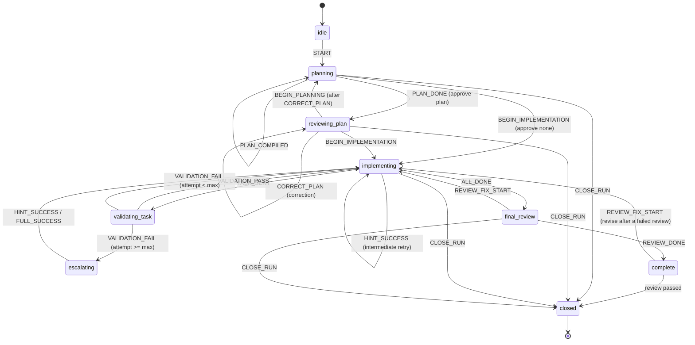

# SPLITBRIEF — Workflow

The state machine reference. Every phase, every transition, what triggers each one, what code runs.

Source of truth: `src/core/state/machine.ts` (reducer), `src/core/phases.ts` (phase taxonomy), `src/core/schemas/enums.ts` (Phase enum). Orchestrator entry: `src/engine/orchestrator/run/workflow.ts` → `src/engine/orchestrator/run/phases.ts`. Planning: `src/engine/orchestrator/planning/session.ts`.

For terminology (planner, implementer, runner kinds, runs, run status, stop reason, step, queue), read `docs/CONCEPTS.md` first.

Continuing a final review preserves the number of repair cycles already started. The persisted `reviewFixes.cycle` counts starts; an ordinary continuation never grants another repair budget. Boundary pauses in BUILD repairs durably park the run and continue from the retained cycle and next step.

---

## Batching, admission, and disposition

**Two-way disposition.** Every new, retry, rewind, and resume planning path
returns exactly one of `ready-for-tasks` or `terminal` (`PlanningPhaseResult`,
`src/engine/orchestrator/planning/types.ts`). Inside it, the planning session
returns `tasks-ready` or `terminal`, and only the plan card turns `tasks-ready`
into `ready-for-tasks`. Readiness is never
inferred from cancellation, failure, task count, score, artifact existence,
phase, or process exit. A terminal result never enters execution.

---

## 1. The state machine

Primary state is the `phase` field — one of 15 values from the `Phase` enum. `idle` is the pre-`START` phase only: nothing ever returns to it. The phase moves forward, and a run ends by being **closed**, never by being reset.

Five overlays sit on top of any phase. None of them moves `phase`:

- **`closed`** — `{ at, as: 'ended' }`, written by `CLOSE_RUN`. The run is over and nothing will pick it up again. Passing the final review closes a run too, as `complete`; those are the only two closers.
- **`interruptedStep`** — the step a stop cut: `{ step, source, cut, partialRef?, at }`. `cut` says whether the stop landed `mid-step` inside a call or on a `boundary` where it cut nothing: between two briefs, or at a gate. The run stays open and picks that step up again.
- **`awaitingContinue`** — the boolean beside it, set by the same action and cleared by `RESUME_STEP`. It predates `interruptedStep`; a state written before that field existed still reads as parked.
- **`lastFailure`** — `{ step, message, at }`, the error a turn died on. The run is still open; `deriveRunStatus` reports it as `failed` and the operator retries the step. `RESUME_STEP` clears it when the run is re-entered.
- **`rewindPending`** — `{ target: 'spec' | 'plan', comment?: string }`. `CORRECT_PLAN` writes it when the user requests changes on the plan card, and an older state can carry one from the removed `/revise-spec` and `/revise-plan` commands. It stands until a plan compiles: `PLAN_COMPILED` clears it, so a replan that stops keeps the correction (§5).
- **`pendingRecovery`** — a `RecoveryIssue` raised when a turn hits something it cannot decide alone. The phase stays where the stop occurred; the overlay gates further progress until the user picks an action.

### 1.1 Phase diagram

The live path of a new run:



No edge returns to `idle`. Every arrow moves forward or closes the run; `CLOSE_RUN` is drawn from four phases for legibility but fires from **any** open phase. A repeated close preserves the first closure, including a passed final review. A state that carries `closed` refuses other actions.

The diagram shows phase-level transitions only. `closed`, `interruptedStep`, `awaitingContinue`, `lastFailure`, `rewindPending` and `pendingRecovery` are overlays on any phase — they don't appear as nodes.

**Retired phases.** `researching`, `specifying`, `reviewing-spec`, `clarifying`, `constitution-check`, `reviewing-briefs` and `analyzing` stay in the `Phase` enum so that an older `state.json` still loads. No new run enters them. An older run saved in one of them continues as one planning session: `BEGIN_PLANNING` is allowed from every one of them (and from `reviewing-plan`), and takes the run to `planning`.

### 1.2 Complete transition table

Verified against the `transition()` reducer in `src/core/state/machine.ts` and the `phaseActions` map.

| From | Action | To | Side effects |
|------|--------|----|-------------|
| `idle` | `START` | `planning` | Every run starts in its planning session |
| `planning` / `reviewing-plan` | `PLAN_COMPILED` | *(same)* | Stores `plan` and `tasks` and clears `rewindPending`. A plan that passed its checks; at the card, a valid `plan.json` edit compiles again in place |
| `planning` | `PLAN_DONE` | `reviewing-plan` | Attaches `tasks` to state. The plan card opens there (`approve: plan`) |
| `planning` / `reviewing-plan` | `BEGIN_IMPLEMENTATION` | `implementing` | Resets `currentTaskIndex` and `attempt` to 0. From `planning` when `approve: none` skips the card |
| `reviewing-plan` | `CORRECT_PLAN` | *(same)* | A correction at the plan card. Stores it as `rewindPending: { target: 'plan', comment }` until a plan compiles, so a run that stops during the replan continues with it |
| any retired phase / `reviewing-plan` | `BEGIN_PLANNING` | `planning` | After `CORRECT_PLAN`, the correction goes back to the planning session, which compiles the plan again and returns with `PLAN_DONE`. An older run continues as one planning session |
| `implementing` | `START_TASK` | `implementing` | Sets task to `in_progress`, resets `attempt` to 0 |
| `implementing` | `TASK_SENT` | `validating-task` | — |
| `validating-task` | `VALIDATION_PASS` | `implementing` | Marks task `done`, advances `currentTaskIndex`, resets `attempt` |
| `validating-task` | `VALIDATION_FAIL` (attempt < maxRetries) | `implementing` | Increments `attempt` |
| `validating-task` | `VALIDATION_FAIL` (attempt >= maxRetries) | `escalating` | — |
| `validating-task` | `ESCALATE` | `escalating` | — |
| `implementing` | `HINT_SUCCESS` | `implementing` | Advances a supported intermediate-worker success; legacy full-planner transitions remain readable. Used by successful intermediate-model retry while still in the implementing phase. |
| `escalating` | `HINT_SUCCESS` | `implementing` | Advances a supported intermediate-worker success; legacy full-planner transitions remain readable |
| `escalating` | `HINT_FAIL` | `escalating` | Exhausts the supported help path and enters recovery |
| `escalating` | `FULL_SUCCESS` | `implementing` | Advances a supported intermediate-worker success; legacy full-planner transitions remain readable |
| `implementing` / `validating-task` / `escalating` | `SKIP_TASK` | *(same)* | Marks task `skipped`, advances `currentTaskIndex` |
| `implementing` / `validating-task` / `escalating` | `RESET_TASK` | `implementing` | Sets task to `pending`, rewinds `currentTaskIndex` to that task's index, resets `attempt`. Tasks after it keep their status. |
| `implementing` | `ALL_DONE` | `final-review` | — |
| `final-review` | `REVIEW_FIX_START` | `implementing` | Records `reviewFixes: { cycle, findings }`, sets every named task back to `pending`, rewinds `currentTaskIndex` to the first of them, resets `attempt` |
| `final-review` | `REVIEW_DONE` | `complete` | Records `reviewStatus: 'passed' \| 'failed'` |
| `complete` (review `failed`) | `REVIEW_FIX_START` | `implementing` | The `revise` recovery action after a failed review: same effect as above, and clears `reviewStatus` and `completedAt`. Refused after a passed review |

`maxRetries` defaults to 2 (configurable via `workflow.maxRetries`).

**Review fix cycles.** A final review that reports blocking findings does not end the run at `complete`: `REVIEW_FIX_START` carries the per-task findings back into `implementing` and the task loop re-runs only the named tasks (`review_fix_started` publishes the cycle and the task ids). A fix attempt is a retry whose error is the reviewer's findings, word for word, after one fixed instruction (`REVIEW_FIX_INSTRUCTION`, `src/engine/orchestrator/task/run-implementation.ts`): change code only where a finding names a code or test defect, in any ordinary project file the fix needs, never a protected path (dependency manifests, lockfiles, CI configuration, env or key files, `.git`, `.splitbrief`) unless the brief explicitly asks for that operation; leave findings about evidence, renders, validation runs or run files (`evidence.json`, the session folder) to SPLITBRIEF and the review seat — do not search for those files or leave the directory; change nothing and say so when no finding needs a code change. A validation-failure retry does not carry the instruction. A reopened brief's code is already on disk, so its fix attempt may change nothing: a finding that asks only for evidence is answered by an attempt that verifies and edits no file. That attempt passes the declared-effect gate (`allowNoChange`, set by `runImplementation`), promotes nothing, and runs the brief's normal validation — green completes the brief, red enters the normal retry ladder. Its `implementer_generate_done` event carries `noChange: true`, and its done row reads `verified · no change needed` under the file name. Every other attempt, the ladder's retries included, still fails `no-staged-change` when it changes nothing. `VALIDATION_PASS` drops a completed task from `reviewFixes.findings`. The cycle count is capped at `REVIEW_CYCLE_CAP` (2, `src/core/pipeline-spec/review.ts`); when the cap is spent the review is recorded as `REVIEW_DONE { reviewStatus: 'failed' }`, a `review-failed` recovery is raised, and the run fails rather than completing. The operator's `revise` on that halt opens one more cycle with the correction beside the findings ([APPROVAL-AND-RECOVERY.md](./APPROVAL-AND-RECOVERY.md)).

**Retired chain actions.** `phaseActions` still lists the actions of the retired planning chain — `RESEARCH_DONE`, `SPEC_DONE`, `APPROVE_SPEC`, `SPEC_CLARIFY_START`, `SPEC_CLARIFY_DONE`, `CONSTITUTION_CHECK_PASS`, `BRIEFS_COMPILED`, `BRIEF_ADMISSION_OPENED` and `ANALYZE_START`. No code dispatches them, so they are dead reducer cases that wait for deletion, not compatibility code: `state.json` loads through its schema and `session.jsonl` replays into the stores, and neither path calls `transition`. What an older state needs is its saved phase and `rewindPending`.

### 1.3 Anytime actions

These fire from any phase. They modify sub-state without changing `phase`.

| Action | Effect |
|--------|--------|
| `CLOSE_RUN` | Records `closed: { at, as: 'ended' }`, clears `interruptedStep` and `pendingRecovery`, leaves `phase` alone. The only terminal action besides passing the final review. Repeating it preserves the first closure and timestamp. A failed review stays open until explicitly ended. |
| `INTERRUPT_STEP` | Records `interruptedStep: { step, source, cut, partialRef?, at }` and sets `awaitingContinue: true`. `cut` is where the stop landed — `mid-step` inside a call, `boundary` where it cut nothing: between two briefs, or at a gate — and `deriveRunStatus` reads it for `paused.at`. The run stays open and resumes at that step. |
| `RESUME_STEP` | Clears `interruptedStep` and sets `awaitingContinue: false`. The run is picking the step up again. |
| `SET_PLANNER_SESSION_ID` | Stores backend session handle for resume. |
| `ENQUEUE_USER_MSG` | Appends message to `messageQueue`. |
| `MARK_INJECTING_NATIVE` | Marks a queued message as currently being delivered to the live native session. |
| `MARK_DELIVERED_NATIVE` | Marks a queued message as delivered to the live native session and no longer pending. |
| `MARK_NATIVE_DELIVERY_FAILED` | Moves an injecting message back to pending delivery. |
| `DRAIN_QUEUE` | Timestamps pending-undelivered messages with `drainedAt`. |
| `CLEAR_QUEUE` | Removes pending or injecting undelivered messages from the queue. Delivered and already-drained messages remain as history. |
| `SET_PENDING_RECOVERY` | Sets `pendingRecovery` to the provided `RecoveryIssue`. |
| `MARK_RECOVERY_APPLYING` | Records selected recovery action and timestamp on `pendingRecovery`. |
| `PAUSE_PENDING_RECOVERY` | Sets `pendingRecovery.status` to `'paused'`. |
| `RESOLVE_PENDING_RECOVERY` | Removes `pendingRecovery` after the selected recovery path is handled. |
| `REWIND_TO_SPEC` | No producer; a dead reducer case that waits for deletion. Sets `phase: 'specifying'`, clears `tasks`, resets `currentTaskIndex` and `attempt` to 0, clears `awaitingContinue`, sets `rewindPending: { target: 'spec', comment? }`. |
| `REWIND_TO_PLAN` | No producer; a dead reducer case that waits for deletion. Sets `phase: 'planning'`, clears `tasks`, resets `currentTaskIndex` and `attempt` to 0, clears `awaitingContinue`, sets `rewindPending: { target: 'plan', comment? }`. |

One task-scoped action also applies in `implementing` and `escalating`: `UPDATE_TASK_CODE` replaces the current code captured on a task (anchor, sibling targets and read-only context files); a field it omits is removed.

---

## 2. Phase taxonomy

From `src/core/phases.ts`. Each phase has three properties derived from the source sets. There is no resumable column: **every open run is continuable**, whatever phase it saved.

| Phase | Role | Cancellable | Live |
|-------|------|:-----------:|:----:|
| `idle` | — | no | no |
| `researching` | planner | yes | yes |
| `specifying` | planner | yes | yes |
| `reviewing-spec` | planner | no | no |
| `clarifying` | planner | no | no |
| `constitution-check` | planner | no | no |
| `planning` | planner | yes | yes |
| `reviewing-plan` | planner | no | no |
| `reviewing-briefs` | planner | no | no |
| `analyzing` | planner | no | no |
| `implementing` | implementer | yes | yes |
| `validating-task` | implementer | no | no |
| `escalating` | implementer | yes | yes |
| `final-review` | planner | yes | yes |
| `complete` | — | no | no |

**Role** — `phaseRole()`: implementer for `implementing`, `validating-task`, `escalating`; planner for everything else (token accounting adds `final-review` to the implementer bucket via `phaseTokenRole()`).

**Cancellable** — Stop now (`ctrl+c`, or the stop sheet's first row) aborts the active model call. This matches `isLivePhase()` in `src/core/phases.ts`.

**Live** — streaming output is happening. Phases where the planner or implementer is actively generating: `researching`, `specifying`, `planning`, `implementing`, `escalating`, `final-review`.

### Run status

How a run stands is not a phase. It is derived once, by `deriveRunStatus` (`src/core/sessions/run-status.ts`), from the saved state plus whether a process still holds the session's lockfile. Every surface — the sessions list, the run screen, the CLI guards, the engine's finalize — reads that one answer.

```typescript
type RunStatus =
  | { kind: 'running' }                                // a live process holds it
  | { kind: 'open'; stop: StopReason; resumeAt: StepRef }
  | { kind: 'closed'; as: 'complete' | 'ended' }
```

`closed` is the only status nothing can pick up: `state.closed` written by an End run, or `complete` with `reviewStatus: 'passed'`. Everything else is `open` and carries two facts.

**`stop`** — why it is not running, in first-match order: `halted` (a `pendingRecovery` is waiting on an answer) · `input-required` (the planner is waiting for a reply) · `paused` (a park, `at: 'mid-step'` or `'boundary'`) · `waiting` (parked at the plan card, or at an older run's spec or briefs gate) · `failed` (`lastFailure` names the error a turn died on) · `interrupted` (the process went away without recording anything).

**`resumeAt`** — the step it picks up at, from `resumeStep(state, artifacts)`: the gate it is parked at, the brief it was building, the review it reached, or the planner call its saved phase names (`plan` for a run in `planning`). The engine reads it to decide what runs, not how: every planner call continues as the one planning session. Artifacts shape `resumeAt` only; they never change the status kind.

**Who runs `final-review`** — the review seat, which is the `reviewer` runner from `.splitbrief/config.yaml` when one is configured and the planner's own runner when none is (`resolveReviewerRunner`, `src/core/config/accessors/reviewer-runner.ts`). It is the only call the reviewer makes; every other model call in this state machine, escalation included, stays on the planner. The phase's `phaseRole()` is still `planner` and `phaseTokenRole()` is still `implementer` — those classifications did not move, so per-phase token attribution is unchanged. During the phase the transcript and the composer live status name the seat actually running — the reviewer's tool and model when one is configured, today's wording when none is — and the sidebar carries a reviewer row whenever one is configured. A reviewer that fails does not hand the review back to the planner — the phase records a failed review, stays in `final-review` instead of transitioning `REVIEW_DONE`, and still builds the run summary.

**Planner markdown headers** — only `escalating` planner markdown gets a header (`Escalation`, `plannerPhaseHeader`). No other phase, live or replayed, gets a phase label. The planning session streams no narration of its own, because its answer is typed JSON; its question rounds and warnings show as plain rows.

**Where a stop is recorded:** `interruptedStep` names the step the stop cut and whether it landed mid-call or at a brief boundary. It does not change the phase, and it does not make a run more or less continuable — it only tells the run where to pick up.

---

## 3. The planning session

Every run plans in one typed planning session. There are no workflow modes and no fixed chain of planner documents. Entry: `runPlanningPhase` (`src/engine/orchestrator/planning/run.ts`) → `runPlanningSession` (`src/engine/orchestrator/planning/session.ts`), which drives the pure loop `runPlanSession` (`src/engine/orchestrator/planning/plan-session.ts`).

| Step | What happens | Code |
|---|---|---|
| Questions | The planner may answer with questions instead of a plan: at most 3 per round, each with a `default`, for at most 2 rounds (`MAX_QUESTION_ROUNDS`). A third round halts the run with `plan-questions-exhausted`. | `plan-session.ts` |
| Typed plan | The planner answers `{ result }` against `PlanAnswerSchema` (`src/core/schemas/plan.ts`): a summary, decisions, acceptance criteria, checks, validation commands and tasks (`TaskSpec`). The call goes through `requestTyped` with the tool's native schema flag where it has one. | `session.ts` |
| Checks | `checkFullPlan` runs `checkPlan` (`src/engine/spec/plan-checks.ts`) plus the context fit of each task (`estimatePlanContextFits`). A failing plan goes back to the planner once with the errors; a second failure halts with `plan-checks-failed`. A transport repair inside `requestTyped` is counted apart from this one semantic repair. | `session.ts`, `plan-checks.ts` |
| Compile | `compilePlan` maps each task with `taskFromSpec`, writes `plan.json`, renders `plan.md` and `tasks.md`, and dispatches `PLAN_COMPILED`, which stores `state.plan` and `state.tasks`. The plan's validation block becomes `state.discoveredValidation`. | `session.ts`, `src/engine/spec/plan-tasks.ts` |
| Plan card | `runPlanApproval` opens the plan card when `workflow.approve` is `plan`, then dispatches `BEGIN_IMPLEMENTATION`. | `session.ts` |

Briefs made from a plan skip any brief-quality pass: `checkPlan` is the only admission check. The pre-planning hook runs once per process, immediately before the first planner call.

The planner's questions, the plan and its repair stay on one native planner session where the tool supports it (`SET_PLANNER_SESSION_ID`). A planner without a session gets the full prompt plus the conversation so far on every turn (`planFullTurn`, `src/engine/spec/prompts/plan-session.ts`). An expired native session is reissued once with the rebuilt transcript (`withExpiredSessionReissue`).

A halt keeps the conversation; only a plan that passed its checks clears it. A `SeatProtocolError` raises a `seat-protocol-error` recovery that offers the seat swap.

### Approval: the plan card

Controlled by `workflow.approve`: `plan` (default) or `none`. `resolveApproveLevel` (`src/core/config/runtime/resolve.ts`) is the one decision, and it reads the config. `approve: none` skips the card, and the build starts as soon as the plan passes its checks. Every run follows the same rule; no run shape skips the card on its own.

The retired values `all`, `spec` and `default` load as `plan`, with one config notice each (`RETIRED_CONFIG_VALUES`, `src/core/config/load/validation/config.ts`). The CLI has no `--approve` flag; passing it fails with `--approve was removed: set workflow.approve (plan or none) in the config`.

The card shows `plan.md`: the summary, the protected operations the plan lists, the decisions, the criteria and checks, and the tasks by batch. It has four rows (`reviewDocumentOptions`, `src/features/workflow/prompt-rows/approval.ts`):

| Row (key) | Result | Effect |
|---|---|---|
| `y` Approve plan and start the build | `{ approved: true }` | Records each listed protected operation as confirmed in the evidence ledger (`planConfirmations`), publishes `plan_approved`, then `BEGIN_IMPLEMENTATION` |
| `c` Request changes (type what to change) | `{ approved: false, action: 'revise', comment }` | Publishes `plan_regenerated`, sends `planRevisedTurn(plan.json, comment)` to the planning session, applies its checks with the one repair, and shows the card again |
| `e` Edit plan.json | `{ approved: false, action: 'edit' }` | Re-reads `plan.json` and validates it: JSON, then `PlanProposalSchema`, then `checkPlan` plus the context fit. A valid edit compiles without a planner call and the card shows again. An invalid edit is not applied: the engine restores `plan.json`, publishes one warning that starts `The edited plan was not applied: `, and shows the card again |
| `q` End run (close this run) | `{ approved: false, action: 'end-run' }` | `CLOSE_RUN` and `plan_rejected`. The run is closed; its files stay on disk |

A row is taken with `↑`/`↓` and `⏎`, or by typing its key and `⏎`; no letter settles the card on its own. Any other typed text is a correction (`c` above). `e`, the `edit` command and `Ctrl+E` open `plan.json` in the in-app editor. A save checks the JSON, the schema and `checkPlan` without the context fit (`planSaveErrors`, `src/features/editor/plan-save.ts`); a refused save keeps the overlay open on one row, `Not saved: <first message> (+N more)`. `Ctrl+O` opens the external editor on the same file, and its save settles the card as an edit. Messages queued while the card waits become its correction.

A headless run approves the card unattended (`{ approved: true, unattended: true }`), and an unattended approval records no confirmation. A protected write in the build then still asks, and a headless run has no one to answer it.

### Clarification questions

A planner turn returns either `{ kind: 'questions' }` or `{ kind: 'plan' }`. A question with `choices` shows as a choice; one without shows as a text input. The default comes first and carries a dim `default` mark, and a free-text question starts filled with its default. Walking through with `⏎` takes the defaults; the last question's `⏎` sends the answers. The transcript shows `Questions before the plan · round <n> of 2`, and the byline reads `Waiting for your answer · Plan`.

Down at the end of the answer field moves to the separate instruction composer; Tab returns to the question box. Sending a non-empty instruction replaces the whole question batch with that instruction. Cancellation discards the partial batch; restarting a process does not restore unfinished UI drafts.

SPLITBRIEF owns this exchange: the planner returns its questions and finishes the turn, then the host collects the answers. The Claude planner also denies `AskUserQuestion`.

`state.pendingPlannerConversation` records the questions before waiting and the answers before the next planner call. Reloading preserves the pending round; recorded answers are not requested again. Headless runs persist the conversation, emit `input_required` and exit non-zero instead of supplying an answer.

An older run can carry a pending conversation from the retired `plan` step. The session treats it as its own only when its text matches its questions; otherwise it goes into the prompt as earlier planning and is cleared.

### `splitbrief spec`

`splitbrief spec "<feature>"` runs the same session without a build and without workflow state (`src/cli/commands/spec.ts`). It writes `plan.json`, `plan.md` and `tasks.md`, and lists the three paths with the task count. In a terminal it prints `The planner asks:` and reads one line; an empty line takes the defaults. Without a TTY every question takes its default. The planner's stream is not echoed, because its output is typed JSON.

### Retired modes

`workflow.mode` (`quick`, `standard`, `speckit`, and the older `instant`) is a retired key: any value loads with one notice and changes nothing. The CLI has no `--mode` flag; passing it fails with `--mode was removed: every run plans in one session`. `/mode`, `/revise-spec` and `/revise-plan` are removed commands with a one-line pointer (`REMOVED_COMMANDS`). `WorkflowModeSchema` stays only to read the mode that older `state.json` files, lockfiles and event logs recorded.

---

## 4. Abort / continue / queue

Four user actions during a live phase:

| Action | Trigger | Effect |
|--------|---------|--------|
| Queue message | Type + Enter | During live planner phases, appends to `messageQueue`. Current call continues. Planners with `injectUserTurn()` also receive the message immediately. Still-pending delivery entries drain at the next safe-point. |
| Stop now | `ctrl+c`, or **Stop now** on the stop sheet | `AbortController.abort()`. Current call terminates. Partial response preserved in `session.jsonl` with `interrupted: true`. Dispatches `INTERRUPT_STEP` → the step it cut is recorded, and the run parks mid-brief with its partial changes kept. |
| Exit workflow | `ctrl+q` or `/quit` | Stop now, then exit once the run has parked or ended, so the session is on disk before the process goes. The saved state may be resumable later with `splitbrief continue <session-id>`. |
| Pause after this brief | **Pause after this brief** on the stop sheet | Nothing is killed: the running brief finishes its checks and its review, then the run parks between briefs. Dispatches `INTERRUPT_STEP` with `cut: 'boundary'` naming the brief it stopped *before*, so leaving the screen persists as a boundary park and the run picks up there. |
| Continue | `/resume`, or typed text on a parked run | Dispatches `RESUME_STEP` → the parked step is cleared. Typed text becomes the step's steer; an empty submit continues with none. |

**Continuing is one path** (`continueRun`, `src/engine/orchestrator/run/continue.ts`). A run this process is still holding settles through its park; a run at rest is re-entered on its saved state with `RunWorkflowOptions.steer`. Either way the operator's words travel as a steer, never as a message queued behind the run, and they are also recorded as a `user_message` in the transcript and `session.jsonl` — once, at the seam the engine consumes them (seed creation on re-entry, the call-continuation loop for a park), except when they answer a planner question still pending, which the call loop records as the answer it consumes. A closed run is refused with its reason rather than restarted.

**A continuation never replaces the step's prompt.** The step is the same step, so it is still stated in full; what the cut attempt left behind trails it (`composeContinuation`, `src/engine/spec/prompts/continuation.ts`). What that means per seat:

| Seat | How it continues |
|---|---|
| Planner | The planning session issues its call again: the plan prompt in full, with the operator's steer as a note, on the native session where the tool has one. A cut typed answer leaves no partial to carry. An unanswered question round takes the steer as its answer. |
| Reviewer | The whole deterministic review prompt is re-issued — the request (or an older run's spec), briefs, diff, drift, evidence, rebuilt from disk — with the continuation block on the end. The review is one shot by constitution: it never resumes a session. |
| Implementer | The brief restarts on its own prompt, with the partial and a line naming the declared files that already changed since the task started, so the next attempt edits what is on disk. The attempt count is unchanged. |

A user park keeps partial edits in either the linked worktree or the staged copy, including a silent worker and a stopped retry. Continue reacquires that workspace at the stopped attempt only while the session, project, brief definition, build seat, and directory identity still match. Its original input fingerprints remain authoritative for approval, so a later operator edit cannot be overwritten. A failed continuation-record save leaves the files in place and reports that automatic continuation is unavailable. The record is capped at 8 MiB; it contains fingerprints and only the original dirty-file entries needed to undo unfinished edits. A **cold resume after a crash** restores the brief's own writes (its declared files and the files the evidence ledger records it promoted) from `activeTaskSnapshot` and restarts clean — `implementing` with the task still `in_progress` and no `interruptedStep` is a crash, not a park.

A stopped workspace keeps its private CLI state and caches. Static credential copies use mode 0400 inside mode 0700 directories; rotating OAuth bridges remain links to host state. Re-entry creates a fresh temporary sandbox outside the stopped directory and removes that sandbox when the entry ends. The original stopped sandbox remains untouched. Automatic teardown preserves stopped directories because pathname checks cannot safely bind later deletion to the original directory. Completing, ending, rewinding, replacing, or failing a resumed staged attempt retires its continuation record and writes a small `preserved-stage-<id>.json` receipt beside it before retirement. That receipt records the directory identities and location, never source bytes or credentials. The notice names the directory for manual removal; Continue never reads these receipts. A receipt failure preserves the existing continuation record and reports failure. Fresh attempts that were never stopped keep their ordinary cleanup. Ending an already parked run closes the run and leaves its existing record and files for manual removal.


**Queue scope.** Planner-only. Mid-task interjection at the implementer, validation, or escalation level is rejected instead of being queued or injected into the planner, because small local models lose coherence when their task prompt is perturbed mid-call.

**Abort scope.** Stop aborts the outer workflow, including model/API calls, validation, planner questions, approval and recovery waits. The engine drains owned processes and persists the interrupted step before navigation or application exit. Queue availability still depends on the live phase.

**Queue lifecycle.** `ENQUEUE_USER_MSG` appends. Native delivery moves through `MARK_INJECTING_NATIVE` to `MARK_DELIVERED_NATIVE`, or back to pending with `MARK_NATIVE_DELIVERY_FAILED`. `DRAIN_QUEUE` timestamps pending-undelivered messages. `CLEAR_QUEUE` removes pending or injecting undelivered messages. On the next safe-point the orchestrator reads pending-undelivered queue entries, folds contents into the next prompt as `[user also says: ...]`, and drains.

Queue submissions return accepted/rejected results. Rejections include planner-unavailable phases and the 50-message cap; both publish a bounded warning. The UI shows feedback near the composer. `/queue show` reports pending-undelivered messages. `/queue clear` clears pending or injecting undelivered messages from the live workflow queue when a live clear handler is available, and otherwise reports unavailable.

**Stopping a run.** `esc` opens the inline menu above the composer; another `esc` stops resumably. A third press requests home after cleanup and persistence, even when all three presses arrive together. After stopping, the menu offers **Resume / End run / Back to sessions**. Tab returns to the composer; `/stop` or the command palette reopens these options. End run remains an explicit action; no Escape or Ctrl+C sequence closes the saved run.

A Stop that newly parks a step records one `turn_interrupted` event, including when the UI settles the stop between engine calls. An explicit End run records `workflow_cancelled` whether the engine or the at-rest UI closes it. Retrying finalization adds no second event. A rewind aborts the old call so the replacement can start; it records its rewind event without parking the rewound state or adding a Stop row.

`ctrl+c` stops active work and advertises the next press as quit. While stopping, Ctrl+C requests exit after cleanup. At rest or home, the first press shows `Press ctrl+c again to quit`; another within two seconds exits. Other input, navigation to another session, or resumed execution clears confirmation. Ctrl+Q and `/quit` use the same safe departure path.

Stop status follows real work: `Waiting for processes to exit` only while owned processes remain, then `Finishing cleanup and saving`. Process termination uses the registry's existing SIGTERM/SIGKILL escalation. A failed cleanup or save reports its error and offers **Retry stop**, which retries cleanup/persistence without running another model call. There is no UI timer that declares success. A parked run returns home on Escape; unsent text, paste content and image references persist in its `draft.json` and return when it is reopened.

---

## 5. Rewind

### A saved rewind

`/revise-spec` and `/revise-plan` are removed commands; request changes on the plan card instead. A correction at the card publishes `plan_regenerated`, dispatches `CORRECT_PLAN` and runs the planning session with the correction (`src/engine/orchestrator/planning/session.ts`). `CORRECT_PLAN` saves the correction as `rewindPending: { target: 'plan', comment }`, and `PLAN_COMPILED` clears it. A run that stops before a plan compiles still carries it, and so can an older `state.json`. On the next planning entry `rewindLead` (`src/engine/orchestrator/planning/run.ts`) resets the drift chain and runs the one planning session with the comment as its correction (`planRevisedTurn`) against the saved `plan.json`, then opens the plan card. `target` is not read: a spec rewind and a plan rewind run the same session.

`REWIND_TO_SPEC` and `REWIND_TO_PLAN` have no producer, so they are dead reducer cases that wait for deletion. A saved state needs only its `rewindPending`, which `rewindLead` reads.

### /redo-task \<id\>

Dispatches `RESET_TASK`. Sets the target task to `pending`, rewinds `currentTaskIndex` to that task's index, resets `attempt` to 0, sets `phase: 'implementing'`. No `rewindPending` — the task loop re-picks the task on its next iteration. Tasks after the target keep their existing status.

---

## 6. Continue

A run is a durable record. It stays continuable until somebody closes it, so there is one verb for picking one up and one path behind it: `continueRun` (`src/engine/orchestrator/run/continue.ts`).

`splitbrief resume` reads `.splitbrief/active` for the most recent run; `splitbrief continue <id>` names one outright. Both load `state.json` through the v4 state operations API and refuse only three things: a state that is missing, one that is malformed or future-versioned, and a run that is **closed**. A v3 state is promoted to v4 on load.

### Where it picks up

At the first thing it has not finished, not at the top. `resumeStep(state, artifacts)` (`src/core/sessions/run-status.ts`) names it, reading the same step table the run walked:

| Saved at | Picks up at |
|---|---|
| The plan card (`reviewing-plan` with `state.plan`) | the card, re-opened without re-spending the planner call behind it |
| An older gate (`reviewing-spec`, `reviewing-briefs`, or `reviewing-plan` without `state.plan`) | the planning session, which reads the run's earlier research, spec, plan and `tasks.md` as "Earlier Planning" and takes the correction typed at the gate; then the plan card opens |
| A brief (`implementing` / `validating-task` / `escalating`) | that brief |
| `final-review` or `complete` with a failed review | the review, at its recorded cycle |
| Anything else (`planning` or a retired planning phase) | the planning session |

**Planning picks up as one session.** `runPlanningPhases` (`src/engine/orchestrator/run/phases.ts`) sends a brief or a review straight to the task loop, re-opens a parked plan card through `resumeParkedApproval`, and runs everything else as the planning session. A run cut mid-call takes `RESUME_STEP` first. Pending questions resume where they stopped; recorded answers are not asked again.

A run saved inside `validating-task` or `escalating` resets the current task (`RESET_TASK`) and restores that task's files from the changed-files baseline snapshot, so the brief is re-attempted from a clean tree rather than half-validated.

### What it continues on

| Planner seat | What the continuation gets |
|---|---|
| `supportsSessionResume: true` and `plannerSessionId` set | The native session, resumed on its thread (`claude --resume <id>`, `codex exec resume <id>`). Only an id the tool itself reported is ever resumed: Claude Code captures it as it streams, the CLI planner keeps codex's own thread id, and the SPLITBRIEF session id never reaches the wire. |
| The backend rejects the session (expired, unknown) | The run drops the thread from its state, warns once (`planner_session_expired`) and issues the planning call again on a fresh session with the rebuilt transcript, the continuation in its stateless form. When that call fails too, the step halts as a planner-call failure that quotes the tool's error, and continuing it starts a fresh session on the rebuilt transcript. Claude Code and codex take the same path. A change requested on the plan card takes it too, because it runs as a planning-session call: the call runs again once on a fresh session with the rebuilt transcript, and a second failure halts it the same way. |
| No native session | A transcript rebuilt from `session.jsonl`: the latest compact summary entry plus every message after it, passed as initial context to a fresh planner call. It holds the planner conversation only. It leaves out implementer output and the documents the planner landed, older logs included. It also leaves out the cut call's partial when the continuation hands that partial to the step, and the steer, which is logged after the rebuild. |
| No transcript either | `applyRebuiltContext()` publishes a warning and continues with the Task Brief transport plus `plan.md`. |

Pending queue entries remain in `state.json`. A continuation excludes still-pending queued user messages from the stateless transcript rebuild so they are not duplicated, and `hydrateFromState` reconstructs queue depth from those pending entries so the footer and `/queue show` still reflect them.

### Every stop, and what continuing it does

| Stop reason | What it was | Continuing it |
|---|---|---|
| `paused · mid-step` | Stop now, inside a call | Re-issues that step with the partial it left behind and the operator's steer |
| `paused · boundary` | Pause after this brief, or Stop now at a gate | Starts the brief it stopped before; a typed steer is held for that brief. A stop at the plan card re-opens the card |
| `waiting` | Parked at the plan card, or at an older run's spec or briefs gate | Re-opens the plan card without re-spending the call behind it; an older gate continues as the planning session. At rest the byline reads `⏎ to reopen it` at the plan card and `⏎ to continue` at an older spec or briefs gate |
| `halted` | A `pendingRecovery` nobody answered | Shows the recovery panel before any work |
| `failed` | `lastFailure` — a turn died on an error | Retries the step it died on |
| `interrupted` | The process went away recording nothing | Restarts at `resumeStep`; an `in_progress` brief with no `interruptedStep` is a crash, so its own writes — declared or recorded as promoted — are restored from `activeTaskSnapshot` and it restarts clean |

A park keeps the worktree's partial edits and continues with that context; a crash does not, because nobody chose to keep them.

### Recovery on continuing

If state has `pendingRecovery`, resume shows that recovery issue before dispatching any work. Selecting `pause-run` keeps `.splitbrief/active` intact so the same decision appears on next resume.

An unresolved recovery also makes the stop audible: when the task loop re-enters a state that still carries `pendingRecovery`, it publishes a transcript-safe `warning` with `code: 'recovery_pending_unresolved'` naming the reason, the recovery status (`awaiting-user`, `paused`, or `applying`) and the available actions, then stops without running any task. The issue is neither cleared nor re-entered. In headless `--json` mode the same state fails the command with exit code 1 for **every** status — a paused or applying recovery no longer exits 0 having done nothing.

In-flight briefs: a brief the operator parked keeps its partial edits and continues with them, at the same attempt. A brief the process died inside — `implementing`, task `in_progress`, no `interruptedStep` — is a crash: the brief's own writes (its declared files and the files the evidence ledger records it promoted) are restored from the snapshot and it restarts from `attempt: 0`.

---

## 7. Escalation and recovery

When a task fails validation `maxRetries` times:

0. **Intermediate tier** — only when `escalation.intermediateProvider` is set and `escalation.enabled` is not `false`: a paid mid-tier API model retries the task. Success → task `done`.
1. **Hint escalation** — present only when the planner has `supportsHintEscalation`; for a planner without it the rung is absent rather than skipped, and the ladder ends at the rung below. The planner sends a short hint, the implementer retries once. An empty hint ends the rung there — no implementer retry, no attempt charged. Success → task `done`.
2. **Recovery** follows exhausted worker retries and hints: `pendingRecovery` is set and the phase stays where the stop occurred. The planner never automatically writes the implementation. Historical full-tier outcomes remain readable.

An implementer that stops on one of its brief's Escalation bullets is answered by the planner, not by you. Its hand-back goes to the planner in one read-only call, and the planner replies with a verdict: an answer the implementer retries with once, a widening of the brief's Approved out of bounds to named files, or a finding that the brief itself is wrong. A widening passes the same protected-path confirmation as any other write and is recorded on the brief with the planner's reason. Only a brief-is-wrong verdict, a denied write, or a planner that cannot be reached stops the run for you, with the implementer's words and the planner's diagnosis on the panel, where the correction you type at that halt retries the brief with it. Planner questions about requirements still come to you.

Recovery is not only the task loop's. A planner-seat turn that cannot decide alone raises one too, and the issue carries a `seat` (`plan` | `build` | `review`) so the panel and the swap offer name the seat that is actually stuck: `planner-call-failed` (the call died and the diagnosis is already on the bus), `plan-questions-exhausted` (the planner asked a third round of questions), `plan-checks-failed` (the plan failed its checks again after one repair) and `seat-protocol-error` (the seat's typed answer did not parse after its repair). `planner-returned-no-briefs`, `constitution-check-failed`, `brief-review-no-progress` and `brief-quality-unrepaired` have no producer now; they stay so that an older `state.json` still loads, and their halts still offer their actions. `runner-unauthenticated` and `runner-usage-limit` are seat-blocked halts and can fire on the plan seat as readily as the build seat.

Recovery reasons: `implementation-error`, `validation-failed`, `retry-exhausted`, `runner-unauthenticated`, `runner-usage-limit`, `context-overflow`, `user-edit-conflict`, `approval-promotion-conflict`, `dependency-blocked`, `scope-violation`, `implementer-recipe-invalid`, `implementer-left-isolation`, `checkout-changed`, `runner-timeout-repeated`, `review-failed`, `approval-denied`, `snapshot-failed`, `planner-call-failed`, `planner-returned-no-briefs`, `constitution-check-failed`, `brief-review-no-progress`, `brief-quality-unrepaired`, `seat-protocol-error`, `plan-questions-exhausted`, `plan-checks-failed` (`RECOVERY_REASONS`, `src/core/schemas/enums.ts`; the table in [APPROVAL-AND-RECOVERY.md](./APPROVAL-AND-RECOVERY.md) gives each one its actions).

Recovery actions:

| Action | Effect |
|--------|--------|
| `retry-same-worker` | Retries the recorded PLAN/REVIEW step, or resets and reruns the matching BUILD task |
| `route-bigger-worker` | Clears recovery, reruns task with named larger profile |
| `switch-seat` | A seat that cannot run at all: moves it to another ready detected tool and re-prepares the session on it |
| `revise` | Clears recovery and queues the operator's correction for the next planner turn; on `review-failed`, records the correction and opens one more review fix cycle |
| `revise-spec` | Kept for an older `constitution-check-failed` halt: it acts as `revise` and queues the note as a correction for the planning session |
| `continue` | Allowed for safe unrelated user edits only |
| `skip-current-task` | Records evidence, marks task `skipped`, advances index |
| `pause-run` | Keeps issue pending and session resumable |
| `end-run` | Dispatches `CLOSE_RUN`: the run is closed and kept on disk, nothing is reverted. The only recovery action that ends a run — there is no abort. |
| `planner-split-rebase` | Legacy/manual only; new prompts do not offer it, and old states block with `planner-proposal-required` |

Recovery statuses: `awaiting-user` → `applying` (via `MARK_RECOVERY_APPLYING`) → cleared (via `RESOLVE_PENDING_RECOVERY`). Or `awaiting-user` → `paused` (via `PAUSE_PENDING_RECOVERY`) → resumable on next `splitbrief resume`.

---

## 8. A run, step by step

```
 1. splitbrief start "add email validator"
 2. CLI loads .splitbrief/config.yaml → configStore.
    A retired key (workflow.mode, an old approve value, task_review, ...) prints one notice.
 3. CLI checks .splitbrief/active → error if present.
    Generate session ID, create .splitbrief/sessions/<id>/, write .splitbrief/active.
 4. routerStore → screen: workflow. useWorkflow starts.

 5. runWorkflow() begins. initializeWorkflow emits workflow_started.
    Repo map built from codebase config.

 6. phase: idle → START → planning
    The planning session sends the typed plan prompt.
    Planner session ID captured → SET_PLANNER_SESSION_ID → state.json.

 7. Questions (optional, at most 2 rounds of at most 3)
    SET_PLANNER_CONVERSATION records them; the question box waits.
    The answers go back on the same planner session.

 8. Plan
    checkPlan + context fit. A failing plan goes back once; a second failure
    halts with plan-checks-failed.
    PLAN_COMPILED stores state.plan and state.tasks.
    plan.json, plan.md and tasks.md are written.

 9. phase: planning → PLAN_DONE → reviewing-plan     (approve: plan)
    callbacks.onApprovalNeeded('plan', plan.md)
      approve  → record the plan's protected operations as confirmed
      revise   → the planning session takes the correction → card again
      edit     → re-validate plan.json → compile or restore → card again
      end run  → CLOSE_RUN. The run is closed; its files stay on disk.

10. phase: reviewing-plan (or planning, with approve: none)
      → BEGIN_IMPLEMENTATION → implementing
    Before the first task, the validation baseline is probed: each enabled stage
    runs once (the test probe is narrowed to the first task's affected file) and
    publishes `validation_baseline` running/done rows, so the run shows proof of
    life instead of silent waiting. Stages already red before any task ran are
    recorded as pre-existing failures.

11. Per task:
      implementing → START_TASK (task in_progress, attempt 0)
      The task's code and its read-only context files are refreshed from disk.
      implementer.implement(taskPrompt) → code written to disk
      A direct-writing implementer edits the run's isolation directory instead of
      the project — where it works is set by `workflow.isolation`
      (worktree by default; see CONFIGURATION.md §5)
      A write to a protected path asks, unless the approved plan listed it.
      implementing → TASK_SENT → validating-task
      typecheck → lint → tests (stops at the first failure attributable to the task)
        pass → VALIDATION_PASS → implementing (next task)
        fail → VALIDATION_FAIL → implementing (attempt++, retry)
        fail (attempt >= maxRetries) → VALIDATION_FAIL → escalating
          HINT_SUCCESS / HINT_FAIL / FULL_SUCCESS → implementing

12. implementing (last task) → ALL_DONE → final-review
    Drift report computed. The review seat reads the diff against the briefs
    and the plan.

13. final-review → REVIEW_DONE → complete
    summary.json written. A passing review closes the run, so .splitbrief/active
    is released and nothing will pick it up again; a failed review leaves the run
    open at complete, and continuing it re-enters the review.
    A review with blocking findings takes REVIEW_FIX_START back to implementing
    for the named tasks instead, up to the review cycle cap. After the cap, the
    operator's revise takes REVIEW_FIX_START from complete for one more cycle.
```

During live model-call phases, `ctrl+c` is Stop now and parks the run; `esc` opens the stop menu. Messages typed during live planner phases queue; only still-pending delivery entries drain at the next safe-point. Request changes on the plan card to revise the plan. `/redo-task` replays a single task.

---

## 9. WorkflowState shape

Source: `src/core/schemas/workflow.ts` (Zod), `src/core/state/machine.ts` (`createInitialState`). State version: 4.

```typescript
type WorkflowState = {
  stateVersion: 4
  stateRevision: number                    // CAS revision
  phase: Phase
  feature: string
  currentTaskIndex: number
  attempt: number
  tasks: Task[]
  plannerSessionId: string | null
  startedAt: string                       // ISO 8601
  tokenUsage: TokenUsage
  awaitingContinue: boolean               // true while a step is parked
  messageQueue: QueuedMessage[]           // user messages typed during live phases

  // Optional overlays
  closed?: { at: string; as: 'ended' }     // CLOSE_RUN; the run is over
  interruptedStep?: {                      // the step a stop cut
    step: StepRef
    source: 'user' | 'watchdog'
    cut?: 'mid-step' | 'boundary'
    partialRef?: { kind: 'session-log'; index: number }
    at: string                             // ISO 8601
  }
  lastFailure?: { step: StepRef; message: string; at: string }
  rewindPending?: { target: 'spec' | 'plan'; comment?: string }  // older states only
  plan?: Plan                              // PLAN_COMPILED; the checked plan without its tasks
  pendingRecovery?: RecoveryIssue
  reviewFixes?: { cycle: number; findings: Record<TaskId, string[]> }
  reviewStatus?: 'passed' | 'failed'
  discoveredValidation?: DiscoveredValidation

  // Runner identity (set once at workflow start)
  plannerTool?: string
  plannerModel?: string
  implementerTool?: string
  implementerModel?: string
}

type QueuedMessage = {
  id: string
  text: string
  queuedAt: string                        // ISO 8601
  phase: Phase
  deliveredViaNative: boolean
  nativeDeliveryState: 'pending' | 'injecting' | 'delivered'
  drainedAt?: string
  origin?: 'user-input' | 'clarification'
  question?: string
}
```

`StepRef` is the shared step vocabulary (`src/core/schemas/run-step.ts`): `{ kind: 'planner', call }` over the planner calls (a new run uses `plan`; the other six name an older run's steps), `{ kind: 'gate', gate }` over plan (and spec/briefs for older runs), `{ kind: 'brief', taskId, attempt }`, or `{ kind: 'review', cycle }`. The state, the interrupt action, the failure record and `resumeAt` all speak it.

The three closing/stopping fields are additive: a state written before they existed still loads, and `deriveRunStatus` falls back to `awaitingContinue` and the captured partial when `cut` is absent.

`createInitialState(feature)` returns a minimal state: `phase: 'idle'`, `currentTaskIndex: 0`, `attempt: 0`, `tasks: []`, `plannerSessionId: null`, `tokenUsage` zeroed, `awaitingContinue: false`, `messageQueue: []`. All optional fields are absent. The version constant is `WORKFLOW_STATE_VERSION` (`src/core/schemas/workflow.ts`) — the one home for the number; every reader and `commitWorkflowState` read it rather than spelling `4`.

---

## See also

- `docs/CONCEPTS.md` — terminology
- `docs/MENTAL-MODEL.md` — the concept without code
- `docs/HOW-IT-WORKS.md` — same flow with file paths and data flow diagrams
- `docs/ENGINE.md` — orchestrator internals, EventBus, engine/UI communication
- `docs/TASK-CONTRACT.md` — the plan contract, plan checks, evidence vocabulary, drift detection
- `docs/CONFIGURATION.md` — all config keys including `workflow.*`
- `docs/SLASH-COMMANDS-REFERENCE.md` — all slash commands including `/redo-task`
