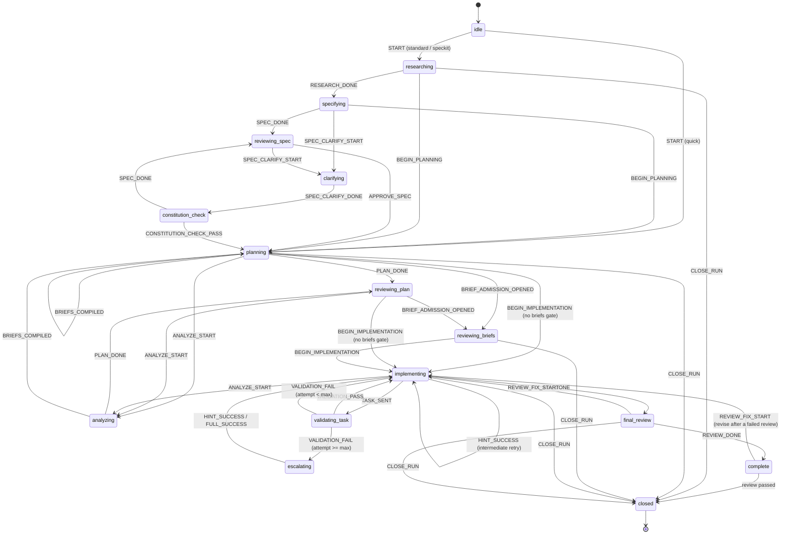

# SPLITBRIEF — Workflow

The state machine reference. Every phase, every transition, what triggers each one, what code runs.

Source of truth: `src/core/state/machine.ts` (reducer), `src/core/phases.ts` (phase taxonomy), `src/core/schemas/enums.ts` (Phase / WorkflowMode enums). Orchestrator entry: `src/engine/orchestrator/run/workflow.ts` → `src/engine/orchestrator/run/phases.ts`.

For terminology (planner, implementer, runner kinds, runs, run status, stop reason, step, queue), read `docs/CONCEPTS.md` first.

Continuing a final review preserves the number of repair cycles already started. The persisted `reviewFixes.cycle` counts starts; an ordinary continuation never grants another repair budget. Boundary pauses in BUILD repairs durably park the run and continue from the retained cycle and next step. Revising an approved speckit spec invalidates its dependent constitution check before plan or tasks use the revised contents.

---

## Batching, admission, and disposition

**Two-way disposition.** Every new, retry, rewind, and resume planning path
returns exactly one of `ready-for-tasks` or `terminal`. Readiness is never
inferred from cancellation, failure, task count, score, artifact existence,
phase, or process exit. A terminal result never enters execution.

---

## 1. The state machine

Primary state is the `phase` field — one of 15 values from the `Phase` enum. `idle` is the pre-`START` phase only: nothing ever returns to it. The phase moves forward, and a run ends by being **closed**, never by being reset.

Five overlays sit on top of any phase. None of them moves `phase`:

- **`closed`** — `{ at, as: 'ended' }`, written by `CLOSE_RUN`. The run is over and nothing will pick it up again. Passing the final review closes a run too, as `complete`; those are the only two closers.
- **`interruptedStep`** — the step a stop cut: `{ step, source, cut, partialRef?, at }`. `cut` says whether the stop landed `mid-step` inside a call or on a `boundary` where it cut nothing: between two briefs, or at a gate. The run stays open and picks that step up again.
- **`awaitingContinue`** — the boolean beside it, set by the same action and cleared by `RESUME_STEP`. It predates `interruptedStep`; a state written before that field existed still reads as parked.
- **`lastFailure`** — `{ step, message, at }`, the error a turn died on. The run is still open; `deriveRunStatus` reports it as `failed` and the operator retries the step. `RESUME_STEP` clears it when the run is re-entered.
- **`rewindPending`** — a `/revise-spec` or `/revise-plan` command was issued. Contains `{ target: 'spec' | 'plan', comment?: string }`. The planning runner reads it on restart and takes the rewind fast-path. Cleared via `CLEAR_REWIND_PENDING` before the approval gate.
- **`pendingRecovery`** — a `RecoveryIssue` raised when a turn hits something it cannot decide alone. The phase stays where the stop occurred; the overlay gates further progress until the user picks an action.

### 1.1 Phase diagram



No edge returns to `idle`. Every arrow moves forward or closes the run; `CLOSE_RUN` is drawn from five phases for legibility but fires from **any** open phase. A repeated close preserves the first closure, including a passed final review. A state that carries `closed` refuses other actions.

The diagram shows phase-level transitions only. `closed`, `interruptedStep`, `awaitingContinue`, `lastFailure`, `rewindPending` and `pendingRecovery` are overlays on any phase — they don't appear as nodes.

### 1.2 Complete transition table

Verified against the `transition()` reducer in `src/core/state/machine.ts` and the `phaseActions` map.

| From | Action | To | Side effects |
|------|--------|----|-------------|
| `idle` | `START` | `researching` or `planning` | Quick starts in `planning`, the phase of its first `tasks` step; standard and speckit start in `researching` |
| `researching` | `RESEARCH_DONE` | `specifying` | — |
| `idle` / `researching` / `specifying` | `BEGIN_PLANNING` | `planning` | A planner step enters planning without a document gate in front of it |
| `specifying` | `SPEC_DONE` | `reviewing-spec` | — |
| `specifying` | `SPEC_CLARIFY_START` | `clarifying` | Speckit only |
| `reviewing-spec` | `APPROVE_SPEC` | `planning` | — |
| `reviewing-spec` | `SPEC_CLARIFY_START` | `clarifying` | Speckit only |
| `reviewing-spec` | `PLAN_DONE` | `reviewing-plan` | The spec gate approved and the plan the run already holds is unchanged |
| `clarifying` | `SPEC_CLARIFY_DONE` | `constitution-check` | — |
| `constitution-check` | `CONSTITUTION_CHECK_PASS` | `planning` | — |
| `constitution-check` | `SPEC_DONE` | `reviewing-spec` | Speckit opens the spec gate once the constitution check has passed |
| `planning` | `PLAN_DONE` | `reviewing-plan` | Attaches `tasks` to state. Only a run whose steps open the plan gate |
| `planning` / `reviewing-plan` / `analyzing` | `BRIEFS_COMPILED` | `planning` | Attaches `tasks` to state. Sent instead of `PLAN_DONE` by a run whose steps open no plan gate (`opensPlanGate`, `src/core/pipeline-spec/steps.ts`): `quick` at any approve level, `standard` and `speckit` at `none` or `spec`. From `reviewing-plan` it moves a run saved there by an older engine |
| `planning` | `ANALYZE_START` | `analyzing` | Speckit resuming straight into its audit |
| `planning` / `reviewing-plan` / `reviewing-briefs` | `BRIEF_ADMISSION_OPENED` | `reviewing-briefs` | Resets `currentTaskIndex` and `attempt` to 0 |
| `planning` / `reviewing-plan` | `BEGIN_IMPLEMENTATION` | `implementing` | A run with no briefs gate enters implementation in one saved transition |
| `reviewing-plan` | `ANALYZE_START` | `analyzing` | Speckit post-planning audit |
| `analyzing` | `PLAN_DONE` | `reviewing-plan` | Re-attaches `tasks` to state |
| `reviewing-briefs` | `BEGIN_IMPLEMENTATION` | `implementing` | Resets `currentTaskIndex` and `attempt` to 0 |
| `implementing` | `ANALYZE_START` | `analyzing` | Speckit post-planning audit |
| `implementing` | `START_TASK` | `implementing` | Sets task to `in_progress`, resets `attempt` to 0 |
| `implementing` | `TASK_SENT` | `validating-task` | — |
| `validating-task` | `VALIDATION_PASS` | `implementing` | Marks task `done`, advances `currentTaskIndex`, resets `attempt` |
| `validating-task` | `VALIDATION_FAIL` (attempt < maxRetries) | `implementing` | Increments `attempt` |
| `validating-task` | `VALIDATION_FAIL` (attempt >= maxRetries) | `escalating` | — |
| `validating-task` | `ESCALATE` | `escalating` | — |
| `implementing` | `HINT_SUCCESS` | `implementing` | Advances a supported intermediate-worker success; legacy full-planner transitions remain readable. Used by successful intermediate-model retry while still in the implementing phase. |
| `escalating` | `HINT_SUCCESS` | `implementing` | Advances a supported intermediate-worker success; legacy full-planner transitions remain readable |
| `escalating` | `HINT_FAIL` | `escalating` | Exhausts the supported help path and enters recovery |
| `escalating` | `FULL_SUCCESS` | `implementing` | Advances a supported intermediate-worker success; legacy full-planner transitions remain readable |
| `implementing` / `validating-task` / `escalating` | `SKIP_TASK` | *(same)* | Marks task `skipped`, advances `currentTaskIndex` |
| `implementing` / `validating-task` / `escalating` | `RESET_TASK` | `implementing` | Sets task to `pending`, rewinds `currentTaskIndex` to that task's index, resets `attempt`. Tasks after it keep their status. |
| `implementing` | `ALL_DONE` | `final-review` | — |
| `final-review` | `REVIEW_FIX_START` | `implementing` | Records `reviewFixes: { cycle, findings }`, sets every named task back to `pending`, rewinds `currentTaskIndex` to the first of them, resets `attempt` |
| `final-review` | `REVIEW_DONE` | `complete` | Records `reviewStatus: 'passed' \| 'failed'` |
| `complete` (review `failed`) | `REVIEW_FIX_START` | `implementing` | The `revise` recovery action after a failed review: same effect as above, and clears `reviewStatus` and `completedAt`. Refused after a passed review |

`maxRetries` defaults to 2 (configurable via `workflow.maxRetries`).

**Review fix cycles.** A final review that reports blocking findings does not end the run at `complete`: `REVIEW_FIX_START` carries the per-task findings back into `implementing` and the task loop re-runs only the named tasks (`review_fix_started` publishes the cycle and the task ids). A fix attempt is a retry whose error is the reviewer's findings, word for word, after one fixed instruction (`REVIEW_FIX_INSTRUCTION`, `src/engine/orchestrator/task/run-implementation.ts`): change code only where a finding names a code or test defect, in any ordinary project file the fix needs, never a protected path (dependency manifests, lockfiles, CI configuration, env or key files, `.git`, `.splitbrief`) unless the brief explicitly asks for that operation; leave findings about evidence, renders, validation runs or run files (`evidence.json`, the session folder) to SPLITBRIEF and the review seat — do not search for those files or leave the directory; change nothing and say so when no finding needs a code change. A validation-failure retry does not carry the instruction. A reopened brief's code is already on disk, so its fix attempt may change nothing: a finding that asks only for evidence is answered by an attempt that verifies and edits no file. That attempt passes the declared-effect gate (`allowNoChange`, set by `runImplementation`), promotes nothing, and runs the brief's normal validation — green completes the brief, red enters the normal retry ladder. Its `implementer_generate_done` event carries `noChange: true`, and its done row reads `verified · no change needed` under the file name. Every other attempt, the ladder's retries included, still fails `no-staged-change` when it changes nothing. `VALIDATION_PASS` drops a completed task from `reviewFixes.findings`. The cycle count is capped at `REVIEW_CYCLE_CAP` (2, `src/core/pipeline-spec/review.ts`); when the cap is spent the review is recorded as `REVIEW_DONE { reviewStatus: 'failed' }`, a `review-failed` recovery is raised, and the run fails rather than completing. The operator's `revise` on that halt opens one more cycle with the correction beside the findings ([APPROVAL-AND-RECOVERY.md](./APPROVAL-AND-RECOVERY.md)).

**Cross-phase actions from `phaseActions` not shown above:** `RESEARCH_DONE` is also allowed from `idle`, `specifying` and `planning`. `SPEC_CLARIFY_START` is allowed from `idle`, `researching`, `reviewing-spec`, and `planning`. `PLAN_DONE` is also allowed from `researching`, `specifying` and `reviewing-plan`. `BRIEF_ADMISSION_OPENED` is allowed from `planning`, `reviewing-plan` and `reviewing-briefs`. `ANALYZE_START` is allowed from `reviewing-plan` and `implementing`. Every planning producer exits where its compiled briefs wait: in `reviewing-plan` when its steps open the plan gate, in `planning` when they do not. `BRIEF_ADMISSION_OPENED` is the single door into `reviewing-briefs` for all three modes. These permit the orchestrator to skip or re-enter phases depending on mode and backend capability without the reducer rejecting the action.

### 1.3 Anytime actions

These fire from any phase. They modify sub-state without changing `phase`.

| Action | Effect |
|--------|--------|
| `CLOSE_RUN` | Records `closed: { at, as: 'ended' }`, clears `interruptedStep` and `pendingRecovery`, leaves `phase` alone. The only terminal action besides passing the final review. Repeating it preserves the first closure and timestamp. A failed review stays open until explicitly ended. |
| `INTERRUPT_STEP` | Records `interruptedStep: { step, source, cut, partialRef?, at }` and sets `awaitingContinue: true`. `cut` is where the stop landed — `mid-step` inside a call, `boundary` where it cut nothing: between two briefs, or at a gate — and `deriveRunStatus` reads it for `paused.at`. The run stays open and resumes at that step. |
| `RESUME_STEP` | Clears `interruptedStep` and sets `awaitingContinue: false`. The run is picking the step up again. |
| `SET_PLANNER_SESSION_ID` | Stores backend session handle for resume. |
| `ENQUEUE_USER_MSG` | Appends message to `messageQueue`. |
| `MARK_INJECTING_NATIVE` | Marks a queued message as currently being delivered to the live native session. |
| `MARK_DELIVERED_NATIVE` | Marks a queued message as delivered to the live native session and no longer pending. |
| `MARK_NATIVE_DELIVERY_FAILED` | Moves an injecting message back to pending delivery. |
| `DRAIN_QUEUE` | Timestamps pending-undelivered messages with `drainedAt`. |
| `CLEAR_QUEUE` | Removes pending or injecting undelivered messages from the queue. Delivered and already-drained messages remain as history. |
| `SET_PENDING_RECOVERY` | Sets `pendingRecovery` to the provided `RecoveryIssue`. |
| `MARK_RECOVERY_APPLYING` | Records selected recovery action and timestamp on `pendingRecovery`. |
| `PAUSE_PENDING_RECOVERY` | Sets `pendingRecovery.status` to `'paused'`. |
| `RESOLVE_PENDING_RECOVERY` | Removes `pendingRecovery` after the selected recovery path is handled. |
| `REWIND_TO_SPEC` | Sets `phase: 'specifying'`, clears `tasks`, resets `currentTaskIndex` and `attempt` to 0, clears `awaitingContinue`, sets `rewindPending: { target: 'spec', comment? }`. |
| `REWIND_TO_PLAN` | Sets `phase: 'planning'`, clears `tasks`, resets `currentTaskIndex` and `attempt` to 0, clears `awaitingContinue`, sets `rewindPending: { target: 'plan', comment? }`. |
| `CLEAR_REWIND_PENDING` | Removes `rewindPending`. |

Two task-scoped actions also apply in `implementing` and `escalating`: `UPDATE_TASK_CODE` stores partial implementer output on a task, `CLEAR_TASK_CODE` removes it.

---

## 2. Phase taxonomy

From `src/core/phases.ts`. Each phase has three properties derived from the source sets. There is no resumable column: **every open run is continuable**, whatever phase it saved.

| Phase | Role | Cancellable | Live |
|-------|------|:-----------:|:----:|
| `idle` | — | no | no |
| `researching` | planner | yes | yes |
| `specifying` | planner | yes | yes |
| `reviewing-spec` | planner | no | no |
| `clarifying` | planner | no | no |
| `constitution-check` | planner | no | no |
| `planning` | planner | yes | yes |
| `reviewing-plan` | planner | no | no |
| `reviewing-briefs` | planner | no | no |
| `analyzing` | planner | no | no |
| `implementing` | implementer | yes | yes |
| `validating-task` | implementer | no | no |
| `escalating` | implementer | yes | yes |
| `final-review` | planner | yes | yes |
| `complete` | — | no | no |

**Role** — `phaseRole()`: implementer for `implementing`, `validating-task`, `escalating`; planner for everything else (token accounting adds `final-review` to the implementer bucket via `phaseTokenRole()`).

**Cancellable** — Stop now (`ctrl+c`, or the stop sheet's first row) aborts the active model call. This matches `isLivePhase()` in `src/core/phases.ts`.

**Live** — streaming output is happening. Phases where the planner or implementer is actively generating: `researching`, `specifying`, `planning`, `implementing`, `escalating`, `final-review`.

### Run status

How a run stands is not a phase. It is derived once, by `deriveRunStatus` (`src/core/sessions/run-status.ts`), from the saved state plus whether a process still holds the session's lockfile. Every surface — the sessions list, the run screen, the CLI guards, the engine's finalize — reads that one answer.

```typescript
type RunStatus =
  | { kind: 'running' }                                // a live process holds it
  | { kind: 'open'; stop: StopReason; resumeAt: StepRef }
  | { kind: 'closed'; as: 'complete' | 'ended' }
```

`closed` is the only status nothing can pick up: `state.closed` written by an End run, or `complete` with `reviewStatus: 'passed'`. Everything else is `open` and carries two facts.

**`stop`** — why it is not running, in first-match order: `halted` (a `pendingRecovery` is waiting on an answer) · `input-required` (the planner is waiting for a reply) · `paused` (a park, `at: 'mid-step'` or `'boundary'`) · `waiting` (parked at the spec, plan or briefs gate) · `failed` (`lastFailure` names the error a turn died on) · `interrupted` (the process went away without recording anything).

**`resumeAt`** — the step it picks up at, from `resumeStep(state, artifacts)`: the gate it is parked at, the brief it was building, the review it reached, or the first planner artifact its mode has not written yet. Artifacts shape `resumeAt` only; they never change the status kind.

**Who runs `final-review`** — the review seat, which is the `reviewer` runner from `.splitbrief/config.yaml` when one is configured and the planner's own runner when none is (`resolveReviewerRunner`, `src/core/config/accessors/reviewer-runner.ts`). It is the only call the reviewer makes; every other model call in this state machine, escalation included, stays on the planner. The phase's `phaseRole()` is still `planner` and `phaseTokenRole()` is still `implementer` — those classifications did not move, so per-phase token attribution is unchanged. During the phase the transcript and the composer live status name the seat actually running — the reviewer's tool and model when one is configured, today's wording when none is — and the sidebar carries a reviewer row whenever one is configured. A reviewer that fails does not hand the review back to the planner — the phase records a failed review, stays in `final-review` instead of transitioning `REVIEW_DONE`, and still builds the run summary.

**Planner markdown headers** — `planner_text` events with `content: 'markdown'` prepend a phase label before the rendered markdown body. During `researching`, the label is the literal `RESEARCH` (codebase research output, not the later Task Brief). `specifying` uses `SPEC`, `planning` uses `PLAN`, and `escalating` uses `ESCALATION`. Task Brief markdown is produced later in `planning` and at the `reviewing-briefs` gate, not during the research phase.

**Where a stop is recorded:** `interruptedStep` names the step the stop cut and whether it landed mid-call or at a brief boundary. It does not change the phase, and it does not make a run more or less continuable — it only tells the run where to pick up.

---

## 3. Mode dispatch

Mode dispatch: `src/engine/orchestrator/planning/run.ts`. A mode is an ordered list of **steps**, each of which can include a conversation before producing its artifact, declared in `src/core/pipeline-spec/steps.ts` and run by `src/engine/orchestrator/planning/steps.ts`. Each step names the phase it runs in, the artifact that memoizes it, and the gate that opens once it has landed. All three modes stay in the product; the question a mode answers is how much ceremony precedes the briefs, not which features are available.

| Mode | Steps, in order (artifact · phase · gate after) | Planner calls | Default approval |
|------|---|:---:|:---:|
| `quick` | `tasks` (tasks.md · planning) | 1 | `none` |
| `standard` | `research` (research.md · researching) → `spec` (spec.md · specifying · **spec gate**) → `plan` (plan.md · planning) → `tasks` (tasks.md · planning · **plan gate**) | 4 | `spec` |
| `speckit` | `research` → `spec` → `clarify` (clarifications.md · clarifying) → `constitution` (constitution-check.json · constitution-check · **spec gate**) → `plan` → `tasks` → `analyze` (analyze.json · analyzing · **plan gate**) | 6-7 | `all` |

The call counts assume each step completes in one turn. Clarification replies continue that same step before it writes an artifact. The briefs gate opens after the brief quality pass. The `clarify` step spends no planner call. Completed artifacts are reused on resume; a pending conversation takes precedence, and a legacy question-only `research.md` does not count as completed research.

**The retired `instant` mode.** `instant` was merged into `quick`; it is no longer a mode you can select. The string still parses everywhere it was persisted — `WorkflowModeSchema` (`src/core/schemas/enums.ts`) preprocesses `instant` to `quick` — so old configs, old `--mode instant` invocations, and session state written before the merge all keep loading. Reading `instant` prints a deprecation notice: a config warning from `validateConfig`, a `--mode` warning on stderr from `resolveEffectiveConfig`, and a feedback line from the runtime `/mode` handler. One persisted wire format is retained for back-compatibility only, so pre-merge sessions still replay: the `instant_plan_received` event. Nothing produces it any more.

With its plan gate (approve `plan` or `all`, the speckit default), speckit's `tasks` step dispatches `PLAN_DONE` (entering `reviewing-plan`), `ANALYZE_START` enters `analyzing`, the plan gate returns to `reviewing-plan`, and `BRIEF_ADMISSION_OPENED` opens `reviewing-briefs`.

A run whose steps open no plan gate never waits in `reviewing-plan`. That is `quick` at any approve level, and `standard` and `speckit` at `none` or `spec`. Quick starts in `planning`, the phase of its first and only planner step. Its `tasks` step, and speckit's `analyze` after it, dispatch `BRIEFS_COMPILED` instead of `PLAN_DONE`, so the briefs stay in `planning`. The brief quality pass runs there, and its repair call is a live planner call. Then `BRIEF_ADMISSION_OPENED` opens the briefs gate if configured. A run with no briefs gate saves `BEGIN_IMPLEMENTATION` directly from its planning phase, with no `reviewing-briefs` state in between.

**When the `tasks` call produces no briefs.** The call is never repeated automatically: there is no zero-task retry or repair. A coded, transcript-safe warning (`planner_returned_zero_tasks`) is published stating that the failed attempt contributes no Brief generation, no `tasks.md` is written — so the step stays un-memoized and re-issuing it is exactly what the operator's answer does — and the run halts on a `planner-returned-no-briefs` recovery rather than entering implementation with nothing to build.

### Selecting a mode

Every entry point that runs the planner reaches all three modes. Resolution happens in `resolveMode()` (`src/core/config/runtime/resolve.ts`), highest precedence first:

| Source | Scope | Notes |
|--------|-------|-------|
| Saved mode in `state.json` | the resumed run | Written with the approval level when the run starts (`initializeWorkflow`). A started run keeps it: `resume` / `continue` reuse it, and a `--mode` that names another mode prints a notice and changes nothing. A `state.json` from an older release that saved no mode resolves from the rows below on its first continue, then saves that fallback. |
| `--mode <mode>` | one invocation | Accepted by `start`, `spec`, `resume`, and `continue`. The value is parsed against the three-mode enum; anything else aborts the command with `Invalid mode: <value>. Must be one of: quick, standard, speckit`. |
| `workflow.mode` in `.splitbrief/config.yaml` | the project | What `/mode` and the Settings Mode row write. |
| `standard` | — | Built-in default when nothing else is set. |

`splitbrief spec` takes the same flag with the same validation and the same precedence. The mode decides how much planning happens before the command stops: `quick` makes one planner call, `standard` and `speckit` run the multi-call pipeline. `spec` never implements, so the approval gates below do not apply to it — it writes the artifacts its mode produces and exits. In particular `spec --mode speckit` produces the **standard** artifact set (`research.md`, `spec.md`, `plan.md`, `tasks.md`): the speckit-only artifacts (`clarifications.md`, `constitution-check.json`, `analyze.json`) are orchestrator-side and the 6-7-call row in the table above describes `start`, not `spec`.

**Where the mode is visible when the choice is made.** On the home screen the crew block above the composer (`src/features/home/components/seat-block.tsx`) prints one labelled row per seat — `PLAN`, `BUILD`, `REVIEW`, each followed by that seat's identity (`Claude Code CLI · Claude Sonnet 4`) — and closes with a status line carrying the mode, then the optional skill count and detection notice, then the `/crew to change` hint. The mode in force is therefore on screen while the feature is being typed; when the block is too short for a row per seat it collapses to a single line, and when the status line is too narrow the optional parts drop before the mode or the hint do. Typing `/mode ` completes the three modes in the composer itself, each row carrying its planning-call and gate counts and `current` on the config's mode — the one the next run starts with — and a bare `/mode` refills the composer with `/mode ` so those rows appear; `/mode <name>` sets it outright, and Settings → Workflow → Mode cycles it in place. All of them persist `workflow.mode` to `.splitbrief/config.yaml`. On the command line, `--mode` is listed in `splitbrief start --help` and `splitbrief spec --help`, and `spec` names the resolved mode alongside the planner identity on the line it prints before planning starts. On every continue, and when fresh planning begins, the orchestrator publishes `mode_resolved` carrying the resolved mode and approval level. Artifact frontmatter, liveness records, recovery evidence, and summaries use the same saved mode. A legacy run with no saved mode takes today's config mode on its first continue and saves that fallback before any planner or queue read; this records the fallback, not a claim about the run's original mode. On the workflow screen the sidebar names the mode the run is on — its saved mode, else the config's, as `resolveMode()` resolves it — not the one the config names today.

### Approval gates

Controlled by `workflow.approve`: `none` | `spec` | `plan` | `all` | `default`. Each mode has a default; `default` follows that mode default. Override via `--approve <level>` on the CLI.

- `none` — skip spec, plan, and briefs approval gates. quick default. The brief quality check still runs.
- `spec` — gate on supporting spec. standard default.
- `plan` — gate on plan only.
- `all` — gate on spec and plan. speckit default.

The brief quality gate (`src/engine/spec/brief-quality.ts`) runs for all three modes after the Task Brief is produced and before `implementing`. It writes `brief-quality.json` and publishes `brief_quality_passed` or `brief_quality_failed`. In `standard` and `speckit`, an error-level report feeds the linter's issues back to the planner as regeneration feedback, up to `workflow.maxRetries` attempts; when the retries are exhausted and a briefs gate runs, the run still enters `reviewing-briefs` with the last quality report in hand rather than failing. This applies to every error-level issue, not only `empty_task_list`.

An unrepaired error-level report is not a planning failure wherever a human still reviews the briefs: the run proceeds to `reviewing-briefs` with the last quality report in hand, and the reviewer decides what happens to them — edit, revise, retry or end the run. Where no briefs gate runs — `quick` mode, `--approve none`, and therefore every headless run that does not ask for a gate — there is no reviewer to decide, so an unrepaired error-level report halts the run with a `brief-quality-unrepaired` recovery naming the first brief error instead of entering `implementing`. At the briefs gate the report is re-measured over the briefs read back from `tasks.md`, so an edit made outside the TUI is measured before it can be approved and an error-level brief is refused rather than admitted. A user cancellation or abort keeps cancellation semantics.

Next to it, the brief readiness gate (`src/engine/orchestrator/planning/brief-readiness-gate.ts`) runs over the Task Briefs at briefs approval and again after brief edits. It writes `brief-readiness.json` and publishes `brief_readiness_passed` or `brief_readiness_blocked`. `READINESS BLOCKED` records a readiness diagnostic and requires re-evaluation or a user edit. It never authorizes a quality override (see [APPROVAL-AND-RECOVERY.md](./APPROVAL-AND-RECOVERY.md)).

With an approval level other than `none`, `standard` and `speckit` enter `reviewing-briefs` after the initial quality check and any bounded repair pass. The user can then review `tasks.md` before implementation.

### Mode advisor

`adviseMode()` in `src/engine/orchestrator/planning/mode-advisor.ts` is a deterministic keyword/pattern classifier. No LLM call. It classifies the feature prompt into a risk tier (`trivial` → quick, `small` → quick, `normal` → standard, `high` → speckit) and produces a `ModeAdviceKind`: `none`, `downgrade`, `upgrade`, or `missing-context`.

The keywords of every tier count only as whole words of prose, so `typography` is not a typo. A name is not a risk signal: fenced code, a code span, a path (any token with a `/`), or a word inside a longer kebab-case or snake_case name such as `overlay-picker-auth-config-owned`.

The `trivial` tier does one thing beyond suggesting `quick`: `runPlanningPhase` passes `trivial: true` into the quick planning phase for that run, and `buildQuickPlanPrompt()` then tells the planner to skip the codebase-structure review. The Task Brief count is not capped. The contract sections (Scope, Escalation, Evidence) are still required; only their length is relaxed.

Upgrade and downgrade advice fire only when `confidence >= 0.65`. Missing-context fires below that threshold when the prompt is obviously vague.

The advisor never auto-switches the mode. It publishes a `mode_advice` event and the footer displays the suggestion. The number of compiled briefs and the files they write produce no advice: no count upgrades a mode or asks for a separate run. A historical `mode_advice` event of kind `stop` still parses and replays.

The byline and the sidebar read the advice from its own slot (`src/stores/workflow/mode-advice.ts`), which every `mode_advice` replaces, `none` included. The event log drops its oldest entries past its cap, so a long run would otherwise lose the advice it started with. A run read back from disk — at rest, or continued — shows the advice its saved feature, `@file` context and mode earn today (`adviseRun`, applied by `readRunHistory`), not a verdict an older advisor logged.

### Clarification questions

A planner turn either completes the current document or continues the conversation. Research, spec and plan must contain the populated sections declared by their prompts; a heading alone does not make a reply an artifact. A heading may carry a qualifier after the section name (`## Architecture (the parts P01 touches)`, `## Relevant Code: …`, a leading number or bold), but a following word makes a different heading (`Architecture Decisions` is not `Architecture`). A reply that wraps the whole document in one ```` ```md ```` or ```` ```markdown ```` fence is read, and persisted, as the document inside the fence (`plannerDocumentText`, `src/core/pipeline-spec/planner-documents.ts`). Task Briefs still pass the strict parser. Ordinary replies wait for the user before persistence or advancement, including in `quick` mode.

The planner can optionally attach up to five `<!-- Q:{...} -->` markers for structured questions. Markers never appear in the transcript; choice and input defaults are strings, while confirm defaults are booleans. A numeric choice default names the option at that index; a marker with a string `id` and `text` that the schema still rejects is asked as an input question instead of dropped. Without markers, the user answers the ordinary reply in the composer. A bare `⏎` on a reply sends the default continuation (`emptyReplyContinuation`): proceed with your best judgement and return the complete document, with its exact section headings and the names of the sections the reply lacks. Only a stop leaves the reply unanswered. The fullscreen question panel shows one structured question at a time. A valid default appears first and still requires explicit acceptance. Use up/down and Enter to choose, or Tab / “Write an answer…” to type inside the question box. Input questions focus that field immediately. From the second question, “Previous question” lets you revise an answer; Tab returns from the answer field to these actions. Page Up/Down scroll long questions and options.

Down at the end of the answer field moves to the separate instruction composer; Tab returns to the question box. Moving focus and typing preserve both drafts. Sending a non-empty instruction replaces the whole question batch with that instruction, and the planner may ask again. Otherwise, the final “send answers” action submits each original question and answer once. Cancellation discards the partial batch; restarting a process does not restore unfinished UI drafts.

SPLITBRIEF owns this exchange: the planner returns its question and finishes the CLI turn, then the host collects the answer. Shared planner instructions prohibit invoking or searching for native question tools; the Claude planner also denies `AskUserQuestion`. A reply continues the same step as a user answer, without describing it as an interruption. Heartbeats run only while an invocation is active.

`state.pendingPlannerConversation` records the originating call, reply, questions and answers before waiting. Answers are saved before the next planner call. Continuation uses the same native planner session where supported, or includes the prior reply and answer in the step's prompt. Reloading preserves the pending turn; completed artifacts and already recorded answers are not requested again. No placeholder `spec.md` is needed.

Accepted answers appear in the live transcript before the next invocation. Replay also restores older message-only answers, while keeping adjacent message/event pairs to one visible reply. A resumed Claude call streams as soon as its initialization confirms the expected session. Expired or mismatched sessions can fall back before that confirmation; a failure afterward is reported without silently repeating already-visible work.

Cancellation or an empty answer leaves the step pending. Headless runs persist the conversation, emit `input_required` and exit non-zero instead of supplying an empty answer. A completed artifact clears the pending conversation and allows the next step to run.

This durable conversation belongs to workflow `start` and `continue`. The standalone `splitbrief spec` command has no workflow state: it reports that input is required without saving the reply as a document. Use `start` when the request needs an interactive conversation.

---

## 4. Abort / continue / queue

Four user actions during a live phase:

| Action | Trigger | Effect |
|--------|---------|--------|
| Queue message | Type + Enter | During live planner phases, appends to `messageQueue`. Current call continues. Planners with `injectUserTurn()` also receive the message immediately. Still-pending delivery entries drain at the next safe-point. |
| Stop now | `ctrl+c`, or **Stop now** on the stop sheet | `AbortController.abort()`. Current call terminates. Partial response preserved in `session.jsonl` with `interrupted: true`. Dispatches `INTERRUPT_STEP` → the step it cut is recorded, and the run parks mid-brief with its partial changes kept. |
| Exit workflow | `ctrl+q` or `/quit` | Stop now, then exit once the run has parked or ended, so the session is on disk before the process goes. The saved state may be resumable later with `splitbrief continue <session-id>`. |
| Pause after this brief | **Pause after this brief** on the stop sheet | Nothing is killed: the running brief finishes its checks and its review, then the run parks between briefs. Dispatches `INTERRUPT_STEP` with `cut: 'boundary'` naming the brief it stopped *before*, so leaving the screen persists as a boundary park and the run picks up there. |
| Continue | `/resume`, or typed text on a parked run | Dispatches `RESUME_STEP` → the parked step is cleared. Typed text becomes the step's steer; an empty submit continues with none. |

**Continuing is one path** (`continueRun`, `src/engine/orchestrator/run/continue.ts`). A run this process is still holding settles through its park; a run at rest is re-entered on its saved state with `RunWorkflowOptions.steer`. Either way the operator's words travel as a steer, never as a message queued behind the run, and they are also recorded as a `user_message` in the transcript and `session.jsonl` — once, at the seam the engine consumes them (seed creation on re-entry, the call-continuation loop for a park), except when they answer a planner question still pending, which the call loop records as the answer it consumes. A closed run is refused with its reason rather than restarted.

**A continuation never replaces the step's prompt.** The step is the same step, so it is still stated in full; what the cut attempt left behind trails it (`composeContinuation`, `src/engine/spec/prompts/continuation.ts`). What that means per seat:

| Seat | How it continues |
|---|---|
| Planner, on a native session (`claude-code`, `codex`) | One extra user turn on the session it already ran the step on: the operator's steer plus *Continue the `<call>` step and output the complete `<artifact>` again*. The conversation already holds the step's prompt, so it is not sent twice. |
| Planner, stateless | The step's prompt is rebuilt and the continuation block — the partial, the steer — trails it. Prior messages ride the planner's first call as always. |
| Reviewer | The whole deterministic review prompt is re-issued — spec, briefs, diff, drift, evidence, rebuilt from disk — with the continuation block on the end. The review is one shot by constitution: it never resumes a session. |
| Implementer | The brief restarts on its own prompt, with the partial and a line naming the declared files that already changed since the task started, so the next attempt edits what is on disk. The attempt count is unchanged. |

A user park keeps partial edits in either the linked worktree or the staged copy, including a silent worker and a stopped retry. Continue reacquires that workspace at the stopped attempt only while the session, project, brief definition, build seat, and directory identity still match. Its original input fingerprints remain authoritative for approval, so a later operator edit cannot be overwritten. A failed continuation-record save leaves the files in place and reports that automatic continuation is unavailable. The record is capped at 8 MiB; it contains fingerprints and only the original dirty-file entries needed to undo unfinished edits. A **cold resume after a crash** restores the brief's own writes (its declared files and the files the evidence ledger records it promoted) from `activeTaskSnapshot` and restarts clean — `implementing` with the task still `in_progress` and no `interruptedStep` is a crash, not a park.

A stopped workspace keeps its private CLI state and caches. Static credential copies use mode 0400 inside mode 0700 directories; rotating OAuth bridges remain links to host state. Re-entry creates a fresh temporary sandbox outside the stopped directory and removes that sandbox when the entry ends. The original stopped sandbox remains untouched. Automatic teardown preserves stopped directories because pathname checks cannot safely bind later deletion to the original directory. Completing, ending, rewinding, replacing, or failing a resumed staged attempt retires its continuation record and writes a small `preserved-stage-<id>.json` receipt beside it before retirement. That receipt records the directory identities and location, never source bytes or credentials. The notice names the directory for manual removal; Continue never reads these receipts. A receipt failure preserves the existing continuation record and reports failure. Fresh attempts that were never stopped keep their ordinary cleanup. Ending an already parked run closes the run and leaves its existing record and files for manual removal.


**Queue scope.** Planner-only. Mid-task interjection at the implementer, validation, or escalation level is rejected instead of being queued or injected into the planner, because small local models lose coherence when their task prompt is perturbed mid-call.

**Abort scope.** Stop aborts the outer workflow, including model/API calls, validation, planner questions, approval and recovery waits. The engine drains owned processes and persists the interrupted step before navigation or application exit. Queue availability still depends on the live phase.

**Queue lifecycle.** `ENQUEUE_USER_MSG` appends. Native delivery moves through `MARK_INJECTING_NATIVE` to `MARK_DELIVERED_NATIVE`, or back to pending with `MARK_NATIVE_DELIVERY_FAILED`. `DRAIN_QUEUE` timestamps pending-undelivered messages. `CLEAR_QUEUE` removes pending or injecting undelivered messages. On the next safe-point the orchestrator reads pending-undelivered queue entries, folds contents into the next prompt as `[user also says: ...]`, and drains.

Queue submissions return accepted/rejected results. Rejections include planner-unavailable phases and the 50-message cap; both publish a bounded warning. The UI shows feedback near the composer. `/queue show` reports pending-undelivered messages. `/queue clear` clears pending or injecting undelivered messages from the live workflow queue when a live clear handler is available, and otherwise reports unavailable.

**Stopping a run.** `esc` opens the inline menu above the composer; another `esc` stops resumably. A third press requests home after cleanup and persistence, even when all three presses arrive together. After stopping, the menu offers **Resume / End run / Back to sessions**. Tab returns to the composer; `/stop` or the command palette reopens these options. End run remains an explicit action; no Escape or Ctrl+C sequence closes the saved run.

A Stop that newly parks a step records one `turn_interrupted` event, including when the UI settles the stop between engine calls. An explicit End run records `workflow_cancelled` whether the engine or the at-rest UI closes it. Retrying finalization adds no second event. A rewind aborts the old call so the replacement can start; it records its rewind event without parking the rewound state or adding a Stop row.

`ctrl+c` stops active work and advertises the next press as quit. While stopping, Ctrl+C requests exit after cleanup. At rest or home, the first press shows `Press ctrl+c again to quit`; another within two seconds exits. Other input, navigation to another session, or resumed execution clears confirmation. Ctrl+Q and `/quit` use the same safe departure path.

Stop status follows real work: `Waiting for processes to exit` only while owned processes remain, then `Finishing cleanup and saving`. Process termination uses the registry's existing SIGTERM/SIGKILL escalation. A failed cleanup or save reports its error and offers **Retry stop**, which retries cleanup/persistence without running another model call. There is no UI timer that declares success. A parked run returns home on Escape; unsent text, paste content and image references persist in its `draft.json` and return when it is reopened.

---

## 5. Rewind

Source: `src/engine/orchestrator/planning/rewind.ts`.

### /revise-spec [comment]

Dispatches `REWIND_TO_SPEC`. Reducer sets `phase: 'specifying'`, clears `tasks`, resets `currentTaskIndex` and `attempt`, clears `awaitingContinue`, sets `rewindPending: { target: 'spec', comment? }`.

On the next planning restart, `handleRewindSpec` detects `rewindPending`:
- If `comment` is non-empty: calls `planner.regenerate()` with `buildRegeneratePrompt({ artifactType: 'spec', currentContent: currentSpec, feedback: comment })`. Writes regenerated spec.md.
- If `comment` is empty: skips regeneration.
- Either way: dispatches `SPEC_DONE` → `reviewing-spec`. Presents the spec approval gate. On approval: dispatches `APPROVE_SPEC` → `planning`. Regenerates plan and tasks from the new spec. Runs `PLAN_DONE` → `reviewing-plan` (`BRIEFS_COMPILED` → `planning` in a run with no plan gate), then briefs approval.

The regenerated document follows the same admission rule as the initial document. This covers replacement spec and plan artifacts: invalid Markdown is rejected before the file write or `artifact_written` event, so the previous artifact remains available for the current workflow.

### /revise-plan [comment]

Dispatches `REWIND_TO_PLAN`. Reducer sets `phase: 'planning'`, clears `tasks`, resets counters, clears `awaitingContinue`, sets `rewindPending: { target: 'plan', comment? }`.

`handleRewindPlan` detects `rewindPending`:
- If `comment` is non-empty: calls `planner.regenerate()` on the plan artifact. Writes regenerated plan.md. Spec is preserved.
- If `comment` is empty: skips regeneration.
- Re-derives tasks from the plan. Dispatches `PLAN_DONE` (`BRIEFS_COMPILED` in a run with no plan gate). Runs plan approval gate (if enabled), then briefs approval.

### /redo-task \<id\>

Dispatches `RESET_TASK`. Sets the target task to `pending`, rewinds `currentTaskIndex` to that task's index, resets `attempt` to 0, sets `phase: 'implementing'`. No `rewindPending` — the task loop re-picks the task on its next iteration. Tasks after the target keep their existing status.

| Slash command | Reducer action | `rewindPending` | Regenerates? |
|---------------|---------------|:---------------:|:------------:|
| `/revise-spec` + comment | `REWIND_TO_SPEC` | `{ target: 'spec', comment }` | spec → plan → tasks |
| `/revise-spec` (no comment) | `REWIND_TO_SPEC` | `{ target: 'spec' }` | plan → tasks (spec kept) |
| `/revise-plan` + comment | `REWIND_TO_PLAN` | `{ target: 'plan', comment }` | plan → tasks |
| `/revise-plan` (no comment) | `REWIND_TO_PLAN` | `{ target: 'plan' }` | tasks only |
| `/redo-task <id>` | `RESET_TASK` | not set | no |

`rewindPending` is cleared via `CLEAR_REWIND_PENDING` before the approval gate runs.

---

## 6. Continue

A run is a durable record. It stays continuable until somebody closes it, so there is one verb for picking one up and one path behind it: `continueRun` (`src/engine/orchestrator/run/continue.ts`).

`splitbrief resume` reads `.splitbrief/active` for the most recent run; `splitbrief continue <id>` names one outright. Both load `state.json` through the v4 state operations API and refuse only three things: a state that is missing, one that is malformed or future-versioned, and a run that is **closed**. A v3 state is promoted to v4 on load.

### Where it picks up

At the first thing it has not finished, not at the top. `resumeStep(state, artifacts)` (`src/core/sessions/run-status.ts`) names it, reading the same step table the run walked:

| Saved at | Picks up at |
|---|---|
| A gate (`reviewing-spec` / `reviewing-plan` / `reviewing-briefs`) | that gate, re-opened without re-spending the call behind it |
| `reviewing-plan`, in a state that records a run with no plan gate (an older engine measured every run's briefs there) | the `tasks` step (speckit: `analyze`), which reuses what is on disk; the quality pass runs again. A state that records neither its mode nor its approve level stays at the plan gate |
| A brief (`implementing` / `validating-task` / `escalating`) | that brief |
| `final-review` or `complete` with a failed review | the review, at its recorded cycle |
| Anything else | the first planner artifact its mode has not written |

**Planning picks up at the first missing artifact.** Every planner step is memoized by the artifact it writes, so the step loop skips what is already on disk and re-issues exactly the call `resumeStep` names: a run killed after `research.md` landed picks up at `spec`, one killed with `plan.md` present picks up at `tasks`. Revising an artifact invalidates what it fed — a revised spec drops `plan.md` and `tasks.md`, a revised plan drops `tasks.md` — so the loop recompiles only what the revision changed.

A run saved inside `validating-task` or `escalating` resets the current task (`RESET_TASK`) and restores that task's files from the changed-files baseline snapshot, so the brief is re-attempted from a clean tree rather than half-validated.

### What it continues on

| Planner seat | What the continuation gets |
|---|---|
| `supportsSessionResume: true` and `plannerSessionId` set | The native session, resumed on its thread (`claude --resume <id>`, `codex exec resume <id>`). Only an id the tool itself reported is ever resumed: Claude Code captures it as it streams, the CLI planner keeps codex's own thread id, and the SPLITBRIEF session id never reaches the wire. |
| The backend rejects the session (expired, unknown) | The run drops the thread from its state, warns once (`planner_session_expired`) and issues the planning call again on a fresh session with the rebuilt transcript, the continuation in its stateless form. When that call fails too, the step halts as a planner-call failure that quotes the tool's error, and continuing it starts a fresh session on the rebuilt transcript. Claude Code and codex take the same path. A spec or plan revision takes it too: the revision runs again once on a fresh session with the rebuilt transcript, and a second failure halts it the same way. |
| No native session | A transcript rebuilt from `session.jsonl`: the latest compact summary entry plus every message after it, passed as initial context to a fresh planner call. It holds the planner conversation only. It leaves out implementer output and the documents the planner landed, older logs included. It also leaves out the cut call's partial when the continuation hands that partial to the step, and the steer, which is logged after the rebuild. |
| No transcript either | `applyRebuiltContext()` publishes a warning and continues with the Task Brief transport plus any supporting spec/plan artifacts. |

Pending queue entries remain in `state.json`. A continuation excludes still-pending queued user messages from the stateless transcript rebuild so they are not duplicated, and `hydrateFromState` reconstructs queue depth from those pending entries so the footer and `/queue show` still reflect them.

### Every stop, and what continuing it does

| Stop reason | What it was | Continuing it |
|---|---|---|
| `paused · mid-step` | Stop now, inside a call | Re-issues that step with the partial it left behind and the operator's steer |
| `paused · boundary` | Pause after this brief, or Stop now at a gate | Starts the brief it stopped before; a typed steer is held for that brief. A gate stop re-opens the gate |
| `waiting` | Parked at a gate | Re-opens the gate; the call behind it is not re-spent |
| `halted` | A `pendingRecovery` nobody answered | Shows the recovery panel before any work |
| `failed` | `lastFailure` — a turn died on an error | Retries the step it died on |
| `interrupted` | The process went away recording nothing | Restarts at `resumeStep`; an `in_progress` brief with no `interruptedStep` is a crash, so its own writes — declared or recorded as promoted — are restored from `activeTaskSnapshot` and it restarts clean |

A park keeps the worktree's partial edits and continues with that context; a crash does not, because nobody chose to keep them.

### Recovery on continuing

If state has `pendingRecovery`, resume shows that recovery issue before dispatching any work. Selecting `pause-run` keeps `.splitbrief/active` intact so the same decision appears on next resume.

An unresolved recovery also makes the stop audible: when the task loop re-enters a state that still carries `pendingRecovery`, it publishes a transcript-safe `warning` with `code: 'recovery_pending_unresolved'` naming the reason, the recovery status (`awaiting-user`, `paused`, or `applying`) and the available actions, then stops without running any task. The issue is neither cleared nor re-entered. In headless `--json` mode the same state fails the command with exit code 1 for **every** status — a paused or applying recovery no longer exits 0 having done nothing.

In-flight briefs: a brief the operator parked keeps its partial edits and continues with them, at the same attempt. A brief the process died inside — `implementing`, task `in_progress`, no `interruptedStep` — is a crash: the brief's own writes (its declared files and the files the evidence ledger records it promoted) are restored from the snapshot and it restarts from `attempt: 0`.

---

## 7. Escalation and recovery

When a task fails validation `maxRetries` times:

0. **Intermediate tier** — only when `escalation.intermediateProvider` is set and `escalation.enabled` is not `false`: a paid mid-tier API model retries the task. Success → task `done`.
1. **Hint escalation** — present only when the planner has `supportsHintEscalation`; for a planner without it the rung is absent rather than skipped, and the ladder ends at the rung below. The planner sends a short hint, the implementer retries once. An empty hint ends the rung there — no implementer retry, no attempt charged. Success → task `done`.
2. **Recovery** follows exhausted worker retries and hints: `pendingRecovery` is set and the phase stays where the stop occurred. The planner never automatically writes the implementation. Historical full-tier outcomes remain readable.

An implementer that stops on one of its brief's Escalation bullets is answered by the planner, not by you. Its hand-back goes to the planner in one read-only call, and the planner replies with a verdict: an answer the implementer retries with once, a widening of the brief's Approved out of bounds to named files, or a finding that the brief itself is wrong. A widening passes the same tiered approval as any other out-of-scope write and is recorded on the brief with the planner's reason. Only a brief-is-wrong verdict, a denied write, or a planner that cannot be reached stops the run for you, with the implementer's words and the planner's diagnosis on the panel, where the correction you type at that halt retries the brief with it. Planner questions about requirements still come to you.

Recovery is not only the task loop's. A planner-seat turn that cannot decide alone raises one too, and the issue carries a `seat` (`plan` | `build` | `review`) so the panel and the swap offer name the seat that is actually stuck: `planner-call-failed` (the call died and the diagnosis is already on the bus), `planner-returned-no-briefs` (the `tasks` call parsed none), `constitution-check-failed` (a hard violation; the phase stays at `constitution-check`), `brief-review-no-progress` (the briefs gate looped without settling) and `brief-quality-unrepaired` (the repair pass failed where no gate exists to decide). `runner-unauthenticated` and `runner-usage-limit` are seat-blocked halts and can fire on the plan seat as readily as the build seat.

Recovery reasons: `implementation-error`, `validation-failed`, `retry-exhausted`, `runner-unauthenticated`, `runner-usage-limit`, `context-overflow`, `user-edit-conflict`, `approval-promotion-conflict`, `dependency-blocked`, `scope-violation`, `implementer-recipe-invalid`, `implementer-left-isolation`, `checkout-changed`, `runner-timeout-repeated`, `review-failed`, `approval-denied`, `snapshot-failed`, `planner-call-failed`, `planner-returned-no-briefs`, `constitution-check-failed`, `brief-review-no-progress`, `brief-quality-unrepaired`, `seat-protocol-error` (`RECOVERY_REASONS`, `src/core/schemas/enums.ts`; the table in [APPROVAL-AND-RECOVERY.md](./APPROVAL-AND-RECOVERY.md) gives each one its actions).

Recovery actions:

| Action | Effect |
|--------|--------|
| `retry-same-worker` | Retries the recorded PLAN/REVIEW step, or resets and reruns the matching BUILD task |
| `route-bigger-worker` | Clears recovery, reruns task with named larger profile |
| `switch-seat` | A seat that cannot run at all: moves it to another ready detected tool and re-prepares the session on it |
| `revise` | Clears recovery and queues the operator's correction for the next planner turn; on `review-failed`, records the correction and opens one more review fix cycle |
| `revise-spec` | Rewinds to `specifying` with the operator's note, then clears recovery |
| `continue` | Allowed for safe unrelated user edits only |
| `skip-current-task` | Records evidence, marks task `skipped`, advances index |
| `pause-run` | Keeps issue pending and session resumable |
| `end-run` | Dispatches `CLOSE_RUN`: the run is closed and kept on disk, nothing is reverted. The only recovery action that ends a run — there is no abort. |
| `planner-split-rebase` | Legacy/manual only; new prompts do not offer it, and old states block with `planner-proposal-required` |

Recovery statuses: `awaiting-user` → `applying` (via `MARK_RECOVERY_APPLYING`) → cleared (via `RESOLVE_PENDING_RECOVERY`). Or `awaiting-user` → `paused` (via `PAUSE_PENDING_RECOVERY`) → resumable on next `splitbrief resume`.

---

## 8. A standard run, step by step

```
 1. splitbrief start "add email validator"
 2. CLI loads .splitbrief/config.yaml → configStore
 3. CLI checks .splitbrief/active → error if present.
    Generate session ID, create .splitbrief/sessions/<id>/, write .splitbrief/active.
 4. routerStore → screen: workflow. useWorkflow starts.

 5. runWorkflow() begins. initializeWorkflow emits workflow_started.
    Mode advisor runs — deterministic classifier, publishes mode_advice if applicable.
    Repo map built from codebase config.

 6. phase: idle → START → researching (standard / speckit)
    Planner streams codebase research. Markdown planner text renders with a `RESEARCH` header.
    Output → session.jsonl + workflow store → UI.
    Planner session ID captured → SET_PLANNER_SESSION_ID → state.json.
    Quick instead starts in planning, the phase of its tasks step.

 7. phase: researching → RESEARCH_DONE → specifying
    Planner writes supporting spec.md. The artifact must be non-empty Markdown
    with a heading before review or downstream use. Empty or heading-free output
    fails admission and does not feed the next phase.

 8. phase: specifying → SPEC_DONE → reviewing-spec
    callbacks.onApprovalNeeded('spec', specPath)
      approve  → re-read spec.md; if edited on disk, regenerate plan + tasks
                 from the edited spec, then APPROVE_SPEC
      edit     → open the external editor on spec.md, then re-prompt the gate
      comment  → planner.regenerate() → loop back to reviewing-spec
      end run  → CLOSE_RUN. The run is closed; its files stay on disk.

 9. phase: reviewing-spec → APPROVE_SPEC → planning
    Planner compiles plan and Task Brief transport. Writes plan.md and tasks.md.
    plan.md must meet the same minimum before downstream use or review. Invalid
    plan output is not used to derive or review Task Briefs.

10. phase: planning → BRIEFS_COMPILED → planning
    The steps of the default approve level ('spec') open no plan gate, so the
    briefs stay in planning. With approve 'plan' or 'all', PLAN_DONE takes them
    to reviewing-plan instead, and the plan gate opens there.

11. phase: planning, then → BRIEF_ADMISSION_OPENED → reviewing-briefs when the briefs gate runs
    Brief quality gate runs first, where the briefs wait (planning, or
    reviewing-plan after a plan gate). Writes brief-quality.json. An error-level
    result feeds the linter's issues back through planner regeneration, up to
    maxRetries attempts; when they are exhausted the run still enters
    reviewing-briefs with the last report in hand.
    Quick and approve none run without that gate: a passing report takes
    BEGIN_IMPLEMENTATION directly to implementing; an unrepaired report halts.

12. phase: reviewing-briefs
    callbacks.onApprovalNeeded('briefs', tasksPath)
    Approval reads tasks.md from disk and re-runs the quality gate over what it
    read, so brief-quality.json describes the briefs about to run; an error-level
    report re-prompts the gate instead of being approved. The verdict is published
    again only when the briefs or the report changed, or the report fails.
    Ctrl+E/e/edit/E/edit-file opens tasks.md in the external editor
    resolved as VISUAL, non-terminal EDITOR, detected GUI editor from safe absolute PATH, macOS open, terminal EDITOR, then vi.

 13. phase: reviewing-briefs → BEGIN_IMPLEMENTATION → implementing
     Runtime output, retries, validation reruns and escalation are tracked as
     the run proceeds.
     Before the first task, the validation baseline is probed: each enabled stage
     runs once (the test probe is narrowed to the first task's affected file) and
     publishes `validation_baseline` running/done rows, so the run shows proof of
     life instead of silent waiting. Stages already red before any task ran are
     recorded as pre-existing failures.

14. Per task:
      implementing → START_TASK (task in_progress, attempt 0)
      implementer.implement(taskPrompt) → code written to disk
      A direct-writing implementer edits the run's isolation directory instead of
      the project — where it works is set by `workflow.isolation`
      (worktree by default; see CONFIGURATION.md §5)
      implementing → TASK_SENT → validating-task
      typecheck → lint → tests (stops at the first failure attributable to the task)
        pass → VALIDATION_PASS → implementing (next task)
        fail → VALIDATION_FAIL → implementing (attempt++, retry)
        fail (attempt >= maxRetries) → VALIDATION_FAIL → escalating
          HINT_SUCCESS / HINT_FAIL / FULL_SUCCESS → implementing

15. implementing (last task) → ALL_DONE → final-review
    Drift report computed. The review seat reads the diff against Task Brief and spec.

16. final-review → REVIEW_DONE → complete
    summary.json written. A passing review closes the run, so .splitbrief/active
    is released and nothing will pick it up again; a failed review leaves the run
    open at complete, and continuing it re-enters the review.
    A review with blocking findings takes REVIEW_FIX_START back to implementing
    for the named tasks instead, up to the review cycle cap. After the cap, the
    operator's revise takes REVIEW_FIX_START from complete for one more cycle.
```

During live model-call phases, `ctrl+c` is Stop now and parks the run; `esc` opens the stop menu. Messages typed during live planner phases queue; only still-pending delivery entries drain at the next safe-point. `/revise-spec` and `/revise-plan` rewind to the appropriate phase. `/redo-task` replays a single task.

---

## 9. WorkflowState shape

Source: `src/core/schemas/workflow.ts` (Zod), `src/core/state/machine.ts` (`createInitialState`). State version: 4.

```typescript
type WorkflowState = {
  stateVersion: 4
  stateRevision: number                    // CAS revision
  phase: Phase
  feature: string
  currentTaskIndex: number
  attempt: number
  tasks: Task[]
  plannerSessionId: string | null
  startedAt: string                       // ISO 8601
  tokenUsage: TokenUsage
  awaitingContinue: boolean               // true while a step is parked
  messageQueue: QueuedMessage[]           // user messages typed during live phases

  // Optional overlays
  closed?: { at: string; as: 'ended' }     // CLOSE_RUN; the run is over
  interruptedStep?: {                      // the step a stop cut
    step: StepRef
    source: 'user' | 'watchdog'
    cut?: 'mid-step' | 'boundary'
    partialRef?: { kind: 'session-log'; index: number }
    at: string                             // ISO 8601
  }
  lastFailure?: { step: StepRef; message: string; at: string }
  rewindPending?: { target: 'spec' | 'plan'; comment?: string }
  pendingRecovery?: RecoveryIssue
  reviewFixes?: { cycle: number; findings: Record<TaskId, string[]> }
  reviewStatus?: 'passed' | 'failed'
  discoveredValidation?: DiscoveredValidation

  // Runner identity (set once at workflow start)
  plannerTool?: string
  plannerModel?: string
  implementerTool?: string
  implementerModel?: string
}

type QueuedMessage = {
  id: string
  text: string
  queuedAt: string                        // ISO 8601
  phase: Phase
  deliveredViaNative: boolean
  nativeDeliveryState: 'pending' | 'injecting' | 'delivered'
  drainedAt?: string
  origin?: 'user-input' | 'clarification'
  question?: string
}
```

`StepRef` is the shared step vocabulary (`src/core/schemas/run-step.ts`): `{ kind: 'planner', call }` over the seven planner calls, `{ kind: 'gate', gate }` over spec/plan/briefs, `{ kind: 'brief', taskId, attempt }`, or `{ kind: 'review', cycle }`. The state, the interrupt action, the failure record and `resumeAt` all speak it.

The three closing/stopping fields are additive: a state written before they existed still loads, and `deriveRunStatus` falls back to `awaitingContinue` and the captured partial when `cut` is absent.

`createInitialState(feature)` returns a minimal state: `phase: 'idle'`, `currentTaskIndex: 0`, `attempt: 0`, `tasks: []`, `plannerSessionId: null`, `tokenUsage` zeroed, `awaitingContinue: false`, `messageQueue: []`. All optional fields are absent. The version constant is `WORKFLOW_STATE_VERSION` (`src/core/schemas/workflow.ts`) — the one home for the number; every reader and `commitWorkflowState` read it rather than spelling `4`.

---

## See also

- `docs/CONCEPTS.md` — terminology
- `docs/MENTAL-MODEL.md` — the concept without code
- `docs/HOW-IT-WORKS.md` — same flow with file paths and data flow diagrams
- `docs/ENGINE.md` — orchestrator internals, EventBus, engine/UI communication
- `docs/TASK-CONTRACT.md` — brief quality gate rules, evidence vocabulary, drift detection
- `docs/CONFIGURATION.md` — all config keys including `workflow.*`
- `docs/SLASH-COMMANDS-REFERENCE.md` — all slash commands including `/revise-spec`, `/revise-plan`, `/redo-task`, `/mode`
