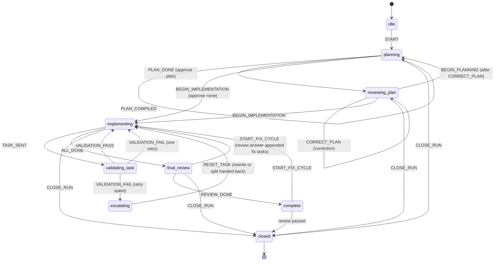

# SPLITBRIEF — Workflow

The state machine reference. Every phase, every transition, what triggers each one, what code runs.

Source of truth: `src/core/state/machine.ts` (reducer), `src/core/phases.ts` (phase taxonomy), `src/core/schemas/enums.ts` (Phase enum). Orchestrator entry: `src/engine/orchestrator/run/workflow.ts` → `src/engine/orchestrator/run/phases.ts`. Planning: `src/engine/orchestrator/planning/session.ts`.

For terminology (planner, implementer, runner kinds, runs, run status, stop reason, step, queue), read `docs/CONCEPTS.md` first.

Continuing a final review preserves the number of repair cycles already started. The persisted `fixCycles.used` counts them; an ordinary continuation never grants another repair budget. Boundary pauses in BUILD repairs durably park the run and continue from the retained cycle and next step.

---

## Batching, admission, and disposition

**Two-way disposition.** Every new, retry, rewind, and resume planning path
returns exactly one of `ready-for-tasks` or `terminal` (`PlanningPhaseResult`,
`src/engine/orchestrator/planning/types.ts`). Inside it, the planning session
returns `tasks-ready` or `terminal`, and only the plan card turns `tasks-ready`
into `ready-for-tasks`. Readiness is never
inferred from cancellation, failure, task count, score, artifact existence,
phase, or process exit. A terminal result never enters execution.

---

## 1. The state machine

Primary state is the `phase` field — one of 15 values from the `Phase` enum. `idle` is the pre-`START` phase only: nothing ever returns to it. The phase moves forward, and a run ends by being **closed**, never by being reset.

These overlays sit on top of any phase. They do not change `phase`:

- **`closed`** records `{ at, as }`. `as` is `applied`, `discarded` or `ended`. Apply, Discard and `CLOSE_RUN` close worktree and staged-copy runs. A passing review or Accept as is override makes them ready to apply. Checkout runs and older runs without a recorded workspace close as `complete` on either result. An override preserves the failed verdict.
- **`workspace`** records the run's directory, kind and base snapshot. **`applying`** records an Apply in progress and its backup. **`applied`** records the completed write. **`acceptedAsIs`** records an Accept as is override, its open findings and the note you typed (`note`, optional; the Apply warning shows it after the findings). A final review verdict clears it, also when a task-cadence Skip review set it.
- **`interruptedStep`** — the step a stop cut: `{ step, source, cut, partialRef?, kept?, at }`. `cut` says whether the stop landed `mid-step` inside a call or on a `boundary` where it cut nothing: between two briefs, or at a gate. `source` says what cut it: `user`, `watchdog`, or `seat` for a seat halt. `kept` lists the declared files a cut brief had already changed when the stop parked it; it is absent when the brief changed none, and on a state written before the field. The run stays open and picks that step up again.
- **`awaitingContinue`** — the boolean beside it, set by the same action and cleared by `RESUME_STEP`. It predates `interruptedStep`; a state written before that field existed still reads as parked.
- **`lastFailure`** — `{ step, message, at }`, the error a turn died on. The run is still open; `deriveRunStatus` reports it as `failed` and the operator retries the step. `RESUME_STEP` clears it when the run is re-entered.
- **`rewindPending`** — `{ target: 'spec' | 'plan', comment?: string }`. `CORRECT_PLAN` writes it when the user requests changes on the plan card, and an older state can carry one from the removed `/revise-spec` and `/revise-plan` commands. It stands until a plan compiles: `PLAN_COMPILED` clears it, so a replan that stops keeps the correction (§5).
- **`pendingRecovery`** — a `RecoveryIssue` raised when a turn hits something it cannot decide alone. The phase stays where the stop occurred; the overlay gates further progress until the user picks an action.

### 1.1 Phase diagram

The live path of a new run:



No edge returns to `idle`. `CLOSE_RUN` fires from any open phase. A repeated close preserves the first closure. A state that carries `closed` refuses other actions.

The diagram's `review passed` closure applies to older runs without a workspace and to checkout mode. A workspace run instead becomes ready to apply. Apply or Discard then closes it. See [Apply](#apply).

The diagram shows phase-level transitions only. `closed`, `interruptedStep`, `awaitingContinue`, `lastFailure`, `rewindPending` and `pendingRecovery` are overlays on any phase — they don't appear as nodes.

**Retired phases.** `researching`, `specifying`, `reviewing-spec`, `clarifying`, `constitution-check`, `reviewing-briefs` and `analyzing` stay in the `Phase` enum so that an older `state.json` still loads. No new run enters them. An older run saved in one of them continues as one planning session: `BEGIN_PLANNING` is allowed from every one of them (and from `reviewing-plan`), and takes the run to `planning`.

### 1.2 Complete transition table

Verified against the `transition()` reducer in `src/core/state/machine.ts` and the `phaseActions` map.

| From | Action | To | Side effects |
|------|--------|----|-------------|
| `idle` | `START` | `planning` | Every run starts in its planning session |
| `planning` / `reviewing-plan` | `PLAN_COMPILED` | *(same)* | Stores `plan` and `tasks` and clears `rewindPending`. A plan that passed its checks; at the card, a valid `plan.json` edit compiles again in place |
| `planning` | `PLAN_DONE` | `reviewing-plan` | Attaches `tasks` to state. The plan card opens there (`approve: plan`) |
| `planning` / `reviewing-plan` | `BEGIN_IMPLEMENTATION` | `implementing` | Resets `currentTaskIndex` and `attempt` to 0. From `planning` when `approve: none` skips the card |
| `reviewing-plan` | `CORRECT_PLAN` | *(same)* | A correction at the plan card. Stores it as `rewindPending: { target: 'plan', comment }` until a plan compiles, so a run that stops during the replan continues with it |
| any retired phase / `reviewing-plan` | `BEGIN_PLANNING` | `planning` | After `CORRECT_PLAN`, the correction goes back to the planning session, which compiles the plan again and returns with `PLAN_DONE`. An older run continues as one planning session |
| `implementing` | `START_TASK` | `implementing` | Sets task to `in_progress`, resets `attempt` to 0 |
| `implementing` | `TASK_SENT` | `validating-task` | — |
| `validating-task` | `VALIDATION_PASS` | `implementing` | Marks task `done`, advances `currentTaskIndex`, resets `attempt` |
| `validating-task` | `VALIDATION_FAIL` (retry available) | `implementing` | Increments `attempt`. One retry: `DEFAULT_LOCAL_RETRIES` is 1 |
| `validating-task` | `VALIDATION_FAIL` (retry spent) | `escalating` | The ladder moves to the consult |
| `validating-task` | `ESCALATE` | `escalating` | — |
| `implementing` / `validating-task` / `escalating` | `SKIP_TASK` | *(same)* | Marks task `skipped`, advances `currentTaskIndex` |
| `implementing` / `validating-task` / `escalating` | `RESET_TASK` | `implementing` | Sets task to `pending`, rewinds `currentTaskIndex` to that task's index, resets `attempt`. Tasks after it keep their status. |
| `implementing` | `ALL_DONE` | `final-review` | — |
| `final-review` | `START_FIX_CYCLE` | `implementing` | Records the fix cycle (`fixCycles.used` + 1), clears `reviewStatus`, `completedAt` and `pendingTriage`, and sets `currentTaskIndex` to the first open task. Runs the fix tasks from the review answer |
| `final-review` | `REVIEW_DONE` | `complete` | Records `reviewStatus: 'passed' \| 'failed'` |
| `complete` (review `failed`) or `final-review` (`review-failed` halt) | `REVIEW_CORRECTION` | `final-review` | The `revise` recovery action: queues the correction as a user triage input of kind `defect` with source `user`, and grants +1 fix cycle (`BOUNDS.extraFixCyclesPerRun`) when the cap is spent. Refused after a passed review |

`DEFAULT_LOCAL_RETRIES` is 1 (`src/core/pipeline-spec/retries.ts`); `workflow.max_retries` is retired and loads with one notice. The old `HINT_SUCCESS`, `HINT_FAIL` and `FULL_SUCCESS` transitions are gone from the reducer; old `escalated-hint`, `escalated-intermediate` and `escalated-full` completion values and the old `escalate`, `hint_failed` and `task_scope_widened` events stay parseable so a saved `state.json` and `session.jsonl` still load.

Before final review, `runPreReviewChecks` runs every plan and task check separately. The collection prepares its validation context once and each test command once. Running and settled rows use that prepared command. Each publishes `full_suite` at `moment: plan` in the review phase, first `running`, then `done`, `not-run` or `refused`. A render alone carries `scenario`, and its row reads `Render <scenario>` with `rendered` or `failed` and its duration. The rail shows Review during collection. The byline and build block use each check's own clock. Plan rows preserve existing required-check triage and add no reviewer-check reds.

**Review fix cycles.** The review seat answers with a typed `ReviewAnswer` (one stateless, read-only call through `requestTyped`). SPLITBRIEF derives `pass`, `pass-with-notes` or `fail` from its verdict (`deriveReviewOutcome`, `src/core/review/verdict.ts`). A criterion or finding the verdict leaves `unverified` runs its registered checks through `runChecks`; a `render` check stays unverified, and an unverified criterion blocks pass. A red check whose failures all failed at the run base in this review too fails nothing: it verifies the claim, and the Checks Log names its failures pre-existing. A minor finding is a note, also when it is unverified. A blocking unverified finding blocks until its checks verify it. The verdict lives in `state.review` and `review.json`; `review.md` is its rendering, and `parseFinalReview` stays only as the reader for old sessions that have no `review.json`.

The reviewer returns one typed `ReviewAnswer`. It contains the verdict and the fix work. The call reads the diff, the briefs, every check result, every reviewer check result, and every pending input. Its `fixTasks` are complete TaskSpecs with `findingIds`. They may edit any ordinary project file a finding needs, except a file that was already changed when the run started and that the run did not change. SPLITBRIEF appends them through `INSERT_TASKS` with new `T###` ids and `batch` = the highest plan batch + the fix cycle. Each task carries its findings under `task.fix`. Its `verify` entries run registered checks. Its `rejected` entries answer pending inputs only. Its `ask` asks the user about a change to what is built.

**The changes of the run.** The reviewer's check choice, the review prompt, the review packet and the fix work read one list of run changes (`resolveRunUniverse`, `src/engine/orchestrator/evidence/review-packet/sections-io.ts`): the run workspace against its state when the run started. A file that was already changed in the checkout when the run started (`runStartChangedFiles`) is the user's own work. A `.gitignore` whose only difference is the `.splitbrief/` and `.trees/` lines SPLITBRIEF adds to the workspace is neither the user's change nor the run's. It is a run change only when the run changed it again: the run base reader (`createRunBaseReader`) compares it with the run base, and its diff starts at the version the run started with. Each prompt lists these files apart from the run changes. A fix task that targets one that the run did not change sends the answer back for its one schema repair. Apply merges from the same run base, so such a file keeps the user's version.

Without an ask, each blocking finding inside the review scope needs exactly one fix, rejection or verification, unless it is unverified.
Each pending input also needs exactly one answer.
Unverified and minor findings never create fix tasks. `START_FIX_CYCLE` spends one cycle and starts the fix tasks. The reviewer checks and the reviewer run again after the fixes. A reviewer command a fix check ran leaves the pending list only after it passes or fails and the review records a verdict. The plan call must choose the pending commands first, with the same text. The plan holds at most 6 commands. The review section names each remaining command as not run; it stays pending.

A red at the final review never reopens a finished brief. The reviewer writes the fix work. Each fix finding carries its check ids, commands by id, own failure keys and original red keys by id, file and output. Its brief gate runs those checks again.

A fix check fails the task when a carried failure remains. The task takes the local retry with the exact errors, then the consult. The review seat answers that consult, because the reviewer judged the change and wrote the fix. This happens before the next round of reviewer checks and review.

The fields live on each finding of `task.fix` (`file`, `checkIds`, `commands`, `failureKeys`, `redKeys`, `output`). Each `commands` entry maps a check id to the exact command text it ran. SPLITBRIEF copies a pending input's command and failure keys under its check ids. A verdict finding carries every reviewer command its check ids name. It takes the union of pending input keys for the same check id and file. Keys come from the full process capture. A test row without FAILED or ERROR and a row with warning severity are not failure keys. A line of Node's TAP stream is not a failure key: a test point, its YAML block with its `location:` and stack lines, and a `#` comment. A failing `node --test` test is keyed by its file and name, and a test file that fails outside its tests by its file. A parent that failed only through its subtests gives no key. A test cancelled by a failed hook or a timeout of an ancestor gives no key; that ancestor gives one. SPLITBRIEF reads the severity where the tool prints it, not in the message text. An incomplete capture gives one placeholder key. The command must pass. Each `redKeys` entry contains every key the original red showed, before the run-base split. A verdict finding takes their union across all inputs for that check id and all files. A verdict finding assigned to a fix task must name only registered checks. An unknown id sends the answer back for its one schema repair.

The brief gate (`runBriefGate`, `src/engine/orchestrator/task/brief-gate.ts`) adds those checks to the checks its cadence runs. `runTaskChecks` (`src/engine/orchestrator/task/task-checks.ts`) builds each carried reviewer check from `commands[id]`. It runs under the same command policy as the review. For each check id, the task carries the union of its findings' failure keys, with repeats removed. A red passes only when no carried failure remains and the re-run still shows a key the original red showed that is not the task's own. Otherwise, the command must pass.

The error text of a check that did not pass comes from one builder (`checkFailureText`, `src/engine/orchestrator/validation/failure-text.ts`). The implementer retry, consult, escalation, reviewer-command inputs and triage verification results read it. Required-check and end-check inputs also use it. It lists at most 10 failure keys. Failing tests and diagnostic lines each get up to five places; unused places go to the other family. Each listed test keeps its captured assertion message, including a Go diagnostic that also forms a key. Each key and message line is clipped and secrets are redacted.

The shared selector beside the builder supplies both the input's failure keys and its text. A per-file input keeps that file's keys and unassigned keys, such as Rust's `tests::adds`. When no key names a file, an input assigned to the check's test target keeps all keys. An input without a file also keeps all keys within the same bound. File-scoped text omits the raw output tail and any test message whose diagnostic names another file. The input's `output` field keeps the recorded output. Text without a file appends the bounded output tail after the keys. Reviewer inputs keep the run-base classification and file owner before the failure listing. The builder labels new and pre-existing keys separately when the run records pre-existing failures. Pre-existing failures also fail at the run base. A fix task's text names which of its own keys remain. A red with a placeholder key keeps only the tail, or the placeholder reason when the tail is empty or the text has a file.

A diagnostic key includes its path, position and message. Match exact keys first, then pair unmatched diagnostics by message identity, with only the position removed. Pair each key once. Test failures match by name. Keys with no file match exactly. Every unmatched re-run key counts as another failure.

Other failures belong to other fix tasks or the next review. A check with no carried keys must pass. This includes older saved fix tasks. A timeout or a red with no named failure fails the gate. Results of `refused`, `unknown` and `not-runnable` also reject the brief. A settled fix check records `status: 'pass'` in `checkResults`; its command evidence keeps the failure.

The same rule covers carried reviewer, plan and task checks, even when a check is optional. Each judged re-run gets a fix check verdict row. A green re-run shows that all carried failures are gone. A red without proof shows `your N failures not shown · not proven fixed`. Plan and task checks get only a done row, with no duration.

A fix check runs once per brief gate. Each new BUILD attempt runs the checks again. A fix check never re-runs at the run base. The run base still supplies changed-script refusal for reviewer checks.

The fix brief names each command by check id and shows each distinct failing output once (`fixBriefDescription`).

A fix attempt may verify the existing code without changing it: `task.fix` permits that attempt, and normal validation decides whether it completes. `implementer_generate_done` records `noChange: true`; its done row reads `verified · no change needed`. The first call of a brief continued after a stop or a *Seat down* halt, with or without a correction, may change nothing in the same way when the brief's declared files already changed since the brief started: the call found the work it wrote before the cut complete, and the brief gate judges that work. That call's `implementer_generate_done` also records `kept`, the declared files the cut attempt left, in the brief's file order. Its done row names those files and reads `verified · kept the interrupted attempt's work · no further change`. When the continued call does change more, its row names the files it changed and adds `kept the interrupted attempt's work`, followed by the kept files it did not change again. Other attempts still fail `no-staged-change` when they change nothing.

`REVIEW_CYCLE_CAP` is 2 fix cycles (`src/core/pipeline-spec/review.ts`), so the run permits 2 automatic fix cycles; each review answer that starts fix work spends one cycle, and the Apply integration re-review counts one too. A scheduled review under `workflow.review: task` does not spend one when it passes.

`workflow.review` selects the review cadence. The default, `end`, reviews after the final brief.
`task` also reviews after every brief that passed its validation.
A task review judges completed tasks and due criteria. A criterion is due when all tasks that serve it are done.

The prompt states the reviewed tasks, due criteria, and pending tasks. Pending tasks provide context and do not represent missing implementation.

`findingInReviewScope` (`src/core/review/verdict.ts`) checks each finding.
A blocking finding must name a reviewed task or a due criterion. If it names both, both must be in scope.
Check ids alone do not place a finding in scope.
SPLITBRIEF records a finding outside the scope as a note, `Outside the task review scope: …`.
The finding does not block the review and never becomes a fix task.

`triageContractErrors` (`src/engine/orchestrator/triage.ts`) refuses a fix task for a finding outside the scope.
It also refuses a fix task criterion outside the scope.
These rules also apply when `ask` is set or the fix task has no criteria.
Pending user, Apply, and check inputs keep their existing rules.

The final review judges every task and every acceptance criterion. It still accepts a finding with no task or criterion id.

A spent cap raises `review-failed`. With a red check or Apply input that still blocks, it keeps the phase open and offers no Accept as is. Every red check or Apply input blocks, except a red reviewer check not verified at the run base that the reviewer rejects. The review record, `review.md` and the review result row count every red input that blocks as a blocking finding. Other failed reviews record `REVIEW_DONE` with a failed status. The run stays open with three actions: fix again with a note, which records the operator's correction as a triage input and grants one more cycle (`BOUNDS.extraFixCyclesPerRun`); [Accept as is](./APPROVAL-AND-RECOVERY.md#accept-as-is), at final review when no red check or Apply input blocks it; and end the run. A `complete`/failed state takes that correction through `REVIEW_CORRECTION`, which moves it back to `final-review` with the input queued, so the reviewer answers the pending inputs in a new call without running the reviewer checks.

An Apply whose merge writes text conflict markers for a file both sides changed does not halt: it queues one triage input per conflicted file (`source: 'apply'`), re-enters `final-review` through `APPLY_REVIEW_START`, and the review turns them into fix tasks before Apply runs again. Any other conflict still raises the [`apply-conflict` halt](./APPROVAL-AND-RECOVERY.md#apply-conflicts).

`runFinalReviewPhase` announces both review scopes with `review_started`, then publishes one `review_completed` per start. Each event names the review seat's tool, optional model, and nonempty effort axes. Task scope carries `afterTaskId`, the brief that scheduled it; final scope omits this anchor. The completion records the verdict, `blocking`, `minor`, and `outOfScope` counts when a verdict exists, and the duration. A failed call records `no-verdict`; a stop records `stopped`; neither carries findings. A `preReview` halt publishes neither event.

Review events never fire hooks. `workflow_complete` remains the run completion event and fires `on_complete`. The review publishes no `planner_status`, including when the planner holds the review seat. See [the review event fields](./ENGINE.md#key-event-shapes).

**Retired chain actions.** `phaseActions` no longer lists the actions of the retired planning chain — `RESEARCH_DONE`, `SPEC_DONE`, `APPROVE_SPEC`, `SPEC_CLARIFY_START`, `SPEC_CLARIFY_DONE`, `CONSTITUTION_CHECK_PASS`, `BRIEFS_COMPILED`, `BRIEF_ADMISSION_OPENED` and `ANALYZE_START`. Their reducer cases are deleted: `state.json` loads through its schema and `session.jsonl` replays into the stores, and neither path calls `transition`. What an older state needs is its saved phase and `rewindPending`.

### 1.3 Anytime actions

These fire from any phase. They modify sub-state without changing `phase`.

| Action | Effect |
|--------|--------|
| `CLOSE_RUN` | Records `closed` as `ended` or `discarded`, clears `interruptedStep` and `pendingRecovery`, and leaves `phase` alone. The shared close path first preserves unapplied workspace work. Repeating it preserves the first closure and timestamp. See [Apply](#apply). |
| `RECORD_WORKSPACE` | Records the run workspace and its base snapshot. |
| `INTERRUPT_STEP` | Records `interruptedStep: { step, source, cut, partialRef?, kept?, at }` and sets `awaitingContinue: true`. `cut` is where the stop landed — `mid-step` inside a call, `boundary` where it cut nothing: between two briefs, or at a gate — and `deriveRunStatus` reads it for `paused.at`. `kept` is recorded only when the cut brief had changed declared files; `deriveRunStatus` carries it as `paused.kept`. The run stays open and resumes at that step. |
| `RESUME_STEP` | Clears `interruptedStep` and sets `awaitingContinue: false`. The run is picking the step up again. |
| `RESTORE_BRIEF_PARK` | Puts a cut brief's park back on resume: the task `in_progress`, `attempt` the cut attempt, `phase: 'implementing'`, `interruptedStep` with `cut: 'mid-step'`, `awaitingContinue: true`. Dispatched only by `initializeWorkflow`, when the state has no park and the session log's most recent brief cut has not run again. |
| `SET_PLANNER_SESSION_ID` | Stores backend session handle for resume. |
| `ENQUEUE_USER_MSG` | Appends message to `messageQueue`. |
| `MARK_INJECTING_NATIVE` | Marks a queued message as currently being delivered to the live native session. |
| `MARK_DELIVERED_NATIVE` | Marks a queued message as delivered to the live native session and no longer pending. |
| `MARK_NATIVE_DELIVERY_FAILED` | Moves an injecting message back to pending delivery. |
| `DRAIN_QUEUE` | Timestamps pending-undelivered messages with `drainedAt`. |
| `CLEAR_QUEUE` | Removes pending or injecting undelivered messages from the queue. Delivered and already-drained messages remain as history. |
| `SET_PENDING_RECOVERY` | Sets `pendingRecovery` to the provided `RecoveryIssue`. |
| `MARK_RECOVERY_APPLYING` | Records selected recovery action and timestamp on `pendingRecovery`. |
| `RESOLVE_PENDING_RECOVERY` | Removes `pendingRecovery` after the selected recovery path is handled. |
| `REPLACE_TASK` | A consult's `rewrite-task` answer: replaces a task in place at the same id, keeps its criteria and `parentId`, sets `status: 'pending'`, raises `revision` by one and resets `attempt` to 0 |
| `INSERT_TASKS` | A consult's `split-task` answer (with `parentId`): removes the parent from `state.tasks`, appends it to its lineage's `replacedParents`, inserts the subtasks at the parent's position with `parentId` set to the lineage root, re-points every pending `dependsOn` that named the parent to all subtasks and adjusts `currentTaskIndex`. With `parentId: null` the review answer's fix tasks are appended at the end, with no lineage change |
| `RECORD_CONSULT` | Appends the answer to the task's lineage with its reason, action and diagnosis and raises the lineage's consult count (a decision-confirm, reason `deviation`, does not raise it). It does not mark a stale answer as applied |
| `RECORD_REVIEW` | Stores the typed review as `state.review`: its verdict, its derived outcome and the check runs behind its unverified claims |
| `RECORD_REVIEW_CHECKS` | Stores the answer of the reviewer's plan call (chosen reviewer checks, declined tests, reason) as `state.reviewChecks` with its scope (`final` or `task`) and fix cycle. A second dispatch adds `skipped: { reason }` when none of the chosen commands ran (`validation.approve_checks: ask`). Accepted in `implementing` and `final-review` |
| `RECORD_TRIAGE` | Appends the fix part of one review answer (`cycle`, input ids, result, and verification) to `state.triage` |
| `QUEUE_TRIAGE` | Saves check, user or Apply inputs as `state.pendingTriage`. The reviewer answers them. A correction or question answer reviews again without the reviewer checks |
| `COUNT_ATTEMPT` | Raises the lineage's attempt count. Never reset by a split or a resume |
| `COUNT_PLANNER_CALL` | Raises the run's planner-call count after planning; a stale consult and a decision-confirm do not spend one |
| `GRANT_ALLOWANCE` | `continue` on a spent consult bound: +1 consult and +4 attempts for the lineage, or +5 planner calls for the run, with the operator's note recorded on the lineage and the halt's last failing output recorded as the lineage's `carriedFailure` |
| `CLEAR_CARRIED_FAILURE` | Drops the lineage's `carriedFailure` once the replayed attempt that carried it has returned |
| `SET_TASK_INPUT_HASHES` | Saves fresh input hashes and `staleConsultedRevision` together after successful stale guidance. The marker prevents another stale consult on that revision |
| `RECORD_DISPATCH` | Records the task's revision in its lineage's `dispatchedRevision` after the stale refresh and the task-start snapshot, before the implementer runs. A Try again of that revision then runs on the brief's own files: no stale consult, the first task-start snapshot and the same action |
| `RECORD_CHECK_RESULTS` | Merges a `verify` answer's check results into the task |
| `SET_SEAT_WAIT` / `CLEAR_SEAT_WAIT` | Persists and releases the rate-limit reset deadline a seat is waiting for |

One task-scoped action also applies in `implementing` and `escalating`: `UPDATE_TASK_CODE` replaces the current code captured on a task (anchor, sibling targets and read-only context files); a field it omits is removed.

---

## 2. Phase taxonomy

From `src/core/phases.ts`. Each phase has three properties derived from the source sets. There is no resumable column: **every open run is continuable**, whatever phase it saved.

| Phase | Role | Cancellable | Live |
|-------|------|:-----------:|:----:|
| `idle` | — | no | no |
| `researching` | planner | yes | yes |
| `specifying` | planner | yes | yes |
| `reviewing-spec` | planner | no | no |
| `clarifying` | planner | no | no |
| `constitution-check` | planner | no | no |
| `planning` | planner | yes | yes |
| `reviewing-plan` | planner | no | no |
| `reviewing-briefs` | planner | no | no |
| `analyzing` | planner | no | no |
| `implementing` | implementer | yes | yes |
| `validating-task` | implementer | no | no |
| `escalating` | implementer | yes | yes |
| `final-review` | planner | yes | yes |
| `complete` | — | no | no |

**Role** — `phaseRole()`: implementer for `implementing`, `validating-task`, `escalating`; planner for everything else (token accounting adds `final-review` to the implementer bucket via `phaseTokenRole()`).

**Cancellable** — Stop now (`ctrl+c`, or the stop sheet's first row) aborts the active model call. This matches `isLivePhase()` in `src/core/phases.ts`.

**Live** — streaming output is happening. Phases where the planner or implementer is actively generating: `researching`, `specifying`, `planning`, `implementing`, `escalating`, `final-review`.

### Run status

How a run stands is not a phase. It is derived once, by `deriveRunStatus` (`src/core/sessions/run-status.ts`), from the saved state plus whether a process still holds the session's lockfile. Every surface — the sessions list, the run screen, the CLI guards, the engine's finalize — reads that one answer.

| Status | Meaning |
|---|---|
| `running` | A live process holds the run. |
| `open` | The run stopped. It carries `stop` and `resumeAt`. |
| `ready-to-apply` | A worktree or staged-copy result has a passing review or an Accept as is override. It awaits Apply or Discard. `override` names the override. |
| `closed` | The run is over. Workspace outcomes are `applied`, `undone`, `discarded` and `ended`. An applied run reads `undone` after `/run reject confirm` undid its Apply; its state keeps `closed.as: 'applied'`. A passed checkout-mode run and an older passed run close as `complete`. |

Continuation takes an open run. A ready run takes Apply or Discard, and a closed run takes nothing. A ready run has no pending recovery, interrupted step or Apply in progress. An `apply-conflict` or `apply-partial` halt leaves the run `open` and waiting for you on that halt. An unfinished Apply resumes at its Apply step.

Older runs without `state.workspace` keep their status rules. A passed run stays closed; a stopped run, or a run that waits for you at a halt, stays open. Continuing an old open run creates its workspace at first acquisition. Its base captures the checkout then, including tasks already written there. A retained task workspace keeps its partial files.

The "Workspace kept at … for Continue" notice appears only when an open run returns control to you after successful retention. The notice carries the code `workspace_kept`. End run, Discard and Apply let a workspace run's workspace go through one function, which publishes the row-less `workspace_closed` event. Once a run's log holds that event, the transcript drops the kept notice. A continue (`workflow_resumed`) drops it too, so a continued run never offers its own running workspace for Continue; a later stop that keeps the workspace again shows its own notice. Recovery publishes it immediately before opening its panel, after automatic switches, replayed actions and supplied corrections have had their turn. Headless continuation of an answered partial Apply publishes no notice before execution. If the retention record cannot be verified, SPLITBRIEF reports the diagnostic and returns control to you without a successful-retention notice. Automatic seat switches and automatic continuation after a settings boundary publish no retention notice. After a successful seat switch, the workflow refreshes its displayed crew from the admitted execution and its saved config metadata, without saving the config again; a memory-only switch stays visible when no config file exists.

**Closing a checkout run.** With `workflow.isolation: none` the implementer edits your checkout itself. Readiness warns about uncommitted changes and names the `reverted/` backup folder. An attempt revert restores only paths that attempt changed and leaves your other uncommitted files untouched. The run records `workspace.kind: 'checkout'` once, so a later config change does not move it. There is no Apply step: a passing review or an Accept as is override closes the run as `closed complete`. An override preserves the failed or unverified verdict; the closed block shows needs attention. End run, Discard and `CLOSE_RUN` write no `run.patch`, because nothing is unapplied. The close notice reads: "This run edited your checkout directly: its changes are already there, so nothing is unapplied and no run patch was written."

On a checkout run, `/run accept` closes an open run as `ended`, with its current files. `/run reject confirm` compares the baseline, the latest recorded run snapshot and the current checkout. The run records a run snapshot after each brief settles and when the run comes to rest, so a run that stopped or halted before its review can also be rejected. It restores or deletes only recorded run changes that still match the run snapshot. Later user edits and files outside that recorded change stay untouched. The message names paths left as you changed them. Rejection saves replaced files with their modes under `.splitbrief/sessions/<id>/reverted/<stamp>/`.

A rejection with no conflicts or missing snapshot files closes the checkout run as `discarded`. Otherwise the run stays open for a retry. Only a run killed before its first brief settled has no recorded run snapshot. Rejection then reports `No run snapshot to reject.` and changes no files. Rejection refuses closed runs in every isolation mode, except undo of a completed Apply from its backup in a worktree or staged-copy run. See [`/run`](./SLASH-COMMANDS-REFERENCE.md#run-acceptreject).

**`stop`** — why it is not running. It has two kinds. `waiting-for-you` means that the run cannot go on without you, `on`: `halt` (a `pendingRecovery` waits on an answer), `question` (the planner waits for a reply) or `gate` (parked at the plan card, or at an older run's spec or briefs gate). `stopped` means that the run can go on as it stands, `on`: `paused` (a park, `at: 'mid-step'` or `'boundary'`), `failed` (`lastFailure` names the error a turn died on) or `interrupted` (the process went away without recording anything). The first match wins, in this order: `halt`, `question`, `paused`, `gate`, `failed`, `interrupted`. Together with `running`, `ready-to-apply` and `closed`, a user sees five states: running, waiting for you, stopped, ready to apply and closed.

**`resumeAt`** — the step it picks up at, from `resumeStep(state)`: the gate it is parked at, the brief it was building, the review it reached, or the planner call its saved phase names (`plan` for a run in `planning`). The engine reads it to decide what runs, not how: every planner call continues as the one planning session. `resumeStep` reads the saved state only; first match wins: an open planner conversation, a ready Apply, a parked gate, the brief, the review, else the planning session.

**Who runs `final-review`** — the review seat, which is the `reviewer` runner from `.splitbrief/config.yaml` when one is configured and the planner's own runner when none is (`resolveReviewerRunner`, `src/core/config/accessors/reviewer-runner.ts`). The review seat makes three kinds of call: the plan call that chooses the reviewer checks before each review (`runReviewChecks`, `src/engine/orchestrator/review-checks.ts`), the verdict call, and the consult of a fix task (`consultSeat`, `src/engine/orchestrator/consult/request.ts`). Every other model call in this state machine, the consult of a plan task included, stays on the planner. The phase's `phaseRole()` is still `planner` and `phaseTokenRole()` is still `implementer` — those classifications did not move, so per-phase token attribution is unchanged. During the phase the transcript and the composer live status name the seat actually running — the reviewer's tool and model when one is configured, today's wording when none is — and the sidebar carries a reviewer row whenever one is configured. A reviewer that fails does not hand the review back to the planner — the phase records a failed review, stays in `final-review` instead of transitioning `REVIEW_DONE`, and still builds the run summary.

**Planner markdown headers** — only `escalating` planner markdown gets a header (`Escalation`, `plannerPhaseHeader`). No other phase, live or replayed, gets a phase label. The planning session streams no narration of its own, because its answer is typed JSON; its question rounds and warnings show as plain rows.

**How long a run ran** — `saveFinalSession` reads it from `session.jsonl` once per pass (`activeTimeOf`, `src/engine/orchestrator/summary/active-time.ts`) and saves it as `Summary.activeTime`; the closed block states it as `Ran`. The run ran in stretches. `workflow_started` or `workflow_resumed` opens a stretch, at `resumedAt` when the event carries one. A cut call that goes on in the same process — after a steer, a ctrl+⏎ send or a Resume from the stop menu — opens a stretch at its next `runner_call_started`, so the time after it counts and the wait before it does not. `turn_interrupted`, `recovery_prompted`, `workflow_complete` and `workflow_cancelled` close it. A stretch a process left open, by a crash or a restart, ends at the latest event it holds. An End taken at rest marks its `workflow_cancelled` with `atRestFrom`, the time the End began, and ends the open stretch at its latest event before that time, so neither the days before that End nor the events the End writes are counted. A live End ends the stretch at its `workflow_cancelled`. A wait on you inside a stretch (a question, the plan card, an approval) counts; a halt, a stop and time at rest do not.

A resumable stop publishes `turn_interrupted`. The operations reducer clears command stages as it does for `workflow_cancelled`. The events store settles unfinished `full_suite` and older running `validate` rows as `stopped` in the dim tone. Live continuation and hydration apply the same rule; the engine publishes no command settlement for the cut. The next command starts a new clock.

**Where a stop is recorded:** `interruptedStep` names the step the stop cut and whether it landed mid-call or at a brief boundary. It does not change the phase, and it does not make a run more or less continuable — it only tells the run where to pick up.

---

## Apply

Run changes in a worktree or staged-copy workspace await Apply. A seat switch can save the crew in `.splitbrief/config.yaml` before Apply. See [Seat down](./APPROVAL-AND-RECOVERY.md#seat-down) for this write.

Apply writes an assessed run result into your checkout once. A checkout-mode run (`workflow.isolation: none`) has no Apply; see [Closing a checkout run](#run-status). Use [the result menu](./FEATURES.md#run-result-menu) or [`/run accept`](./SLASH-COMMANDS-REFERENCE.md#run-acceptreject). An override follows [Accept as is](./APPROVAL-AND-RECOVERY.md#accept-as-is).

Apply merges the current checkout into the run workspace. It uses the three states defined in [HOW-IT-WORKS.md](./HOW-IT-WORKS.md#run-workspace-and-apply). The checkout receives no candidate writes during this merge.

A conflict raises the `apply-conflict` halt. You choose the result for each file in the workspace. Resolve every conflict before checks or review. The available choices and recovery steps are in [Apply conflicts](./APPROVAL-AND-RECOVERY.md#apply-conflicts).

If the merge or a repair changes the reviewed candidate, SPLITBRIEF runs validation and the required checks again. The review seat then reviews the whole run diff, from the workspace base to the candidate, with checkout hunks marked. This re-review counts as a final-review fix cycle against `REVIEW_CYCLE_CAP`.

Before the first checkout write, Apply saves a backup under `.splitbrief/sessions/<id>/apply/<backup-id>/`. It records replaced files and symlinks, created paths and expected results, and freezes the assessed candidate. `APPLY_START` persists the backup id. The writer uses one hash-guarded call for the result. Its guard compares the checkout with the bytes Apply read for the merge. A later checkout edit cannot silently replace that baseline.

Apply is not atomic. A failed write or a killed process can leave a partial result. The run keeps `applying` and offers restore or retry. See [Partial Apply recovery](./APPROVAL-AND-RECOVERY.md#partial-apply-recovery). `APPLY_DONE` records the applied files and closes the run as `applied`.

End run and Discard refuse closure while `applying` remains recorded. Restore or retry Apply first. The shared close path checks the state used for each commit attempt, including retries after another writer starts Apply. A refusal preserves the workspace, Apply backup and recovery.

For a worktree or staged-copy run, Discard, End run and `CLOSE_RUN` preserve unapplied work in `.splitbrief/sessions/<id>/run.patch` before closing or removing the workspace. A run with no changes writes no patch. The closed run's `Patch` row names the patch after the close commits, and a headless close names it on its close line. A patch failure keeps the run open and the workspace intact. End run on a ready run closes it as `discarded`; an earlier End run closes it as `ended`. Neither writes the run result into the checkout.

These state actions describe Apply:

| Action | Effect |
|---|---|
| `ACCEPT_AS_IS` | Records the Accept as is override and open findings. |
| `APPLY_REVIEW_START` | Re-enters `final-review` for a changed candidate and marks the checkout hunks. |
| `APPLY_START` | Records the backup before checkout writes. |
| `APPLY_DONE` | Records the applied files, clears `applying`, and closes as `applied`. |
| `APPLY_RESTORED` | Clears `applying` after restore. The run can become ready to apply again. |

---

## 3. The planning session

Every run plans in one typed planning session. There are no workflow modes and no fixed chain of planner documents. Entry: `runPlanningPhase` (`src/engine/orchestrator/planning/run.ts`) → `runPlanningSession` (`src/engine/orchestrator/planning/session.ts`), which drives the pure loop `runPlanSession` (`src/engine/orchestrator/planning/plan-session.ts`).

| Step | What happens | Code |
|---|---|---|
| Questions | The planner may answer with questions instead of a plan: at most 3 per round, each with a `default`, for at most 2 rounds (`MAX_QUESTION_ROUNDS`). A third round halts the run with `plan-questions-exhausted`. | `plan-session.ts` |
| Typed plan | The planner answers `{ result }` against `PlanAnswerSchema` (`src/core/schemas/plan.ts`): a summary, decisions, acceptance criteria, checks, validation commands and tasks (`TaskSpec`). The call goes through `requestTyped` with the tool's native schema flag where it has one. | `session.ts` |
| Checks | `checkFullPlan` runs `checkPlan` (`src/engine/spec/plan-checks.ts`) plus the context fit of each task (`estimatePlanContextFits`). A failing plan goes back to the planner once with the errors; a second failure halts with `plan-checks-failed`. A transport repair inside `requestTyped` is counted apart from this one semantic repair. | `session.ts`, `plan-checks.ts` |
| Compile | `compilePlan` maps each task with `taskFromSpec`, writes `plan.json`, renders `plan.md` and `tasks.md`, and dispatches `PLAN_COMPILED`, which stores `state.plan` and `state.tasks`. The plan's validation block becomes `state.discoveredValidation`. | `session.ts`, `src/engine/spec/plan-tasks.ts` |
| Plan card | `runPlanApproval` opens the plan card when `workflow.approve` is `plan`, then dispatches `BEGIN_IMPLEMENTATION`. | `session.ts` |

Briefs made from a plan skip any brief-quality pass: `checkPlan` is the only admission check. The pre-planning hook runs once per process, immediately before the first planner call.

The planner's questions, the plan and its repair stay on one native planner session where the tool supports it (`SET_PLANNER_SESSION_ID`). A planner without a session gets the full prompt plus the conversation so far on every turn (`planFullTurn`, `src/engine/spec/prompts/plan-session.ts`). An expired native session, or a resumed one the tool refused as too long, is reissued once on a fresh session with the rebuilt transcript (`withFreshSessionReissue`).

The session streams no narration of its own: its answer is typed JSON, so the planner's live output is not echoed. The byline and the planner heartbeat stay its signs of life, and its question rounds and warnings show as plain rows.

A halt keeps the conversation; only a plan that passed its checks clears it. A `SeatProtocolError` raises a `seat-protocol-error` recovery that offers the seat swap.

### Approval: the plan card

Controlled by `workflow.approve`: `plan` (default) or `none`. `resolveApproveLevel` (`src/core/config/runtime/resolve.ts`) is the one decision, and it reads the config. `approve: none` skips the card, and the build starts as soon as the plan passes its checks. Every run follows the same rule; no run shape skips the card on its own.

The retired values `all`, `spec` and `default` load as `plan`, with one config notice each (`RETIRED_CONFIG_VALUES`, `src/core/config/load/validation/config.ts`). The CLI has no `--approve` flag; passing it fails with `--approve was removed: set workflow.approve (plan or none) in the config`.

The card shows `plan.md`: the summary, the protected operations the plan lists, the decisions, the criteria and checks, and the tasks by batch. It has four rows (`reviewDocumentOptions`, `src/features/workflow/prompt-rows/approval.ts`):

| Row (key) | Result | Effect |
|---|---|---|
| `y` Approve plan and start the build | `{ approved: true }` | Records each listed protected operation as confirmed in the evidence ledger (`planConfirmations`), publishes `plan_approved`, then `BEGIN_IMPLEMENTATION` |
| `c` Request changes (type what to change) | `{ approved: false, action: 'revise', comment }` | Publishes `plan_regenerated`, sends `planRevisedTurn(plan.json, comment)` to the planning session, applies its checks with the one repair, and shows the card again |
| `e` Edit plan.json | `{ approved: false, action: 'edit' }` | Re-reads `plan.json` and validates it: JSON, then `PlanProposalSchema`, then `checkPlan` plus the context fit. A valid edit compiles without a planner call and the card shows again. An invalid edit is not applied: the engine restores `plan.json`, publishes one warning that starts `The edited plan was not applied: `, and shows the card again |
| `q` End run (close this run) | `{ approved: false, action: 'end-run' }` | `CLOSE_RUN` and `plan_rejected`. The run is closed; its files stay on disk |

A row is taken with `↑`/`↓` and `⏎`, or by typing its key and `⏎`; no letter settles the card on its own. Any other typed text is a correction (`c` above). While a correction is typed the legend reads `⏎ send · esc back`: `esc` clears the draft and returns the keys to the rows, and the next `esc` opens the stop menu. `e`, the `edit` command and `Ctrl+E` open `plan.json` in the in-app editor. A save checks the JSON, the schema and `checkPlan` without the context fit (`planSaveErrors`, `src/features/editor/plan-save.ts`); a refused save keeps the overlay open on one row, `Not saved: <first message> (+N more)`. `Ctrl+O` opens the external editor on the same file, and its save settles the card as an edit. Messages queued while the card waits become its correction.

A headless run approves the card unattended (`{ approved: true, unattended: true }`), and an unattended approval records no confirmation. A protected write in the build then still asks, and a headless run has no one to answer it.

### Clarification questions

A planner turn returns either `{ kind: 'questions' }` or `{ kind: 'plan' }`. A question with `choices` shows as a choice; one without shows as a text input. The default comes first and carries a dim `default` mark, and a free-text question starts filled with its default. Walking through with `⏎` takes the defaults; the last question's `⏎` sends the answers. The transcript shows `Questions before the plan · round <n> of 2`, and the byline reads `Waiting for your answer · Plan`.

Down at the end of the answer field moves to the separate instruction composer; Tab returns to the question box. Sending a non-empty instruction replaces the whole question batch with that instruction. Cancellation discards the partial batch; restarting a process does not restore unfinished UI drafts.

SPLITBRIEF owns this exchange: the planner returns its questions and finishes the turn, then the host collects the answers. The Claude planner also denies `AskUserQuestion`.

`state.pendingPlannerConversation` records the questions before waiting and the answers before the next planner call. Reloading preserves the pending round; recorded answers are not requested again. Headless runs persist the conversation, emit `input_required` and exit non-zero instead of supplying an answer.

An older run can carry a pending conversation from the retired `plan` step. The session treats it as its own only when its text matches its questions; otherwise it goes into the prompt as earlier planning and is cleared.

### `splitbrief spec`

`splitbrief spec "<feature>"` runs the same session without a build and without workflow state (`src/cli/commands/spec.ts`). It writes `plan.json`, `plan.md` and `tasks.md`, and lists the three paths with the task count. In a terminal it prints `The planner asks:` and reads one line; an empty line takes the defaults. Without a TTY every question takes its default. The planner's stream is not echoed, because its output is typed JSON.

### Retired modes

`workflow.mode` (`quick`, `standard`, `speckit`, and the older `instant`) is a retired key: any value loads with one notice and changes nothing. The CLI has no `--mode` flag; passing it fails with `--mode was removed: every run plans in one session`. `/mode`, `/revise-spec` and `/revise-plan` are removed commands with a one-line pointer (`REMOVED_COMMANDS`). `WorkflowModeSchema` stays only to read the mode that older `state.json` files, lockfiles and event logs recorded.

---

## 4. Abort / continue / queue

The operator can take these actions during a live phase:

| Action | Trigger | Effect |
|--------|---------|--------|
| Queue message | Type + Enter | Appends to `messageQueue` for the seat of the active stage: PLAN, BUILD, or REVIEW. The current call continues. Each seat reads pending messages at its next safe break, as described below. |
| Send now | Text + `ctrl+⏎`, or `/steer <text>` | Stops now, keeps the text until the stop completes, then continues with it as the step's steer. |
| Stop now | `ctrl+c`, or **Stop now** on the stop sheet | `AbortController.abort()`. Current call terminates. Partial response preserved in `session.jsonl` with `interrupted: true`. Dispatches `INTERRUPT_STEP` → the step it cut is recorded, and the run parks mid-brief with its partial changes kept. |
| Exit workflow | `ctrl+q` or `/quit` | Stop now, then exit once the run has parked or ended, so the session is on disk before the process goes. The saved state may be resumable later with `splitbrief continue <session-id>`. |
| Pause after this brief | **Pause after this brief** on the stop sheet | Nothing is killed: the running brief finishes its checks and its review, then the run parks between briefs. Dispatches `INTERRUPT_STEP` with `cut: 'boundary'` naming the brief it stopped *before*, so leaving the screen persists as a boundary park and the run picks up there. |
| Continue | `/resume`, or typed text on a parked run | Dispatches `RESUME_STEP` → the parked step is cleared. Typed text becomes the step's steer; an empty submit continues with none. |

**Continuing is one path** (`continueRun`, `src/engine/orchestrator/run/continue.ts`). A run this process is still holding settles through its park; a run at rest is re-entered on its saved state with `RunWorkflowOptions.steer`. Either way the operator's words travel as a steer, never as a message queued behind the run, and they are also recorded as a `user_message` in the transcript and `session.jsonl` — once, at the seam the engine consumes them (seed creation on re-entry, the call-continuation loop for a park), except when they answer a planner question still pending, which the call loop records as the answer it consumes. A closed run is refused with its reason rather than restarted.

**A continuation never replaces the step's prompt.** The step is the same step, so it is still stated in full; what the cut attempt left behind trails it (`composeContinuation`, `src/engine/spec/prompts/continuation.ts`). What that means per seat:

| Seat | How it continues |
|---|---|
| Planner | The planning session issues its call again: the plan prompt in full, with the operator's steer as a note, on the native session where the tool has one. A cut typed answer leaves no partial to carry. An unanswered question round takes the steer as its answer. |
| Reviewer | The whole deterministic review prompt is re-issued — the request (or an older run's spec), briefs, diff, drift, evidence, rebuilt from disk — with the continuation block on the end. Each verdict call uses a full, stateless prompt. It never resumes a session. |
| Implementer | The brief restarts on its own prompt, with the partial and a line naming the declared files that already changed since the task started, so the next attempt edits what is on disk. The attempt count is unchanged. |

A user park keeps partial edits in the run workspace, including a stopped retry. Continue reuses that workspace at the stopped attempt while the session, brief, build seat and directory identity match. A failed continuation-record save leaves the files in place and reports that automatic continuation is unavailable. A cold crash restores the current brief's attributed workspace changes from its task snapshot and restarts that brief. Earlier completed tasks stay in the workspace.

A stopped workspace keeps its private CLI state and caches. Static credential copies use mode 0400 inside mode 0700 directories; rotating OAuth bridges remain links to host state. Re-entry creates a fresh temporary sandbox and removes that sandbox when the entry ends. The run workspace survives ordinary disposal while the run stays open. Closing follows the patch rules in [Apply](#apply).


**Queue scope.** `phaseStage(phase)` determines the receiving seat: PLAN, BUILD, or REVIEW. See [Message queue](./ENGINE.md#message-queue) for delivery rules during calls, checks, retries, and verdicts. See [Mid-call steering](./PLANNERS-AND-IMPLEMENTERS.md#mid-call-steering) for tool support and transport details.

`ctrl+⏎` with text uses the same path as `/steer <text>` to stop now and continue with the text. A terminal without extended keys reports this key as Enter, which queues the message. `/steer` works in every terminal.

**Abort scope.** Stop aborts the outer workflow, including model/API calls, validation, planner questions, approval and recovery waits. The engine drains owned processes and persists the interrupted step before navigation or application exit. Queue availability still depends on the live phase.

**Queue lifecycle.** The queued count drops at a message's first delivery to any seat. A later delivery of that id changes no count. A message that REVIEW read also goes to the next fix brief's BUILD call. After first delivery, the message is history and `/queue clear` preserves it. See [Queued count](./ENGINE.md#queued-count) for state and replay rules.

Queue submissions return accepted or rejected results. Unsupported live phases and the 50-message cap cause a rejection and a bounded warning. The UI shows feedback near the composer. `/queue show` reports the queued count. `/queue clear` removes only messages awaiting first delivery. It reports unavailable when the run has no live clear handler.

**Stopping a run.** `esc` opens the inline menu above the composer; another `esc` stops resumably. A third press requests home after cleanup and persistence, even when all three presses arrive together. After stopping, the menu offers **Resume / End run / Back to sessions**. Tab returns to the composer; `/stop` or the command palette reopens these options. End run remains an explicit action; no Escape or Ctrl+C sequence closes the saved run.

A Stop that newly parks a step records one `turn_interrupted` event, including when the UI settles the stop between engine calls. An explicit End run records `workflow_cancelled` whether the engine or the at-rest UI closes it. End run on a ready-to-apply run is its Discard: nothing runs, so it records no `workflow_cancelled` and the transcript shows no `Stopped by you` row. Retrying finalization adds no second event. A rewind aborts the old call so the replacement can start; it records its rewind event without parking the rewound state or adding a Stop row.

`ctrl+c` stops active work and advertises the next press as quit. While stopping, Ctrl+C requests exit after cleanup. At rest or home, the first press shows `Press ctrl+c again to quit`; another within two seconds exits. Other input, navigation to another session, or resumed execution clears confirmation. Ctrl+Q and `/quit` use the same safe departure path.

Stop status follows real work: `Waiting for processes to exit` only while owned processes remain, then `Finishing cleanup and saving`. Process termination uses the registry's existing SIGTERM/SIGKILL escalation. A failed cleanup or save reports its error and offers **Retry stop**, which retries cleanup/persistence without running another model call. There is no UI timer that declares success. A parked run returns home on Escape; unsent text, paste content and image references persist in its `draft.json` and return when it is reopened.

---

## 5. Rewind

### A saved rewind

`/revise-spec` and `/revise-plan` are removed commands; request changes on the plan card instead. A correction at the card publishes `plan_regenerated`, dispatches `CORRECT_PLAN` and runs the planning session with the correction (`src/engine/orchestrator/planning/session.ts`). `CORRECT_PLAN` saves the correction as `rewindPending: { target: 'plan', comment }`, and `PLAN_COMPILED` clears it. A run that stops before a plan compiles still carries it, and so can an older `state.json`. On the next planning entry `rewindLead` (`src/engine/orchestrator/planning/run.ts`) runs the one planning session with the comment as its correction (`planRevisedTurn`) against the saved `plan.json`, then opens the plan card. `target` is not read: a spec rewind and a plan rewind run the same session.

`REWIND_TO_SPEC` and `REWIND_TO_PLAN` reducer cases are deleted. A saved state needs only its `rewindPending`, which `rewindLead` reads.

---

## 6. Continue

A run is a durable record. An open run stays continuable, so there is one verb for picking one up and one path behind it: `continueRun` (`src/engine/orchestrator/run/continue.ts`).

`splitbrief resume` reads `.splitbrief/active` for the most recent run; `splitbrief continue <id>` names one outright. Both load `state.json` through the v4 state operations API. Missing, malformed, future-versioned and closed states cannot continue. A ready run offers Apply or Discard. A v3 state migrates to v4 on load.

### Where it picks up

At the first thing it has not finished, not at the top. `resumeStep(state)` (`src/core/sessions/run-status.ts`) names it, reading the same step table the run walked:

| Saved at | Picks up at |
|---|---|
| The plan card (`reviewing-plan` with `state.plan`) | the card, re-opened without re-spending the planner call behind it |
| An older gate (`reviewing-spec`, `reviewing-briefs`, or `reviewing-plan` without `state.plan`) | the planning session, which reads the run's earlier research, spec, plan and `tasks.md` as "Earlier Planning" and takes the correction typed at the gate; then the plan card opens |
| A brief (`implementing` / `validating-task` / `escalating`) | that brief |
| `final-review` or `complete` with a failed review | the review, at its recorded cycle |
| Ready to apply, or Apply interrupted with `applying` recorded | the Apply step, through its result or recovery menu |
| Anything else (`planning` or a retired planning phase) | the planning session |

**Planning picks up as one session.** `runPlanningPhases` (`src/engine/orchestrator/run/phases.ts`) sends a brief or a review straight to the task loop, re-opens a parked plan card through `resumeParkedApproval`, and runs everything else as the planning session. A run cut mid-call takes `RESUME_STEP` first. Pending questions resume where they stopped; recorded answers are not asked again.

A run saved inside `validating-task` or `escalating` resets the current task (`RESET_TASK`) and restores that task's files from the changed-files baseline snapshot, so the brief is re-attempted from a clean tree rather than half-validated.

### What it continues on

| Planner seat | What the continuation gets |
|---|---|
| `supportsSessionResume: true` and `plannerSessionId` set | The native session, resumed on its thread (`claude --resume <id>`, `codex exec resume <id>`). Only an id the tool itself reported is ever resumed: Claude Code captures it as it streams, the CLI planner keeps codex's own thread id, and the SPLITBRIEF session id never reaches the wire. |
| The backend rejects the session (expired, unknown) | The run drops the thread from its state, warns once (`planner_session_expired`) and issues the planning call again on a fresh session with the rebuilt transcript, the continuation in its stateless form. When that call fails too, the step halts as a planner-call failure that quotes the tool's error, and continuing it starts a fresh session on the rebuilt transcript. Claude Code and codex take the same path. A resumed thread the tool refused as too long takes the same path and warns `planner_session_refused`; the refused call drops the thread, so no later call resumes it. A change requested on the plan card takes it too, because it runs as a planning-session call: the call runs again once on a fresh session with the rebuilt transcript, and a second failure halts it the same way. |
| No native session | A transcript rebuilt from `session.jsonl`: the latest compact summary entry plus every message after it, passed as initial context to a fresh planner call. It holds the planner conversation only. It leaves out implementer output and the documents the planner landed, older logs included. It also leaves out the cut call's partial when the continuation hands that partial to the step, and the steer, which is logged after the rebuild. |
| No transcript either | `applyRebuiltContext()` publishes a warning and continues with the Task Brief transport plus `plan.md`. |

Pending queue entries remain in `state.json`. A continuation excludes still-pending queued user messages from the stateless transcript rebuild so they are not duplicated, and `hydrateFromState` restores message ids awaiting first delivery. The footer and `/queue show` count those ids.

### Every stop, and what continuing it does

| Stop reason | What it was | Continuing it |
|---|---|---|
| `stopped` · `paused` · `mid-step` | Stop now, inside a call | Re-issues that step with the partial it left behind and the operator's steer |
| `stopped` · `paused` · `boundary` | Pause after this brief, or Stop now at a gate | Starts the brief it stopped before; a typed steer is held for that brief. A stop at the plan card re-opens the card |
| `waiting-for-you` · `gate` | Parked at the plan card, or at an older run's spec or briefs gate | Re-opens the plan card without re-spending the call behind it; an older gate continues as the planning session. At rest the byline reads `⏎ to reopen it` at the plan card and `⏎ to continue` at an older spec or briefs gate |
| `waiting-for-you` · `halt` | A `pendingRecovery` nobody answered | Shows the recovery panel before any work |
| `waiting-for-you` · `halt` · seat cut | A *Seat down* halt cut the brief it was running (`interruptedStep.source: seat`, `cut: mid-step`) | Shows the recovery panel. `switch-seat` restarts the cut attempt on the new seat. `retry-later` sets the seat wait to the reset |
| `stopped` · `failed` | `lastFailure` — a turn died on an error | Retries the step it died on |
| `stopped` · `interrupted` | The process went away recording nothing | Restarts at `resumeStep`; an `in_progress` brief with no `interruptedStep` is a crash, so its own writes — declared or attributed in the workspace — are restored from `activeTaskSnapshot` and it restarts clean |

A park keeps the worktree's partial edits and continues with that context; a crash does not, because nobody chose to keep them.

A crash leaves its last calls open in `session.jsonl`. The first writer after the crash records each one as interrupted (`recordInterruptedCalls`, `src/engine/calls/interrupted.ts`): a `runner_call_error` with code `runner_interrupted`, dated at the last report of its call and marked `endUnknown`, as is its terminal activity. The continuation records it before it restores files or runs a step again. End run at rest (the TUI or `splitbrief continue <id> --action end-run`) records it before the run closes. A run opened at rest before either shows the same close, read from the log, so the cut call reads `current turn interrupted: SPLITBRIEF exited` once: at rest, after the continuation and after End run. Because the close is dated at the last report, a review whose call carries that mark reads its time as `at least …`. Its activity batch wears the stop mark `×` and reads `interrupted`, and the row reads `Stop`. A stop you make inside a call closes that call the same way: every runner kind, CLI tools included, records the cut call as `aborted` with code `runner_interrupted` (a timeout keeps `timeout`), so the cut reads `Stop · current turn interrupted: stopped by you` and never counts as an error. No batch of a call that ended is live, whether the call finished or a stop cut it: while the continued run waits for its first report, the brief's header carries the running mark. At rest, a brief left in progress wears the mark of its stop (`atRestBriefMark`, `src/features/workflow/at-rest.ts`), as the rail does, and an attempt that ended drops its `working on <file>…` row. While a continued run starts again, the byline reads `Resuming T002` (or `the plan`, `the review`), and `esc` opens the stop sheet as it does on a running run.

Another process can close a run that this screen shows at rest, for example with `splitbrief continue <id> --action end-run`. The screen refreshes without input. It shows the closed run and its saved transcript, and removes the stop options. Home, `/sessions` and the palette read the session list again each time they open.

### Recovery on continuing

If state has `pendingRecovery`, resume shows that issue before dispatching work. [Retired file halts](./APPROVAL-AND-RECOVERY.md#retired-file-halts) resolve on continue with a notice. A halt stays pending until you choose one of its actions, so a run you leave shows the same decision when you continue it.

An unresolved recovery also makes the stop audible: when the task loop re-enters a state that still carries `pendingRecovery`, it publishes a transcript-safe `warning` with `code: 'recovery_pending_unresolved'` naming the reason, the recovery status (`awaiting-user` or `applying`) and the available actions, then stops without running any task. The issue is neither cleared nor re-entered. In headless `--json` mode the same state fails the command with exit code 1 for **every** status — an applying recovery does not exit 0 having done nothing.

An operator park keeps partial workspace edits at the same attempt. A crash without `interruptedStep` restores the brief's attributed workspace changes and restarts at attempt 0. Re-entry clears the park before the brief runs. A halt followed by Stop in that gap can therefore leave an `in_progress` brief without `interruptedStep`. If the session log proves that brief never ran again, `RESTORE_BRIEF_PARK` restores its park instead of restarting it.

---

## 7. Escalation and recovery

Every failed, blocked or stale consult failure stops through `handleTaskPlannerCallFailure` in `task/retry.ts`.
A thrown failure or a malformed answer halts on the seat that answered.
A failed stale call, a malformed answer or an unanswered guard question leaves the input hashes and stale marker unchanged.
The halt names the interrupted task. Retry consults that task's same seat again before dispatch.
Only successful guidance saves fresh hashes and marks the revision in one transition.
A successful rewrite records fresh hashes on its new revision. That revision can take its own stale consult if inputs move again.
Switch moves REVIEW.
When REVIEW follows PLAN, Switch writes a `reviewer` block and leaves `planner` unchanged.

During a consult, the composer byline uses the active call's seat and clock.
A reviewer consult uses the same formatter as a final review.
The question callback carries the seat that asked. A reviewer question shows `Reply to the reviewer…`.

A rewrite that changes criteria or drops a required criterion check asks the operator before the answer applies.
A split that drops a criterion or its required check asks through the same path.
`applyConsultAnswer` returns the operator's answer as guidance, or `failed` when no answer is available.
It never returns an unasked question to a caller.
During a stale refresh, an unanswered guard question halts on the consulted seat.
The task's input hashes stay unchanged, and no implementer attempt runs.
An answered question records the fresh hashes, then dispatches the first attempt with the operator's answer as guidance.

When a task fails validation after its attempt and its one retry (`DEFAULT_LOCAL_RETRIES`), or its implementer reports `blocked`, or its recorded inputs moved since it was compiled, SPLITBRIEF consults a seat: one read-only typed call (`requestConsult`, `src/engine/orchestrator/consult/request.ts`). `consultSeat` chooses the seat. A plan task consults the planner on the planner's own session. A fix task (`task.fix`) consults the review seat, because the reviewer judged the change and wrote the fix. A rewrite or a split keeps `task.fix`, so its descendants also consult the review seat. The review consult is one stateless call through the reviewer with the full prompt and the findings' `failureKeys` and `redKeys`. Its usage goes to the reviewer. With no `reviewer:` block the planner holds the review seat (`resolveReviewerRunner`). The seat answers a `ConsultAnswer` (`src/core/schemas/consult.ts`) with exactly one action — `guidance`, `rewrite-task`, `split-task`, `verify` or `ask-user` — and the run acts on it: one more implementer attempt carrying the guidance in its error block, a replacement at the same id with `revision` raised by one, a split whose subtasks take the next free ids and share the lineage, a brief gate and the named checks that can complete the task as `consulted`, or the one question the ladder asks the user. An answer that would drop a criterion becomes that question. The consulted seat never writes the implementation, and that seat answers a `blocked` report, not you. Each answer is one transcript row that names the seat, `PLAN → T003: split into T011, T012 · <diagnosis>` or `REVIEW → T013: guidance · <diagnosis>`. The consult record and the `consult_answered` event carry the `seat`; a record without a seat is a planner consult. Planner questions about requirements still come to you.

A hand-back that reports `decisions` is not a consult. Before its attempt is validated, the planner confirms (also on a fix task) the decisions the ledger does not hold yet for that task, in one cheap call (the *decision-confirm*): `confirm` adds the changes of how, and the decisions that carry out your corrections, to the plan's decisions ledger. A reported decision the `confirm` leaves out or rewords is rejected, and the implementer retries with the planner's diagnosis before any validation. `ask-user` puts any other change of what to you, with your instructions for the brief under the question. SPLITBRIEF adds your answer to the brief's operator instructions and asks the planner once more: `confirm` sends the kept work to the brief gate with no new implementer call, and `guidance` sends its instructions to the implementer in one more attempt. When that second call fails, the attempt delivers your answer, and an attempt that finds the kept work already right may change no file. Every consult and every review sees the brief's operator instructions: your queued messages, messages during a call, the correction typed on a stopped run, and your answers. That delivery is not a retry: it writes no `task_retry` row, spends no local retry and no consult, and counts only against the lineage attempt allowance. A retry that reports the same decisions again is not asked about twice. After the confirm, the brief gate follows the review cadence. A red takes the normal ladder: one retry with the exact errors, then a consult. A decision-confirm runs at most once per attempt, bounded by the brief's lineage attempt allowance. It spends no run counter, never a lineage consult and never one of the 10 planner calls. Its transcript row says what the planner decided and why: `PLAN confirmed 2 decisions for T004 · <diagnosis>` or `PLAN rejected 1 decision for T004 · <diagnosis>`.

A lineage has at most 2 consults and 8 attempts (`src/core/pipeline-spec/bounds.ts`). The run has at most 10 planner calls after planning. The name stays for compatibility: the planner consults and the review-seat consults spend from this one allowance. A spent bound halts with `consult-bound-spent` or `planner-calls-spent`. The halt carries the diagnosis of the failure that raised it, or the consulted seat's diagnosis when a consult diagnosed that failure. A failed brief gate has the diagnosis `check <id> failed`, naming the first failed check. The halt also carries the failing output. Continuing it grants one more consult and four more attempts, or five more planner calls, and replays the brief from the files its last attempt left, with the brief's first task-start snapshot, as a retry that carries the halt's last failing output and runs no stale consult; Skip restores the files; End run keeps them in `run.patch`. A stale consult spends no planner call. Each revision takes at most one successful stale consult; Retry replays a failed one. A Try again after the brief ran runs no stale consult, because its moved inputs are its own files; it keeps the brief's first task-start snapshot and its action.

Seat trouble is bounded before a halt: a transient failure on a seat call retries up to 3 times with backoff, and a reported rate-limit reset no more than 10 minutes away is waited for, its deadline persisted as `state.seatWait` (`src/engine/orchestrator/escalation/seat-wait.ts`). A longer or unreported reset halts as `runner-usage-limit` with the seat picker, or moves the seat at once when the seat declares a `fallback` ([Seat down](./APPROVAL-AND-RECOVERY.md#seat-down)). The idle watchdog warns after 5 minutes of no output and never ends a call by default. A seat that sets `idleKillMs` or `timeout` is cut at that limit. The cut counts as one attempt and the ladder continues; two cuts or timeouts in a row halt as `runner-timeout-repeated`.

Recovery follows a spent bound, a ladder that cannot continue — a consult call that failed, a `pre_escalation` hook that denied it — or a run-level failure: `pendingRecovery` is set and the phase stays where the stop occurred. Historical full-tier outcomes remain readable.

Recovery is not only the task loop's. A planner-seat turn that cannot decide alone raises one too, and the issue carries a `seat` (`plan` | `build` | `review`) so the panel and the swap offer name the seat that is actually stuck: `planner-call-failed` (the call died and the diagnosis is already on the bus), `plan-questions-exhausted` (the planner asked a third round of questions), `plan-checks-failed` (the plan failed its checks again after one repair) and `seat-protocol-error` (the seat's typed answer did not parse after its repair). The reasons in `RETIRED_RECOVERY_REASONS` (`validation-failed`, `user-edit-conflict`, `approval-promotion-conflict`, `scope-violation`, `planner-returned-no-briefs`, `constitution-check-failed`, `brief-review-no-progress` and `brief-quality-unrepaired`) have no producer now. They still parse so that an older `state.json` still loads, and a saved halt on one of them resolves on continue with a notice. `runner-unauthenticated` and `runner-usage-limit` are *Seat down* halts and can fire on the plan seat as readily as the build seat.

`RECOVERY_REASONS` (`src/core/schemas/enums.ts`) defines the persisted reason names. A person sees one of two halts, and each reason maps onto one of them (`haltOf`, `src/core/recovery/halt.ts`): *Needs you* (a decision only the operator can make) or *Seat down* (the seat cannot run). The panel title and the at-rest byline read `Needs you · <cause>` or `Seat down · <cause>`; the reason code stays in the issue, the events and the log. [APPROVAL-AND-RECOVERY.md](./APPROVAL-AND-RECOVERY.md#recovery) lists their producers, actions and compatibility rules.

Recovery actions:

| Action | Effect |
|--------|--------|
| `retry-same-worker` | Retries the recorded PLAN/REVIEW step, or resets and reruns the matching BUILD task |
| `switch-seat` | A seat that cannot run at all: moves it to its declared `fallback` or another ready detected tool. The switch prepares the session, writes that one seat to `config.yaml` against the revision the halt read, then resolves the halt. See [Seat down](./APPROVAL-AND-RECOVERY.md#seat-down) |
| `retry-later` | A *Seat down* action, offered only when the halt names a reset: the seat waits for that reset, then the run continues |
| `revise` | Clears recovery and queues the operator's correction for the next planner turn; on `review-failed`, records the correction and opens one more review fix cycle |
| `continue` | Grants extra allowance on `consult-bound-spent` or `planner-calls-spent` |
| `accept-as-is` | Records an Accept as is override at final review. Workspace runs become ready to apply; checkout runs and older runs without a workspace close. See [Accept as is](./APPROVAL-AND-RECOVERY.md#accept-as-is). |
| `restore-backup` | Restores a partial Apply through its backup. See [Partial Apply recovery](./APPROVAL-AND-RECOVERY.md#partial-apply-recovery). |
| `skip-current-task` | Records evidence, marks task `skipped`, advances index |
| `end-run` | Uses the shared close path. Refuses an unfinished Apply: restore or retry Apply first. Unapplied workspace work stays in `run.patch`; a checkout-mode run writes no patch. The run closes as `ended` or `discarded`. See [Apply](#apply). |

A *Needs you* halt allows `continue`, `retry-same-worker`, `revise`, `accept-as-is`, `restore-backup`, `skip-current-task` and `end-run`; a *Seat down* halt allows `retry-same-worker`, `switch-seat`, `retry-later` (with a reset only), `skip-current-task` and `end-run`. The retired actions of older files read through `RETIRED_RECOVERY_ACTIONS`: `revise-spec` as `revise`, `route-bigger-worker` as `retry-same-worker`, and `pause-run` and `planner-split-rebase` are dropped.

Recovery statuses: `awaiting-user` → `applying` (via `MARK_RECOVERY_APPLYING`) → cleared (via `RESOLVE_PENDING_RECOVERY`). A status `paused` saved by an older run reads as `awaiting-user`.

---

## 8. A run, step by step

```
 1. splitbrief start "add email validator"
 2. CLI loads .splitbrief/config.yaml → configStore.
    A retired key (workflow.mode, an old approve value, task_review, ...) prints one notice.
 3. CLI checks .splitbrief/active → error if it names a live run;
    a pointer whose run is no longer alive is cleared.
    Generate session ID, create .splitbrief/sessions/<id>/, write the
    .splitbrief/active receipt { version, sessionId, generation }.
 4. routerStore → screen: workflow. useRunLoop starts.

 5. runWorkflow() begins. initializeWorkflow emits workflow_started.
    Repo map built from codebase config.

 6. phase: idle → START → planning
    The planning session sends the typed plan prompt.
    Planner session ID captured → SET_PLANNER_SESSION_ID → state.json.

 7. Questions (optional, at most 2 rounds of at most 3)
    SET_PLANNER_CONVERSATION records them; the question box waits.
    The answers go back on the same planner session.

 8. Plan
    checkPlan + context fit. A failing plan goes back once; a second failure
    halts with plan-checks-failed.
    PLAN_COMPILED stores state.plan and state.tasks.
    plan.json, plan.md and tasks.md are written.

 9. phase: planning → PLAN_DONE → reviewing-plan     (approve: plan)
    callbacks.onApprovalNeeded('plan', plan.md)
      approve  → record the plan's protected operations as confirmed
      revise   → the planning session takes the correction → card again
      edit     → re-validate plan.json → compile or restore → card again
      end run  → CLOSE_RUN. The run is closed; its files stay on disk.

10. phase: reviewing-plan (or planning, with approve: none)
      → BEGIN_IMPLEMENTATION → implementing
    The run records one workspace and its workspace-base snapshot.
    No command runs before the first task.
    review: end runs the reviewer checks at the final review over the run workspace.
    review: task also runs due checks after each task, then a task review whose
    reviewer checks run the tests related to the task's changed files.
    validation.end_checks: false runs no reviewer check; one row says so.
    A red reviewer check is re-run at the run base with the same command text;
    only new or not verified failures reach the reviewer as pending inputs.
    Each reviewer check and its base re-run publish full_suite events (id V1, …).

11. Per task:
      implementing → START_TASK (task in_progress, attempt 0)
      The task's code and its read-only context files are refreshed from disk.
      The recorded input hashes are compared with the workspace; a task whose
      inputs moved takes one successful stale consult for this revision first.
      A failed consult halts; Retry consults the same seat again before dispatch.
      implementer.implement(taskPrompt) → code written to disk
      (a brief replayed by continue starts as implementer.retry carrying the
      last failing output)
      Every writer uses the run workspace selected by `workflow.isolation`.
      The protected gate checks changed files there before validation.
      (worktree by default; `none` edits the checkout; see CONFIGURATION.md §5)
      A write to a protected path asks, unless the approved plan listed it.
      A hand-back that reports new decisions gets one decision-confirm first:
        confirm → the accepted decisions join the ledger → validation
                  a decision it leaves out or rewords is rejected → retry with the diagnosis
        ask-user → one question; the answer joins the brief's operator instructions,
                   and the planner is asked once more:
                   confirm → validation of the kept work, no new attempt
                   guidance → the next attempt carries the instructions
      implementing → TASK_SENT → validating-task
      brief-gate selects checks by workflow.review:
        end → no checks (only the checks a caller names, e.g. a consult verify)
        task → the task's checks and the checks due when this task completes
        a fix task also runs each carried check once per brief gate, with no base re-run
        full capture → keys; incomplete capture → placeholder → command must pass
        diagnostics pair by exact key, then message identity; tests match exactly
        each unmatched re-run key counts as another failure
        no own failure left + an original other key remains → pass
        no original other key, no own keys or a placeholder → command must pass
        each judged re-run gets a verdict row, including green re-runs
        plan and task checks get only a done row
      The project formatter runs on this brief's changed files first.
        pass → VALIDATION_PASS → implementing (next task)
        fail → VALIDATION_FAIL → implementing (attempt++, one retry)
        fail (retry spent) → escalating, where a seat is consulted
        (the planner for a plan task, the review seat for a fix task):
          guidance → one more implementer attempt with the guidance attached
          rewrite-task → REPLACE_TASK (same id, revision+1) → implementing
          split-task → INSERT_TASKS (next free ids, parentId) → implementing
          verify → validation + checks → done as consulted
          ask-user → one question; the answer continues as guidance
        consult bound spent → recovery (continue grants +1 consult / +4 attempts)

12. implementing (last task) → ALL_DONE → final-review
    Drift report computed. The review seat reads the diff against the briefs
    and the plan. With workflow.review: task, one scoped review also runs after
    each task after its due checks pass.
    Before the final review, every registered plan and task check runs.
    Then the review runs in two reviewer calls, with the reviewer checks run
    between them:
      1. Plan call (read-only, review_checks): the reviewer reads the project
         and chooses at most 6 reviewer checks (V1, V2, …) with a reason each,
         names each related test it declines, or gives the reason it chose none.
         A task review chooses only the tests related to the task's changed files.
         A reviewer command a fix check ran leaves the pending list only after
         it passes or fails and the review records a verdict.
         The plan call must choose the pending commands first, with the same text.
         The review section names each command over the limit as not run;
         it stays pending.
         A failed plan call (a transport error or a protocol error) halts the
         review the same way a failed verdict call does; it is never a pass.
         With validation.approve_checks: ask, one card shows the chosen commands
         and their reasons: Run all or Skip all. Skip all, a card closed without
         an answer, or a headless run runs none of them; one row and
         state.reviewChecks.skipped name the reason, and step 2 is skipped.
      2. SPLITBRIEF runs the reviewer checks in the run workspace, in order,
         under the reviewer command policy: any installed program, but no shell
         syntax, program by path (the root ./gradlew and ./mvnw run while
         this run changed none of their wrapper files), inline code,
         download-and-run launcher, setup command, or package script, task
         file, build wrapper or interpreter script this run changed or the
         run base does not hold.
         Each refused command is a named row. A red reviewer check re-runs at
         the run base with the same text, in a detached Git worktree at the
         base commit with the base snapshot on top (withRunBaseTree); failures
         red there too are pre-existing. With no base commit the copy has no
         Git history, file modes or symlinks: a red there is "not verified at
         the run base". Any base-tree preparation failure, including
         listing stale trees, snapshot reconciliation or dependency linking, gives
         "not verified at the run base" with the error and any cleanup error;
         no base command runs. Every re-run sweeps dead-PID trees, even with no
         base commit. Registered trees are removed in their owning repository
         with worktree remove --force; unrelated registrations stay. Older
         names without a PID need manual removal. A tree whose .git file names
         a missing gitdir is deleted from disk; its registration is gone.
         A stale tree that cannot be removed is a warning; the sweep and the
         current base re-run continue. A cleanup error of the re-run's own tree
         settles the row as "not verified at the run base" with the error
         visible, even after the command completed. The review continues; its keys stay unverified
         and the check has no base field.
         Callback errors propagate unchanged, with cleanup failures warned.
         Only a base re-run that returns its result gets a base field in
         evidence.json. A timeout or a red without failure keys is never
         pre-existing: with a red base re-run it is "not verified at the run
         base", stays new, and the reviewer decides. The first reviewer check
         with new failures stops the list; each later one is not run (<id> failed).
      3. Verdict call: the reviewer gets every result in a Reviewer checks section.
         A skipped plan is named there: none of its commands is a pass, and a
         criterion that only they verify is unverified.
    Every new or not verified red becomes a pending input. No brief reopens.
    The input carries the red check's id, its command and its output.
    A re-review of the same candidate (after an answer or a correction) runs
    no new reviewer checks. A review after a fix cycle is never such a re-review,
    even when the run stopped inside it. validation.end_checks: false skips steps 1 and 2;
    plan and task checks still run.

13. final-review → REVIEW_DONE → complete
    The review seat returns a typed verdict and fix work; SPLITBRIEF derives pass,
    pass-with-notes or fail. summary.json is saved at the end of this run
    pass, as at the end of every pass. A passing workspace review
    makes the run ready to apply.
    Apply or Discard closes it. An older run without a workspace closes on pass.
    The same review answer supplies the fix tasks. They are appended
    with new ids and batch = highest plan batch + cycle, one fix cycle is spent,
    and implementing runs them (START_FIX_CYCLE) up to the review cycle cap.
    Each fix task carries own failure keys and all original red keys per check. Its brief gate runs each check
    once, with no base re-run. Full capture supplies the keys.
    Incomplete capture → placeholder → command must pass.
    Diagnostics pair by exact key, then message identity. Tests match exactly.
    Each unmatched re-run key counts as another failure.
    No own failure left + an original other key remains → pass.
    No original other key remains → command must pass.
    Each judged re-run gets a verdict row, including green re-runs.
    Plan and task checks get only a done row.
    A carried failure that remains retries and consults the review seat.
    With no carried keys or no named failure, the command must pass. The cap is
    2. After the cap the run halts on review-failed: fix again with a note
    (+1 cycle), Accept as is when no red check or Apply input blocks it, or end.
```

During live model calls, `ctrl+c` stops now and parks the run. `esc` opens the stop menu. Enter with text queues a message for the seat of the active stage: PLAN, BUILD, or REVIEW. That seat reads pending messages at its next safe break. `ctrl+⏎` with text stops now and continues with the text, like `/steer <text>`. Request changes on the plan card to revise the plan.

**What the checks run.** Every check in steps 10 to 13 runs the project's own code: its tests, build scripts, `Makefile` recipes and package scripts. This applies to plan checks, reviewer checks, base re-runs, the checks of a fix task, `render` checks and the formatter. They run with your user's permissions, in the run workspace. SPLITBRIEF isolates their working directory, drops secrets from their environment, stops them at `validation.timeout_ms`, bounds their output, and kills their whole process group. It does not isolate the file system, the network or other processes: a check can read and write any file your user can, `~/.ssh` and `~/.npmrc` included. There is no OS sandbox for checks. [CONFIGURATION.md §What a check can reach](./CONFIGURATION.md#what-a-check-can-reach) lists the kept environment variables. The seats are isolated differently; see [PLANNERS-AND-IMPLEMENTERS.md §Posture, trust, and auth](./PLANNERS-AND-IMPLEMENTERS.md#posture-trust-and-auth).

---

## 9. WorkflowState shape

Source: `src/core/schemas/workflow.ts` (Zod), `src/core/state/machine.ts` (`createInitialState`). State version: 4.

```typescript
type WorkflowState = {
  stateVersion: 4
  stateRevision: number                    // CAS revision
  phase: Phase
  feature: string
  currentTaskIndex: number
  attempt: number
  tasks: Task[]
  plannerSessionId: string | null
  startedAt: string                       // ISO 8601
  tokenUsage: TokenUsage
  awaitingContinue: boolean               // true while a step is parked
  messageQueue: QueuedMessage[]           // user messages typed during live phases

  // Optional overlays
  closed?: { at: string; as: 'ended' | 'applied' | 'discarded' }
  interruptedStep?: {                      // the step a stop cut
    step: StepRef
    source: 'user' | 'watchdog'
    cut?: 'mid-step' | 'boundary'
    partialRef?: { kind: 'session-log'; index: number }
    at: string                             // ISO 8601
  }
  lastFailure?: { step: StepRef; message: string; at: string }
  rewindPending?: { target: 'spec' | 'plan'; comment?: string }  // older states only
  plan?: Plan                              // PLAN_COMPILED; the checked plan without its tasks
  pendingRecovery?: RecoveryIssue
  review?: ReviewRecord                    // RECORD_REVIEW; the typed verdict and its derived outcome
  fixCycles?: { used: number; allowance: number; notes: string[] }  // cycle cap and grants
  triage?: TriageRecord[]                  // RECORD_TRIAGE; fix part of each review answer
  pendingTriage?: { inputs: TriageInput[] }  // pending inputs waiting for the reviewer
  reviewChecks?: ReviewChecksRecord        // RECORD_REVIEW_CHECKS; the reviewer's chosen commands,
                                           // and skipped: { reason } when none of them ran
  reviewStatus?: 'passed' | 'failed'
  discoveredValidation?: DiscoveredValidation

  // Runner identity (set once at workflow start)
  plannerTool?: string
  plannerModel?: string
  implementerTool?: string
  implementerModel?: string
}

type QueuedMessage = {
  id: string
  text: string
  queuedAt: string                        // ISO 8601
  phase: Phase
  deliveredViaNative: boolean
  nativeDeliveryState: 'pending' | 'injecting' | 'delivered'
  drainedAt?: string
  possibleDuplicate?: boolean
  deliveredMidCall?: true
  origin?: 'user-input' | 'clarification'
  question?: string
}
```

`StepRef` (`src/core/schemas/run-step.ts`) names a planner call, gate, brief attempt, review cycle or Apply. Apply uses `{ kind: 'apply' }`. New planning uses `plan`; older call and gate names remain readable. State, interruptions, failures and `resumeAt` use the same vocabulary.

The closing, stopping, workspace, and queue fields are additive. States written before them still load. When `cut` is absent, `deriveRunStatus` uses `awaitingContinue` and the captured partial.

`createInitialState(feature)` returns a minimal state: `phase: 'idle'`, `currentTaskIndex: 0`, `attempt: 0`, `tasks: []`, `plannerSessionId: null`, `tokenUsage` zeroed, `awaitingContinue: false`, `messageQueue: []`. All optional fields are absent. The version constant is `WORKFLOW_STATE_VERSION` (`src/core/schemas/workflow.ts`) — the one home for the number; every reader and `commitWorkflowState` read it rather than spelling `4`.

---

## See also

- `docs/CONCEPTS.md` — terminology
- `docs/MENTAL-MODEL.md` — the concept without code
- `docs/HOW-IT-WORKS.md` — same flow with file paths and data flow diagrams
- `docs/ENGINE.md` — orchestrator internals, EventBus, engine/UI communication
- `docs/TASK-CONTRACT.md` — the plan contract, plan checks, evidence vocabulary, drift detection
- `docs/CONFIGURATION.md` — all config keys including `workflow.*`
- `docs/SLASH-COMMANDS-REFERENCE.md` — all slash commands
